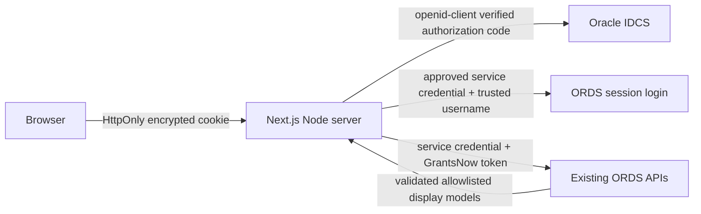

# Architecture

Next.js 16.4.0 App Router, React 19.3.0, Node 24 LTS. Dependency APIs were checked against current official documentation/registry metadata. TypeScript 6 was selected because the installed typescript-eslint explicitly rejects TypeScript 7; ESLint 9 is the compatible peer range of Next's currently shipped React/import/accessibility plugins. Exact versions are in package.json/lockfile. Current lint-tool maintenance/advisory limitations are recorded in status.

Server Components load initial data through shared services directly. Browser refresh calls authenticated route handlers that invoke the same services. There are no loopback fetches. Transport operations are allowlisted, have a 15-second timeout, reject redirects, and keep credentials/tokens in headers server-side. Oracle errors are mapped to safe messages; raw upstream bodies/errors are not logged or returned.

Protected encrypted-cookie storage holds only backend token, subject, fixture/environment marker and expiries (plus short-lived login transaction or logout notice). User details, roles, configuration and resources are reloaded with token-bound validation, rather than inflating the cookie or shipping raw role/session bodies to clients. All instances need the same key. `iron-session` size limits reject oversized payloads; no chunking or new cloud database is silently introduced. See authentication for revocation/concurrent renewal limits.

`proxy.ts` performs a local sealed-session/lifetime check to preserve deep links during login. Protected pages and every API service separately validate Oracle session/module access. Home additionally requires explicit DASHBOARD `home` read grant. Proposal listing mirrors the verified module gate and relies on the existing token-scoped listing operation for row scope. No record-detail permission claims are made. Administrator must verify token scoping independently of VBCS before enabling live use.

All personalized requests use no-store/private response headers and request-local React `cache` deduplication only. Cache Components are not enabled; there is no persistent/public data cache. Configuration loads are request-local. Landing is Home, except approved legacy `PROPOSALS` landing when no specific return route is present; other unbuilt landing modules fall back to Home.

UI stack: semantic HTML, native form fields/selects, table and buttons; responsive CSS with shared color/spacing tokens; default/dark preference handling. No additional form/state/chart system. The bar visualizations include full textual values and accessible descriptions. The legacy custom theme catalogue/accessibility preferences are deferred; app supports native keyboard/focus/skip-link and narrow-screen controls.

Client display DTOs contain permitted fields only. Financial masking remains verbatim. Optional Proposal columns require explicit resource visibility before values are serialized. Query state is in the URL; expanded filter toolbar/loading/error state remains client-only; OIDC/database session state remains server-only.

Official references: [App Router](https://nextjs.org/docs/app), [authentication](https://nextjs.org/docs/app/guides/authentication), [BFF](https://nextjs.org/docs/app/guides/backend-for-frontend), [structure](https://nextjs.org/docs/app/getting-started/project-structure), [proxy](https://nextjs.org/docs/app/api-reference/file-conventions/proxy), [self hosting](https://nextjs.org/docs/app/guides/self-hosting), [openid-client](https://github.com/panva/openid-client), [iron-session](https://github.com/vvo/iron-session). Ordinary session requests do not require Workflow SDK or Vercel services.

### Dashboard chart/loading conventions (2026-10-14)

Use the shared modular ECharts 6.1.0 engine for Home Insights and Dynamic Charts. Match actual Oracle shapes in server/home/insight-mapping.ts, never in a transport singleton/client global. Source-aware typed view models carry authorized values, presentation and capabilities only. Named library imports are confined to a lazily imported SVG chart engine; hidden tabs do not start chart requests. Each request has cancellation and generation protection. Insight API pages are fully reconciled before chart percentages are drawn. Use feedback/skeleton.tsx for chart/KPI/table/record/detail loading geometry, reduced-motion and accessible status.

Fixture E2E execution uses an ignored source-only scratch copy to avoid competing generated Next files. GRANTSNOW_BUILD_CHECK isolates a production verification artifact without replacing the user's live dev output; normal deployment commands stay unchanged. See dashboard-parity.md for exact read/write scope and current backend findings.
