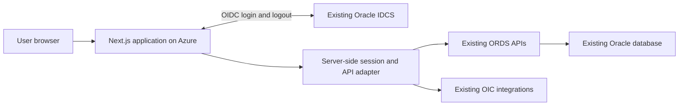

# GrantsNow Next.js UI Rebuild Specification

Version 1.0 • 12 October 2026 • Repository-derived planning baseline

This document defines the UI work required to replace GrantsNow's Oracle Visual Builder application with a new Next.js application hosted on Azure. It is intended for the two UI developers, two AI developers learning Next.js, the business owner, and the existing API and identity administrators. It combines an exhaustive inventory of current page templates with proposed component responsibilities, migration acceptance criteria, and a delivery plan.

The database, existing APIs, OIC integrations, and Oracle IDCS remain. The new project owns presentation, navigation, interaction, application sessions, and the server-side mediation needed to consume those services. No database replacement, API redesign, or new identity provider is included. A separate application repository is proposed; this document is stored in the existing repository so the legacy evidence remains easy to inspect. No new application has been scaffolded.

## Contents

1. [Scope and evidence](#1-scope-and-evidence)
2. [Architecture and platform requirements](#2-architecture-and-platform-requirements)
3. [Shared component catalogue](#3-shared-component-catalogue)
4. [Screen inventory and build specifications](#4-screen-inventory-and-build-specifications)
5. [Cross-module rules and acceptance scenarios](#5-cross-module-rules-and-acceptance-scenarios)
6. [Team responsibilities and delivery sequence](#6-team-responsibilities-and-delivery-sequence)
7. [Release gates and definition of done](#7-release-gates-and-definition-of-done)
8. [Decisions and unresolved scope](#8-decisions-and-unresolved-scope)
9. [API operation reference](#9-api-operation-reference)
10. [Source and maintenance notes](#10-source-and-maintenance-notes)

## 1 Scope and evidence

### 1.1 Confirmed decisions

| Subject | Decision |
| --- | --- |
| Application | Rebuild the entire GrantsNow UI as a new project |
| Framework | Next.js with TypeScript proposed as the implementation language |
| Hosting | Azure; exact Azure service and region still to be chosen |
| Database | Retain the current database |
| APIs | Retain existing APIs and integration services |
| Login | Retain Oracle IDCS |
| Team | Two UI developers and two AI developers |
| Training | The AI developers have no Next.js knowledge; other skills are not established |
| UI developer experience | React and Next.js experience still to be confirmed |
| Launch date | Not provided |
| Production scope | Must reconcile production features, approved newer changes, customer configuration, and deployment-only differences |

### 1.2 Evidence classification

**Verified source inventory** means a template, control, fragment, or API operation exists in the inspected repository. It does not prove the feature is reachable, deployed, enabled for every customer, or functioning in production.

**Proposed build requirement** means a recommended responsibility, route, acceptance test, or implementation design for the replacement. Proposed requirements need product review before becoming an agreed behavior change.

**Confirmation required** means the repository cannot settle the question. Examples include production usage, API authorization enforcement, supported customer variants, and whether prototype screens should become persistent features.

The screen catalogue is complete for the inspected HTML page templates. Dialogs and shared fragments are separately captured. Runtime-generated form fields and conditional branches require configuration exports and business walkthroughs; static inspection cannot enumerate every possible configured screen state.

### 1.3 Scope boundary

Included: shell, dashboard, Opportunities and EOI, Proposals and Outline Proposals, costing and pricing, Awards, Contracts, Ethics, Due Diligence, Claims, announcements, notifications, tutorials, user preferences, profile and session UI, shared forms, approvals, attachments, history, delegations, comments, existing report and integration entry points, and existing chatbot/AI-related UI subject to confirmation of deployed use.

Not automatically included: new AI features, a new administrator portal, replacement report generation, a new signature provider, backend business-rule changes, new database tables, or persistent storage for currently browser-only prototypes. Any API gap must be recorded and resolved explicitly with the backend owner rather than hidden inside a UI estimate.

## 2 Architecture and platform requirements

### 2.1 Application boundary

The adapter is a thin part of the new application, not a replacement business backend. It obtains trusted identity from the authenticated session, calls the existing session and business APIs, normalizes transport errors, and keeps integration credentials server-side. It must not accept an arbitrary client-supplied username as proof of identity.

### 2.2 Platform work packages

| ID | Work package | Required behavior | Evidence or completion check |
| --- | --- | --- | --- |
| PL-01 | New repository and conventions | Pin supported framework/runtime versions at kickoff; TypeScript checks; linting; documented setup; environment examples without secrets | A new developer can run and build the application using the README |
| PL-02 | IDCS login and callback | Register the new application and approved callback/logout URLs; use an appropriate OIDC client; validate callback state and identity | Login success, cancellation, invalid callback, and unregistered-user cases on Azure |
| PL-03 | GrantsNow database session | Reproduce the existing login/validate/extend/logout contract; map person, organization, roles, and module access from trusted responses | IDCS user reaches the correct GrantsNow account and existing audit attribution is retained |
| PL-04 | Session storage and expiry | Protect session cookies; keep API credentials out of client bundles; handle expired database and IDCS sessions, renewal, multiple tabs, and logout | Expiry never leaves a stuck loader or permits an unauthorized retry |
| PL-05 | API adapter | Typed operation contracts; allowlisted service destinations; parameter mapping; business-error handling; upload/download support | Read and test write work against the existing API without VBCS |
| PL-06 | Access policy | Load module/page/action/object permissions; gate rendering and server-mediated operations; confirm upstream authorization | A hidden button cannot be bypassed by a direct request |
| PL-07 | Runtime configuration | Preserve resource labels, descriptions, visibility, requiredness, lookup codes, organization themes, and user preferences | Two differing customer configurations behave correctly |
| PL-08 | Navigation and record layouts | Stable routes; direct linking; browser back/forward; selected tabs; query filters; record identity/version; unsaved-change handling | Refresh and deep links restore the correct screen without identity leakage |
| PL-09 | Data fetching and mutation state | Explicit loading/empty/error/forbidden states; cancel stale searches; refresh only affected data; prevent duplicate submissions | Slow and out-of-order responses cannot overwrite a newer selection |
| PL-10 | Azure deployment | Prove the selected Node/container deployment, start command, assets, health probes, environment wiring, and HTTPS | CI deploys a reproducible artifact to a nonproduction environment |
| PL-11 | Azure secrets and network | Proposed Key Vault use; approved service identity; Oracle access, DNS, certificate, egress/allowlist and regional latency checks | Integration secrets remain server-side and Azure can reach each required Oracle service |
| PL-12 | Operations | Structured logs and correlation IDs; mask personal data/tokens; latency and failure monitoring; useful support error IDs | A failed workflow can be traced from UI to its API call without exposing credentials |
| PL-13 | Test fixtures | Safe nonproduction identities and records; API contract fixtures; approved business-error examples; repeatable user journeys | Automated tests do not write to production |
| PL-14 | Multi-instance behavior | Define session sharing, cookie keys, cache isolation, deployment consistency, and lock behavior | Two application instances behave consistently; no per-process session dependence |
| PL-15 | Compatibility and accessibility | Agree supported browsers, responsive widths, keyboard behavior, screen-reader expectations, and light/dark themes | Acceptance matrix established before module UAT |

### 2.3 Important current authentication behavior

The shell's `beforeEnterHandlerChain.js` calls `base/getSessionLogin` with the authenticated VBCS username, receives a GrantsNow `token` and expiry, and sets `db_auth_token`. Other APIs commonly receive that token in a header. The replacement must obtain the trusted username from its own IDCS session and reproduce the backend session contract; an IDCS access token is not assumed interchangeable with the GrantsNow token.

The same chain handles business errors inside successful HTTP responses, including `response_msg: ERROR`. A successful HTTP status is therefore insufficient proof that the application login or a business mutation succeeded. Preserve per-operation business-error interpretation and present recoverable errors.

Service catalogue entries contain VBCS credential identifiers and proxy instructions. These identifiers are not transferable secret values. Backend and identity administrators must establish the supported independent application authentication path. Verify whether any username-based session endpoint depends on VBCS's trusted service credentials or network boundary.

### 2.4 Next.js implementation guidance

Use App Router layouts for the shell and record containers. Server Components can load appropriate initial data; interactive tables, form editors, dialogs, calendars, and charts need client-side behavior. Define one consistent mutation pattern rather than allowing every developer to invent an API path. Treat proxy/interception as navigation support, with authorization checked at the actual data and mutation boundaries.

Sensitive GrantsNow records must not enter shared public caches. Define user/organization/configuration cache keys and invalidation deliberately. Keep costing, workflow, and lookup behavior aligned with the retained APIs. Review official documentation when pinning versions or choosing APIs. These are architectural recommendations, not a scaffold or library selection.

References: [Next.js App Router](https://nextjs.org/docs/app), [Next.js self-hosting](https://nextjs.org/docs/app/guides/self-hosting), [Azure Node.js App Service](https://learn.microsoft.com/en-us/azure/app-service/quickstart-nodejs), [Oracle IDCS authorization flow](https://docs.oracle.com/en/cloud/paas/identity-cloud/idcsa/ACWebServerAppAuth.html).

## 3 Shared component catalogue

### 3.1 Component contract

Every shared component needs an owner, documented inputs/events, loading and error behavior, permission semantics, configuration handling, and at least one reference use. Domain components receive object type, object ID, version where relevant, editability, labels, and explicit capabilities. They must not depend on a hidden global page variable or reach into another component's DOM.

The names below are proposed responsibilities, not final package/class names. Implement the smallest common contract that supports verified module differences. Do not force Claims approvals into the grants workflow without proving their compatibility.

### 3.2 Design and interaction primitives

| ID | Component | Build responsibility | Acceptance focus |
| --- | --- | --- | --- |
| CP-01 | Application shell | Header, navigation, content area, drawers, notification entry, user menu, layout breakpoints | Correct accessible module navigation and no nested-scroll trapping |
| CP-02 | Page and record header | Title, number, status, breadcrumbs/back action, primary actions, creator information | Long titles wrap; action availability follows status and access |
| CP-03 | Record tabs | Configured tab labels, visibility, selected state, direct links, shared record context | Hidden tab cannot be opened directly; edits are protected during navigation |
| CP-04 | Buttons and action menus | Labelled icon actions, disabled/busy states, destructive confirmation, keyboard use | No duplicate operation; tooltips and accessible names exist |
| CP-05 | Form layout and field wrapper | Labels, help descriptions, required markers, inline errors, readonly/disabled states | Requiredness is configuration-aware and errors identify the field |
| CP-06 | Text and numeric fields | Length, numeric precision, positive/negative bounds and null handling | Zero is distinct from empty; no accidental coercion of identifiers |
| CP-07 | Date and date-time fields | Display locale, date-only semantics, bounds, timezone policy | Equal endpoints and missing dates follow the approved domain rule |
| CP-08 | Lookup and person selectors | Search, pagination, stable IDs, dependent filters, multi-selection | Full results can be reached and selected labels survive reload |
| CP-09 | Organization selector | Hierarchy, primary/secondary membership, permitted scope and dependent reset | Selected organization is the one saved and used for routing |
| CP-10 | Rich text editor and viewer | Existing content compatibility, sanitization, permitted formatting, links | Existing rich text renders safely and survives edit/save |
| CP-11 | Data table | Sorting, paging, row keys, configurable columns, totals, selection, overflow | Correct totals and row identity under filtering and paging |
| CP-12 | Editable grid | Draft row state, add/edit/delete, validation, cancel, server reconciliation | Cancel leaves the saved row unchanged; failed save remains recoverable |
| CP-13 | Record cards and list view | Card/list modes, expanded rows, status/fund information, empty states | Long fund names and statuses remain distinguishable at narrow widths |
| CP-14 | Filter drawer | Basic/advanced filters, saved criteria where supported, apply/reset, badges | Reset restores query defaults and removes every applied filter |
| CP-15 | Advanced query builder | Attribute/operator/value rows, edit dialog, logical combination and serialization | Query semantics match legacy API filtering; no cramped in-cell editor |
| CP-16 | Modal and confirmation | Focus trap/return, close/cancel, unique instances, pending-state guard | Navigation and promise resolution never hang on a dismissed dialog |
| CP-17 | Side drawer | Comments/preferences/filter use cases, focus, scroll and responsive size | Close restores context and mobile content remains usable |
| CP-18 | Messages and validation summary | Inline business warnings, errors, success messages, field focus, retry | Business errors are not reported as successful saves |
| CP-19 | Loading empty and error states | Page, table and section states; permission denial; missing record | No indefinite spinner, misleading empty result, or silent click |
| CP-20 | Unsaved-change guard | Form/grid dirty state, Save/Discard/Stay and in-app navigation | Form-owner controls validation; nested tabs cannot bypass pending changes |
| CP-21 | Chart and drill-down | Labels, legends, filters, expanded chart, matching drill-down query | Chart count/value reconciles with the underlying list |
| CP-22 | Calendar | Events from multiple providers, list/calendar modes, record links, dates | Paging does not lose earlier loaded events; keyboard selection works |
| CP-23 | Currency and percentage presentation | Currency code, decimals, rounding, rates, totals | Agreed numerical fixtures reconcile with API responses |
| CP-24 | Help description viewer | Resource descriptions and configured help; HTML-to-text labels | Help HTML never becomes a plain dropdown's displayed label |

### 3.3 Domain components

| ID | Component | Build responsibility | Required module variations |
| --- | --- | --- | --- |
| DC-01 | Resource configuration resolver | Labels, descriptions, visibility and mandatory flags; explicit missing-key handling | Different resource namespaces, Outline Proposal versus Proposal, customer variants |
| DC-02 | Permission resolver | Module/page/action/object read/edit/delete and stage capabilities | Permission maps are not all identical; identify legacy exceptions |
| DC-03 | Dynamic form renderer | Form/section/field IDs; conditional visibility; section toggles; validation; draft/final save | EOI, Proposal, Award, Contract, Ethics, Due Diligence; Claims implementation requires comparison |
| DC-04 | Dynamic grid section | Metadata-driven columns, row editor, checklist validation, grid values and files | Required sections, disabled/finalized state, hidden values policy |
| DC-05 | Object attributes | Metadata-defined additional fields and help; field values merged with main save | Summary/header/overview/response hosts |
| DC-06 | Approval workflow | Stage list/graph, approvers, groups, remarks, actions and history | Object types, parent references, locks, add/change-stage rights, withdraw rights |
| DC-07 | Approval editor | Add stage, add/remove/change approver, stage user details, date changes | Module access keys, routing groups, editable stages |
| DC-08 | Approval documents | Upload/list/preview/delete during approvals | Existing OIC storage and attachment metadata paths |
| DC-09 | Object attachments | Folder tree/list, file upload, metadata, preview/download/delete, links | Confidentiality, folders, path segments, module upload/delete rights |
| DC-10 | Object comments | List/add/edit/delete rich-text comments | Permissions, object scope, configured maximum length |
| DC-11 | Object history | Status timeline/table, approval history, manual status and remarks | Allowed transitions, abandonment, actual submission date, module-specific status display |
| DC-12 | Delegations | Delegate person/pages, dates, active state, edit/remove | Permitted pages, object scope, organization/person filtering |
| DC-13 | Linked record picker | Link/unlink and inspect related objects | EOI/Proposal/Award/Contract/Ethics/DD references, permitted object types |
| DC-14 | Creator and participant panels | Creator detail, person links, participant edit, organization | Creator-not-participant warning and multi-organization rules |
| DC-15 | Object lock controller | Lock acquire/release, read-only UI, competing edit recovery | Record/version locks and status-driven editability |
| DC-16 | Budget version selector | List/create/rename/delete/select version and sync child screens | Active version and legacy identifiers; permissions and finalization |
| DC-17 | Staff costing editor | Salary model, person master data, units/FTE, periods, benefits and recalculation | Role/configuration requiredness, model-specific fields, dates and numerical precision |
| DC-18 | Non-staff costing editor | Cost category/item, quantity, units, periods and totals | Category-specific rules and available lookups |
| DC-19 | Pricing and FX editor | Funder and institution contributions, research partners, rates and allocation | Version scope, currency rules, rounding and editable status |
| DC-20 | Credit allocation | Participant credit rows, percentages and totals | Proposal and Award contracts differ and must be mapped |
| DC-21 | Deadline and milestone editor | Add/edit/delete, dates, descriptions, statuses and reminders where supported | Proposal/Contract/Award deadline types and allowed dates |
| DC-22 | Copy convert and extend wizard | Select source/options, related objects, warnings, result navigation | EOI to Proposal, Outline to full, Proposal/Award copies and extensions |
| DC-23 | Recycle bin | Deleted-record list, restore confirmation and permissions | Proposal, Ethics, DD; no assumption that other modules support restore |
| DC-24 | Claims unit and fund workspace | Fiscal-year/unit/fund identity, summary, activities, goals and allocations | Different unit and fund detail tabs and available actions |
| DC-25 | Claims activity editor | Activity-specific fields, roster, equipment, amendments and calculations | Position/non-position/tuition and Exempt/Hourly branches |
| DC-26 | Claims line and adjustment editor | Claim details/lines, amendments, adjustments, cloning, rejected lines | Claim status, allowed dates, reconciliation and approval rights |
| DC-27 | Claims approval workflow | Claims-specific stages, comments, documents and approvals | Share only proven common pieces with DC-06 |
| DC-28 | Report launcher and output viewer | Existing report parameters, requests, print/download and errors | Staff-time, award report, object references, existing report integrations |
| DC-29 | Signature and ERP status panels | Existing signer/envelope and ERP identifier/status presentation | No new integration endpoints presumed; confirm actual API/action wiring |
| DC-30 | Profile and absence preferences | Profile fields, OOO/delegation-related state, theme/dashboard/accessibility preferences | Organization policy versus personal preferences |
| DC-31 | Notifications and announcements | Badge, feed, detail, announcements carousel, read state where supported | Object navigation and role/configuration scope |
| DC-32 | Existing chatbot and AI content viewer | Preserve current entry points and response presentation if in production scope | Existing service access, generated content handling and errors; no new AI products implied |

### 3.4 Dynamic form field coverage

The shared fragment explicitly renders `RICHTEXTEDITOR`, `TEXTBOX`, `TEXTFIELD`, `NUMERIC`, `RADIO`, `CHECKBOX`, `CHECKLIST`, `DATE`, `LOV`, and `FILE`. It also supports `GRID` sections and conditional section visibility. Rebuild and test every type, including combination cases: a hidden required field, a disabled section containing files, a grid row with required checklist values, and a finalized form reopened for read-only viewing.

Record the existing response JSON structure and distinguish form ID, section ID, field ID, row identity, and value. Do not change that structure casually: retained APIs and saved responses depend on it. Decide explicitly whether hiding a field preserves or clears its value; this can vary by existing business rule. Draft save and final submission have different validation requirements.

### 3.5 Exact legacy fragment and custom component mapping

The generated catalogue below maps all 13 shared fragments and three custom component directories. API lists are static references, not a complete executed call graph. A host page may load its data via ancestor flows or application-level chains.
#### LF-01 Approval workflow

Source: [approval-workflow-fragment](../../webApps/app/fragments/approval-workflow/approval-workflow-fragment.html). Proposed replacement: DC-06, DC-07, DC-08.

Verified page hosts: OP-02, PR-02, ET-01, DD-01, AW-01, CT-10.

Dialogs: `dialogStageUsers`; `submitPopUp`; `dialogAddStage`; `dialogConfirmDelete`; `dialogAddnewAttachment`; `dialogViewAttachments`; `filepreview`; `userRemarksDialog`; `commentPopUp`; `confirmDialog`.
Popups: `stageHelpTextPopUp`.

API references: `apps/deleteApproval_setupApproval_stages`; `apps/deleteApproval_setupApproval_stages_users`; `apps/deletePre_awardAttachmentsId`; `apps/getApproval_groupApproval_group_m`; `apps/getApproval_setupApproval_stages`; `apps/getApproval_setupApproval_stages_graph`; `apps/getApproval_setupGenerate_stages`; `apps/getApproval_setupGet_stage_users`; `apps/getPost_awardsAwardHeader`; `apps/getPre_awardAttachmentsProposal_id`; `apps/getPre_awardGetApprovalHistory`; `apps/getPre_awardGetLookupTypesCodes`; `apps/getPre_awardGetPersonList`; `apps/postApproval_setupAdd_stage`; `apps/postApproval_setupApproval_stages_users`; `apps/postApproval_setupPost_approval`; `apps/postApproval_setupReassign_stage`; `apps/postPre_awardAttachments`; `ics/deleteDELETE_OBJECT1_0Objectstorage`; `ics/getGET_OBJECT1_0Objectstorage`; `ics/putUPLOAD_OBJECT1_0Objectstorage`.

#### LF-02 Dynamic form

Source: [dynamic-form-fragment](../../webApps/app/fragments/dynamic-form/dynamic-form-fragment.html). Proposed replacement: DC-03, DC-04.

Verified page hosts: OP-01, OP-05, OP-06, OP-07, OP-08, OP-09, PR-13, PR-14, PR-15, PR-16, PR-17, PR-24, ET-03, ET-05, DD-03, DD-05, AW-07, AW-08, AW-09, AW-10, AW-11, AW-12, CT-02, CT-03, CT-04, CT-05, CT-06, CT-09.

Dialogs: `dialogViewDocuments`; `dialogSourceCode`.
Popups: `helperTextPopUpDynamicFormFragment`.

API references: `apps/deletePre_awardAttachmentsId`; `apps/getPre_awardAttachmentsProposal_id`; `apps/getProposalEthical_dynFormsP_ref_module`; `apps/getProposalEthicaldynFormResponse`; `apps/postPre_awardAttachments`; `apps/postProposalEthicaldynFormResponse`; `ics/deleteDELETE_OBJECT1_0Objectstorage`; `ics/getGET_OBJECT1_0Objectstorage`; `ics/putUPLOAD_OBJECT1_0Objectstorage`.

#### LF-03 Fx rates

Source: [fx-rates-fragment](../../webApps/app/fragments/fx-rates/fx-rates-fragment.html). Proposed replacement: DC-19.

Verified page hosts: PR-25.

Dialogs: None declared directly.
Popups: None declared directly.

API references: `apps/getProposalFxRates`; `apps/getSharedGetCurrencyRate`; `apps/postProposalFxRates`.

#### LF-04 Object attachments

Source: [object-attachments-fragment](../../webApps/app/fragments/object-attachments/object-attachments-fragment.html). Proposed replacement: DC-09.

Verified page hosts: OP-03, PR-03, ET-02, DD-02, AW-02, CL-04, CL-10.

Dialogs: `dialogAddNewDocument`; `dialogDeleteRecords`; `updateLinkDialog`.
Popups: None declared directly.

API references: `apps/deletePre_awardAttachmentsId`; `apps/deletePre_awardLinks`; `apps/getPre_awardAttachmentsProposal_id`; `apps/getPre_awardLinks`; `apps/postPre_awardAttachments`; `apps/postPre_awardLinks`; `ics/deleteDELETE_OBJECT1_0Objectstorage`; `ics/getGET_OBJECT1_0Objectstorage`; `ics/putUPLOAD_OBJECT1_0Objectstorage`.

#### LF-05 Object attributes

Source: [object-attributes-fragment](../../webApps/app/fragments/object-attributes/object-attributes-fragment.html). Proposed replacement: DC-05.

Verified page hosts: OP-01, PR-24, ET-03, ET-05, DD-03, DD-05, AW-12, CT-09.

Dialogs: `dialogSourceCode`.
Popups: `helpTextPopUp`.

API references: `apps/getSharedGetObjectAttributes`.

#### LF-06 Object comments

Source: [object-comments-fragment](../../webApps/app/fragments/object-comments/object-comments-fragment.html). Proposed replacement: DC-10.

Verified page hosts: OP-14, PR-25, ET-06, DD-06, AW-18, CT-11.

Dialogs: `EditCommentsPopUp`.
Popups: None declared directly.

API references: `apps/deleteSharedComments`; `apps/getProposalComments`; `apps/postProposalComments`.

#### LF-07 Object delegations

Source: [object-delegations-fragment](../../webApps/app/fragments/object-delegations/object-delegations-fragment.html). Proposed replacement: DC-12.

Verified page hosts: OP-04, PR-11, AW-05, CT-01.

Dialogs: `dialogAddDelegation`; `dialogDeleteConfirmation`.
Popups: None declared directly.

API references: `apps/deleteProposalDelegations`; `apps/getProposalDelegationsProposal_id`; `apps/postProposalDelegations`; `apps/postProposalDelegationsDelegation_id`.

#### LF-08 Object history

Source: [object-history-fragment](../../webApps/app/fragments/object-history/object-history-fragment.html). Proposed replacement: DC-11.

Verified page hosts: OP-10, PR-20, ET-04, DD-04, AW-13, CT-07.

Dialogs: `dialogCreateStatus`; `commentPopUp`.
Popups: None declared directly.

API references: `apps/getPre_awardGetApprovalHistory`; `apps/getSharedGetNextObjectStatus`; `apps/getSharedObjectStatus`; `apps/postSharedObjectStatus`.

#### LF-09 Page header

Source: [page-header-fragment](../../webApps/app/fragments/page-header/page-header-fragment.html). Proposed replacement: CP-02.

Verified page hosts: No direct page host detected; check nested/indirect usage..

Dialogs: None declared directly.
Popups: None declared directly.

API references: None detected locally.

#### LF-10 Shell announcements

Source: [shell-announcements-fragment](../../webApps/app/fragments/shell-announcements/shell-announcements-fragment.html). Proposed replacement: DC-31.

Verified page hosts: SH-01, OP-15.

Dialogs: None declared directly.
Popups: None declared directly.

API references: `apps/getSharedAnnouncements`.

#### LF-11 Shell configure drawer

Source: [shell-configure-drawer-fragment](../../webApps/app/fragments/shell-configure-drawer/shell-configure-drawer-fragment.html). Proposed replacement: DC-30.

Verified page hosts: SH-01.

Dialogs: None declared directly.
Popups: None declared directly.

API references: `apps/postSharedDashboardPreferences`; `apps/postSharedOrgThemePolicy`.

#### LF-12 Shell drawer

Source: [shell-drawer-fragment](../../webApps/app/fragments/shell-drawer/shell-drawer-fragment.html). Proposed replacement: CP-01.

Verified page hosts: SH-01.

Dialogs: None declared directly.
Popups: None declared directly.

API references: None detected locally.

#### LF-13 Shell header

Source: [shell-header-fragment](../../webApps/app/fragments/shell-header/shell-header-fragment.html). Proposed replacement: CP-01.

Verified page hosts: SH-01.

Dialogs: None declared directly.
Popups: None declared directly.

API references: None detected locally.

#### LC-01 fp-dynamic-form

Source: [fp-dynamic-form](../../webApps/app/resources/components/fp-dynamic-form/component.json). Declared properties: `data`, `value`, `responses`. Declared events: none.

Direct page hosts: none detected; verify indirect usage before deciding replacement scope.

Replacement requirement: map the existing public contract to the corresponding form/calendar/status component; inspect loader, template, and implementation before retiring it. Directory presence is not proof of production usage.

#### LC-02 fp-proposals-calendar

Source: [fp-proposals-calendar](../../webApps/app/resources/components/fp-proposals-calendar/component.json). Declared properties: `events`, `calendarProviders`, `translations`. Declared events: `ojEventSelected`.

Direct page hosts: HM-01.

Replacement requirement: map the existing public contract to the corresponding form/calendar/status component; inspect loader, template, and implementation before retiring it. Directory presence is not proof of production usage.

#### LC-03 fp-update-status-dialog

Source: [fp-update-status-dialog](../../webApps/app/resources/components/fp-update-status-dialog/component.json). Declared properties: none. Declared events: none.

Direct page hosts: none detected; verify indirect usage before deciding replacement scope.

Replacement requirement: map the existing public contract to the corresponding form/calendar/status component; inspect loader, template, and implementation before retiring it. Directory presence is not proof of production usage.

## 4 Screen inventory and build specifications

Inspected branch: `9248`. Commit: `3acfe9e272e2db076d92942ebbf86776ae583077`. The inventory covers **111 page templates: 110 flow pages plus one application shell**. It also captures **13 fragments**, **3 custom component directories**, **190 named page-local dialog declarations**, and **21 named fragment dialog declarations**. Counts describe declarations, not distinct designs or runtime instances. Dynamic templates can create multiple runtime instances.

Routes below are proposals, not existing URLs or final route contracts. Creation and detail can share a layout while retaining separate entry paths. Fiscal year, version, organization and other context must be added to route/query/session contracts where required by the screen. A record ID alone may not uniquely identify a Claims workspace.

| Module | Screen templates | Delivery wave |
| --- | ---: | --- |
| Application shell | 1 | W1 |
| Home and insights | 1 | W2 then W6 for full insights |
| Opportunities and expressions of interest | 16 | W2 |
| Proposals and outline proposals | 26 | W3 |
| Ethics | 7 | W4 |
| Due Diligence | 7 | W4 |
| Awards | 19 | W5 |
| Contracts | 12 | W5 |
| Claims | 18 | W6 |
| Announcements and notifications | 3 | W2 |
| Tutorials | 1 | W2 |

### Screen index

| Screen ID | Screen | Proposed route |
| --- | --- | --- |
| [SH-01](#sh-01-application-shell) | Application shell | `Shared authenticated layout (no standalone business route)` |
| [HM-01](#hm-01-home-dashboard-and-insights) | Home dashboard and insights | `/home` |
| [OP-01](#op-01-eoi-application) | EOI application | `/opportunities/eoi/[eoiId]/application` |
| [OP-02](#op-02-opportunities-and-expressions-of-interest-approvals) | Opportunities and expressions of interest approvals | `/opportunities/eoi/[eoiId]/approvals` |
| [OP-03](#op-03-opportunities-and-expressions-of-interest-attachments) | Opportunities and expressions of interest attachments | `/opportunities/eoi/[eoiId]/attachments` |
| [OP-04](#op-04-opportunities-and-expressions-of-interest-delegations) | Opportunities and expressions of interest delegations | `/opportunities/eoi/[eoiId]/delegation` |
| [OP-05](#op-05-opportunities-and-expressions-of-interest-configured-form-slot-1) | Opportunities and expressions of interest configured form slot 1 | `/opportunities/eoi/[eoiId]/forms/1` |
| [OP-06](#op-06-opportunities-and-expressions-of-interest-configured-form-slot-2) | Opportunities and expressions of interest configured form slot 2 | `/opportunities/eoi/[eoiId]/forms/2` |
| [OP-07](#op-07-opportunities-and-expressions-of-interest-configured-form-slot-3) | Opportunities and expressions of interest configured form slot 3 | `/opportunities/eoi/[eoiId]/forms/3` |
| [OP-08](#op-08-opportunities-and-expressions-of-interest-configured-form-slot-4) | Opportunities and expressions of interest configured form slot 4 | `/opportunities/eoi/[eoiId]/forms/4` |
| [OP-09](#op-09-opportunities-and-expressions-of-interest-configured-form-slot-5) | Opportunities and expressions of interest configured form slot 5 | `/opportunities/eoi/[eoiId]/forms/5` |
| [OP-10](#op-10-opportunities-and-expressions-of-interest-history) | Opportunities and expressions of interest history | `/opportunities/eoi/[eoiId]/history` |
| [OP-11](#op-11-eoi-summary) | EOI summary | `/opportunities/eoi/[eoiId]/summary` |
| [OP-12](#op-12-opportunity-analytics) | Opportunity analytics | `/opportunities/analytics` |
| [OP-13](#op-13-eoi-listing) | EOI listing | `/opportunities/eoi` |
| [OP-14](#op-14-eoi-record-workspace) | EOI record workspace | `/opportunities/eoi/[eoiId]` |
| [OP-15](#op-15-opportunity-finder) | Opportunity finder | `/opportunities/finder` |
| [OP-16](#op-16-opportunity-registration-form) | Opportunity registration form | `/opportunities/register` |
| [PR-01](#pr-01-proposal-credit-allocation) | Proposal credit allocation | `/proposals/[recordId]/allocation-for-credit` |
| [PR-02](#pr-02-proposals-and-outline-proposals-approvals) | Proposals and outline proposals approvals | `/proposals/[recordId]/approvals` |
| [PR-03](#pr-03-proposals-and-outline-proposals-attachments) | Proposals and outline proposals attachments | `/proposals/[recordId]/attachments` |
| [PR-04](#pr-04-proposal-awards-and-conversions) | Proposal awards and conversions | `/proposals/[recordId]/awards` |
| [PR-05](#pr-05-proposal-indirect-costs) | Proposal indirect costs | `/proposals/[recordId]/budget/indirects` |
| [PR-06](#pr-06-proposal-non-staff-costing) | Proposal non-staff costing | `/proposals/[recordId]/budget/non-staff` |
| [PR-07](#pr-07-proposal-staff-costing) | Proposal staff costing | `/proposals/[recordId]/budget/staff` |
| [PR-08](#pr-08-proposal-budget-workspace) | Proposal budget workspace | `/proposals/[recordId]/budget` |
| [PR-09](#pr-09-proposal-research-partner-costs) | Proposal research partner costs | `/proposals/[recordId]/budget/research-partner` |
| [PR-10](#pr-10-proposal-linked-contracts) | Proposal linked contracts | `/proposals/[recordId]/contracts` |
| [PR-11](#pr-11-proposals-and-outline-proposals-delegations) | Proposals and outline proposals delegations | `/proposals/[recordId]/delegation` |
| [PR-12](#pr-12-proposal-linked-due-diligence) | Proposal linked due diligence | `/proposals/[recordId]/due-diligence` |
| [PR-13](#pr-13-proposals-and-outline-proposals-configured-form-slot-1) | Proposals and outline proposals configured form slot 1 | `/proposals/[recordId]/forms/1` |
| [PR-14](#pr-14-proposals-and-outline-proposals-configured-form-slot-2) | Proposals and outline proposals configured form slot 2 | `/proposals/[recordId]/forms/2` |
| [PR-15](#pr-15-proposals-and-outline-proposals-configured-form-slot-3) | Proposals and outline proposals configured form slot 3 | `/proposals/[recordId]/forms/3` |
| [PR-16](#pr-16-proposals-and-outline-proposals-configured-form-slot-4) | Proposals and outline proposals configured form slot 4 | `/proposals/[recordId]/forms/4` |
| [PR-17](#pr-17-proposals-and-outline-proposals-configured-form-slot-5) | Proposals and outline proposals configured form slot 5 | `/proposals/[recordId]/forms/5` |
| [PR-18](#pr-18-proposal-linked-ethics) | Proposal linked ethics | `/proposals/[recordId]/ethics` |
| [PR-19](#pr-19-proposal-full-economic-cost-summary) | Proposal full economic cost summary | `/proposals/[recordId]/fec-summary` |
| [PR-20](#pr-20-proposals-and-outline-proposals-history) | Proposals and outline proposals history | `/proposals/[recordId]/history` |
| [PR-21](#pr-21-proposal-in-kind-contributions) | Proposal in-kind contributions | `/proposals/[recordId]/inkind-contribution` |
| [PR-22](#pr-22-proposal-pricing) | Proposal pricing | `/proposals/[recordId]/pricing` |
| [PR-23](#pr-23-proposal-sponsor-due-diligence) | Proposal sponsor due diligence | `/proposals/[recordId]/sponsor-due-diligence` |
| [PR-24](#pr-24-proposal-summary) | Proposal summary | `/proposals/[recordId]/summary` |
| [PR-25](#pr-25-proposal-record-workspace) | Proposal record workspace | `/proposals/[recordId]` |
| [PR-26](#pr-26-proposal-and-outline-proposal-listing) | Proposal and outline proposal listing | `/proposals` |
| [ET-01](#et-01-ethics-approvals) | Ethics approvals | `/ethics/[recordId]/approvals` |
| [ET-02](#et-02-ethics-attachments) | Ethics attachments | `/ethics/[recordId]/attachments` |
| [ET-03](#et-03-ethics-general-overview-and-setup) | Ethics general overview and setup | `/ethics/[recordId]/general-overview` |
| [ET-04](#et-04-ethics-history) | Ethics history | `/ethics/[recordId]/history` |
| [ET-05](#et-05-ethics-responses) | Ethics responses | `/ethics/[recordId]/responses` |
| [ET-06](#et-06-ethics-record-workspace) | Ethics record workspace | `/ethics/[recordId]` |
| [ET-07](#et-07-ethics-listing) | Ethics listing | `/ethics` |
| [DD-01](#dd-01-due-diligence-approvals) | Due Diligence approvals | `/due-diligence/[recordId]/approvals` |
| [DD-02](#dd-02-due-diligence-attachments) | Due Diligence attachments | `/due-diligence/[recordId]/attachments` |
| [DD-03](#dd-03-due-diligence-general-overview-and-setup) | Due Diligence general overview and setup | `/due-diligence/[recordId]/general-overview` |
| [DD-04](#dd-04-due-diligence-history) | Due Diligence history | `/due-diligence/[recordId]/history` |
| [DD-05](#dd-05-due-diligence-responses) | Due Diligence responses | `/due-diligence/[recordId]/responses` |
| [DD-06](#dd-06-due-diligence-record-workspace) | Due Diligence record workspace | `/due-diligence/[recordId]` |
| [DD-07](#dd-07-due-diligence-listing) | Due Diligence listing | `/due-diligence` |
| [AW-01](#aw-01-awards-approvals) | Awards approvals | `/awards/[recordId]/approvals` |
| [AW-02](#aw-02-awards-attachments) | Awards attachments | `/awards/[recordId]/attachments` |
| [AW-03](#aw-03-award-budget-periods) | Award budget periods | `/awards/[recordId]/budget/periods` |
| [AW-04](#aw-04-award-credit-allocation) | Award credit allocation | `/awards/[recordId]/credit-allocation` |
| [AW-05](#aw-05-awards-delegations) | Awards delegations | `/awards/[recordId]/delegation` |
| [AW-06](#aw-06-award-linked-due-diligence) | Award linked due diligence | `/awards/[recordId]/due-diligence` |
| [AW-07](#aw-07-awards-configured-form-slot-1) | Awards configured form slot 1 | `/awards/[recordId]/forms/1` |
| [AW-08](#aw-08-awards-configured-form-slot-2) | Awards configured form slot 2 | `/awards/[recordId]/forms/2` |
| [AW-09](#aw-09-awards-configured-form-slot-3) | Awards configured form slot 3 | `/awards/[recordId]/forms/3` |
| [AW-10](#aw-10-awards-configured-form-slot-4) | Awards configured form slot 4 | `/awards/[recordId]/forms/4` |
| [AW-11](#aw-11-awards-configured-form-slot-5) | Awards configured form slot 5 | `/awards/[recordId]/forms/5` |
| [AW-12](#aw-12-award-header) | Award header | `/awards/[recordId]/header` |
| [AW-13](#aw-13-awards-history) | Awards history | `/awards/[recordId]/history` |
| [AW-14](#aw-14-award-installments) | Award installments | `/awards/[recordId]/installments` |
| [AW-15](#aw-15-award-milestones) | Award milestones | `/awards/[recordId]/milestones` |
| [AW-16](#aw-16-award-projects-and-cost-lines) | Award projects and cost lines | `/awards/[recordId]/projects` |
| [AW-17](#aw-17-award-report) | Award report | `/awards/[recordId]/report` |
| [AW-18](#aw-18-award-record-workspace) | Award record workspace | `/awards/[recordId]` |
| [AW-19](#aw-19-awards-listing) | Awards listing | `/awards` |
| [CT-01](#ct-01-contracts-delegations) | Contracts delegations | `/contracts/[recordId]/delegation` |
| [CT-02](#ct-02-contracts-configured-form-slot-1) | Contracts configured form slot 1 | `/contracts/[recordId]/forms/1` |
| [CT-03](#ct-03-contracts-configured-form-slot-2) | Contracts configured form slot 2 | `/contracts/[recordId]/forms/2` |
| [CT-04](#ct-04-contracts-configured-form-slot-3) | Contracts configured form slot 3 | `/contracts/[recordId]/forms/3` |
| [CT-05](#ct-05-contracts-configured-form-slot-4) | Contracts configured form slot 4 | `/contracts/[recordId]/forms/4` |
| [CT-06](#ct-06-contracts-configured-form-slot-5) | Contracts configured form slot 5 | `/contracts/[recordId]/forms/5` |
| [CT-07](#ct-07-contracts-history) | Contracts history | `/contracts/[recordId]/history` |
| [CT-08](#ct-08-contract-signers-and-signatures) | Contract signers and signatures | `/contracts/[recordId]/signers` |
| [CT-09](#ct-09-contract-summary-and-deadlines) | Contract summary and deadlines | `/contracts/[recordId]/summary` |
| [CT-10](#ct-10-contracts-approvals) | Contracts approvals | `/contracts/[recordId]/workflow` |
| [CT-11](#ct-11-contract-create-and-record-workspace) | Contract create and record workspace | `/contracts/[recordId] (also /contracts/new)` |
| [CT-12](#ct-12-contracts-listing) | Contracts listing | `/contracts` |
| [CL-01](#cl-01-claims-configured-form-slot-1) | Claims configured form slot 1 | `Claims form host route pending object identity and reachability confirmation` |
| [CL-02](#cl-02-claims-configured-form-slot-2) | Claims configured form slot 2 | `Claims form host route pending object identity and reachability confirmation` |
| [CL-03](#cl-03-claims-fund-approvals) | Claims fund approvals | `/claims/funds/[fundId]/approvals` |
| [CL-04](#cl-04-claims-fund-attachments) | Claims fund attachments | `/claims/funds/[fundId]/attachments` |
| [CL-05](#cl-05-claims-fund-awards) | Claims fund awards | `/claims/funds/[fundId]/awards` |
| [CL-06](#cl-06-claims-fund-budget) | Claims fund budget | `/claims/funds/[fundId]/budget` |
| [CL-07](#cl-07-claims-fund-claims) | Claims fund claims | `/claims/funds/[fundId]/claims` |
| [CL-08](#cl-08-claims-fund-summary) | Claims fund summary | `/claims/funds/[fundId]/summary` |
| [CL-09](#cl-09-claims-unit-activities) | Claims unit activities | `/claims/units/[unitId]/activities` |
| [CL-10](#cl-10-claims-unit-attachments) | Claims unit attachments | `/claims/units/[unitId]/attachments` |
| [CL-11](#cl-11-claims-unit-claims-and-adjustments) | Claims unit claims and adjustments | `/claims/units/[unitId]/claims` |
| [CL-12](#cl-12-claims-unit-goals) | Claims unit goals | `/claims/units/[unitId]/goals` |
| [CL-13](#cl-13-claims-unit-summary-and-allocations) | Claims unit summary and allocations | `/claims/units/[unitId]/summary` |
| [CL-14](#cl-14-claims-fund-workspace) | Claims fund workspace | `/claims/funds/[fundId]` |
| [CL-15](#cl-15-claims-fund-inquiry) | Claims fund inquiry | `/claims/funds` |
| [CL-16](#cl-16-claims-landing-and-navigation) | Claims landing and navigation | `/claims` |
| [CL-17](#cl-17-claims-unit-workspace) | Claims unit workspace | `/claims/units/[unitId]` |
| [CL-18](#cl-18-claims-unit-inquiry) | Claims unit inquiry | `/claims/units` |
| [AN-01](#an-01-announcement-detail) | Announcement detail | `/announcements/[announcementId]` |
| [AN-02](#an-02-notifications-listing) | Notifications listing | `/notifications` |
| [AN-03](#an-03-announcements-listing) | Announcements listing | `/announcements` |
| [TU-01](#tu-01-tutorials) | Tutorials | `/tutorials` |

### 4.1 Reading a screen specification

Each entry includes verified source/control evidence and a proposed replacement responsibility. All screens inherit the common acceptance criteria in Section 5. Local endpoint references include page metadata and page-local action chains; references inherited from fragments, parent flows or app chains are additional. Absence of local endpoints is not proof that a screen requires no API. Input bindings and configuration expressions are supplied in the companion field register. Repeated controls and conditional branches need runtime walkthroughs.

All source-listed screens begin in **Inventoried / not implemented** status. Production inclusion and product acceptance remain pending. Complexity is a planning classification, not a duration estimate.

### 4.2 Application shell

#### SH-01 Application shell

**Legacy evidence:** [shell-page](../../webApps/app/pages/shell-page.html). Paired page JSON and JS, when present, plus the page-local chain directory were scanned.

**Proposed route:** `Shared authenticated layout (no standalone business route)`. **Wave:** W1. **Planning complexity:** High.

**Build responsibility:** Provide the authenticated application layout, permitted module navigation, user/profile menu, notifications, announcements, preferences, session expiry, existing chatbot entry and shared content dialogs. Bootstrap the GrantsNow account only after trusted IDCS login.

**Components:** CP-01, CP-03, CP-05, CP-08, CP-16, CP-17, CP-18, CP-19, DC-01, DC-02, DC-30, DC-31.

**Verified shared fragments:** `shell-drawer`, `shell-header`, `shell-announcements`, `shell-configure-drawer`.

**Local action controls:** `btnSaveProfile`; `btnSaveDigitalPreference`; `btnOkay`. An additional 1 named help/info buttons were detected.

**Input and selector coverage:** `full-name`; `[[$application.variables.translations.dashboard.labels.email]]`; `[[ $application.variables.translations.dashboard.labels.dob ]]`; `[[ $application.variables.translations.dashboard.labels.gender ]]`; `org-unit`; `position`; `research-areas-of-interest`; `favourite-funders`; `research-keyword-preference`; `linkedIn`; `google-scholar`; `researchgate-url`; `orcid`; `researcher-id`; `select-status`; `start-datetime`; `end-datetime`; `status-message`; `select-org`; `select-proxy`; `chatInputText`.

The field register contains 21 direct input declarations for SH-01, including IDs, bound values, labels, requiredness, readonly and disabled expressions. These are declarations across all branches, not the number visible at once.

**Containers and overlays:** Tab bars: `hnavlist`; Drawers: `navDrawer`; Popups: `popupNotifications`, `helperTextPopUp`.

**Dialogs to rebuild or consolidate:**

| Legacy dialog ID | Migration responsibility |
| --- | --- |
| `aboutDialog` | about ; preserve invoking action, fields, validation, permission gate, cancel and result refresh. |
| `dialogManageProfile` | Manage Profile; preserve invoking action, fields, validation, permission gate, cancel and result refresh. |
| `dialogSessionExpiry` | Session Expiry; preserve invoking action, fields, validation, permission gate, cancel and result refresh. |
| `chatbotDialog` | chatbot ; preserve invoking action, fields, validation, permission gate, cancel and result refresh. |
| `htmlDialog` | html ; preserve invoking action, fields, validation, permission gate, cancel and result refresh. |

**Direct/local API dependencies:**

| Operation reference | HTTP method and path from current specification |
| --- | --- |
| `GrantsNowChatBotService/postQuery` | `POST /query` |
| `apps/getCustomTheme` | `GET /shared/getCustomTheme` |
| `apps/getNotificationsNotifications` | `GET /notifications/notifications/` |
| `apps/getOpportunitiesNewFlags` | `GET /shared/getOpportunitiesNewFlags` |
| `apps/getPre_awardGetPersonList` | `GET /pre_award/getPersonList/` |
| `apps/getPre_awardGetPersonListAll` | `GET /pre_award/getPersonListAll` |
| `apps/getPre_award_costingGetGlobalVar` | `GET /pre_awards_costing/getGlobalVar/` |
| `apps/getSecurityUser_roles` | `GET /security/user_roles` |
| `apps/getSharedDashboardPreferences` | `GET /shared/dashboardPreferences` |
| `apps/getSharedDigitalPresence2` | `GET /shared/digitalPresence` |
| `apps/getSharedGetOppFunders` | `GET /shared/getOppFunders` |
| `apps/getSharedLabels` | `GET /shared/labels` |
| `apps/getSharedPersonStatus` | `GET /shared/PersonStatus` |
| `apps/getSharedUserPreference` | `GET /shared/UserPreference` |
| `apps/getSharedUserPreferenceLOV` | `GET /shared/UserPreferenceLOV` |
| `apps/postNotificationsNotifications` | `POST /notifications/notifications/` |
| `apps/postSharedDigitalPresence2` | `POST /shared/digitalPresence` |
| `apps/postSharedPersonStatus` | `POST /shared/PersonStatus` |
| `apps/postSharedUserPreference` | `POST /shared/UserPreference` |
| `base/getSessionExtend_token` | `GET /session/extend_token` |
| `base/getSessionLogin` | `GET /session/login` |
| `base/getSessionLogout` | `GET /session/logout` |
| `base/getSessionValidate` | `GET /session/validate` |

**Screen acceptance checklist:**

- Load an existing permitted record or result set and verify field values against the same API response.
- Exercise loading, empty, API business-error, unauthorized and expired-session states; verify useful recovery.
- Verify direct navigation and action access for at least read-only and editable roles under two relevant resource configurations.
- Change fields, validate, save, reopen and cancel a separate edit; inspect the request payload and ensure cancelled values never alter saved data.
- Open every listed dialog from its invoking action, test cancel/close/keyboard behavior, prevent duplicate submit, and verify the correct list/summary refresh.

**Confirmation required:** production inclusion, customer variants, exact role matrix, configured labels/fields, any inherited API dependencies, and agreed legacy-versus-new behavior.

### 4.3 Home and insights

#### HM-01 Home dashboard and insights

**Legacy evidence:** [home-start-page](../../webApps/app/flows/home/pages/home-start-page.html). Paired page JSON and JS, when present, plus the page-local chain directory were scanned.

**Proposed route:** `/home`. **Wave:** W2 then W6 for full insights. **Planning complexity:** High.

**Build responsibility:** Rebuild the configured attention widgets, approval queues, approaching deadlines, approved awards, opportunity cards, chart filters and drill-downs. Include organization scope, list/calendar modes, expanded charts, proposal creation shortcuts, sharing and notes.

**Components:** CP-03, CP-05, CP-08, CP-16, CP-18, CP-19, CP-21, CP-22, DC-01, DC-02, DC-31.

**Verified shared fragments:** none directly embedded.

**Verified custom tags:** `fp-proposals-calendar`.

**Local action controls:** `ExpandChart`; `ExpandChart1`; `ExpandChart2`; `ExpandChart3`; `ExpandChart4`; `ExpandChart5`; `ExpandChart13`; `ExpandChart6`; `ExpandChart7`; `ExpandChart8`; `ExpandChart9`; `ExpandChart10`; `ExpandChart11`; `ExpandChart12`; `clearChartDimention`; `saveChartDimention`; `cancelbtn`; `savebtn`; `cancelDirectBtn`; `saveDirectBtn`; `backToCreate`; `saveCreate`; `dialogShareButton`; `cancelDeadlineWarning`; `continueDeadlineWarning`. An additional 27 named help/info buttons were detected.

**Input and selector coverage:** `(unlabelled oj-select-single)`; `(unlabelled oj-input-number)`; `years`; `quarter`; `months`; `Cols`; `Rows`; `full-name`; `employee-number`; `org-unit`; `activity-type`; `start-date`; `end-date`; `duration-months`; `primary-sponsor`; `proposal-stage`; `confidential`.

The field register contains 28 direct input declarations for HM-01, including IDs, bound values, labels, requiredness, readonly and disabled expressions. These are declarations across all branches, not the number visible at once.

**Containers and overlays:** Tab bars: `tabBarPropApprDeadline`, `tabBarPropPending`, `tabBarContractDeadline`, `tabBarContractPending`, `tabBarEthicsDeadline`, `tabBarEthicsPending`, `tabBarAwardPending`, `tabBarApprovedAwards`, `tabBarEoiPending`.

**Dialogs to rebuild or consolidate:**

| Legacy dialog ID | Migration responsibility |
| --- | --- |
| `chartDialog` | chart ; preserve invoking action, fields, validation, permission gate, cancel and result refresh. |
| `dialogChangeDimension` | Change Dimension; preserve invoking action, fields, validation, permission gate, cancel and result refresh. |
| `dialogProposal` | Proposal; preserve invoking action, fields, validation, permission gate, cancel and result refresh. |
| `dialogDirectProposal` | Direct Proposal; preserve invoking action, fields, validation, permission gate, cancel and result refresh. |
| `dialogFunderWarning` | Funder Warning; preserve invoking action, fields, validation, permission gate, cancel and result refresh. |
| `dialogShareOpportunityHome` | Share Opportunity Home; preserve invoking action, fields, validation, permission gate, cancel and result refresh. |
| `dialogDeadlineWarning` | Deadline Warning; preserve invoking action, fields, validation, permission gate, cancel and result refresh. |
| `dialogNotes` | Notes; preserve invoking action, fields, validation, permission gate, cancel and result refresh. |

**Direct/local API dependencies:**

| Operation reference | HTTP method and path from current specification |
| --- | --- |
| `apps/GetSponsorList` | `GET /pre_award/getSponsorList/` |
| `apps/deleteSharedBookmarkOpp` | `DELETE /shared/bookmarkOpp` |
| `apps/getContractsContractPendingApproval` | `GET /contracts/ContractPendingApproval` |
| `apps/getContractsContract_appr_deadline` | `GET /contracts/contract_appr_deadline` |
| `apps/getDynamicFormsApplApprDeadline2` | `GET /dynamicForms/applApprDeadline` |
| `apps/getDynamicFormsApplPendingApproval` | `GET /dynamicForms/applPendingApproval` |
| `apps/getDynamicFormsApplicationStatistics` | `GET /dynamicForms/applicationStatistics` |
| `apps/getDynamicFormsCheckApplApprAccess` | `GET /dynamicForms/checkApplApprAccess` |
| `apps/getEoiPendingApproval` | `GET /dynamicForms/eoiPendingApproval` |
| `apps/getNotificationsNotifications` | `GET /notifications/notifications/` |
| `apps/getPost_awardsApprovedAwards` | `GET /post_awards/approvedAwards` |
| `apps/getPost_awardsAwardPendingApproval` | `GET /post_awards/awardPendingApproval` |
| `apps/getPost_awardsAwardStatistics` | `GET /post_awards/AwardStatistics` |
| `apps/getPost_awardsAwardVsCostStatistics` | `GET /post_awards/AwardVsCostStatistics` |
| `apps/getPre_awardGetLkpOrgUnitType` | `GET /pre_award/getLkpOrgUnitType/` |
| `apps/getPre_awardGetLookupTypesCodes` | `GET /pre_award/getLookupTypesCodes` |
| `apps/getPre_awardGetPersonList` | `GET /pre_award/getPersonList/` |
| `apps/getPre_awardGetTypesSponsorReport` | `GET /pre_award/getTypesSponsorReport/` |
| `apps/getProposalEthical_dynFormsP_ref_module` | `GET /dynamicForms/dynForms` |
| `apps/getProposalGetProposalStatistics` | `GET /Proposal/GetProposalStatistics` |
| `apps/getProposalPendingApproval` | `GET /Proposal/pendingApproval` |
| `apps/getProposalProp_appr_deadline` | `GET /Proposal/prop_appr_deadline/` |
| `apps/getProposalProposal_id` | `GET /Proposal/proposal/{proposal_id}` |
| `apps/getSharedAwardYOY` | `GET /shared/AwardYOY` |
| `apps/getSharedBidSuccessRate` | `GET /shared/BidSuccessRate` |
| `apps/getSharedGetDynamicCharts` | `GET /shared/getDynamicCharts` |
| `apps/getSharedGetKpiStatistics` | `GET /shared/getKpiStatistics` |
| `apps/getSharedGetOppCategoryStat` | `GET /shared/getOppCategoryStat` |
| `apps/getSharedGetOppFunnelStat` | `GET /shared/getOppFunnelStat` |
| `apps/getSharedGetOpportunities` | `GET /shared/getOpportunities` |
| `apps/getSharedGetTopOppCategoryStat` | `GET /shared/getTopOppCategoryStat` |
| `apps/getSharedGetWidgetParameters` | `GET /shared/getWidgetParameters` |
| `apps/getSharedVarianceCostAward` | `GET /shared/VarianceCostAward` |
| `apps/getSharedVariancePriceAward` | `GET /shared/VariancePriceAward` |
| `apps/postNotificationsSendPersonNotifications` | `POST /notifications/sendPersonNotifications` |
| `apps/postOppAddDetails` | `POST /shared/oppAddlDetails` |
| `apps/postProposal` | `POST /Proposal/proposal` |
| `apps/postProposalEthicaldynFormResponse` | `POST /dynamicForms/dynFormResponse` |
| `apps/postSharedBookmarkOpp` | `POST /shared/bookmarkOpp` |
| `apps/postSharedSaveDynamicCharts` | `POST /shared/saveDynamicCharts` |

**Screen acceptance checklist:**

- Load an existing permitted record or result set and verify field values against the same API response.
- Exercise loading, empty, API business-error, unauthorized and expired-session states; verify useful recovery.
- Verify direct navigation and action access for at least read-only and editable roles under two relevant resource configurations.
- Change fields, validate, save, reopen and cancel a separate edit; inspect the request payload and ensure cancelled values never alter saved data.
- Open every listed dialog from its invoking action, test cancel/close/keyboard behavior, prevent duplicate submit, and verify the correct list/summary refresh.
- Reconcile every chart drill-down with its configured filters; test accumulated calendar events, widget preferences and organization changes.

**Confirmation required:** production inclusion, customer variants, exact role matrix, configured labels/fields, any inherited API dependencies, and agreed legacy-versus-new behavior.

### 4.4 Opportunities and expressions of interest

#### OP-01 EOI application

**Legacy evidence:** [opportunities-eoi-application-start-page](../../webApps/app/flows/opportunities/flows/opportunities-eoi-application/pages/opportunities-eoi-application-start-page.html). Paired page JSON and JS, when present, plus the page-local chain directory were scanned.

**Proposed route:** `/opportunities/eoi/[eoiId]/application`. **Wave:** W2. **Planning complexity:** High.

**Build responsibility:** Render EOI application attributes and dynamic form content, draft/edit state, validation and submission. Keep response payloads compatible with existing APIs.

**Components:** CP-05, CP-08, CP-16, CP-18, CP-19, DC-01, DC-02, DC-03, DC-04, DC-05.

**Verified shared fragments:** `object-attributes`, `dynamic-form`.

**Local action controls:** `btnCreateApplicationDetails`; `btnDialogCancelSubmit`; `btnDialogSubmit`.

**Input and selector coverage:** `(unlabelled oj-text-area)`.

The field register contains 1 direct input declarations for OP-01, including IDs, bound values, labels, requiredness, readonly and disabled expressions. These are declarations across all branches, not the number visible at once.

**Containers and overlays:** No named table/tab/drawer/popup IDs detected locally.

**Dialogs to rebuild or consolidate:**

| Legacy dialog ID | Migration responsibility |
| --- | --- |
| `submitPopUp` | submit Pop Up; preserve invoking action, fields, validation, permission gate, cancel and result refresh. |
| `dialogSourceCode` | Source Code; preserve invoking action, fields, validation, permission gate, cancel and result refresh. |

**Direct/local API dependencies:**

| Operation reference | HTTP method and path from current specification |
| --- | --- |
| `apps/deletePre_awardAttachmentsId` | `DELETE /pre_award/attachments/` |
| `apps/getDynamicFormsInsertRequest` | `GET /dynamicForms/insertRequest/` |
| `apps/getPre_awardAttachmentsProposal_id` | `GET /pre_award/attachments/` |
| `apps/getProposalEthical_dynFormsP_ref_module` | `GET /dynamicForms/dynForms` |
| `apps/getProposalEthicaldynFormResponse` | `GET /dynamicForms/dynFormResponse` |
| `apps/getProposalGetLockStatus` | `GET /Proposal/getLockStatus/` |
| `apps/postPre_awardAttachments` | `POST /pre_award/attachments/` |
| `apps/postProposalEthicaldynFormResponse` | `POST /dynamicForms/dynFormResponse` |
| `ics/deleteDELETE_OBJECT1_0Objectstorage` | `DELETE /DELETE_OBJECT/1.0/objectstorage` |
| `ics/getGET_OBJECT1_0Objectstorage` | `GET /GET_OBJECT/1.0/objectstorage` |
| `ics/putUPLOAD_OBJECT1_0Objectstorage` | `PUT /UPLOAD_OBJECT/1.0/objectstorage` |

**Screen acceptance checklist:**

- Load an existing permitted record or result set and verify field values against the same API response.
- Exercise loading, empty, API business-error, unauthorized and expired-session states; verify useful recovery.
- Verify direct navigation and action access for at least read-only and editable roles under two relevant resource configurations.
- Change fields, validate, save, reopen and cancel a separate edit; inspect the request payload and ensure cancelled values never alter saved data.
- Open every listed dialog from its invoking action, test cancel/close/keyboard behavior, prevent duplicate submit, and verify the correct list/summary refresh.
- Verify configured visibility/mandatory rules, draft versus final save, grid/file responses and finalized read-only state using existing response fixtures.

**Confirmation required:** production inclusion, customer variants, exact role matrix, configured labels/fields, any inherited API dependencies, and agreed legacy-versus-new behavior.

#### OP-02 Opportunities and expressions of interest approvals

**Legacy evidence:** [opportunities-eoi-approvals-start-page](../../webApps/app/flows/opportunities/flows/opportunities-eoi-approvals/pages/opportunities-eoi-approvals-start-page.html). Paired page JSON and JS, when present, plus the page-local chain directory were scanned.

**Proposed route:** `/opportunities/eoi/[eoiId]/approvals`. **Wave:** W2. **Planning complexity:** Medium.

**Build responsibility:** Host the shared approval workflow with correct object type, parent/reference identity, groups, permissions, labels, stages and status/lock rules. Preserve submit/approve/reject/rework/withdraw behavior and document handling supported by the current configuration.

**Components:** CP-18, CP-19, DC-01, DC-02, DC-06, DC-07, DC-08.

**Verified shared fragments:** `approval-workflow`.

**Local action controls:** No named local button IDs detected; actions may use unnamed controls or fragments.

**Input and selector coverage:** No direct input declarations detected; consult embedded forms and shared components.

The field register contains 0 direct input declarations for OP-02, including IDs, bound values, labels, requiredness, readonly and disabled expressions. These are declarations across all branches, not the number visible at once.

**Containers and overlays:** No named table/tab/drawer/popup IDs detected locally.

**Dialogs:** none declared locally; embedded fragments can supply additional dialogs.

**Direct/local API dependencies:**

| Operation reference | HTTP method and path from current specification |
| --- | --- |
| `apps/postApproval_setupPost_approval` | `POST /approval_setup/post_approval` |

**Screen acceptance checklist:**

- Load an existing permitted record or result set and verify field values against the same API response.
- Exercise loading, empty, API business-error, unauthorized and expired-session states; verify useful recovery.
- Verify direct navigation and action access for at least read-only and editable roles under two relevant resource configurations.
- Test each configured transition with authorized and unauthorized actors; check stage/user identity, remarks, attachment scope and history.

**Confirmation required:** production inclusion, customer variants, exact role matrix, configured labels/fields, any inherited API dependencies, and agreed legacy-versus-new behavior.

#### OP-03 Opportunities and expressions of interest attachments

**Legacy evidence:** [opportunities-eoi-attachments-start-page](../../webApps/app/flows/opportunities/flows/opportunities-eoi-attachments/pages/opportunities-eoi-attachments-start-page.html). Paired page JSON and JS, when present, plus the page-local chain directory were scanned.

**Proposed route:** `/opportunities/eoi/[eoiId]/attachments`. **Wave:** W2. **Planning complexity:** Medium.

**Build responsibility:** Host the shared attachment workspace with the correct object identity, folder paths, configured labels, confidential-file behavior, links and upload/delete/preview capabilities. Preserve metadata and OIC storage coordination.

**Components:** CP-18, CP-19, DC-01, DC-02, DC-09.

**Verified shared fragments:** `object-attachments`.

**Local action controls:** No named local button IDs detected; actions may use unnamed controls or fragments.

**Input and selector coverage:** No direct input declarations detected; consult embedded forms and shared components.

The field register contains 0 direct input declarations for OP-03, including IDs, bound values, labels, requiredness, readonly and disabled expressions. These are declarations across all branches, not the number visible at once.

**Containers and overlays:** No named table/tab/drawer/popup IDs detected locally.

**Dialogs:** none declared locally; embedded fragments can supply additional dialogs.

**Direct/local API dependencies:**

| Operation reference | HTTP method and path from current specification |
| --- | --- |
| `apps/deletePre_awardAttachmentsId` | `DELETE /pre_award/attachments/` |
| `apps/getPre_awardAttachmentsProposal_id` | `GET /pre_award/attachments/` |
| `apps/postPre_awardAttachments` | `POST /pre_award/attachments/` |
| `ics/deleteDELETE_OBJECT1_0Objectstorage` | `DELETE /DELETE_OBJECT/1.0/objectstorage` |
| `ics/getGET_OBJECT1_0Objectstorage` | `GET /GET_OBJECT/1.0/objectstorage` |
| `ics/putUPLOAD_OBJECT1_0Objectstorage` | `PUT /UPLOAD_OBJECT/1.0/objectstorage` |

**Screen acceptance checklist:**

- Load an existing permitted record or result set and verify field values against the same API response.
- Exercise loading, empty, API business-error, unauthorized and expired-session states; verify useful recovery.
- Verify direct navigation and action access for at least read-only and editable roles under two relevant resource configurations.
- Upload, preview/download and delete a test file; test failed metadata/storage steps, confidential access and duplicate-file behavior.

**Confirmation required:** production inclusion, customer variants, exact role matrix, configured labels/fields, any inherited API dependencies, and agreed legacy-versus-new behavior.

#### OP-04 Opportunities and expressions of interest delegations

**Legacy evidence:** [opportunities-eoi-delegation-start-page](../../webApps/app/flows/opportunities/flows/opportunities-eoi-delegation/pages/opportunities-eoi-delegation-start-page.html). Paired page JSON and JS, when present, plus the page-local chain directory were scanned.

**Proposed route:** `/opportunities/eoi/[eoiId]/delegation`. **Wave:** W2. **Planning complexity:** Low or Medium after shared dependency.

**Build responsibility:** Host delegation list/add/edit/remove with object-scoped identity, permitted pages, delegate persons, date range and active state. Resolve page names from plain labels and preserve current access rules.

**Components:** CP-18, CP-19, DC-01, DC-02, DC-12.

**Verified shared fragments:** `object-delegations`.

**Local action controls:** No named local button IDs detected; actions may use unnamed controls or fragments.

**Input and selector coverage:** No direct input declarations detected; consult embedded forms and shared components.

The field register contains 0 direct input declarations for OP-04, including IDs, bound values, labels, requiredness, readonly and disabled expressions. These are declarations across all branches, not the number visible at once.

**Containers and overlays:** No named table/tab/drawer/popup IDs detected locally.

**Dialogs:** none declared locally; embedded fragments can supply additional dialogs.

**Direct/local API dependencies:**

No local static endpoint reference was found. Trace parent/app chains and embedded fragments before estimating integration work.

**Screen acceptance checklist:**

- Load an existing permitted record or result set and verify field values against the same API response.
- Exercise loading, empty, API business-error, unauthorized and expired-session states; verify useful recovery.
- Verify direct navigation and action access for at least read-only and editable roles under two relevant resource configurations.
- Add/edit/end a delegation, check date bounds and delegated pages, and ensure rich-text help descriptions do not become page labels.

**Confirmation required:** production inclusion, customer variants, exact role matrix, configured labels/fields, any inherited API dependencies, and agreed legacy-versus-new behavior.

#### OP-05 Opportunities and expressions of interest configured form slot 1

**Legacy evidence:** [opportunities-eoi-dynamic-form-1-start-page](../../webApps/app/flows/opportunities/flows/opportunities-eoi-dynamic-form-1/pages/opportunities-eoi-dynamic-form-1-start-page.html). Paired page JSON and JS, when present, plus the page-local chain directory were scanned.

**Proposed route:** `/opportunities/eoi/[eoiId]/forms/1`. **Wave:** W2. **Planning complexity:** Medium after renderer; High renderer dependency.

**Build responsibility:** Host configured form slot 1 using the shared metadata-driven renderer. Preserve form identifiers, configured labels, response values, editability/finalization and draft/final validation. Slot contents and visibility are customer configuration, not hardcoded fields.

**Components:** CP-18, CP-19, DC-01, DC-02, DC-03, DC-04.

**Verified shared fragments:** `dynamic-form`.

**Local action controls:** No named local button IDs detected; actions may use unnamed controls or fragments.

**Input and selector coverage:** No direct input declarations detected; consult embedded forms and shared components.

The field register contains 0 direct input declarations for OP-05, including IDs, bound values, labels, requiredness, readonly and disabled expressions. These are declarations across all branches, not the number visible at once.

**Containers and overlays:** No named table/tab/drawer/popup IDs detected locally.

**Dialogs:** none declared locally; embedded fragments can supply additional dialogs.

**Direct/local API dependencies:**

No local static endpoint reference was found. Trace parent/app chains and embedded fragments before estimating integration work.

**Screen acceptance checklist:**

- Load an existing permitted record or result set and verify field values against the same API response.
- Exercise loading, empty, API business-error, unauthorized and expired-session states; verify useful recovery.
- Verify direct navigation and action access for at least read-only and editable roles under two relevant resource configurations.
- Verify configured visibility/mandatory rules, draft versus final save, grid/file responses and finalized read-only state using existing response fixtures.

**Confirmation required:** production inclusion, customer variants, exact role matrix, configured labels/fields, any inherited API dependencies, and agreed legacy-versus-new behavior.

#### OP-06 Opportunities and expressions of interest configured form slot 2

**Legacy evidence:** [opportunities-eoi-dynamic-form-2-start-page](../../webApps/app/flows/opportunities/flows/opportunities-eoi-dynamic-form-2/pages/opportunities-eoi-dynamic-form-2-start-page.html). Paired page JSON and JS, when present, plus the page-local chain directory were scanned.

**Proposed route:** `/opportunities/eoi/[eoiId]/forms/2`. **Wave:** W2. **Planning complexity:** Medium after renderer; High renderer dependency.

**Build responsibility:** Host configured form slot 2 using the shared metadata-driven renderer. Preserve form identifiers, configured labels, response values, editability/finalization and draft/final validation. Slot contents and visibility are customer configuration, not hardcoded fields.

**Components:** CP-18, CP-19, DC-01, DC-02, DC-03, DC-04.

**Verified shared fragments:** `dynamic-form`.

**Local action controls:** No named local button IDs detected; actions may use unnamed controls or fragments.

**Input and selector coverage:** No direct input declarations detected; consult embedded forms and shared components.

The field register contains 0 direct input declarations for OP-06, including IDs, bound values, labels, requiredness, readonly and disabled expressions. These are declarations across all branches, not the number visible at once.

**Containers and overlays:** No named table/tab/drawer/popup IDs detected locally.

**Dialogs:** none declared locally; embedded fragments can supply additional dialogs.

**Direct/local API dependencies:**

No local static endpoint reference was found. Trace parent/app chains and embedded fragments before estimating integration work.

**Screen acceptance checklist:**

- Load an existing permitted record or result set and verify field values against the same API response.
- Exercise loading, empty, API business-error, unauthorized and expired-session states; verify useful recovery.
- Verify direct navigation and action access for at least read-only and editable roles under two relevant resource configurations.
- Verify configured visibility/mandatory rules, draft versus final save, grid/file responses and finalized read-only state using existing response fixtures.

**Confirmation required:** production inclusion, customer variants, exact role matrix, configured labels/fields, any inherited API dependencies, and agreed legacy-versus-new behavior.

#### OP-07 Opportunities and expressions of interest configured form slot 3

**Legacy evidence:** [opportunities-eoi-dynamic-form-3-start-page](../../webApps/app/flows/opportunities/flows/opportunities-eoi-dynamic-form-3/pages/opportunities-eoi-dynamic-form-3-start-page.html). Paired page JSON and JS, when present, plus the page-local chain directory were scanned.

**Proposed route:** `/opportunities/eoi/[eoiId]/forms/3`. **Wave:** W2. **Planning complexity:** Medium after renderer; High renderer dependency.

**Build responsibility:** Host configured form slot 3 using the shared metadata-driven renderer. Preserve form identifiers, configured labels, response values, editability/finalization and draft/final validation. Slot contents and visibility are customer configuration, not hardcoded fields.

**Components:** CP-18, CP-19, DC-01, DC-02, DC-03, DC-04.

**Verified shared fragments:** `dynamic-form`.

**Local action controls:** No named local button IDs detected; actions may use unnamed controls or fragments.

**Input and selector coverage:** No direct input declarations detected; consult embedded forms and shared components.

The field register contains 0 direct input declarations for OP-07, including IDs, bound values, labels, requiredness, readonly and disabled expressions. These are declarations across all branches, not the number visible at once.

**Containers and overlays:** No named table/tab/drawer/popup IDs detected locally.

**Dialogs:** none declared locally; embedded fragments can supply additional dialogs.

**Direct/local API dependencies:**

No local static endpoint reference was found. Trace parent/app chains and embedded fragments before estimating integration work.

**Screen acceptance checklist:**

- Load an existing permitted record or result set and verify field values against the same API response.
- Exercise loading, empty, API business-error, unauthorized and expired-session states; verify useful recovery.
- Verify direct navigation and action access for at least read-only and editable roles under two relevant resource configurations.
- Verify configured visibility/mandatory rules, draft versus final save, grid/file responses and finalized read-only state using existing response fixtures.

**Confirmation required:** production inclusion, customer variants, exact role matrix, configured labels/fields, any inherited API dependencies, and agreed legacy-versus-new behavior.

#### OP-08 Opportunities and expressions of interest configured form slot 4

**Legacy evidence:** [opportunities-eoi-dynamic-form-4-start-page](../../webApps/app/flows/opportunities/flows/opportunities-eoi-dynamic-form-4/pages/opportunities-eoi-dynamic-form-4-start-page.html). Paired page JSON and JS, when present, plus the page-local chain directory were scanned.

**Proposed route:** `/opportunities/eoi/[eoiId]/forms/4`. **Wave:** W2. **Planning complexity:** Medium after renderer; High renderer dependency.

**Build responsibility:** Host configured form slot 4 using the shared metadata-driven renderer. Preserve form identifiers, configured labels, response values, editability/finalization and draft/final validation. Slot contents and visibility are customer configuration, not hardcoded fields.

**Components:** CP-18, CP-19, DC-01, DC-02, DC-03, DC-04.

**Verified shared fragments:** `dynamic-form`.

**Local action controls:** No named local button IDs detected; actions may use unnamed controls or fragments.

**Input and selector coverage:** No direct input declarations detected; consult embedded forms and shared components.

The field register contains 0 direct input declarations for OP-08, including IDs, bound values, labels, requiredness, readonly and disabled expressions. These are declarations across all branches, not the number visible at once.

**Containers and overlays:** No named table/tab/drawer/popup IDs detected locally.

**Dialogs:** none declared locally; embedded fragments can supply additional dialogs.

**Direct/local API dependencies:**

No local static endpoint reference was found. Trace parent/app chains and embedded fragments before estimating integration work.

**Screen acceptance checklist:**

- Load an existing permitted record or result set and verify field values against the same API response.
- Exercise loading, empty, API business-error, unauthorized and expired-session states; verify useful recovery.
- Verify direct navigation and action access for at least read-only and editable roles under two relevant resource configurations.
- Verify configured visibility/mandatory rules, draft versus final save, grid/file responses and finalized read-only state using existing response fixtures.

**Confirmation required:** production inclusion, customer variants, exact role matrix, configured labels/fields, any inherited API dependencies, and agreed legacy-versus-new behavior.

#### OP-09 Opportunities and expressions of interest configured form slot 5

**Legacy evidence:** [opportunities-eoi-dynamic-form-5-start-page](../../webApps/app/flows/opportunities/flows/opportunities-eoi-dynamic-form-5/pages/opportunities-eoi-dynamic-form-5-start-page.html). Paired page JSON and JS, when present, plus the page-local chain directory were scanned.

**Proposed route:** `/opportunities/eoi/[eoiId]/forms/5`. **Wave:** W2. **Planning complexity:** Medium after renderer; High renderer dependency.

**Build responsibility:** Host configured form slot 5 using the shared metadata-driven renderer. Preserve form identifiers, configured labels, response values, editability/finalization and draft/final validation. Slot contents and visibility are customer configuration, not hardcoded fields.

**Components:** CP-18, CP-19, DC-01, DC-02, DC-03, DC-04.

**Verified shared fragments:** `dynamic-form`.

**Local action controls:** No named local button IDs detected; actions may use unnamed controls or fragments.

**Input and selector coverage:** No direct input declarations detected; consult embedded forms and shared components.

The field register contains 0 direct input declarations for OP-09, including IDs, bound values, labels, requiredness, readonly and disabled expressions. These are declarations across all branches, not the number visible at once.

**Containers and overlays:** No named table/tab/drawer/popup IDs detected locally.

**Dialogs:** none declared locally; embedded fragments can supply additional dialogs.

**Direct/local API dependencies:**

No local static endpoint reference was found. Trace parent/app chains and embedded fragments before estimating integration work.

**Screen acceptance checklist:**

- Load an existing permitted record or result set and verify field values against the same API response.
- Exercise loading, empty, API business-error, unauthorized and expired-session states; verify useful recovery.
- Verify direct navigation and action access for at least read-only and editable roles under two relevant resource configurations.
- Verify configured visibility/mandatory rules, draft versus final save, grid/file responses and finalized read-only state using existing response fixtures.

**Confirmation required:** production inclusion, customer variants, exact role matrix, configured labels/fields, any inherited API dependencies, and agreed legacy-versus-new behavior.

#### OP-10 Opportunities and expressions of interest history

**Legacy evidence:** [opportunities-eoi-history-start-page](../../webApps/app/flows/opportunities/flows/opportunities-eoi-history/pages/opportunities-eoi-history-start-page.html). Paired page JSON and JS, when present, plus the page-local chain directory were scanned.

**Proposed route:** `/opportunities/eoi/[eoiId]/history`. **Wave:** W2. **Planning complexity:** Low or Medium after shared dependency.

**Build responsibility:** Host object status and approval history with allowed transitions, remarks, manual status and abandonment only where permitted. Preserve timestamps, actor identity, display mode and submission-date variations.

**Components:** CP-18, CP-19, DC-01, DC-02, DC-11.

**Verified shared fragments:** `object-history`.

**Local action controls:** No named local button IDs detected; actions may use unnamed controls or fragments.

**Input and selector coverage:** No direct input declarations detected; consult embedded forms and shared components.

The field register contains 0 direct input declarations for OP-10, including IDs, bound values, labels, requiredness, readonly and disabled expressions. These are declarations across all branches, not the number visible at once.

**Containers and overlays:** No named table/tab/drawer/popup IDs detected locally.

**Dialogs:** none declared locally; embedded fragments can supply additional dialogs.

**Direct/local API dependencies:**

No local static endpoint reference was found. Trace parent/app chains and embedded fragments before estimating integration work.

**Screen acceptance checklist:**

- Load an existing permitted record or result set and verify field values against the same API response.
- Exercise loading, empty, API business-error, unauthorized and expired-session states; verify useful recovery.
- Verify direct navigation and action access for at least read-only and editable roles under two relevant resource configurations.
- Compare timestamps, actors, status transitions and manual status fields with legacy/API records; preserve actual submission date where applicable.

**Confirmation required:** production inclusion, customer variants, exact role matrix, configured labels/fields, any inherited API dependencies, and agreed legacy-versus-new behavior.

#### OP-11 EOI summary

**Legacy evidence:** [opportunities-eoi-summary-start-page](../../webApps/app/flows/opportunities/flows/opportunities-eoi-summary/pages/opportunities-eoi-summary-start-page.html). Paired page JSON and JS, when present, plus the page-local chain directory were scanned.

**Proposed route:** `/opportunities/eoi/[eoiId]/summary`. **Wave:** W2. **Planning complexity:** High.

**Build responsibility:** Present and edit the EOI summary as permitted; expose the supported proposal creation choices, funder warning and deadline warning.

**Components:** CP-05, CP-08, CP-16, CP-18, CP-19, DC-01, DC-02.

**Verified shared fragments:** none directly embedded.

**Local action controls:** `btnApplyOpp`; `btnCreateOutlineOpp`; `btnCreateProposalOpp`; `cancelbtn`; `savebtn`; `cancelDirectBtn`; `saveDirectBtn`; `backToCreate`; `saveCreate`; `cancelDeadlineWarning`; `continueDeadlineWarning`.

**Input and selector coverage:** `summary-status`; `summary-funder`; `summary-cofunders`; `summary-sectors`; `summary-call-code`; `summary-programme`; `summary-mga`; `summary-currency`; `summary-total-fund`; `summary-low-award-range`; `summary-high-award-range`; `summary-funding-type`; `summary-opening-date`; `summary-closing-date`; `summary-deadline-date`; `summary-last-updated-date`; `summary-publication-date`; `full-name`; `employee-number`; `org-unit`; `activity-type`; `start-date`; `end-date`; `duration-months`; `primary-sponsor`; `outline-proposal-stage`; `confidential`; `proposal-stage`.

The field register contains 37 direct input declarations for OP-11, including IDs, bound values, labels, requiredness, readonly and disabled expressions. These are declarations across all branches, not the number visible at once.

**Containers and overlays:** No named table/tab/drawer/popup IDs detected locally.

**Dialogs to rebuild or consolidate:**

| Legacy dialog ID | Migration responsibility |
| --- | --- |
| `dialogProposal` | Proposal; preserve invoking action, fields, validation, permission gate, cancel and result refresh. |
| `dialogDirectProposal` | Direct Proposal; preserve invoking action, fields, validation, permission gate, cancel and result refresh. |
| `dialogFunderWarning` | Funder Warning; preserve invoking action, fields, validation, permission gate, cancel and result refresh. |
| `dialogDeadlineWarning` | Deadline Warning; preserve invoking action, fields, validation, permission gate, cancel and result refresh. |

**Direct/local API dependencies:**

| Operation reference | HTTP method and path from current specification |
| --- | --- |
| `apps/GetSponsorList` | `GET /pre_award/getSponsorList/` |
| `apps/getPre_awardGetLkpOrgUnitType` | `GET /pre_award/getLkpOrgUnitType/` |
| `apps/getProposalEthical_dynFormsP_ref_module` | `GET /dynamicForms/dynForms` |
| `apps/getProposalProposal_id` | `GET /Proposal/proposal/{proposal_id}` |
| `apps/getSharedGetOpportunities` | `GET /shared/getOpportunities` |
| `apps/postProposal` | `POST /Proposal/proposal` |
| `apps/postProposalEthicaldynFormResponse` | `POST /dynamicForms/dynFormResponse` |

**Screen acceptance checklist:**

- Load an existing permitted record or result set and verify field values against the same API response.
- Exercise loading, empty, API business-error, unauthorized and expired-session states; verify useful recovery.
- Verify direct navigation and action access for at least read-only and editable roles under two relevant resource configurations.
- Change fields, validate, save, reopen and cancel a separate edit; inspect the request payload and ensure cancelled values never alter saved data.
- Open every listed dialog from its invoking action, test cancel/close/keyboard behavior, prevent duplicate submit, and verify the correct list/summary refresh.

**Confirmation required:** production inclusion, customer variants, exact role matrix, configured labels/fields, any inherited API dependencies, and agreed legacy-versus-new behavior.

#### OP-12 Opportunity analytics

**Legacy evidence:** [opportunities-analytics-page](../../webApps/app/flows/opportunities/pages/opportunities-analytics-page.html). Paired page JSON and JS, when present, plus the page-local chain directory were scanned.

**Proposed route:** `/opportunities/analytics`. **Wave:** W2. **Planning complexity:** Medium.

**Build responsibility:** Render the existing top-funder bar chart and funding-type pie chart using retained statistics APIs. Preserve categories, counts, labels and empty-data handling.

**Components:** CP-18, CP-19, DC-01, DC-02.

**Verified shared fragments:** none directly embedded.

**Local action controls:** No named local button IDs detected; actions may use unnamed controls or fragments.

**Input and selector coverage:** No direct input declarations detected; consult embedded forms and shared components.

The field register contains 0 direct input declarations for OP-12, including IDs, bound values, labels, requiredness, readonly and disabled expressions. These are declarations across all branches, not the number visible at once.

**Containers and overlays:** No named table/tab/drawer/popup IDs detected locally.

**Dialogs:** none declared locally; embedded fragments can supply additional dialogs.

**Direct/local API dependencies:**

| Operation reference | HTTP method and path from current specification |
| --- | --- |
| `apps/getSharedGetOppStatistics` | `GET /shared/getOppStatistics` |

**Screen acceptance checklist:**

- Load an existing permitted record or result set and verify field values against the same API response.
- Exercise loading, empty, API business-error, unauthorized and expired-session states; verify useful recovery.
- Verify direct navigation and action access for at least read-only and editable roles under two relevant resource configurations.

**Confirmation required:** production inclusion, customer variants, exact role matrix, configured labels/fields, any inherited API dependencies, and agreed legacy-versus-new behavior.

#### OP-13 EOI listing

**Legacy evidence:** [opportunities-eoi-list-page](../../webApps/app/flows/opportunities/pages/opportunities-eoi-list-page.html). Paired page JSON and JS, when present, plus the page-local chain directory were scanned.

**Proposed route:** `/opportunities/eoi`. **Wave:** W2. **Planning complexity:** Medium.

**Build responsibility:** List expressions of interest with existing scope, filters, access-controlled actions and navigation to the EOI workspace. Confirm the customer-facing AOI/EOI terminology from resources.

**Components:** CP-05, CP-08, CP-17, CP-18, CP-19, DC-01, DC-02.

**Verified shared fragments:** none directly embedded.

**Local action controls:** `btnClearFilter`.

**Input and selector coverage:** `eoi-list-opportunity-name`; `eoi-list-opportunity-title`; `eoi-list-sponsor`; `eoi-list-department`; `eoi-list-created-by`; `eoi-list-date-sort`; `eoi-list-created-after`; `eoi-list-created-before`; `eoi-list-created-on`; `eoi-list-updated-on`.

The field register contains 12 direct input declarations for OP-13, including IDs, bound values, labels, requiredness, readonly and disabled expressions. These are declarations across all branches, not the number visible at once.

**Containers and overlays:** Drawers: `eoiListDrawer`.

**Dialogs:** none declared locally; embedded fragments can supply additional dialogs.

**Direct/local API dependencies:**

| Operation reference | HTTP method and path from current specification |
| --- | --- |
| `apps/getDynamicFormsAllRequests` | `GET /dynamicForms/allRequests/` |
| `apps/getSharedGetOppFunders` | `GET /shared/getOppFunders` |

**Screen acceptance checklist:**

- Load an existing permitted record or result set and verify field values against the same API response.
- Exercise loading, empty, API business-error, unauthorized and expired-session states; verify useful recovery.
- Verify direct navigation and action access for at least read-only and editable roles under two relevant resource configurations.
- Change fields, validate, save, reopen and cancel a separate edit; inspect the request payload and ensure cancelled values never alter saved data.

**Confirmation required:** production inclusion, customer variants, exact role matrix, configured labels/fields, any inherited API dependencies, and agreed legacy-versus-new behavior.

#### OP-14 EOI record workspace

**Legacy evidence:** [opportunities-eoi-page](../../webApps/app/flows/opportunities/pages/opportunities-eoi-page.html). Paired page JSON and JS, when present, plus the page-local chain directory were scanned.

**Proposed route:** `/opportunities/eoi/[eoiId]`. **Wave:** W2. **Planning complexity:** High.

**Build responsibility:** Host EOI header/actions, permitted tabs, comments and creator details. Support proposal creation from the EOI using current warnings and selected-object identity.

**Components:** CP-03, CP-05, CP-08, CP-16, CP-17, CP-18, CP-19, DC-01, DC-02, DC-10.

**Verified shared fragments:** `object-comments`.

**Local action controls:** `endButtonCloser`; `btnNavigateBack`; `btnSaveApplication`; `btnCancelEditApplication`; `btnEditApplication`; `btncomments`; `btnConvertProposal`; `btnConvertFullProposal`; `cancelbtn`; `openWarningbtn`; `backToCreate`; `saveCreate`; `btnConfigureDrawerCloseAudit`. An additional 1 named help/info buttons were detected.

**Input and selector coverage:** `idCreationDate`; `eoi-full-name`; `eoi-employee-number`; `eoi-org-unit`; `activity-type`; `eoi-start-date`; `eoi-end-date`; `duration-months`; `eoi-primary-sponsor`; `eoi-proposal-stage`; `confidential`; `full-name`; `employee-number`; `opportunities-eoi`; `org-unit`.

The field register contains 18 direct input declarations for OP-14, including IDs, bound values, labels, requiredness, readonly and disabled expressions. These are declarations across all branches, not the number visible at once.

**Containers and overlays:** Tab bars: `accessTabBar`; Drawers: `dlEOIComments`.

**Dialogs to rebuild or consolidate:**

| Legacy dialog ID | Migration responsibility |
| --- | --- |
| `dialogProposalEOI` | Proposal EOI; preserve invoking action, fields, validation, permission gate, cancel and result refresh. |
| `dialogFunderWarningEOI` | Funder Warning EOI; preserve invoking action, fields, validation, permission gate, cancel and result refresh. |
| `dialogCreatorDetails` | Creator Details; preserve invoking action, fields, validation, permission gate, cancel and result refresh. |

**Direct/local API dependencies:**

| Operation reference | HTTP method and path from current specification |
| --- | --- |
| `apps/GetSponsorList` | `GET /pre_award/getSponsorList/` |
| `apps/getDynamicFormsGetRequestDetails` | `GET /dynamicForms/getRequestDetails/` |
| `apps/getPre_awardGetLkpOrgUnitType` | `GET /pre_award/getLkpOrgUnitType/` |
| `apps/getPre_awardGetPersonList` | `GET /pre_award/getPersonList/` |
| `apps/getPre_awardGetPersonListAll` | `GET /pre_award/getPersonListAll` |
| `apps/getProposalComments` | `GET /shared/comments/` |
| `apps/getProposalGetLockStatus` | `GET /Proposal/getLockStatus/` |
| `apps/getProposalGetLockedModules` | `GET /Proposal/getLockedModules/` |
| `apps/getSharedFinalizablePages` | `GET /shared/finalizablePages` |
| `apps/getSharedGetObjectAudits2` | `GET /shared/getObjectAudits` |
| `apps/getSharedGetOpportunities` | `GET /shared/getOpportunities` |
| `apps/postApproval_setupPost_approval` | `POST /approval_setup/post_approval` |
| `apps/postProposal` | `POST /Proposal/proposal` |
| `apps/postProposalInsertModuleLock2` | `POST /Proposal/insertModuleLock/` |

**Screen acceptance checklist:**

- Load an existing permitted record or result set and verify field values against the same API response.
- Exercise loading, empty, API business-error, unauthorized and expired-session states; verify useful recovery.
- Verify direct navigation and action access for at least read-only and editable roles under two relevant resource configurations.
- Change fields, validate, save, reopen and cancel a separate edit; inspect the request payload and ensure cancelled values never alter saved data.
- Open every listed dialog from its invoking action, test cancel/close/keyboard behavior, prevent duplicate submit, and verify the correct list/summary refresh.

**Confirmation required:** production inclusion, customer variants, exact role matrix, configured labels/fields, any inherited API dependencies, and agreed legacy-versus-new behavior.

#### OP-15 Opportunity finder

**Legacy evidence:** [opportunities-finder-page](../../webApps/app/flows/opportunities/pages/opportunities-finder-page.html). Paired page JSON and JS, when present, plus the page-local chain directory were scanned.

**Proposed route:** `/opportunities/finder`. **Wave:** W2. **Planning complexity:** High.

**Build responsibility:** Search and filter opportunities by the existing query model; render opportunity cards and detail overlays; support bookmarks, notes, sharing, configured proposal/EOI creation paths and funder/deadline warnings.

**Components:** CP-03, CP-05, CP-08, CP-14, CP-16, CP-17, CP-18, CP-19, DC-01, DC-02, DC-22, DC-31.

**Verified shared fragments:** `shell-announcements`.

**Local action controls:** `btnFilterCloser`; `btnClearAllFiltersTop`; `clearTree`; `btnToggleStart`; `btnAdvanceFilterPopup`; `btnAdvancedFilter`; `btnClearFilter`; `cancelbtn`; `savebtn`; `cancelDirectBtn`; `saveDirectBtn`; `backToCreate`; `saveCreate`; `shareCancelbtn`; `dialogShareButton`; `cancelDeadlineWarning`; `continueDeadlineWarning`. An additional 1 named help/info buttons were detected.

**Input and selector coverage:** `Search funders`; `cbFundingStatus`; `listing-funder-type`; `cbFundingType`; `listing-date-sort`; `searchOpportunities`; `rsSearchMatchMode`; `keyword`; `opportunities-eoi`; `publication-date-filter`; `publication-date`; `publication-date-from`; `publication-date-to`; `opening-date-filter`; `opening-date`; `opening-date-from`; `opening-date-to`; `closing-date-filter`; `closing-date`; `closing-date-from`; `closing-date-to`; `total-fund-from`; `call-code`; `assistance-listing`; `funding-opportunity-no`; `cost-sharing`; `finder-status`; `full-name`; `employee-number`; `org-unit`; `activity-type`; `start-date`; `end-date`; `duration-months`; `primary-sponsor`; `outline-proposal-stage`; `confidential`; `proposal-stage`; `total-fund`; `low-award-range`; `high-award-range`; `funding-type`; `last-updated-date`; `send-to`; `send-to-value`; `[[ $application.functions.getResourceLabel('opportunities-eoi', 'labels', 'share-comment', 'Comment (optional)') ]]`.

The field register contains 68 direct input declarations for OP-15, including IDs, bound values, labels, requiredness, readonly and disabled expressions. These are declarations across all branches, not the number visible at once.

**Containers and overlays:** Tab bars: `tbOpportunities`; Drawers: `proposalDrawer`; Popups: `popupAdvancedFilter`.

**Dialogs to rebuild or consolidate:**

| Legacy dialog ID | Migration responsibility |
| --- | --- |
| `dialogProposal` | Proposal; preserve invoking action, fields, validation, permission gate, cancel and result refresh. |
| `dialogDirectProposal` | Direct Proposal; preserve invoking action, fields, validation, permission gate, cancel and result refresh. |
| `dialogFunderWarning` | Funder Warning; preserve invoking action, fields, validation, permission gate, cancel and result refresh. |
| `dialogMoreDetails` | More Details; preserve invoking action, fields, validation, permission gate, cancel and result refresh. |
| `dialogShareOpportunity` | Share Opportunity; preserve invoking action, fields, validation, permission gate, cancel and result refresh. |
| `dialogShareComments` | Share Comments; preserve invoking action, fields, validation, permission gate, cancel and result refresh. |
| `dialogDeadlineWarning` | Deadline Warning; preserve invoking action, fields, validation, permission gate, cancel and result refresh. |
| `dialogNotes` | Notes; preserve invoking action, fields, validation, permission gate, cancel and result refresh. |

**Direct/local API dependencies:**

| Operation reference | HTTP method and path from current specification |
| --- | --- |
| `apps/GetSponsorList` | `GET /pre_award/getSponsorList/` |
| `apps/deleteSharedBookmarkOpp` | `DELETE /shared/bookmarkOpp` |
| `apps/getNotificationsGetGroupsAndRoles2` | `GET /notifications/getGroupsAndRoles` |
| `apps/getPre_awardGetLkpOrgUnitType` | `GET /pre_award/getLkpOrgUnitType/` |
| `apps/getPre_awardGetLookupTypesCodes` | `GET /pre_award/getLookupTypesCodes` |
| `apps/getPre_awardGetPersonList` | `GET /pre_award/getPersonList/` |
| `apps/getProposalEthical_dynFormsP_ref_module` | `GET /dynamicForms/dynForms` |
| `apps/getProposalProposal_id` | `GET /Proposal/proposal/{proposal_id}` |
| `apps/getSharedGetOppCallCodes2` | `GET /shared/getOppCallCodes` |
| `apps/getSharedGetOppFunderTypes2` | `GET /shared/getOppFunderTypes` |
| `apps/getSharedGetOppFunders` | `GET /shared/getOppFunders` |
| `apps/getSharedGetOpportunities` | `GET /shared/getOpportunities` |
| `apps/getSharedOpportunitiesFilter` | `GET /shared/OpportunitiesFilter` |
| `apps/postNotificationsSendPersonNotifications` | `POST /notifications/sendPersonNotifications` |
| `apps/postOppAddDetails` | `POST /shared/oppAddlDetails` |
| `apps/postProposal` | `POST /Proposal/proposal` |
| `apps/postProposalEthicaldynFormResponse` | `POST /dynamicForms/dynFormResponse` |
| `apps/postSharedBookmarkOpp` | `POST /shared/bookmarkOpp` |

**Screen acceptance checklist:**

- Load an existing permitted record or result set and verify field values against the same API response.
- Exercise loading, empty, API business-error, unauthorized and expired-session states; verify useful recovery.
- Verify direct navigation and action access for at least read-only and editable roles under two relevant resource configurations.
- Change fields, validate, save, reopen and cancel a separate edit; inspect the request payload and ensure cancelled values never alter saved data.
- Open every listed dialog from its invoking action, test cancel/close/keyboard behavior, prevent duplicate submit, and verify the correct list/summary refresh.

**Confirmation required:** production inclusion, customer variants, exact role matrix, configured labels/fields, any inherited API dependencies, and agreed legacy-versus-new behavior.

#### OP-16 Opportunity registration form

**Legacy evidence:** [opportunities-register-page](../../webApps/app/flows/opportunities/pages/opportunities-register-page.html). Paired page JSON and JS, when present, plus the page-local chain directory were scanned.

**Proposed route:** `/opportunities/register`. **Wave:** W2. **Planning complexity:** High until registration/business-object scope is resolved.

**Build responsibility:** The source is a registration/create-edit form, not a second opportunity listing. It renders dynamic registration fields, requests metadata for `SPORT-ENGLAND-USER-REG` with object type `PROPOSAL`, and contains Employee business-object creation references. Confirm deployed usage and a retained API contract before scheduling a replacement; do not carry a VBCS-only business-object dependency into the new application.

**Components:** CP-05, CP-08, CP-18, CP-19, DC-01, DC-02, DC-03.

**Verified shared fragments:** none directly embedded.

**Local action controls:** No named local button IDs detected; actions may use unnamed controls or fragments.

**Input and selector coverage:** `[[field.data.description]]`; `[[ field.data.description ]]`; `(unlabelled oj-select-single)`.

The field register contains 6 direct input declarations for OP-16, including IDs, bound values, labels, requiredness, readonly and disabled expressions. These are declarations across all branches, not the number visible at once.

**Containers and overlays:** No named table/tab/drawer/popup IDs detected locally.

**Dialogs:** none declared locally; embedded fragments can supply additional dialogs.

**Direct/local API dependencies:**

| Operation reference | HTTP method and path from current specification |
| --- | --- |
| `apps/getProposalEthical_dynFormsP_ref_module` | `GET /dynamicForms/dynForms` |
| `businessObjects/create_Employee` | **Unresolved in supplied service specifications; contract confirmation required** |
| `create_Employee` | **Unresolved in supplied service specifications; contract confirmation required** |

**Screen acceptance checklist:**

- Load an existing permitted record or result set and verify field values against the same API response.
- Exercise loading, empty, API business-error, unauthorized and expired-session states; verify useful recovery.
- Verify direct navigation and action access for at least read-only and editable roles under two relevant resource configurations.
- Change fields, validate, save, reopen and cancel a separate edit; inspect the request payload and ensure cancelled values never alter saved data.

**Confirmation required:** production inclusion, customer variants, exact role matrix, configured labels/fields, any inherited API dependencies, and agreed legacy-versus-new behavior.

### 4.5 Proposals and outline proposals

#### PR-01 Proposal credit allocation

**Legacy evidence:** [proposals-allocation-for-credit-start-page](../../webApps/app/flows/proposals/flows/proposals-allocation-for-credit/pages/proposals-allocation-for-credit-start-page.html). Paired page JSON and JS, when present, plus the page-local chain directory were scanned.

**Proposed route:** `/proposals/[recordId]/allocation-for-credit`. **Wave:** W3. **Planning complexity:** Medium.

**Build responsibility:** Manage participant credit allocations and totals with draft/save/cancel behavior and unsaved-change confirmation. Confirm percentage and total rules with the business owner.

**Components:** CP-05, CP-08, CP-11, CP-16, CP-18, CP-19, DC-01, DC-02, DC-20.

**Verified shared fragments:** none directly embedded.

**Local action controls:** `btnCancelExit`; `btnConfirmExit`.

**Input and selector coverage:** `(unlabelled oj-input-number)`.

The field register contains 4 direct input declarations for PR-01, including IDs, bound values, labels, requiredness, readonly and disabled expressions. These are declarations across all branches, not the number visible at once.

**Containers and overlays:** Tables: `tAllocationForCredit`.

**Dialogs to rebuild or consolidate:**

| Legacy dialog ID | Migration responsibility |
| --- | --- |
| `dialogConfirmExitCredit` | Confirm Exit Credit; preserve invoking action, fields, validation, permission gate, cancel and result refresh. |

**Direct/local API dependencies:**

| Operation reference | HTTP method and path from current specification |
| --- | --- |
| `apps/getCreditAllocation` | `GET /Proposal/creditAllocation` |
| `apps/getProposalProposal_id` | `GET /Proposal/proposal/{proposal_id}` |
| `apps/postProposalCreditAllocation` | `POST /Proposal/creditAllocation` |

**Screen acceptance checklist:**

- Load an existing permitted record or result set and verify field values against the same API response.
- Exercise loading, empty, API business-error, unauthorized and expired-session states; verify useful recovery.
- Verify direct navigation and action access for at least read-only and editable roles under two relevant resource configurations.
- Change fields, validate, save, reopen and cancel a separate edit; inspect the request payload and ensure cancelled values never alter saved data.
- Open every listed dialog from its invoking action, test cancel/close/keyboard behavior, prevent duplicate submit, and verify the correct list/summary refresh.

**Confirmation required:** production inclusion, customer variants, exact role matrix, configured labels/fields, any inherited API dependencies, and agreed legacy-versus-new behavior.

#### PR-02 Proposals and outline proposals approvals

**Legacy evidence:** [proposals-approvals-start-page](../../webApps/app/flows/proposals/flows/proposals-approvals/pages/proposals-approvals-start-page.html). Paired page JSON and JS, when present, plus the page-local chain directory were scanned.

**Proposed route:** `/proposals/[recordId]/approvals`. **Wave:** W3. **Planning complexity:** Medium.

**Build responsibility:** Host the shared approval workflow with correct object type, parent/reference identity, groups, permissions, labels, stages and status/lock rules. Preserve submit/approve/reject/rework/withdraw behavior and document handling supported by the current configuration.

**Components:** CP-18, CP-19, DC-01, DC-02, DC-06, DC-07, DC-08.

**Verified shared fragments:** `approval-workflow`.

**Local action controls:** No named local button IDs detected; actions may use unnamed controls or fragments.

**Input and selector coverage:** No direct input declarations detected; consult embedded forms and shared components.

The field register contains 0 direct input declarations for PR-02, including IDs, bound values, labels, requiredness, readonly and disabled expressions. These are declarations across all branches, not the number visible at once.

**Containers and overlays:** No named table/tab/drawer/popup IDs detected locally.

**Dialogs:** none declared locally; embedded fragments can supply additional dialogs.

**Direct/local API dependencies:**

| Operation reference | HTTP method and path from current specification |
| --- | --- |
| `apps/getProposalProposal_id` | `GET /Proposal/proposal/{proposal_id}` |

**Screen acceptance checklist:**

- Load an existing permitted record or result set and verify field values against the same API response.
- Exercise loading, empty, API business-error, unauthorized and expired-session states; verify useful recovery.
- Verify direct navigation and action access for at least read-only and editable roles under two relevant resource configurations.
- Test each configured transition with authorized and unauthorized actors; check stage/user identity, remarks, attachment scope and history.

**Confirmation required:** production inclusion, customer variants, exact role matrix, configured labels/fields, any inherited API dependencies, and agreed legacy-versus-new behavior.

#### PR-03 Proposals and outline proposals attachments

**Legacy evidence:** [proposals-attachments-start-page](../../webApps/app/flows/proposals/flows/proposals-attachments/pages/proposals-attachments-start-page.html). Paired page JSON and JS, when present, plus the page-local chain directory were scanned.

**Proposed route:** `/proposals/[recordId]/attachments`. **Wave:** W3. **Planning complexity:** Medium.

**Build responsibility:** Host the shared attachment workspace with the correct object identity, folder paths, configured labels, confidential-file behavior, links and upload/delete/preview capabilities. Preserve metadata and OIC storage coordination.

**Components:** CP-18, CP-19, DC-01, DC-02, DC-09.

**Verified shared fragments:** `object-attachments`.

**Local action controls:** No named local button IDs detected; actions may use unnamed controls or fragments.

**Input and selector coverage:** No direct input declarations detected; consult embedded forms and shared components.

The field register contains 0 direct input declarations for PR-03, including IDs, bound values, labels, requiredness, readonly and disabled expressions. These are declarations across all branches, not the number visible at once.

**Containers and overlays:** No named table/tab/drawer/popup IDs detected locally.

**Dialogs:** none declared locally; embedded fragments can supply additional dialogs.

**Direct/local API dependencies:**

| Operation reference | HTTP method and path from current specification |
| --- | --- |
| `apps/deletePre_awardAttachmentsId` | `DELETE /pre_award/attachments/` |
| `apps/deletePre_awardLinks` | `DELETE /pre_award/links` |
| `apps/getPre_awardAttachmentsProposal_id` | `GET /pre_award/attachments/` |
| `apps/getPre_awardLinks` | `GET /pre_award/links` |
| `apps/getProposalProposal_id` | `GET /Proposal/proposal/{proposal_id}` |
| `apps/postPre_awardAttachments` | `POST /pre_award/attachments/` |
| `apps/postPre_awardLinks` | `POST /pre_award/links` |
| `ics/deleteDELETE_OBJECT1_0Objectstorage` | `DELETE /DELETE_OBJECT/1.0/objectstorage` |
| `ics/getGET_OBJECT1_0Objectstorage` | `GET /GET_OBJECT/1.0/objectstorage` |
| `ics/putUPLOAD_OBJECT1_0Objectstorage` | `PUT /UPLOAD_OBJECT/1.0/objectstorage` |

**Screen acceptance checklist:**

- Load an existing permitted record or result set and verify field values against the same API response.
- Exercise loading, empty, API business-error, unauthorized and expired-session states; verify useful recovery.
- Verify direct navigation and action access for at least read-only and editable roles under two relevant resource configurations.
- Upload, preview/download and delete a test file; test failed metadata/storage steps, confidential access and duplicate-file behavior.

**Confirmation required:** production inclusion, customer variants, exact role matrix, configured labels/fields, any inherited API dependencies, and agreed legacy-versus-new behavior.

#### PR-04 Proposal awards and conversions

**Legacy evidence:** [proposals-awards-start-page](../../webApps/app/flows/proposals/flows/proposals-awards/pages/proposals-awards-start-page.html). Paired page JSON and JS, when present, plus the page-local chain directory were scanned.

**Proposed route:** `/proposals/[recordId]/awards`. **Wave:** W3. **Planning complexity:** High.

**Build responsibility:** Present associated awards and supported conversion/extension/sub-proposal paths. Include edit/copy award dialogs and outline-from-AOI options while preserving the original proposal linkage.

**Components:** CP-05, CP-08, CP-16, CP-18, CP-19, DC-01, DC-02.

**Verified shared fragments:** none directly embedded.

**Local action controls:** `btnAddStaffCosts`; `btnSaveProposal`; `btnAddAward`; `PreviousStep`; `NextStep`; `btnCancelExit`; `btnConfirmExit`; `cancelbtn`; `savebtn`; `btnCreateFresh`; `btnShowAOIList`; `btnCancelCopy`; `btnCopy`.

**Input and selector coverage:** `award-pi-name`; `award-org-unit`; `award-sponsor`; `award-full-title`; `award-name`; `award-start-date`; `award-end-date`; `award-amount`; `award-currency`; `award-period`; `project-name`; `award-project-start-date`; `award-project-end-date`; `intelectual-property`; `research-location`; `research-office`; `proposal-entered-by`; `credit-receiver`; `conflict-of-interest`; `details-of-conflict`; `extend-proposal-full-name`; `extend-proposal-org-unit`; `extend-proposal-sub-proposals`; `extend-proposal-start-date`; `extend-proposal-end-date`; `extend-proposal-deadline-type`; `extend-proposal-deadline-date`; `extend-proposal-primary-sponsor`; `(unlabelled oj-checkboxset)`.

The field register contains 30 direct input declarations for PR-04, including IDs, bound values, labels, requiredness, readonly and disabled expressions. These are declarations across all branches, not the number visible at once.

**Containers and overlays:** No named table/tab/drawer/popup IDs detected locally.

**Dialogs to rebuild or consolidate:**

| Legacy dialog ID | Migration responsibility |
| --- | --- |
| `dialogAwardDetailsEdit` | Award Details Edit; preserve invoking action, fields, validation, permission gate, cancel and result refresh. |
| `dialogConvert` | Convert; preserve invoking action, fields, validation, permission gate, cancel and result refresh. |
| `dialogExtendOptions` | Extend Options; preserve invoking action, fields, validation, permission gate, cancel and result refresh. |
| `dialogOutlineFromAOI` | Outline From AOI; preserve invoking action, fields, validation, permission gate, cancel and result refresh. |
| `dialogSubProposalOptions` | Sub Proposal Options; preserve invoking action, fields, validation, permission gate, cancel and result refresh. |
| `dialogCopyAward` | Copy Award; preserve invoking action, fields, validation, permission gate, cancel and result refresh. |

**Direct/local API dependencies:**

| Operation reference | HTTP method and path from current specification |
| --- | --- |
| `apps/GetSponsorList` | `GET /pre_award/getSponsorList/` |
| `apps/deletePre_awardAttachmentsId` | `DELETE /pre_award/attachments/` |
| `apps/getPost_awardsAwardDetails` | `GET /post_awards/AwardDetails` |
| `apps/getPost_awardsAwardHeader` | `GET /post_awards/AwardHeader` |
| `apps/getPost_awardsAwardhierarchy` | `GET /post_awards/Awardhierarchy` |
| `apps/getPost_awardsCopyAwardObjList` | `GET /post_awards/copyAwardObjList` |
| `apps/getPost_awardsGetProjectrole` | `GET /post_awards/GetProjectrole` |
| `apps/getPre_awardAttachmentsProposal_id` | `GET /pre_award/attachments/` |
| `apps/getPre_awardGetLkpOrgUnitType` | `GET /pre_award/getLkpOrgUnitType/` |
| `apps/getPre_awardGetLookupTypesCodes` | `GET /pre_award/getLookupTypesCodes` |
| `apps/getPre_awardGetPersonList` | `GET /pre_award/getPersonList/` |
| `apps/getPre_awardGetcostcategoryitem` | `GET /pre_award/getcostcategoryitem` |
| `apps/getPre_awards_costingGetSponsorParties` | `GET /pre_awards_costing/getSponsorParties/` |
| `apps/getProposalGetSubProposalLists` | `GET /Proposal/getSubProposalLists` |
| `apps/getProposalProposal_id` | `GET /Proposal/proposal/{proposal_id}` |
| `apps/getSharedCustErpDetails2` | `GET /shared/custErpDetails` |
| `apps/postPost_awardsAwardBudgetPeriods` | `POST /post_awards/AwardBudgetPeriods` |
| `apps/postPost_awardsAwardHeader` | `POST /post_awards/AwardHeader` |
| `apps/postPost_awardsAwardPRJTeamMembers` | `POST /post_awards/AwardPRJTeamMembers` |
| `apps/postPost_awardsAwardPrjCostItem` | `POST /post_awards/AwardPrjCostItem` |
| `apps/postPost_awardsAwardProjects` | `POST /post_awards/AwardProjects` |
| `apps/postPost_awardsCopyAward` | `POST /post_awards/copyAward` |
| `apps/postPost_awardsGenerateAward` | `GET /post_awards/GenerateAward` |
| `apps/postPre_awardAttachments` | `POST /pre_award/attachments/` |
| `apps/postProposalCreditAllocation` | `POST /Proposal/creditAllocation` |
| `apps/postProposalExtensionProposal` | `POST /Proposal/ExtensionProposal` |
| `ics/deleteDELETE_OBJECT1_0Objectstorage` | `DELETE /DELETE_OBJECT/1.0/objectstorage` |
| `ics/getGET_OBJECT1_0Objectstorage` | `GET /GET_OBJECT/1.0/objectstorage` |
| `ics/getIcApiIntegrationV1FlowsRestUNIT4_MAIN_FLOW1_0Unit4integration` | `POST /` |
| `ics/postFP_GRANT_TO_ERP_AWARD_V2_2_0GrantsToERP` | `POST /FP_GRANT_TO_ERP_AWARD_V2/2.0/GrantsToERP` |
| `ics/putUPLOAD_OBJECT1_0Objectstorage` | `PUT /UPLOAD_OBJECT/1.0/objectstorage` |

**Screen acceptance checklist:**

- Load an existing permitted record or result set and verify field values against the same API response.
- Exercise loading, empty, API business-error, unauthorized and expired-session states; verify useful recovery.
- Verify direct navigation and action access for at least read-only and editable roles under two relevant resource configurations.
- Change fields, validate, save, reopen and cancel a separate edit; inspect the request payload and ensure cancelled values never alter saved data.
- Open every listed dialog from its invoking action, test cancel/close/keyboard behavior, prevent duplicate submit, and verify the correct list/summary refresh.

**Confirmation required:** production inclusion, customer variants, exact role matrix, configured labels/fields, any inherited API dependencies, and agreed legacy-versus-new behavior.

#### PR-05 Proposal indirect costs

**Legacy evidence:** [proposals-budget-indirects-page](../../webApps/app/flows/proposals/flows/proposals-budget/pages/proposals-budget-indirects-page.html). Paired page JSON and JS, when present, plus the page-local chain directory were scanned.

**Proposed route:** `/proposals/[recordId]/budget/indirects`. **Wave:** W3. **Planning complexity:** Medium.

**Build responsibility:** Display indirect cost lines and applicable totals for the selected version. Confirm which fields are calculated or editable before creating mutation controls.

**Components:** CP-05, CP-08, CP-18, CP-19, DC-01, DC-02.

**Verified shared fragments:** none directly embedded.

**Local action controls:** `btnNavigateBack`.

**Input and selector coverage:** `(unlabelled oj-input-number)`.

The field register contains 4 direct input declarations for PR-05, including IDs, bound values, labels, requiredness, readonly and disabled expressions. These are declarations across all branches, not the number visible at once.

**Containers and overlays:** No named table/tab/drawer/popup IDs detected locally.

**Dialogs:** none declared locally; embedded fragments can supply additional dialogs.

**Direct/local API dependencies:**

| Operation reference | HTTP method and path from current specification |
| --- | --- |
| `apps/getPre_awards_costingGetIndirectCostLines` | `GET /pre_awards_costing/getIndirectCostLines/` |
| `apps/getProposalProposal_id` | `GET /Proposal/proposal/{proposal_id}` |

**Screen acceptance checklist:**

- Load an existing permitted record or result set and verify field values against the same API response.
- Exercise loading, empty, API business-error, unauthorized and expired-session states; verify useful recovery.
- Verify direct navigation and action access for at least read-only and editable roles under two relevant resource configurations.
- Change fields, validate, save, reopen and cancel a separate edit; inspect the request payload and ensure cancelled values never alter saved data.
- Reconcile approved numerical fixtures, rounding and selected budget version; ensure a failed recalculation cannot be reported as saved.

**Confirmation required:** production inclusion, customer variants, exact role matrix, configured labels/fields, any inherited API dependencies, and agreed legacy-versus-new behavior.

#### PR-06 Proposal non-staff costing

**Legacy evidence:** [proposals-budget-non-staff-page](../../webApps/app/flows/proposals/flows/proposals-budget/pages/proposals-budget-non-staff-page.html). Paired page JSON and JS, when present, plus the page-local chain directory were scanned.

**Proposed route:** `/proposals/[recordId]/budget/non-staff`. **Wave:** W3. **Planning complexity:** High.

**Build responsibility:** Rebuild category/item selection, cost-line creation/edit, quantities, periods, unit costs, totals and save/cancel. Use the existing costing APIs and approved category rules.

**Components:** CP-05, CP-08, CP-11, CP-16, CP-18, CP-19, DC-01, DC-02, DC-16, DC-18.

**Verified shared fragments:** none directly embedded.

**Local action controls:** `piDetailsInfo`; `btnAddNewStaffCost`; `btnAddNewStudentCost`; `btnAddNewPoolTechCost`; `btnAddNewNonStaffCost`; `btnAddNewResearchPartnerCost`; `btnNavigateBack`; `btnResetToDefaut`; `btnGetCostLines`; `btnAddNewCostLine`; `btnCostSplits`; `btnShowCalculations`; `btnCancelUpdate`; `btnConfirmUpdate`; `cancelbtn`; `savebtn`; `btnCancel`; `btnSave`; `btnCancelExit`; `btnConfirmExit`.

**Input and selector coverage:** `nonStaff-cost-category-type`; `nonStaff-cost-item`; `nonStaff-costing-hdr-section`; `nonStaff-item-description`; `nonStaff-override-Inflation`; `nonStaff-inflation`; `[[$current.data.ind_header_descr]]`; `(unlabelled oj-input-text)`; `(unlabelled oj-input-number)`; `(unlabelled oj-radioset)`; `(unlabelled oj-checkboxset)`; `[[field.data.description]]`; `(unlabelled oj-select-single)`; `(unlabelled oj-input-date)`; `nonStaff-calendar-type`; `nonStaff-start-date`; `nonStaff-end-date`; `nonStaff-unit-type`; `nonStaff-currency`; `nonStaff-unit-cost`; `nonStaff-quantity`; `nonStaff-conversion-rate`.

The field register contains 41 direct input declarations for PR-06, including IDs, bound values, labels, requiredness, readonly and disabled expressions. These are declarations across all branches, not the number visible at once.

**Containers and overlays:** Tables: `tCostSummary`, `tCostSplits`.

**Dialogs to rebuild or consolidate:**

| Legacy dialog ID | Migration responsibility |
| --- | --- |
| `dialogConfirmEdit` | Confirm Edit; preserve invoking action, fields, validation, permission gate, cancel and result refresh. |
| `dialogAddNewCostLine` | Add New Cost Line; preserve invoking action, fields, validation, permission gate, cancel and result refresh. |
| `dialogEditCostSummaryTable` | Edit Cost Summary Table; preserve invoking action, fields, validation, permission gate, cancel and result refresh. |
| `dialogConfirmExit` | Confirm Exit; preserve invoking action, fields, validation, permission gate, cancel and result refresh. |

**Direct/local API dependencies:**

| Operation reference | HTTP method and path from current specification |
| --- | --- |
| `apps/generateReport` | `POST /reports/generate-report` |
| `apps/getPre_awardGetLookupTypesCodes` | `GET /pre_award/getLookupTypesCodes` |
| `apps/getPre_awards_costingDeleteCostingLines` | `DELETE /pre_awards_costing/deleteCostingLines` |
| `apps/getPre_awards_costingGetCostHeaderDetails` | `GET /pre_awards_costing/getCostHeaderDetails/` |
| `apps/getPre_awards_costingGetCostItem` | `GET /pre_awards_costing/getCostItem/` |
| `apps/getPre_awards_costingGetCostLineDetN` | `GET /pre_awards_costing/getCostLineDetN/` |
| `apps/getPre_awards_costingGetCostingLines` | `GET /pre_awards_costing/getCostingLines/` |
| `apps/getPre_awards_costingGetFundingHdr` | `GET /pre_awards_costing/getFundingHdr/` |
| `apps/getPre_awards_costingGetProjectRoleFundHdr` | `GET /pre_awards_costing/getProjectRoleFundHdr/` |
| `apps/getPre_awards_costingGetSalFields` | `GET /pre_awards_costing/getSalFieds/` |
| `apps/getProposalEthical_dynFormsP_ref_module` | `GET /dynamicForms/dynForms` |
| `apps/getProposalEthicaldynFormResponse` | `GET /dynamicForms/dynFormResponse` |
| `apps/getProposalProposal_id` | `GET /Proposal/proposal/{proposal_id}` |
| `apps/getSharedGetCurrencyRate` | `GET /shared/getCurrencyRate` |
| `apps/postPre_awards_costingGetTotFecCostLineN` | `POST /pre_awards_costing/getTotFecCostLineN/` |
| `apps/postPre_awards_costingInsertCostingHeaderN` | `POST /pre_awards_costing/insertCostingHeaderN/` |
| `apps/postPre_awards_costingSaveCostingDataN` | `POST /pre_awards_costing/saveCostingDataN/` |
| `apps/postProposalEthicaldynFormResponse` | `POST /dynamicForms/dynFormResponse` |
| `ics/getGET_OBJECT1_0Objectstorage` | `GET /GET_OBJECT/1.0/objectstorage` |

**Screen acceptance checklist:**

- Load an existing permitted record or result set and verify field values against the same API response.
- Exercise loading, empty, API business-error, unauthorized and expired-session states; verify useful recovery.
- Verify direct navigation and action access for at least read-only and editable roles under two relevant resource configurations.
- Change fields, validate, save, reopen and cancel a separate edit; inspect the request payload and ensure cancelled values never alter saved data.
- Open every listed dialog from its invoking action, test cancel/close/keyboard behavior, prevent duplicate submit, and verify the correct list/summary refresh.
- Reconcile approved numerical fixtures, rounding and selected budget version; ensure a failed recalculation cannot be reported as saved.

**Confirmation required:** production inclusion, customer variants, exact role matrix, configured labels/fields, any inherited API dependencies, and agreed legacy-versus-new behavior.

#### PR-07 Proposal staff costing

**Legacy evidence:** [proposals-budget-staff-page](../../webApps/app/flows/proposals/flows/proposals-budget/pages/proposals-budget-staff-page.html). Paired page JSON and JS, when present, plus the page-local chain directory were scanned.

**Proposed route:** `/proposals/[recordId]/budget/staff`. **Wave:** W3. **Planning complexity:** High.

**Build responsibility:** Rebuild person/salary-model selection, unit/FTE and period inputs, staff availability, additions, cost-line drafts, recalculation and final persistence. Preserve model-dependent field visibility, requiredness and fiscal rules.

**Components:** CP-05, CP-08, CP-11, CP-16, CP-18, CP-19, DC-01, DC-02, DC-16, DC-17.

**Verified shared fragments:** none directly embedded.

**Local action controls:** `piDetailsInfo`; `btnAddNewStaffCost`; `btnAddNewStudentCost`; `btnAddNewPoolTechCost`; `btnAddNewNonStaffCost`; `btnAddNewResearchPartnerCost`; `btnNavigateBack`; `staffNotesInfo`; `btnResetheader`; `btnGetCostLines`; `btnAddNewCostLine`; `btnSplitPeriod`; `btnShowCalculation`; `btnCancelDeleteRecord`; `btnDeleteRecord`; `btnCancelUpdate`; `btnConfirmUpdate`; `btnCancelExit`; `btnConfirmExit`; `btnCancelExitStaff`; `btnConfirmExitStaff`; `btnCancelFteAddition`; `btnConfirmFteAddition`; `cancelbtn`; `savebtn`; `cancelbtnEditCost`; `savebtnEditCost`. An additional 4 named help/info buttons were detected.

**Input and selector coverage:** `cbSearchStaff`; `itStaffName`; `employee-number`; `student-number`; `org-unit`; `faculty-school`; `latest-hire-date`; `probation-end-date`; `first-increment`; `project-role`; `costing-hdr-section`; `salary-model`; `hr-fte`; `[[$current.data.salary_header_descr]]`; `[[$current.data.ind_header_descr]]`; `override-Inflation`; `inflation`; `(unlabelled oj-input-text)`; `(unlabelled oj-input-number)`; `(unlabelled oj-radioset)`; `(unlabelled oj-checkboxset)`; `[[field.data.description]]`; `(unlabelled oj-select-single)`; `(unlabelled oj-input-date)`; `calendar-type`; `staff-start-date`; `staff-end-date`; `staff-unit-type`; `staff-units`; `staff-base-cost`.

The field register contains 49 direct input declarations for PR-07, including IDs, bound values, labels, requiredness, readonly and disabled expressions. These are declarations across all branches, not the number visible at once.

**Containers and overlays:** Tables: `tCostSummary`, `tCostSplits`; Popups: `staffNotesPopUp`.

**Dialogs to rebuild or consolidate:**

| Legacy dialog ID | Migration responsibility |
| --- | --- |
| `dialogDeleteRecords` | Delete Records; preserve invoking action, fields, validation, permission gate, cancel and result refresh. |
| `dialogStaffAvailability` | Staff Availability; preserve invoking action, fields, validation, permission gate, cancel and result refresh. |
| `dialogConfirmEdit` | Confirm Edit; preserve invoking action, fields, validation, permission gate, cancel and result refresh. |
| `dialogConfirmExit` | Confirm Exit; preserve invoking action, fields, validation, permission gate, cancel and result refresh. |
| `dialogConfirmAdditionOfStaff` | Confirm Addition Of Staff; preserve invoking action, fields, validation, permission gate, cancel and result refresh. |
| `dialogConfirmAdditionOfFTE` | Confirm Addition Of FTE; preserve invoking action, fields, validation, permission gate, cancel and result refresh. |
| `dialogAddNewCostLine` | Add New Cost Line; preserve invoking action, fields, validation, permission gate, cancel and result refresh. |
| `dialogEditCostSummaryTable` | Edit Cost Summary Table; preserve invoking action, fields, validation, permission gate, cancel and result refresh. |

**Direct/local API dependencies:**

| Operation reference | HTTP method and path from current specification |
| --- | --- |
| `apps/generateReport` | `POST /reports/generate-report` |
| `apps/getPre_awardGetLkpOrgUnitType` | `GET /pre_award/getLkpOrgUnitType/` |
| `apps/getPre_awardGetLookupTypesCodes` | `GET /pre_award/getLookupTypesCodes` |
| `apps/getPre_awardGetPersonList` | `GET /pre_award/getPersonList/` |
| `apps/getPre_awardGetProjectRoles` | `GET /pre_award/getProjectRoles/` |
| `apps/getPre_awards_costingDeleteCostingLines` | `DELETE /pre_awards_costing/deleteCostingLines` |
| `apps/getPre_awards_costingGetCostHeaderDetails` | `GET /pre_awards_costing/getCostHeaderDetails/` |
| `apps/getPre_awards_costingGetCostLineDetN` | `GET /pre_awards_costing/getCostLineDetN/` |
| `apps/getPre_awards_costingGetCostingHeaderProjectFTE2` | `GET /pre_awards_costing/getCostingHeaderProjectFTE` |
| `apps/getPre_awards_costingGetCostingHeaderTotalFTE` | `GET /pre_awards_costing/getCostingHeaderTotalFTE` |
| `apps/getPre_awards_costingGetCostingLines` | `GET /pre_awards_costing/getCostingLines/` |
| `apps/getPre_awards_costingGetFundingHdr` | `GET /pre_awards_costing/getFundingHdr/` |
| `apps/getPre_awards_costingGetPersonMasterViewDetails` | `GET /pre_awards_costing/getPersonMasterViewDetails/` |
| `apps/getPre_awards_costingGetProjectRoleFundHdr` | `GET /pre_awards_costing/getProjectRoleFundHdr/` |
| `apps/getPre_awards_costingGetSalFields` | `GET /pre_awards_costing/getSalFieds/` |
| `apps/getPre_awards_costingGetSalModelList` | `GET /pre_awards_costing/getSalModelList/` |
| `apps/getProposalEthical_dynFormsP_ref_module` | `GET /dynamicForms/dynForms` |
| `apps/getProposalEthicaldynFormResponse` | `GET /dynamicForms/dynFormResponse` |
| `apps/getProposalProposal_id` | `GET /Proposal/proposal/{proposal_id}` |
| `apps/getReportsGetStaffTimeReport` | `GET /reports/getStaffTimeReport/` |
| `apps/postPre_awards_costingGetTotFecCostLineN` | `POST /pre_awards_costing/getTotFecCostLineN/` |
| `apps/postPre_awards_costingInsertCostingHeaderN` | `POST /pre_awards_costing/insertCostingHeaderN/` |
| `apps/postPre_awards_costingSaveCostingDataN` | `POST /pre_awards_costing/saveCostingDataN/` |
| `apps/postProposalEthicaldynFormResponse` | `POST /dynamicForms/dynFormResponse` |
| `ics/getGET_OBJECT1_0Objectstorage` | `GET /GET_OBJECT/1.0/objectstorage` |

**Screen acceptance checklist:**

- Load an existing permitted record or result set and verify field values against the same API response.
- Exercise loading, empty, API business-error, unauthorized and expired-session states; verify useful recovery.
- Verify direct navigation and action access for at least read-only and editable roles under two relevant resource configurations.
- Change fields, validate, save, reopen and cancel a separate edit; inspect the request payload and ensure cancelled values never alter saved data.
- Open every listed dialog from its invoking action, test cancel/close/keyboard behavior, prevent duplicate submit, and verify the correct list/summary refresh.
- Reconcile approved numerical fixtures, rounding and selected budget version; ensure a failed recalculation cannot be reported as saved.
- Test Unit requiredness with empty/whitespace values, person/model changes, FTE additions and cancellation without mutating the source row.

**Confirmation required:** production inclusion, customer variants, exact role matrix, configured labels/fields, any inherited API dependencies, and agreed legacy-versus-new behavior.

#### PR-08 Proposal budget workspace

**Legacy evidence:** [proposals-budget-start-page](../../webApps/app/flows/proposals/flows/proposals-budget/pages/proposals-budget-start-page.html). Paired page JSON and JS, when present, plus the page-local chain directory were scanned.

**Proposed route:** `/proposals/[recordId]/budget`. **Wave:** W3. **Planning complexity:** High.

**Build responsibility:** Provide costing overview, line selection, clone/delete actions, staff detail and quick-costing interaction; host the staff, non-staff and indirects editors with the active version.

**Components:** CP-03, CP-05, CP-08, CP-11, CP-16, CP-18, CP-19, DC-01, DC-02.

**Verified shared fragments:** none directly embedded.

**Local action controls:** `btnAddStaffCosts`; `btnAddStudentCosts`; `btnAddPoolTech`; `btnAddNonStaffCosts`; `btnAddResearchPartnerCosts`; `btnCancel`; `btnClone`; `btnCancelDeleteRecord`; `btnDeleteRecord`.

**Input and selector coverage:** `idYearSplit`; `(unlabelled oj-input-number)`; `inGrandTotal`; `rsBudgetCloneOption`; `full-name`; `employee-number`; `[[$application.variables.proposalTranslations.labels.email]]`; `org-unit`; `[[$application.variables.proposalTranslations.labels.position]]`; `[[$application.variables.proposalTranslations.labels.school]]`; `[[$application.variables.proposalTranslations.labels.address]]`; `quick-costing-template`; `(unlabelled oj-select-single)`; `(unlabelled oj-input-text)`; `(unlabelled oj-input-date)`.

The field register contains 33 direct input declarations for PR-08, including IDs, bound values, labels, requiredness, readonly and disabled expressions. These are declarations across all branches, not the number visible at once.

**Containers and overlays:** Tables: `quickCostingTable`; Tab bars: `budgetViewTypeTabBar`.

**Dialogs to rebuild or consolidate:**

| Legacy dialog ID | Migration responsibility |
| --- | --- |
| `dialogCloneCostingLine` | Clone Costing Line; preserve invoking action, fields, validation, permission gate, cancel and result refresh. |
| `dialogDeleteRecords` | Delete Records; preserve invoking action, fields, validation, permission gate, cancel and result refresh. |
| `dialogStaffDetails` | Staff Details; preserve invoking action, fields, validation, permission gate, cancel and result refresh. |
| `quickCostingDialog` | quick Costing ; preserve invoking action, fields, validation, permission gate, cancel and result refresh. |

**Direct/local API dependencies:**

| Operation reference | HTTP method and path from current specification |
| --- | --- |
| `apps/deletePre_awards_costingDeleteCostingData` | `DELETE /pre_awards_costing/deleteCostingData/` |
| `apps/getCostingTemplate` | `GET /pre_awards_costing/costingTemplate` |
| `apps/getPre_awardGetProjectRoles` | `GET /pre_award/getProjectRoles/` |
| `apps/getPre_awards_costingGetCostHeaderDetails` | `GET /pre_awards_costing/getCostHeaderDetails/` |
| `apps/getPre_awards_costingGetCostItem` | `GET /pre_awards_costing/getCostItem/` |
| `apps/getPre_awards_costingGetCostSummary` | `GET /pre_awards_costing/getCostSummary/` |
| `apps/getPre_awards_costingGetFundingHdr` | `GET /pre_awards_costing/getFundingHdr/` |
| `apps/getProposalGetLockStatus` | `GET /Proposal/getLockStatus/` |
| `apps/getProposalProposal_id` | `GET /Proposal/proposal/{proposal_id}` |
| `apps/postInsertCostingBulk` | `POST /pre_awards_costing/insertCostingBulk/` |
| `apps/postPre_awards_costingDuplicateCost` | `POST /pre_awards_costing/duplicateCost` |

**Screen acceptance checklist:**

- Load an existing permitted record or result set and verify field values against the same API response.
- Exercise loading, empty, API business-error, unauthorized and expired-session states; verify useful recovery.
- Verify direct navigation and action access for at least read-only and editable roles under two relevant resource configurations.
- Change fields, validate, save, reopen and cancel a separate edit; inspect the request payload and ensure cancelled values never alter saved data.
- Open every listed dialog from its invoking action, test cancel/close/keyboard behavior, prevent duplicate submit, and verify the correct list/summary refresh.
- Reconcile approved numerical fixtures, rounding and selected budget version; ensure a failed recalculation cannot be reported as saved.

**Confirmation required:** production inclusion, customer variants, exact role matrix, configured labels/fields, any inherited API dependencies, and agreed legacy-versus-new behavior.

#### PR-09 Proposal research partner costs

**Legacy evidence:** [proposals-budget-research-partner-start-page](../../webApps/app/flows/proposals/flows/proposals-budget-research-partner/pages/proposals-budget-research-partner-start-page.html). Paired page JSON and JS, when present, plus the page-local chain directory were scanned.

**Proposed route:** `/proposals/[recordId]/budget/research-partner`. **Wave:** W3. **Planning complexity:** High.

**Build responsibility:** Manage research partner headers and lines, add/edit/delete cost dialogs and contribution totals. Preserve partner and version identifiers across operations.

**Components:** CP-05, CP-08, CP-16, CP-18, CP-19, DC-01, DC-02.

**Verified shared fragments:** none directly embedded.

**Local action controls:** `btnCancelDelete`; `btnConfirmDelete`; `btnCancelAddCost`; `btnSaveCost`.

**Input and selector coverage:** `(unlabelled oj-input-date)`; `(unlabelled oj-input-number)`; `edit-cost-start-date`; `edit-cost-end-date`; `edit-cost-cost-category`; `edit-cost-cost-item`; `edit-cost-description`; `edit-cost-cost`; `addCost-start-date`; `addCost-end-date`; `addCost-cost-category`; `addCost-cost-item`; `addCost-description`; `addCost-cost`.

The field register contains 16 direct input declarations for PR-09, including IDs, bound values, labels, requiredness, readonly and disabled expressions. These are declarations across all branches, not the number visible at once.

**Containers and overlays:** No named table/tab/drawer/popup IDs detected locally.

**Dialogs to rebuild or consolidate:**

| Legacy dialog ID | Migration responsibility |
| --- | --- |
| `editCostDialog` | edit Cost ; preserve invoking action, fields, validation, permission gate, cancel and result refresh. |
| `dialogConfirmDelete` | Confirm Delete; preserve invoking action, fields, validation, permission gate, cancel and result refresh. |
| `dialogAddCost` | Add Cost; preserve invoking action, fields, validation, permission gate, cancel and result refresh. |

**Direct/local API dependencies:**

| Operation reference | HTTP method and path from current specification |
| --- | --- |
| `apps/deletePre_awardResearchPartnerLine` | `DELETE /pre_award/researchPartnerLine` |
| `apps/getPre_awardGetLookupTypesCodes` | `GET /pre_award/getLookupTypesCodes` |
| `apps/getPre_awardResearchPartnerHeader` | `GET /pre_award/researchPartnerHeader` |
| `apps/getPre_awardResearchPartnerLine` | `GET /pre_award/researchPartnerLine` |
| `apps/getPre_awards_costingGetCostItem` | `GET /pre_awards_costing/getCostItem/` |
| `apps/getProposalProposal_id` | `GET /Proposal/proposal/{proposal_id}` |
| `apps/postPre_awardResearchPartnerHeader` | `POST /pre_award/researchPartnerHeader` |
| `apps/postPre_awardResearchPartnerLine` | `POST /pre_award/researchPartnerLine` |

**Screen acceptance checklist:**

- Load an existing permitted record or result set and verify field values against the same API response.
- Exercise loading, empty, API business-error, unauthorized and expired-session states; verify useful recovery.
- Verify direct navigation and action access for at least read-only and editable roles under two relevant resource configurations.
- Change fields, validate, save, reopen and cancel a separate edit; inspect the request payload and ensure cancelled values never alter saved data.
- Open every listed dialog from its invoking action, test cancel/close/keyboard behavior, prevent duplicate submit, and verify the correct list/summary refresh.
- Reconcile approved numerical fixtures, rounding and selected budget version; ensure a failed recalculation cannot be reported as saved.

**Confirmation required:** production inclusion, customer variants, exact role matrix, configured labels/fields, any inherited API dependencies, and agreed legacy-versus-new behavior.

#### PR-10 Proposal linked contracts

**Legacy evidence:** [proposals-contracts-start-page](../../webApps/app/flows/proposals/flows/proposals-contracts/pages/proposals-contracts-start-page.html). Paired page JSON and JS, when present, plus the page-local chain directory were scanned.

**Proposed route:** `/proposals/[recordId]/contracts`. **Wave:** W3. **Planning complexity:** Medium.

**Build responsibility:** Show linked contracts and navigate with the correct identifiers and permissions. Confirm whether linking/creation is performed here or from the contract workspace.

**Components:** CP-18, CP-19, DC-01, DC-02.

**Verified shared fragments:** none directly embedded.

**Local action controls:** `btnCreateContract`.

**Input and selector coverage:** No direct input declarations detected; consult embedded forms and shared components.

The field register contains 0 direct input declarations for PR-10, including IDs, bound values, labels, requiredness, readonly and disabled expressions. These are declarations across all branches, not the number visible at once.

**Containers and overlays:** No named table/tab/drawer/popup IDs detected locally.

**Dialogs:** none declared locally; embedded fragments can supply additional dialogs.

**Direct/local API dependencies:**

| Operation reference | HTTP method and path from current specification |
| --- | --- |
| `apps/getGetAllContracts` | `GET /contracts/getAllContracts/` |
| `apps/getProposalProposal_id` | `GET /Proposal/proposal/{proposal_id}` |

**Screen acceptance checklist:**

- Load an existing permitted record or result set and verify field values against the same API response.
- Exercise loading, empty, API business-error, unauthorized and expired-session states; verify useful recovery.
- Verify direct navigation and action access for at least read-only and editable roles under two relevant resource configurations.

**Confirmation required:** production inclusion, customer variants, exact role matrix, configured labels/fields, any inherited API dependencies, and agreed legacy-versus-new behavior.

#### PR-11 Proposals and outline proposals delegations

**Legacy evidence:** [proposals-delegation-start-page](../../webApps/app/flows/proposals/flows/proposals-delegation/pages/proposals-delegation-start-page.html). Paired page JSON and JS, when present, plus the page-local chain directory were scanned.

**Proposed route:** `/proposals/[recordId]/delegation`. **Wave:** W3. **Planning complexity:** Low or Medium after shared dependency.

**Build responsibility:** Host delegation list/add/edit/remove with object-scoped identity, permitted pages, delegate persons, date range and active state. Resolve page names from plain labels and preserve current access rules.

**Components:** CP-18, CP-19, DC-01, DC-02, DC-12.

**Verified shared fragments:** `object-delegations`.

**Local action controls:** No named local button IDs detected; actions may use unnamed controls or fragments.

**Input and selector coverage:** No direct input declarations detected; consult embedded forms and shared components.

The field register contains 0 direct input declarations for PR-11, including IDs, bound values, labels, requiredness, readonly and disabled expressions. These are declarations across all branches, not the number visible at once.

**Containers and overlays:** No named table/tab/drawer/popup IDs detected locally.

**Dialogs:** none declared locally; embedded fragments can supply additional dialogs.

**Direct/local API dependencies:**

No local static endpoint reference was found. Trace parent/app chains and embedded fragments before estimating integration work.

**Screen acceptance checklist:**

- Load an existing permitted record or result set and verify field values against the same API response.
- Exercise loading, empty, API business-error, unauthorized and expired-session states; verify useful recovery.
- Verify direct navigation and action access for at least read-only and editable roles under two relevant resource configurations.
- Add/edit/end a delegation, check date bounds and delegated pages, and ensure rich-text help descriptions do not become page labels.

**Confirmation required:** production inclusion, customer variants, exact role matrix, configured labels/fields, any inherited API dependencies, and agreed legacy-versus-new behavior.

#### PR-12 Proposal linked due diligence

**Legacy evidence:** [proposals-due-diligence-start-page](../../webApps/app/flows/proposals/flows/proposals-due-diligence/pages/proposals-due-diligence-start-page.html). Paired page JSON and JS, when present, plus the page-local chain directory were scanned.

**Proposed route:** `/proposals/[recordId]/due-diligence`. **Wave:** W3. **Planning complexity:** High.

**Build responsibility:** List associated Due Diligence applications and rebuild the explicit Link Due Diligence dialog, its eligibility filters and refresh behavior.

**Components:** CP-05, CP-08, CP-16, CP-18, CP-19, DC-01, DC-02.

**Verified shared fragments:** none directly embedded.

**Local action controls:** `btnCreateContract`; `btnLinkDueDiligence`; `btnCancelLinkDueDiligence`.

**Input and selector coverage:** `proposal-dd-number`; `proposal-dd-description`.

The field register contains 2 direct input declarations for PR-12, including IDs, bound values, labels, requiredness, readonly and disabled expressions. These are declarations across all branches, not the number visible at once.

**Containers and overlays:** No named table/tab/drawer/popup IDs detected locally.

**Dialogs to rebuild or consolidate:**

| Legacy dialog ID | Migration responsibility |
| --- | --- |
| `dialogLinkDueDiligence` | Link Due Diligence; preserve invoking action, fields, validation, permission gate, cancel and result refresh. |

**Direct/local API dependencies:**

| Operation reference | HTTP method and path from current specification |
| --- | --- |
| `apps/getDynamicFormsApplicationList` | `GET /dynamicForms/applicationList` |
| `apps/getDynamicFormsApplicationSetup` | `GET /dynamicForms/applicationSetup` |
| `apps/getPre_awardAttachmentsProposal_id` | `GET /pre_award/attachments/` |
| `apps/getProposalEthical_dynFormsP_ref_module` | `GET /dynamicForms/dynForms` |
| `apps/getProposalEthicaldynFormResponse` | `GET /dynamicForms/dynFormResponse` |
| `apps/getProposalGetApplicationList` | `GET /Proposal/getApplicationList` |
| `apps/getProposalProposal_id` | `GET /Proposal/proposal/{proposal_id}` |
| `apps/postDynamicFormsApplicationSetup` | `POST /dynamicForms/applicationSetup` |
| `apps/postPre_awardAttachments` | `POST /pre_award/attachments/` |
| `apps/postProposalEthicaldynFormResponse` | `POST /dynamicForms/dynFormResponse` |
| `ics/putUPLOAD_OBJECT1_0Objectstorage` | `PUT /UPLOAD_OBJECT/1.0/objectstorage` |

**Screen acceptance checklist:**

- Load an existing permitted record or result set and verify field values against the same API response.
- Exercise loading, empty, API business-error, unauthorized and expired-session states; verify useful recovery.
- Verify direct navigation and action access for at least read-only and editable roles under two relevant resource configurations.
- Change fields, validate, save, reopen and cancel a separate edit; inspect the request payload and ensure cancelled values never alter saved data.
- Open every listed dialog from its invoking action, test cancel/close/keyboard behavior, prevent duplicate submit, and verify the correct list/summary refresh.

**Confirmation required:** production inclusion, customer variants, exact role matrix, configured labels/fields, any inherited API dependencies, and agreed legacy-versus-new behavior.

#### PR-13 Proposals and outline proposals configured form slot 1

**Legacy evidence:** [proposals-dynamic-form-1-start-page](../../webApps/app/flows/proposals/flows/proposals-dynamic-form-1/pages/proposals-dynamic-form-1-start-page.html). Paired page JSON and JS, when present, plus the page-local chain directory were scanned.

**Proposed route:** `/proposals/[recordId]/forms/1`. **Wave:** W3. **Planning complexity:** Medium after renderer; High renderer dependency.

**Build responsibility:** Host configured form slot 1 using the shared metadata-driven renderer. Preserve form identifiers, configured labels, response values, editability/finalization and draft/final validation. Slot contents and visibility are customer configuration, not hardcoded fields.

**Components:** CP-18, CP-19, DC-01, DC-02, DC-03, DC-04.

**Verified shared fragments:** `dynamic-form`.

**Local action controls:** No named local button IDs detected; actions may use unnamed controls or fragments.

**Input and selector coverage:** No direct input declarations detected; consult embedded forms and shared components.

The field register contains 0 direct input declarations for PR-13, including IDs, bound values, labels, requiredness, readonly and disabled expressions. These are declarations across all branches, not the number visible at once.

**Containers and overlays:** No named table/tab/drawer/popup IDs detected locally.

**Dialogs:** none declared locally; embedded fragments can supply additional dialogs.

**Direct/local API dependencies:**

No local static endpoint reference was found. Trace parent/app chains and embedded fragments before estimating integration work.

**Screen acceptance checklist:**

- Load an existing permitted record or result set and verify field values against the same API response.
- Exercise loading, empty, API business-error, unauthorized and expired-session states; verify useful recovery.
- Verify direct navigation and action access for at least read-only and editable roles under two relevant resource configurations.
- Verify configured visibility/mandatory rules, draft versus final save, grid/file responses and finalized read-only state using existing response fixtures.

**Confirmation required:** production inclusion, customer variants, exact role matrix, configured labels/fields, any inherited API dependencies, and agreed legacy-versus-new behavior.

#### PR-14 Proposals and outline proposals configured form slot 2

**Legacy evidence:** [proposals-dynamic-form-2-start-page](../../webApps/app/flows/proposals/flows/proposals-dynamic-form-2/pages/proposals-dynamic-form-2-start-page.html). Paired page JSON and JS, when present, plus the page-local chain directory were scanned.

**Proposed route:** `/proposals/[recordId]/forms/2`. **Wave:** W3. **Planning complexity:** Medium after renderer; High renderer dependency.

**Build responsibility:** Host configured form slot 2 using the shared metadata-driven renderer. Preserve form identifiers, configured labels, response values, editability/finalization and draft/final validation. Slot contents and visibility are customer configuration, not hardcoded fields.

**Components:** CP-18, CP-19, DC-01, DC-02, DC-03, DC-04.

**Verified shared fragments:** `dynamic-form`.

**Local action controls:** No named local button IDs detected; actions may use unnamed controls or fragments.

**Input and selector coverage:** No direct input declarations detected; consult embedded forms and shared components.

The field register contains 0 direct input declarations for PR-14, including IDs, bound values, labels, requiredness, readonly and disabled expressions. These are declarations across all branches, not the number visible at once.

**Containers and overlays:** No named table/tab/drawer/popup IDs detected locally.

**Dialogs:** none declared locally; embedded fragments can supply additional dialogs.

**Direct/local API dependencies:**

No local static endpoint reference was found. Trace parent/app chains and embedded fragments before estimating integration work.

**Screen acceptance checklist:**

- Load an existing permitted record or result set and verify field values against the same API response.
- Exercise loading, empty, API business-error, unauthorized and expired-session states; verify useful recovery.
- Verify direct navigation and action access for at least read-only and editable roles under two relevant resource configurations.
- Verify configured visibility/mandatory rules, draft versus final save, grid/file responses and finalized read-only state using existing response fixtures.

**Confirmation required:** production inclusion, customer variants, exact role matrix, configured labels/fields, any inherited API dependencies, and agreed legacy-versus-new behavior.

#### PR-15 Proposals and outline proposals configured form slot 3

**Legacy evidence:** [proposals-dynamic-form-3-start-page](../../webApps/app/flows/proposals/flows/proposals-dynamic-form-3/pages/proposals-dynamic-form-3-start-page.html). Paired page JSON and JS, when present, plus the page-local chain directory were scanned.

**Proposed route:** `/proposals/[recordId]/forms/3`. **Wave:** W3. **Planning complexity:** Medium after renderer; High renderer dependency.

**Build responsibility:** Host configured form slot 3 using the shared metadata-driven renderer. Preserve form identifiers, configured labels, response values, editability/finalization and draft/final validation. Slot contents and visibility are customer configuration, not hardcoded fields.

**Components:** CP-18, CP-19, DC-01, DC-02, DC-03, DC-04.

**Verified shared fragments:** `dynamic-form`.

**Local action controls:** No named local button IDs detected; actions may use unnamed controls or fragments.

**Input and selector coverage:** No direct input declarations detected; consult embedded forms and shared components.

The field register contains 0 direct input declarations for PR-15, including IDs, bound values, labels, requiredness, readonly and disabled expressions. These are declarations across all branches, not the number visible at once.

**Containers and overlays:** No named table/tab/drawer/popup IDs detected locally.

**Dialogs:** none declared locally; embedded fragments can supply additional dialogs.

**Direct/local API dependencies:**

No local static endpoint reference was found. Trace parent/app chains and embedded fragments before estimating integration work.

**Screen acceptance checklist:**

- Load an existing permitted record or result set and verify field values against the same API response.
- Exercise loading, empty, API business-error, unauthorized and expired-session states; verify useful recovery.
- Verify direct navigation and action access for at least read-only and editable roles under two relevant resource configurations.
- Verify configured visibility/mandatory rules, draft versus final save, grid/file responses and finalized read-only state using existing response fixtures.

**Confirmation required:** production inclusion, customer variants, exact role matrix, configured labels/fields, any inherited API dependencies, and agreed legacy-versus-new behavior.

#### PR-16 Proposals and outline proposals configured form slot 4

**Legacy evidence:** [proposals-dynamic-form-4-start-page](../../webApps/app/flows/proposals/flows/proposals-dynamic-form-4/pages/proposals-dynamic-form-4-start-page.html). Paired page JSON and JS, when present, plus the page-local chain directory were scanned.

**Proposed route:** `/proposals/[recordId]/forms/4`. **Wave:** W3. **Planning complexity:** Medium after renderer; High renderer dependency.

**Build responsibility:** Host configured form slot 4 using the shared metadata-driven renderer. Preserve form identifiers, configured labels, response values, editability/finalization and draft/final validation. Slot contents and visibility are customer configuration, not hardcoded fields.

**Components:** CP-18, CP-19, DC-01, DC-02, DC-03, DC-04.

**Verified shared fragments:** `dynamic-form`.

**Local action controls:** No named local button IDs detected; actions may use unnamed controls or fragments.

**Input and selector coverage:** No direct input declarations detected; consult embedded forms and shared components.

The field register contains 0 direct input declarations for PR-16, including IDs, bound values, labels, requiredness, readonly and disabled expressions. These are declarations across all branches, not the number visible at once.

**Containers and overlays:** No named table/tab/drawer/popup IDs detected locally.

**Dialogs:** none declared locally; embedded fragments can supply additional dialogs.

**Direct/local API dependencies:**

No local static endpoint reference was found. Trace parent/app chains and embedded fragments before estimating integration work.

**Screen acceptance checklist:**

- Load an existing permitted record or result set and verify field values against the same API response.
- Exercise loading, empty, API business-error, unauthorized and expired-session states; verify useful recovery.
- Verify direct navigation and action access for at least read-only and editable roles under two relevant resource configurations.
- Verify configured visibility/mandatory rules, draft versus final save, grid/file responses and finalized read-only state using existing response fixtures.

**Confirmation required:** production inclusion, customer variants, exact role matrix, configured labels/fields, any inherited API dependencies, and agreed legacy-versus-new behavior.

#### PR-17 Proposals and outline proposals configured form slot 5

**Legacy evidence:** [proposals-dynamic-form-5-start-page](../../webApps/app/flows/proposals/flows/proposals-dynamic-form-5/pages/proposals-dynamic-form-5-start-page.html). Paired page JSON and JS, when present, plus the page-local chain directory were scanned.

**Proposed route:** `/proposals/[recordId]/forms/5`. **Wave:** W3. **Planning complexity:** Medium after renderer; High renderer dependency.

**Build responsibility:** Host configured form slot 5 using the shared metadata-driven renderer. Preserve form identifiers, configured labels, response values, editability/finalization and draft/final validation. Slot contents and visibility are customer configuration, not hardcoded fields.

**Components:** CP-18, CP-19, DC-01, DC-02, DC-03, DC-04.

**Verified shared fragments:** `dynamic-form`.

**Local action controls:** No named local button IDs detected; actions may use unnamed controls or fragments.

**Input and selector coverage:** No direct input declarations detected; consult embedded forms and shared components.

The field register contains 0 direct input declarations for PR-17, including IDs, bound values, labels, requiredness, readonly and disabled expressions. These are declarations across all branches, not the number visible at once.

**Containers and overlays:** No named table/tab/drawer/popup IDs detected locally.

**Dialogs:** none declared locally; embedded fragments can supply additional dialogs.

**Direct/local API dependencies:**

No local static endpoint reference was found. Trace parent/app chains and embedded fragments before estimating integration work.

**Screen acceptance checklist:**

- Load an existing permitted record or result set and verify field values against the same API response.
- Exercise loading, empty, API business-error, unauthorized and expired-session states; verify useful recovery.
- Verify direct navigation and action access for at least read-only and editable roles under two relevant resource configurations.
- Verify configured visibility/mandatory rules, draft versus final save, grid/file responses and finalized read-only state using existing response fixtures.

**Confirmation required:** production inclusion, customer variants, exact role matrix, configured labels/fields, any inherited API dependencies, and agreed legacy-versus-new behavior.

#### PR-18 Proposal linked ethics

**Legacy evidence:** [proposals-ethics-start-page](../../webApps/app/flows/proposals/flows/proposals-ethics/pages/proposals-ethics-start-page.html). Paired page JSON and JS, when present, plus the page-local chain directory were scanned.

**Proposed route:** `/proposals/[recordId]/ethics`. **Wave:** W3. **Planning complexity:** Medium.

**Build responsibility:** Show associated Ethics applications and their existing navigation/actions. Preserve proposal-originated application context.

**Components:** CP-18, CP-19, DC-01, DC-02.

**Verified shared fragments:** none directly embedded.

**Local action controls:** `btnCreateContract`.

**Input and selector coverage:** No direct input declarations detected; consult embedded forms and shared components.

The field register contains 0 direct input declarations for PR-18, including IDs, bound values, labels, requiredness, readonly and disabled expressions. These are declarations across all branches, not the number visible at once.

**Containers and overlays:** No named table/tab/drawer/popup IDs detected locally.

**Dialogs:** none declared locally; embedded fragments can supply additional dialogs.

**Direct/local API dependencies:**

| Operation reference | HTTP method and path from current specification |
| --- | --- |
| `apps/getDynamicFormsApplicationList` | `GET /dynamicForms/applicationList` |
| `apps/getProposalEthical_dynFormsP_ref_module` | `GET /dynamicForms/dynForms` |
| `apps/getProposalGetApplicationList` | `GET /Proposal/getApplicationList` |
| `apps/getProposalGetEthicsList` | `GET /Proposal/getEthicsList` |
| `apps/getProposalProposal_id` | `GET /Proposal/proposal/{proposal_id}` |

**Screen acceptance checklist:**

- Load an existing permitted record or result set and verify field values against the same API response.
- Exercise loading, empty, API business-error, unauthorized and expired-session states; verify useful recovery.
- Verify direct navigation and action access for at least read-only and editable roles under two relevant resource configurations.

**Confirmation required:** production inclusion, customer variants, exact role matrix, configured labels/fields, any inherited API dependencies, and agreed legacy-versus-new behavior.

#### PR-19 Proposal full economic cost summary

**Legacy evidence:** [proposals-fec-summary-start-page](../../webApps/app/flows/proposals/flows/proposals-fec-summary/pages/proposals-fec-summary-start-page.html). Paired page JSON and JS, when present, plus the page-local chain directory were scanned.

**Proposed route:** `/proposals/[recordId]/fec-summary`. **Wave:** W3. **Planning complexity:** High.

**Build responsibility:** Present the FEC summary for the active proposal/version and refresh after relevant costing/pricing changes. Preserve the API-provided numerical semantics.

**Components:** CP-05, CP-08, CP-11, CP-18, CP-19, DC-01, DC-02.

**Verified shared fragments:** none directly embedded.

**Local action controls:** No named local button IDs detected; actions may use unnamed controls or fragments.

**Input and selector coverage:** `(unlabelled oj-text-area)`; `(unlabelled oj-input-text)`; `chart-type`; `x-field`; `y-field`.

The field register contains 5 direct input declarations for PR-19, including IDs, bound values, labels, requiredness, readonly and disabled expressions. These are declarations across all branches, not the number visible at once.

**Containers and overlays:** Tables: `report-data-table`.

**Dialogs:** none declared locally; embedded fragments can supply additional dialogs.

**Direct/local API dependencies:**

| Operation reference | HTTP method and path from current specification |
| --- | --- |
| `GrantsNowChatBotService/getCostingAnalysis` | `POST /costinganalysis` |

**Screen acceptance checklist:**

- Load an existing permitted record or result set and verify field values against the same API response.
- Exercise loading, empty, API business-error, unauthorized and expired-session states; verify useful recovery.
- Verify direct navigation and action access for at least read-only and editable roles under two relevant resource configurations.
- Change fields, validate, save, reopen and cancel a separate edit; inspect the request payload and ensure cancelled values never alter saved data.
- Reconcile approved numerical fixtures, rounding and selected budget version; ensure a failed recalculation cannot be reported as saved.

**Confirmation required:** production inclusion, customer variants, exact role matrix, configured labels/fields, any inherited API dependencies, and agreed legacy-versus-new behavior.

#### PR-20 Proposals and outline proposals history

**Legacy evidence:** [proposals-history-start-page](../../webApps/app/flows/proposals/flows/proposals-history/pages/proposals-history-start-page.html). Paired page JSON and JS, when present, plus the page-local chain directory were scanned.

**Proposed route:** `/proposals/[recordId]/history`. **Wave:** W3. **Planning complexity:** Medium.

**Build responsibility:** Host object status and approval history with allowed transitions, remarks, manual status and abandonment only where permitted. Preserve timestamps, actor identity, display mode and submission-date variations.

**Components:** CP-05, CP-08, CP-18, CP-19, DC-01, DC-02, DC-11.

**Verified shared fragments:** `object-history`.

**Local action controls:** `btnSubmitHistoryDynResponse`.

**Input and selector coverage:** `(unlabelled oj-input-date)`; `(unlabelled oj-switch)`; `[[field.data.description]]`; `(unlabelled oj-checkboxset)`; `(unlabelled oj-select-single)`.

The field register contains 8 direct input declarations for PR-20, including IDs, bound values, labels, requiredness, readonly and disabled expressions. These are declarations across all branches, not the number visible at once.

**Containers and overlays:** No named table/tab/drawer/popup IDs detected locally.

**Dialogs:** none declared locally; embedded fragments can supply additional dialogs.

**Direct/local API dependencies:**

| Operation reference | HTTP method and path from current specification |
| --- | --- |
| `apps/getPost_awardsExtendedProjects` | `POST /post_awards/extendedProjects` |
| `apps/getPre_awards_costingBudget_version` | `GET /pre_awards_costing/budget_version` |
| `apps/getProposalAddStatusConfidential` | `GET /Proposal/addStatusConfidential` |
| `apps/getProposalEthical_dynFormsP_ref_module` | `GET /dynamicForms/dynForms` |
| `apps/getProposalEthicaldynFormResponse` | `GET /dynamicForms/dynFormResponse` |
| `apps/getProposalProposal_id` | `GET /Proposal/proposal/{proposal_id}` |
| `apps/postProposalEthicaldynFormResponse` | `POST /dynamicForms/dynFormResponse` |

**Screen acceptance checklist:**

- Load an existing permitted record or result set and verify field values against the same API response.
- Exercise loading, empty, API business-error, unauthorized and expired-session states; verify useful recovery.
- Verify direct navigation and action access for at least read-only and editable roles under two relevant resource configurations.
- Change fields, validate, save, reopen and cancel a separate edit; inspect the request payload and ensure cancelled values never alter saved data.
- Compare timestamps, actors, status transitions and manual status fields with legacy/API records; preserve actual submission date where applicable.

**Confirmation required:** production inclusion, customer variants, exact role matrix, configured labels/fields, any inherited API dependencies, and agreed legacy-versus-new behavior.

#### PR-21 Proposal in-kind contributions

**Legacy evidence:** [proposals-inkind-contribution-start-page](../../webApps/app/flows/proposals/flows/proposals-inkind-contribution/pages/proposals-inkind-contribution-start-page.html). Paired page JSON and JS, when present, plus the page-local chain directory were scanned.

**Proposed route:** `/proposals/[recordId]/inkind-contribution`. **Wave:** W3. **Planning complexity:** Medium.

**Build responsibility:** Manage contributor records and in-kind cost lines with the add-contribution dialog. Preserve category, monetary and identifier semantics.

**Components:** CP-05, CP-08, CP-16, CP-18, CP-19, DC-01, DC-02.

**Verified shared fragments:** none directly embedded.

**Local action controls:** `btnAddContribution`.

**Input and selector coverage:** `(unlabelled oj-input-number)`; `sponsor`; `cost-item`; `type-of-inkind`; `inkind-amount`; `description`.

The field register contains 8 direct input declarations for PR-21, including IDs, bound values, labels, requiredness, readonly and disabled expressions. These are declarations across all branches, not the number visible at once.

**Containers and overlays:** No named table/tab/drawer/popup IDs detected locally.

**Dialogs to rebuild or consolidate:**

| Legacy dialog ID | Migration responsibility |
| --- | --- |
| `dialogAddContribution` | Add Contribution; preserve invoking action, fields, validation, permission gate, cancel and result refresh. |

**Direct/local API dependencies:**

| Operation reference | HTTP method and path from current specification |
| --- | --- |
| `apps/deletePre_awardPropinkindcostline` | `DELETE /pre_award/propinkindcostline` |
| `apps/getPre_awardGetLookupTypesCodes` | `GET /pre_award/getLookupTypesCodes` |
| `apps/getPre_awardInkindCostItems` | `GET /pre_award/inkindCostItems` |
| `apps/getPre_awardPropinkind` | `GET /pre_award/propinkind` |
| `apps/getPre_awardPropinkindcostline` | `GET /pre_award/propinkindcostline` |
| `apps/getPre_awards_costingGetPricingDetails` | `GET /pre_awards_costing/getPricingDetails/` |
| `apps/getProposalProposal_id` | `GET /Proposal/proposal/{proposal_id}` |
| `apps/postPre_awardPropinkind` | `POST /pre_award/propinkind` |
| `apps/postPre_awardPropinkindcostline` | `POST /pre_award/propinkindcostline` |

**Screen acceptance checklist:**

- Load an existing permitted record or result set and verify field values against the same API response.
- Exercise loading, empty, API business-error, unauthorized and expired-session states; verify useful recovery.
- Verify direct navigation and action access for at least read-only and editable roles under two relevant resource configurations.
- Change fields, validate, save, reopen and cancel a separate edit; inspect the request payload and ensure cancelled values never alter saved data.
- Open every listed dialog from its invoking action, test cancel/close/keyboard behavior, prevent duplicate submit, and verify the correct list/summary refresh.

**Confirmation required:** production inclusion, customer variants, exact role matrix, configured labels/fields, any inherited API dependencies, and agreed legacy-versus-new behavior.

#### PR-22 Proposal pricing

**Legacy evidence:** [proposals-pricing-start-page](../../webApps/app/flows/proposals/flows/proposals-pricing/pages/proposals-pricing-start-page.html). Paired page JSON and JS, when present, plus the page-local chain directory were scanned.

**Proposed route:** `/proposals/[recordId]/pricing`. **Wave:** W3. **Planning complexity:** High.

**Build responsibility:** Render pricing rows, sponsor contributions, institution contribution and rates. Rebuild pricing-line editor and FX dialog; reconcile displayed totals with costing and retained API values.

**Components:** CP-03, CP-05, CP-08, CP-11, CP-16, CP-18, CP-19, DC-01, DC-02, DC-19.

**Verified shared fragments:** none directly embedded.

**Local action controls:** `buttonResetToDefault`; `btnSavePricing`; `btnCancelEditPricing`; `buttonResetGloablPCT`; `btnUpdInstValues`; `btnCancelEditPricingLine`; `btnSaveEditPricingLine`. An additional 12 named help/info buttons were detected.

**Input and selector coverage:** `institution_contribution`; `institution_contribution-percent`; `numFunderContribution`; `funder-contribution`; `funder-contribution-percent`; `funder-cost-unindexed`; `funder-percent-unindexed`; `numberGrandTotal`; `grand-total`; `numberTotalApplciationAmount`; `numberGrandTotalUnindexed`; `grand-total-unindexed`; `pricing-currency`; `(unlabelled oj-input-number)`; `title`; `numberFEC`; `numberUnindex`; `(unlabelled oj-input-text)`; `InstContribution`; `FunderCost`; `FunderCostUni`; `numberFundPCTUni`.

The field register contains 65 direct input declarations for PR-22, including IDs, bound values, labels, requiredness, readonly and disabled expressions. These are declarations across all branches, not the number visible at once.

**Containers and overlays:** Tables: `tPricingDetailsCombined`, `funderPriceDetailsTable`, `funderDetailsTable`; Tab bars: `pricingViewTypeTabBar`.

**Dialogs to rebuild or consolidate:**

| Legacy dialog ID | Migration responsibility |
| --- | --- |
| `dialogEditPricingLine` | Edit Pricing Line; preserve invoking action, fields, validation, permission gate, cancel and result refresh. |
| `funderDetailsDialog` | funder Details ; preserve invoking action, fields, validation, permission gate, cancel and result refresh. |
| `institutionContribution` | institution Contribution; preserve invoking action, fields, validation, permission gate, cancel and result refresh. |

**Direct/local API dependencies:**

| Operation reference | HTTP method and path from current specification |
| --- | --- |
| `apps/getPre_awardGetLookupTypesCodes` | `GET /pre_award/getLookupTypesCodes` |
| `apps/getPre_awards_costingGetDefaultPricing` | `GET /pre_awards_costing/getDefaultPricing/` |
| `apps/getPre_awards_costingGetPricingDetails` | `GET /pre_awards_costing/getPricingDetails/` |
| `apps/getProposalGetLockStatus` | `GET /Proposal/getLockStatus/` |
| `apps/getProposalProposal_id` | `GET /Proposal/proposal/{proposal_id}` |
| `apps/getSharedGetCurrencyRate` | `GET /shared/getCurrencyRate` |
| `apps/postPre_awards_costingInsertPricingLines` | `POST /pre_awards_costing/insertPricingLines/` |

**Screen acceptance checklist:**

- Load an existing permitted record or result set and verify field values against the same API response.
- Exercise loading, empty, API business-error, unauthorized and expired-session states; verify useful recovery.
- Verify direct navigation and action access for at least read-only and editable roles under two relevant resource configurations.
- Change fields, validate, save, reopen and cancel a separate edit; inspect the request payload and ensure cancelled values never alter saved data.
- Open every listed dialog from its invoking action, test cancel/close/keyboard behavior, prevent duplicate submit, and verify the correct list/summary refresh.
- Reconcile approved numerical fixtures, rounding and selected budget version; ensure a failed recalculation cannot be reported as saved.

**Confirmation required:** production inclusion, customer variants, exact role matrix, configured labels/fields, any inherited API dependencies, and agreed legacy-versus-new behavior.

#### PR-23 Proposal sponsor due diligence

**Legacy evidence:** [proposals-sponsor-due-diligence-start-page](../../webApps/app/flows/proposals/flows/proposals-sponsor-due-diligence/pages/proposals-sponsor-due-diligence-start-page.html). Paired page JSON and JS, when present, plus the page-local chain directory were scanned.

**Proposed route:** `/proposals/[recordId]/sponsor-due-diligence`. **Wave:** W3. **Planning complexity:** High.

**Build responsibility:** Render sponsor due-diligence data, supported submissions/warnings, document upload/view and existing organization-specific requirements.

**Components:** CP-05, CP-08, CP-16, CP-18, CP-19, DC-01, DC-02.

**Verified shared fragments:** none directly embedded.

**Local action controls:** `btnSubmitDueDiligence`; `btnSubmitToSponsor`; `btnCancel`; `btnProceed`; `btnCancelAddAttachment`; `btnAddDocument`. An additional 1 named help/info buttons were detected.

**Input and selector coverage:** `(unlabelled oj-switch)`; `[[field.data.description]]`; `(unlabelled oj-checkboxset)`; `(unlabelled oj-select-single)`; `actual-submision-date`; `sponsor-dd-folder-name`; `file-name`; `sponsor-dd-description`.

The field register contains 12 direct input declarations for PR-23, including IDs, bound values, labels, requiredness, readonly and disabled expressions. These are declarations across all branches, not the number visible at once.

**Containers and overlays:** No named table/tab/drawer/popup IDs detected locally.

**Dialogs to rebuild or consolidate:**

| Legacy dialog ID | Migration responsibility |
| --- | --- |
| `dialogAlertSponsorSubmission` | Alert Sponsor Submission; preserve invoking action, fields, validation, permission gate, cancel and result refresh. |
| `dialogAddnewAttachment` | Addnew Attachment; preserve invoking action, fields, validation, permission gate, cancel and result refresh. |
| `dialogViewDocuments` | View Documents; preserve invoking action, fields, validation, permission gate, cancel and result refresh. |

**Direct/local API dependencies:**

| Operation reference | HTTP method and path from current specification |
| --- | --- |
| `apps/getPre_awardAttachmentsProposal_id` | `GET /pre_award/attachments/` |
| `apps/getProposalEthical_dynFormsP_ref_module` | `GET /dynamicForms/dynForms` |
| `apps/getProposalEthicaldynFormResponse` | `GET /dynamicForms/dynFormResponse` |
| `apps/getProposalProposal_id` | `GET /Proposal/proposal/{proposal_id}` |
| `apps/postPre_awardAttachments` | `POST /pre_award/attachments/` |
| `apps/postProposalEthicaldynFormResponse` | `POST /dynamicForms/dynFormResponse` |
| `apps/postSharedObjectStatus` | `POST /shared/objectStatus` |
| `ics/putUPLOAD_OBJECT1_0Objectstorage` | `PUT /UPLOAD_OBJECT/1.0/objectstorage` |

**Screen acceptance checklist:**

- Load an existing permitted record or result set and verify field values against the same API response.
- Exercise loading, empty, API business-error, unauthorized and expired-session states; verify useful recovery.
- Verify direct navigation and action access for at least read-only and editable roles under two relevant resource configurations.
- Change fields, validate, save, reopen and cancel a separate edit; inspect the request payload and ensure cancelled values never alter saved data.
- Open every listed dialog from its invoking action, test cancel/close/keyboard behavior, prevent duplicate submit, and verify the correct list/summary refresh.

**Confirmation required:** production inclusion, customer variants, exact role matrix, configured labels/fields, any inherited API dependencies, and agreed legacy-versus-new behavior.

#### PR-24 Proposal summary

**Legacy evidence:** [proposals-summary-start-page](../../webApps/app/flows/proposals/flows/proposals-summary/pages/proposals-summary-start-page.html). Paired page JSON and JS, when present, plus the page-local chain directory were scanned.

**Proposed route:** `/proposals/[recordId]/summary`. **Wave:** W3. **Planning complexity:** High.

**Build responsibility:** Rebuild summary edit/create, investigator/person search, organization, sponsors, dates, costing model, deadlines, version/finalization and mandatory-field handling. Include object attributes and dynamic form content.

**Components:** CP-05, CP-08, CP-11, CP-16, CP-18, CP-19, DC-01, DC-02, DC-03, DC-04, DC-05.

**Verified shared fragments:** `object-attributes`, `dynamic-form`.

**Local action controls:** `piDetailsInfo`; `btnChangePi`; `proposalDetailsInfo`; `sponsorDetailsInfo`; `deadLineDetailsInfo`; `btnAddDeadLine`; `collabDetailsInfo`; `subproposalDetailsInfo`; `btnCreateProposal`; `btnConvertToProposal`; `btnSaveProposal`; `btnCancelProposalEdit`; `btnClear`; `btnSelectPi`; `btnCancelDeleteRecord`; `btnDeleteRecord`; `btnVersionInputCancel`; `btnVersionInputSave`; `btnCancelExit`; `btnConfirmExit`; `btnCancel`; `btnConfirm`; `btnConvertToProposalClose`; `btnConvertToProposalDialog`; `btnAddDeadlineCancel`; `btnAddDeadlineSuccess`; `btnEditDeadlineCancel`; `btnEditDeadlineSuccess`; `btnCancelChange`; `btnConfirmChange`. An additional 19 named help/info buttons were detected.

**Input and selector coverage:** `full-name`; `employee-number`; `org-unit`; `is-new-pi`; `textFullProjectTitle`; `textProjectDescription`; `ssActivityType`; `ssProposalStage`; `ssProposalType`; `ssProposalCategory`; `idStartDate`; `idMonths`; `idEndDate`; `ssCostModel`; `cbTags`; `ssConfidential`; `ssAssigned`; `sponsor-type`; `add-sponsor`; `(unlabelled oj-select-single)`; `(unlabelled oj-input-date-time)`; `DeadlineTypeTable`; `opportunity-title`; `proposalOppUrl`; `collaborator-check`; `add-collaborators`; `(unlabelled oj-combobox-one)`; `(unlabelled oj-input-text)`; `subproposals-check`; `sub-proposal-type`; `add-subproject`; `[[$application.variables.proposalTranslations.labels.search]]`; `new-version`; `summary-version-description`; `summary-version-retain-costing`; `textFullProjectTitleDialog`; `textProjectDescriptionDialog`; `activity-type`; `proposal-type`; `start-date`; `end-date`; `cost-model`; `proposal-category`; `[[$application.variables.proposalTranslations.labels.keywords]]`; `(unlabelled oj-text-area)`; `ssDeadlineType`; `idDeadlineDate`; `DeadlineCreate`; `ssEditDeadlineType`; `idEditDeadlineDate`; `DeadlineEdit`.

The field register contains 57 direct input declarations for PR-24, including IDs, bound values, labels, requiredness, readonly and disabled expressions. These are declarations across all branches, not the number visible at once.

**Containers and overlays:** Tables: `tSponsors`, `tstatusHistory`, `tSelectedCollaborators`, `tSelectedSubProjects`.

**Dialogs to rebuild or consolidate:**

| Legacy dialog ID | Migration responsibility |
| --- | --- |
| `dialogPiSearch` | Pi Search; preserve invoking action, fields, validation, permission gate, cancel and result refresh. |
| `dialogDeleteRecords` | Delete Records; preserve invoking action, fields, validation, permission gate, cancel and result refresh. |
| `dialogVersionInput` | Version Input; preserve invoking action, fields, validation, permission gate, cancel and result refresh. |
| `dialogConfirmExit` | Confirm Exit; preserve invoking action, fields, validation, permission gate, cancel and result refresh. |
| `dialogPRMchange` | PRMchange; preserve invoking action, fields, validation, permission gate, cancel and result refresh. |
| `dialogViewDocuments` | View Documents; preserve invoking action, fields, validation, permission gate, cancel and result refresh. |
| `mandatoryFieldsDialog` | mandatory Fields ; preserve invoking action, fields, validation, permission gate, cancel and result refresh. |
| `dialogSourceCode` | Source Code; preserve invoking action, fields, validation, permission gate, cancel and result refresh. |
| `dialogAddNewDeadline` | Add New Deadline; preserve invoking action, fields, validation, permission gate, cancel and result refresh. |
| `dialogEditDeadline` | Edit Deadline; preserve invoking action, fields, validation, permission gate, cancel and result refresh. |
| `detailsPopup` | details Popup; preserve invoking action, fields, validation, permission gate, cancel and result refresh. |
| `dialogCostModel` | Cost Model; preserve invoking action, fields, validation, permission gate, cancel and result refresh. |

**Direct/local API dependencies:**

| Operation reference | HTTP method and path from current specification |
| --- | --- |
| `apps/GetSponsorList` | `GET /pre_award/getSponsorList/` |
| `apps/deletePre_awardAttachmentsId` | `DELETE /pre_award/attachments/` |
| `apps/deletePre_awardDeleteCollaboratorProp_collab_rltn_id` | `DELETE /pre_award/deleteCollaborator/{prop_collab_rltn_id}` |
| `apps/getOpportunitiesGetOpportunityCategory` | `GET /opportunities/getOpportunityCategory` |
| `apps/getPre_awardAttachmentsProposal_id` | `GET /pre_award/attachments/` |
| `apps/getPre_awardGetCollaboratorList` | `GET /pre_award/getCollaboratorList/` |
| `apps/getPre_awardGetLkpOrgUnitType` | `GET /pre_award/getLkpOrgUnitType/` |
| `apps/getPre_awardGetLookupTypesCodes` | `GET /pre_award/getLookupTypesCodes` |
| `apps/getPre_awardGetPersonList` | `GET /pre_award/getPersonList/` |
| `apps/getPre_awardGetPersonListAll` | `GET /pre_award/getPersonListAll` |
| `apps/getPre_awardGetSponsorTypes` | `GET /pre_award/getSponsorTypes/` |
| `apps/getPre_awards_costingGetCostModel` | `GET /pre_awards_costing/getCostModel/` |
| `apps/getProposalCopyProposalObjList` | `GET /Proposal/copyProposalObjList/` |
| `apps/getProposalEthical_dynFormsP_ref_module` | `GET /dynamicForms/dynForms` |
| `apps/getProposalEthicaldynFormResponse` | `GET /dynamicForms/dynFormResponse` |
| `apps/getProposalGetLockStatus` | `GET /Proposal/getLockStatus/` |
| `apps/getProposalGetProposalDetailsProposal_number` | `GET /Proposal/getProposalDetails/` |
| `apps/getProposalProposal_id` | `GET /Proposal/proposal/{proposal_id}` |
| `apps/getSharedGetObjectAttributes` | `GET /shared/getObjectAttributes` |
| `apps/postPre_awardAttachments` | `POST /pre_award/attachments/` |
| `apps/postProposal` | `POST /Proposal/proposal` |
| `apps/postProposalCopyProposal` | `POST /Proposal/copyProposal` |
| `apps/postProposalEthicaldynFormResponse` | `POST /dynamicForms/dynFormResponse` |
| `apps/postProposalInsertModuleLock2` | `POST /Proposal/insertModuleLock/` |
| `ics/deleteDELETE_OBJECT1_0Objectstorage` | `DELETE /DELETE_OBJECT/1.0/objectstorage` |
| `ics/getGET_OBJECT1_0Objectstorage` | `GET /GET_OBJECT/1.0/objectstorage` |
| `ics/putUPLOAD_OBJECT1_0Objectstorage` | `PUT /UPLOAD_OBJECT/1.0/objectstorage` |

**Screen acceptance checklist:**

- Load an existing permitted record or result set and verify field values against the same API response.
- Exercise loading, empty, API business-error, unauthorized and expired-session states; verify useful recovery.
- Verify direct navigation and action access for at least read-only and editable roles under two relevant resource configurations.
- Change fields, validate, save, reopen and cancel a separate edit; inspect the request payload and ensure cancelled values never alter saved data.
- Open every listed dialog from its invoking action, test cancel/close/keyboard behavior, prevent duplicate submit, and verify the correct list/summary refresh.
- Verify configured visibility/mandatory rules, draft versus final save, grid/file responses and finalized read-only state using existing response fixtures.

**Confirmation required:** production inclusion, customer variants, exact role matrix, configured labels/fields, any inherited API dependencies, and agreed legacy-versus-new behavior.

#### PR-25 Proposal record workspace

**Legacy evidence:** [proposals-info-start-page](../../webApps/app/flows/proposals/pages/proposals-info-start-page.html). Paired page JSON and JS, when present, plus the page-local chain directory were scanned.

**Proposed route:** `/proposals/[recordId]`. **Wave:** W3. **Planning complexity:** High.

**Build responsibility:** Host header, proposal tabs, budget version selector and create/rename/delete dialogs, investigator and research-office details, viability check, report launcher, FX and existing AI content dialogs. Preserve record and version context across children.

**Components:** CP-03, CP-05, CP-08, CP-11, CP-16, CP-17, CP-18, CP-19, DC-01, DC-02, DC-10, DC-19.

**Verified shared fragments:** `object-comments`, `fx-rates`.

**Local action controls:** `btnNavigateBack`; `btnCreateProposal`; `btnNavigateToList`; `btnEditProposal`; `btnSaveProposal`; `btnCancelEditProposal`; `sendToErp`; `quickCost`; `fxRates`; `btnViablityCheck`; `btnConvertToProposal`; `btnSummary`; `btnCompare`; `btncomments`; `btnEditBudget`; `btnCreateBudget`; `btnMarkAsActive`; `btnDeleteBudgetVersion`; `endButtonCloser`; `btnCreateVersion`; `cancelDeleteBudgetVersion`; `deleteBudget`; `cancelUpdateBudget`; `saveUpdatedBudgetName`; `btnConfigureDrawerCloseAudit`; `btnOkay`; `btnCancelExit`; `btnConfirmExit`. An additional 2 named help/info buttons were detected.

**Input and selector coverage:** `ssActualSubmissionDate`; `idStartDate`; `idEndDate`; `idMonths`; `active-budget-version`; `question-create-version`; `budget-version-name`; `(unlabelled oj-input-text)`; `full-name`; `employee-number`; `[[$application.variables.proposalTranslations.labels.email]]`; `org-unit`; `[[$application.variables.proposalTranslations.labels.position]]`; `[[$application.variables.proposalTranslations.labels.school]]`; `[[$application.variables.proposalTranslations.labels.address]]`; `contact-name`; `contact-number`; `contact-email`; `contact-address`; `[[$application.variables.proposalTranslations.labels.currency]]`; `currency-rate`; `[[$application.variables.translations.award.labels.email]]`; `[[$application.variables.translations.award.labels.position]]`; `[[$application.variables.translations.award.labels.school]]`; `[[$application.variables.translations.award.labels.address]]`.

The field register contains 29 direct input declarations for PR-25, including IDs, bound values, labels, requiredness, readonly and disabled expressions. These are declarations across all branches, not the number visible at once.

**Containers and overlays:** Tables: `viablityCheckTabble`; Tab bars: `accessTabBar`; Drawers: `dlProposalDetail`.

**Dialogs to rebuild or consolidate:**

| Legacy dialog ID | Migration responsibility |
| --- | --- |
| `dialogCreateBudgetVersion` | Create Budget Version; preserve invoking action, fields, validation, permission gate, cancel and result refresh. |
| `deleteBudgetVersion` | delete Budget Version; preserve invoking action, fields, validation, permission gate, cancel and result refresh. |
| `dialogViablityCheck` | Viablity Check; preserve invoking action, fields, validation, permission gate, cancel and result refresh. |
| `dialogEditBudgetName` | Edit Budget Name; preserve invoking action, fields, validation, permission gate, cancel and result refresh. |
| `dialogPiDetails` | Pi Details; preserve invoking action, fields, validation, permission gate, cancel and result refresh. |
| `dialogRoDetails` | Ro Details; preserve invoking action, fields, validation, permission gate, cancel and result refresh. |
| `dialogPrintReportDetails` | Print Report Details; preserve invoking action, fields, validation, permission gate, cancel and result refresh. |
| `dialogConfirmExitFromSubProp` | Confirm Exit From Sub Prop; preserve invoking action, fields, validation, permission gate, cancel and result refresh. |
| `dynamicAIContent` | dynamic AIContent; preserve invoking action, fields, validation, permission gate, cancel and result refresh. |
| `dialogCreatorDetails` | Creator Details; preserve invoking action, fields, validation, permission gate, cancel and result refresh. |
| `dialogFxRates` | Fx Rates; preserve invoking action, fields, validation, permission gate, cancel and result refresh. |

**Direct/local API dependencies:**

| Operation reference | HTTP method and path from current specification |
| --- | --- |
| `GrantsNowChatBotService/getComparison` | `GET /comparison` |
| `GrantsNowChatBotService/getSummary` | `GET /summary` |
| `apps/deletePre_awards_costingBudget_version` | `DELETE /pre_awards_costing/budget_version` |
| `apps/generateReport` | `POST /reports/generate-report` |
| `apps/getPre_awardGetPersonList` | `GET /pre_award/getPersonList/` |
| `apps/getPre_awards_costingAuditTrail` | `GET /pre_awards_costing/AuditTrail` |
| `apps/getPre_awards_costingBudget_version` | `GET /pre_awards_costing/budget_version` |
| `apps/getProposalComments` | `GET /shared/comments/` |
| `apps/getProposalContactDtls` | `GET /Proposal/contactDtls/` |
| `apps/getProposalGetLockStatus` | `GET /Proposal/getLockStatus/` |
| `apps/getProposalProposal_id` | `GET /Proposal/proposal/{proposal_id}` |
| `apps/getReportsGetObjectRef` | `GET /reports/getObjectRef` |
| `apps/getSharedCustErpDetails2` | `GET /shared/custErpDetails` |
| `apps/getSharedFinalizablePages` | `GET /shared/finalizablePages` |
| `apps/getSharedGetCurrencyRate` | `GET /shared/getCurrencyRate` |
| `apps/getSharedGetCustomerReport2` | `GET /shared/getCustomerReport` |
| `apps/getSharedGetObjectAudits2` | `GET /shared/getObjectAudits` |
| `apps/postPre_awards_costingBudget_version` | `POST /pre_awards_costing/budget_version` |
| `apps/postPre_awards_costingCreateBudgetVersion` | `POST /pre_awards_costing/createBudgetVersion/` |
| `apps/postPre_awards_costingUpdateBudgetVersion` | `POST /pre_awards_costing/updateBudgetVersion` |
| `apps/postProposalComments` | `POST /shared/comments/` |
| `apps/postProposalInsertModuleLock2` | `POST /Proposal/insertModuleLock/` |
| `ics/getIcApiIntegrationV1FlowsRestUNIT4_MAIN_FLOW1_0Unit4integration` | `POST /` |

**Screen acceptance checklist:**

- Load an existing permitted record or result set and verify field values against the same API response.
- Exercise loading, empty, API business-error, unauthorized and expired-session states; verify useful recovery.
- Verify direct navigation and action access for at least read-only and editable roles under two relevant resource configurations.
- Change fields, validate, save, reopen and cancel a separate edit; inspect the request payload and ensure cancelled values never alter saved data.
- Open every listed dialog from its invoking action, test cancel/close/keyboard behavior, prevent duplicate submit, and verify the correct list/summary refresh.

**Confirmation required:** production inclusion, customer variants, exact role matrix, configured labels/fields, any inherited API dependencies, and agreed legacy-versus-new behavior.

#### PR-26 Proposal and outline proposal listing

**Legacy evidence:** [proposals-start-page](../../webApps/app/flows/proposals/pages/proposals-start-page.html). Paired page JSON and JS, when present, plus the page-local chain directory were scanned.

**Proposed route:** `/proposals`. **Wave:** W3. **Planning complexity:** High.

**Build responsibility:** Rebuild basic/advanced search, configurable list columns, create/copy/outline paths, linked objects, delegated access, sharing, delete and recycle-bin restore. Separate read/edit/delete rights and preserve Proposal versus Outline Proposal scope.

**Components:** CP-05, CP-08, CP-16, CP-17, CP-18, CP-19, DC-01, DC-02.

**Verified shared fragments:** none directly embedded.

**Local action controls:** `btnFilterCloser`; `btnClearFilter`; `btnToggleStartFilter`; `btnNewProposal`; `btnOutlineProposalDialog`; `btnRecycleBin`; `btnProposalListAdvanceFilter`; `btnAdvFilterClose`; `btnAddFilterRow`; `btnCancelEditFilterRow`; `btnSaveEditFilterRow`; `btnCancelCopy`; `btnCopy`; `btnViewRecord`; `btnCancelDeleteRecord`; `btnDeleteRecord`; `btnCreateFresh`; `btnShowAOIList`; `cancelbtn`; `openFunderWarning`; `backToCreate`; `saveCreate`; `btnSubmitDelegation`; `btnDShareAsDocument`; `btnShareAccess`; `btnCancelShareDoc`; `btnShareDoc`.

**Input and selector coverage:** `list-investigator`; `list-category`; `list-proposal-number`; `list-title`; `list-department`; `list-primary-sponsor`; `list-assigned-to`; `list-activity-type`; `list-proposal-type`; `list-tags`; `list-date-sort`; `list-created-on-or-before`; `list-created-on`; `[[$application.variables.translations.proposal.labels.attribute]]`; `[[$application.variables.translations.proposal.labels.operator]]`; `[[$application.variables.translations.proposal.labels.value]]`; `(unlabelled oj-select-single)`; `(unlabelled oj-checkboxset)`; `[[$application.variables.translations.proposal.labels.investigator]]`; `[[$application.variables.translations.proposal.labels.department]]`; `primary-sponsor`; `created-on`; `last-updated-by`; `last-update-date`; `participants-name`; `created-by`; `full-name`; `employee-number`; `org-unit`; `activity-type`; `start-date`; `end-date`; `duration-months`; `outline-proposal-stage`; `confidential`; `delegation-search-by-name`; `delegation-read`; `delegation-edit`; `delegation-delete`; `delegation-start-date`; `delegation-end-date`; `delegation-all`; `delegation-pages`; `delegation-buttons`; `delegation-privileges`; `delegation-others`; `search-by-name`; `[[$application.variables.translations.proposal.labels.report]]`.

The field register contains 75 direct input declarations for PR-26, including IDs, bound values, labels, requiredness, readonly and disabled expressions. These are declarations across all branches, not the number visible at once.

**Containers and overlays:** Drawers: `proposalDrawer`.

**Dialogs to rebuild or consolidate:**

| Legacy dialog ID | Migration responsibility |
| --- | --- |
| `dialogEditProposalFilterRow` | Edit Proposal Filter Row; preserve invoking action, fields, validation, permission gate, cancel and result refresh. |
| `dialogCopyProposal` | Copy Proposal; preserve invoking action, fields, validation, permission gate, cancel and result refresh. |
| `recycleBinDialog` | recycle Bin ; preserve invoking action, fields, validation, permission gate, cancel and result refresh. |
| `linkedModulesDialog` | linked Modules ; preserve invoking action, fields, validation, permission gate, cancel and result refresh. |
| `dialogDeleteRecords` | Delete Records; preserve invoking action, fields, validation, permission gate, cancel and result refresh. |
| `dialogOutlineOptions` | Outline Options; preserve invoking action, fields, validation, permission gate, cancel and result refresh. |
| `dialogOutlineFromAOI` | Outline From AOI; preserve invoking action, fields, validation, permission gate, cancel and result refresh. |
| `dialogProposal` | Proposal; preserve invoking action, fields, validation, permission gate, cancel and result refresh. |
| `dialogFunderWarning` | Funder Warning; preserve invoking action, fields, validation, permission gate, cancel and result refresh. |
| `dialogAddDelegation` | Add Delegation; preserve invoking action, fields, validation, permission gate, cancel and result refresh. |
| `shareOptionsDialog` | share Options ; preserve invoking action, fields, validation, permission gate, cancel and result refresh. |
| `shareAsDocumentDialog` | share As Document ; preserve invoking action, fields, validation, permission gate, cancel and result refresh. |
| `restoreConfirmDialog` | restore Confirm ; preserve invoking action, fields, validation, permission gate, cancel and result refresh. |

**Direct/local API dependencies:**

| Operation reference | HTTP method and path from current specification |
| --- | --- |
| `apps/GetSponsorList` | `GET /pre_award/getSponsorList/` |
| `apps/deleteProposalProposalProposal_id` | `DELETE /Proposal/proposal/{proposal_id}` |
| `apps/getDynamicFormsAllRequests` | `GET /dynamicForms/allRequests/` |
| `apps/getPre_awardGetDeletedProposalsList` | `GET /pre_award/getDeletedProposalsList/` |
| `apps/getPre_awardGetLkpOrgUnitType` | `GET /pre_award/getLkpOrgUnitType/` |
| `apps/getPre_awardGetLookupTypesCodes` | `GET /pre_award/getLookupTypesCodes` |
| `apps/getPre_awardGetPersonList` | `GET /pre_award/getPersonList/` |
| `apps/getPre_awardGetProposalsList` | `GET /pre_award/getProposalsList/` |
| `apps/getProposalCopyProposalObjList` | `GET /Proposal/copyProposalObjList/` |
| `apps/getProposalPages` | `GET /Proposal/pages` |
| `apps/getProposalRestoreProposalProposal_id` | `POST /Proposal/restoreProposal/{proposal_id}` |
| `apps/getProposalsListAdvanced` | `GET /pre_award/getProposalsListAdvanced/` |
| `apps/getReportsGetObjectRef` | `GET /reports/getObjectRef` |
| `apps/getReportsShareReport` | `POST /reports/shareReport/` |
| `apps/getSecurityUser_roles` | `GET /security/user_roles` |
| `apps/getSharedGetObjectAttributes` | `GET /shared/getObjectAttributes` |
| `apps/getSharedObjectLinked2` | `GET /shared/objectLinked` |
| `apps/getTestPivotTest` | `GET /test/pivotTest` |
| `apps/postProposal` | `POST /Proposal/proposal` |
| `apps/postProposalCopyProposal` | `POST /Proposal/copyProposal` |
| `apps/postProposalDelegations` | `POST /shared/delegations/` |

**Screen acceptance checklist:**

- Load an existing permitted record or result set and verify field values against the same API response.
- Exercise loading, empty, API business-error, unauthorized and expired-session states; verify useful recovery.
- Verify direct navigation and action access for at least read-only and editable roles under two relevant resource configurations.
- Change fields, validate, save, reopen and cancel a separate edit; inspect the request payload and ensure cancelled values never alter saved data.
- Open every listed dialog from its invoking action, test cancel/close/keyboard behavior, prevent duplicate submit, and verify the correct list/summary refresh.

**Confirmation required:** production inclusion, customer variants, exact role matrix, configured labels/fields, any inherited API dependencies, and agreed legacy-versus-new behavior.

### 4.6 Ethics

#### ET-01 Ethics approvals

**Legacy evidence:** [ethics-approvals-start-page](../../webApps/app/flows/ethics/flows/ethics-approvals/pages/ethics-approvals-start-page.html). Paired page JSON and JS, when present, plus the page-local chain directory were scanned.

**Proposed route:** `/ethics/[recordId]/approvals`. **Wave:** W4. **Planning complexity:** Medium.

**Build responsibility:** Host the shared approval workflow with correct object type, parent/reference identity, groups, permissions, labels, stages and status/lock rules. Preserve submit/approve/reject/rework/withdraw behavior and document handling supported by the current configuration.

**Components:** CP-18, CP-19, DC-01, DC-02, DC-06, DC-07, DC-08.

**Verified shared fragments:** `approval-workflow`.

**Local action controls:** `cboStakeholdersInfo`; `ssReviewerInfo`.

**Input and selector coverage:** No direct input declarations detected; consult embedded forms and shared components.

The field register contains 0 direct input declarations for ET-01, including IDs, bound values, labels, requiredness, readonly and disabled expressions. These are declarations across all branches, not the number visible at once.

**Containers and overlays:** No named table/tab/drawer/popup IDs detected locally.

**Dialogs:** none declared locally; embedded fragments can supply additional dialogs.

**Direct/local API dependencies:**

| Operation reference | HTTP method and path from current specification |
| --- | --- |
| `apps/getDynamicFormsGetApplicationApprover` | `GET /dynamicForms/getApplicationApprover` |

**Screen acceptance checklist:**

- Load an existing permitted record or result set and verify field values against the same API response.
- Exercise loading, empty, API business-error, unauthorized and expired-session states; verify useful recovery.
- Verify direct navigation and action access for at least read-only and editable roles under two relevant resource configurations.
- Test each configured transition with authorized and unauthorized actors; check stage/user identity, remarks, attachment scope and history.

**Confirmation required:** production inclusion, customer variants, exact role matrix, configured labels/fields, any inherited API dependencies, and agreed legacy-versus-new behavior.

#### ET-02 Ethics attachments

**Legacy evidence:** [ethics-attachments-start-page](../../webApps/app/flows/ethics/flows/ethics-attachments/pages/ethics-attachments-start-page.html). Paired page JSON and JS, when present, plus the page-local chain directory were scanned.

**Proposed route:** `/ethics/[recordId]/attachments`. **Wave:** W4. **Planning complexity:** High.

**Build responsibility:** Host the shared attachment workspace with the correct object identity, folder paths, configured labels, confidential-file behavior, links and upload/delete/preview capabilities. Preserve metadata and OIC storage coordination.

**Components:** CP-18, CP-19, DC-01, DC-02, DC-09.

**Verified shared fragments:** `object-attachments`.

**Local action controls:** No named local button IDs detected; actions may use unnamed controls or fragments.

**Input and selector coverage:** No direct input declarations detected; consult embedded forms and shared components.

The field register contains 0 direct input declarations for ET-02, including IDs, bound values, labels, requiredness, readonly and disabled expressions. These are declarations across all branches, not the number visible at once.

**Containers and overlays:** No named table/tab/drawer/popup IDs detected locally.

**Dialogs:** none declared locally; embedded fragments can supply additional dialogs.

**Direct/local API dependencies:**

| Operation reference | HTTP method and path from current specification |
| --- | --- |
| `apps/deletePre_awardAttachmentsId` | `DELETE /pre_award/attachments/` |
| `apps/getDynamicFormsApplicationSetup` | `GET /dynamicForms/applicationSetup` |
| `apps/getDynamicFormsGetApplicationApprover` | `GET /dynamicForms/getApplicationApprover` |
| `apps/getPost_awardsAwardDetails` | `GET /post_awards/AwardDetails` |
| `apps/getPre_awardAttachmentsProposal_id` | `GET /pre_award/attachments/` |
| `apps/getProposalComments` | `GET /shared/comments/` |
| `apps/postPre_awardAttachments` | `POST /pre_award/attachments/` |
| `apps/postProposalComments` | `POST /shared/comments/` |
| `ics/deleteDELETE_OBJECT1_0Objectstorage` | `DELETE /DELETE_OBJECT/1.0/objectstorage` |
| `ics/getGET_OBJECT1_0Objectstorage` | `GET /GET_OBJECT/1.0/objectstorage` |
| `ics/putUPLOAD_OBJECT1_0Objectstorage` | `PUT /UPLOAD_OBJECT/1.0/objectstorage` |

**Screen acceptance checklist:**

- Load an existing permitted record or result set and verify field values against the same API response.
- Exercise loading, empty, API business-error, unauthorized and expired-session states; verify useful recovery.
- Verify direct navigation and action access for at least read-only and editable roles under two relevant resource configurations.
- Upload, preview/download and delete a test file; test failed metadata/storage steps, confidential access and duplicate-file behavior.

**Confirmation required:** production inclusion, customer variants, exact role matrix, configured labels/fields, any inherited API dependencies, and agreed legacy-versus-new behavior.

#### ET-03 Ethics general overview and setup

**Legacy evidence:** [ethics-general-overview-start-page](../../webApps/app/flows/ethics/flows/ethics-general-overview/pages/ethics-general-overview-start-page.html). Paired page JSON and JS, when present, plus the page-local chain directory were scanned.

**Proposed route:** `/ethics/[recordId]/general-overview`. **Wave:** W4. **Planning complexity:** High.

**Build responsibility:** Rebuild application setup, selected organization, people/participants, reference linkage, object attributes and configured overview forms. Preserve draft/final submission and creator-not-participant warning.

**Components:** CP-05, CP-08, CP-16, CP-18, CP-19, DC-01, DC-02, DC-03, DC-04, DC-05.

**Verified shared fragments:** `object-attributes`, `dynamic-form`.

**Local action controls:** `itaSetupDescriptionInfo`; `idCreatedDateInfo`; `idExpiryDateInfo`; `idDeadlineDateInfo`; `ssDynFormTypeInfo`; `idEthicsTypeInfo`; `cboStakeholdersInfo`; `ssReviewerInfo`; `btnSubmitEthics`; `cancelCreatorWarning`; `proceedCreatorWarning`; `cancelUnlinkReference`; `confirmUnlinkReference`.

**Input and selector coverage:** `itaSetupDescription`; `ssOrgUnit`; `idExpiryDate`; `idDeadlineDate`; `ssDynFormType`; `idEthicsType`; `participants`; `[[$application.variables.translations.ethics.labels.supervisor]]`.

The field register contains 8 direct input declarations for ET-03, including IDs, bound values, labels, requiredness, readonly and disabled expressions. These are declarations across all branches, not the number visible at once.

**Containers and overlays:** No named table/tab/drawer/popup IDs detected locally.

**Dialogs to rebuild or consolidate:**

| Legacy dialog ID | Migration responsibility |
| --- | --- |
| `dialogCreatorNotParticipant` | Creator Not Participant; preserve invoking action, fields, validation, permission gate, cancel and result refresh. |
| `dialogUnlinkReference` | Unlink Reference; preserve invoking action, fields, validation, permission gate, cancel and result refresh. |

**Direct/local API dependencies:**

| Operation reference | HTTP method and path from current specification |
| --- | --- |
| `apps/deleteDynamicFormsReferenceObject` | `DELETE /dynamicForms/referenceObject` |
| `apps/deletePre_awardAttachmentsId` | `DELETE /pre_award/attachments/` |
| `apps/getDynamicFormsApplicationSetup` | `GET /dynamicForms/applicationSetup` |
| `apps/getDynamicFormsGetApplicationApprover` | `GET /dynamicForms/getApplicationApprover` |
| `apps/getDynamicFormsRespondents` | `GET /dynamicForms/respondents/` |
| `apps/getPre_awardAttachmentsProposal_id` | `GET /pre_award/attachments/` |
| `apps/getPre_awardGetLookupTypesCodes` | `GET /pre_award/getLookupTypesCodes` |
| `apps/getPre_awardGetPersonList` | `GET /pre_award/getPersonList/` |
| `apps/getPre_awardGetPersonListAll` | `GET /pre_award/getPersonListAll` |
| `apps/getPre_awardGetProposalsList` | `GET /pre_award/getProposalsList/` |
| `apps/getProposalComments` | `GET /shared/comments/` |
| `apps/getProposalEthical_dynFormsP_ref_module` | `GET /dynamicForms/dynForms` |
| `apps/getProposalEthicaldynFormResponse` | `GET /dynamicForms/dynFormResponse` |
| `apps/getSharedGetHierarchialOrgs` | `GET /shared/getHierarchialOrgs/` |
| `apps/postDynamicFormsApplicationSetup` | `POST /dynamicForms/applicationSetup` |
| `apps/postPre_awardAttachments` | `POST /pre_award/attachments/` |
| `apps/postProposalComments` | `POST /shared/comments/` |
| `apps/postProposalEthicaldynFormResponse` | `POST /dynamicForms/dynFormResponse` |
| `ics/deleteDELETE_OBJECT1_0Objectstorage` | `DELETE /DELETE_OBJECT/1.0/objectstorage` |
| `ics/getGET_OBJECT1_0Objectstorage` | `GET /GET_OBJECT/1.0/objectstorage` |
| `ics/putUPLOAD_OBJECT1_0Objectstorage` | `PUT /UPLOAD_OBJECT/1.0/objectstorage` |

**Screen acceptance checklist:**

- Load an existing permitted record or result set and verify field values against the same API response.
- Exercise loading, empty, API business-error, unauthorized and expired-session states; verify useful recovery.
- Verify direct navigation and action access for at least read-only and editable roles under two relevant resource configurations.
- Change fields, validate, save, reopen and cancel a separate edit; inspect the request payload and ensure cancelled values never alter saved data.
- Open every listed dialog from its invoking action, test cancel/close/keyboard behavior, prevent duplicate submit, and verify the correct list/summary refresh.
- Verify configured visibility/mandatory rules, draft versus final save, grid/file responses and finalized read-only state using existing response fixtures.
- Select a secondary organization for a multi-organization user, save draft and submit; confirm stored organization, participant filtering and routing agree.

**Confirmation required:** production inclusion, customer variants, exact role matrix, configured labels/fields, any inherited API dependencies, and agreed legacy-versus-new behavior.

#### ET-04 Ethics history

**Legacy evidence:** [ethics-history-start-page](../../webApps/app/flows/ethics/flows/ethics-history/pages/ethics-history-start-page.html). Paired page JSON and JS, when present, plus the page-local chain directory were scanned.

**Proposed route:** `/ethics/[recordId]/history`. **Wave:** W4. **Planning complexity:** Medium.

**Build responsibility:** Host object status and approval history with allowed transitions, remarks, manual status and abandonment only where permitted. Preserve timestamps, actor identity, display mode and submission-date variations.

**Components:** CP-18, CP-19, DC-01, DC-02, DC-11.

**Verified shared fragments:** `object-history`.

**Local action controls:** `participantsInfo`; `ssReviewerInfo`.

**Input and selector coverage:** No direct input declarations detected; consult embedded forms and shared components.

The field register contains 0 direct input declarations for ET-04, including IDs, bound values, labels, requiredness, readonly and disabled expressions. These are declarations across all branches, not the number visible at once.

**Containers and overlays:** No named table/tab/drawer/popup IDs detected locally.

**Dialogs:** none declared locally; embedded fragments can supply additional dialogs.

**Direct/local API dependencies:**

| Operation reference | HTTP method and path from current specification |
| --- | --- |
| `apps/getDynamicFormsApplicationSetup` | `GET /dynamicForms/applicationSetup` |
| `apps/getDynamicFormsGetApplicationApprover` | `GET /dynamicForms/getApplicationApprover` |
| `apps/getPre_awardGetPersonListAll` | `GET /pre_award/getPersonListAll` |
| `apps/getProposalComments` | `GET /shared/comments/` |
| `apps/postProposalComments` | `POST /shared/comments/` |

**Screen acceptance checklist:**

- Load an existing permitted record or result set and verify field values against the same API response.
- Exercise loading, empty, API business-error, unauthorized and expired-session states; verify useful recovery.
- Verify direct navigation and action access for at least read-only and editable roles under two relevant resource configurations.
- Compare timestamps, actors, status transitions and manual status fields with legacy/API records; preserve actual submission date where applicable.

**Confirmation required:** production inclusion, customer variants, exact role matrix, configured labels/fields, any inherited API dependencies, and agreed legacy-versus-new behavior.

#### ET-05 Ethics responses

**Legacy evidence:** [ethics-responses-start-page](../../webApps/app/flows/ethics/flows/ethics-responses/pages/ethics-responses-start-page.html). Paired page JSON and JS, when present, plus the page-local chain directory were scanned.

**Proposed route:** `/ethics/[recordId]/responses`. **Wave:** W4. **Planning complexity:** High.

**Build responsibility:** Render response forms and additional attributes with edit/finalized modes, document access, audit trail, source-view UI and reference unlink interaction.

**Components:** CP-05, CP-08, CP-16, CP-18, CP-19, DC-01, DC-02, DC-03, DC-04, DC-05.

**Verified shared fragments:** `object-attributes`, `dynamic-form`.

**Local action controls:** `btnSubmitEthics`; `cboStakeholdersInfo`; `ssReviewerInfo`; `cancelUnlinkResponsesReference`; `confirmUnlinkResponsesReference`.

**Input and selector coverage:** `(unlabelled oj-text-area)`.

The field register contains 1 direct input declarations for ET-05, including IDs, bound values, labels, requiredness, readonly and disabled expressions. These are declarations across all branches, not the number visible at once.

**Containers and overlays:** No named table/tab/drawer/popup IDs detected locally.

**Dialogs to rebuild or consolidate:**

| Legacy dialog ID | Migration responsibility |
| --- | --- |
| `dialogSourceCode` | Source Code; preserve invoking action, fields, validation, permission gate, cancel and result refresh. |
| `dialogUnlinkReferenceResponses` | Unlink Reference Responses; preserve invoking action, fields, validation, permission gate, cancel and result refresh. |
| `AuidtTrailPopUp` | Auidt Trail Pop Up; preserve invoking action, fields, validation, permission gate, cancel and result refresh. |

**Direct/local API dependencies:**

| Operation reference | HTTP method and path from current specification |
| --- | --- |
| `apps/deleteDynamicFormsReferenceObject` | `DELETE /dynamicForms/referenceObject` |
| `apps/deletePre_awardAttachmentsId` | `DELETE /pre_award/attachments/` |
| `apps/getApproval_setupApproval_stages` | `GET /approval_setup/approval_stages` |
| `apps/getApproval_setupGet_stage_users` | `GET /approval_setup/get_stage_users` |
| `apps/getDynamicFormsApplicationSetup` | `GET /dynamicForms/applicationSetup` |
| `apps/getDynamicFormsApplicationSetupVersion` | `GET /dynamicForms/applicationSetupVersion` |
| `apps/getDynamicFormsDynFormRespVersions` | `GET /dynamicForms/dynFormRespVersions` |
| `apps/getDynamicFormsGetApplicationApprover` | `GET /dynamicForms/getApplicationApprover` |
| `apps/getPre_awardAttachmentsProposal_id` | `GET /pre_award/attachments/` |
| `apps/getPre_awardGetPersonList` | `GET /pre_award/getPersonList/` |
| `apps/getPre_awardGetPersonListAll` | `GET /pre_award/getPersonListAll` |
| `apps/getProposalComments` | `GET /shared/comments/` |
| `apps/getProposalEthical_dynFormsP_ref_module` | `GET /dynamicForms/dynForms` |
| `apps/getProposalGetLockStatus` | `GET /Proposal/getLockStatus/` |
| `apps/getSharedGetObjectAudits2` | `GET /shared/getObjectAudits` |
| `apps/postApproval_setupPost_approval` | `POST /approval_setup/post_approval` |
| `apps/postPre_awardAttachments` | `POST /pre_award/attachments/` |
| `apps/postProposalComments` | `POST /shared/comments/` |
| `ics/deleteDELETE_OBJECT1_0Objectstorage` | `DELETE /DELETE_OBJECT/1.0/objectstorage` |
| `ics/getGET_OBJECT1_0Objectstorage` | `GET /GET_OBJECT/1.0/objectstorage` |
| `ics/putUPLOAD_OBJECT1_0Objectstorage` | `PUT /UPLOAD_OBJECT/1.0/objectstorage` |

**Screen acceptance checklist:**

- Load an existing permitted record or result set and verify field values against the same API response.
- Exercise loading, empty, API business-error, unauthorized and expired-session states; verify useful recovery.
- Verify direct navigation and action access for at least read-only and editable roles under two relevant resource configurations.
- Change fields, validate, save, reopen and cancel a separate edit; inspect the request payload and ensure cancelled values never alter saved data.
- Open every listed dialog from its invoking action, test cancel/close/keyboard behavior, prevent duplicate submit, and verify the correct list/summary refresh.
- Verify configured visibility/mandatory rules, draft versus final save, grid/file responses and finalized read-only state using existing response fixtures.

**Confirmation required:** production inclusion, customer variants, exact role matrix, configured labels/fields, any inherited API dependencies, and agreed legacy-versus-new behavior.

#### ET-06 Ethics record workspace

**Legacy evidence:** [ethics-detail-page](../../webApps/app/flows/ethics/pages/ethics-detail-page.html). Paired page JSON and JS, when present, plus the page-local chain directory were scanned.

**Proposed route:** `/ethics/[recordId]`. **Wave:** W4. **Planning complexity:** High.

**Build responsibility:** Host application header, version/status context, tabs, comments, creator detail, link-to interaction and supported delete action.

**Components:** CP-03, CP-05, CP-08, CP-16, CP-17, CP-18, CP-19, DC-01, DC-02, DC-10.

**Verified shared fragments:** `object-comments`.

**Local action controls:** `btnNavigateToList`; `btnEditSetup`; `btnEditSetupCancel`; `btnAutoSubmit`; `btnLinkObject`; `btnEditResponses`; `btnEditCancel`; `btnCreateEthics`; `btnSubmitEthics`; `btncomments`; `endButtonCloser`; `btnConfigureDrawerCloseAudit`; `btnCancelDeleteRecord`; `btnDeleteRecord`; `btnCancelLinkObject`; `btnSubmitLinkObject`. An additional 4 named help/info buttons were detected.

**Input and selector coverage:** `idDeadlineDate`; `ethics-detail-ethics-version`; `full-name`; `employee-number`; `[[$application.variables.translations.ethics.labels.email]]`; `org-unit`; `[[$application.variables.translations.ethics.labels.position]]`; `[[$application.variables.translations.ethics.labels.school]]`; `[[$application.variables.translations.ethics.labels.address]]`; `reference-type`; `reference-id`.

The field register contains 11 direct input declarations for ET-06, including IDs, bound values, labels, requiredness, readonly and disabled expressions. These are declarations across all branches, not the number visible at once.

**Containers and overlays:** Tab bars: `accessTabBar`; Drawers: `dlProposalDetail`.

**Dialogs to rebuild or consolidate:**

| Legacy dialog ID | Migration responsibility |
| --- | --- |
| `dialogDeleteRecords` | Delete Records; preserve invoking action, fields, validation, permission gate, cancel and result refresh. |
| `dialogCreatorDetails` | Creator Details; preserve invoking action, fields, validation, permission gate, cancel and result refresh. |
| `dialogLinkTo` | Link To; preserve invoking action, fields, validation, permission gate, cancel and result refresh. |

**Direct/local API dependencies:**

| Operation reference | HTTP method and path from current specification |
| --- | --- |
| `apps/deleteDynamicFormsApplicationSetup` | `DELETE /dynamicForms/applicationSetup` |
| `apps/generateReport` | `POST /reports/generate-report` |
| `apps/getApproval_setupGenerate_stages` | `GET /approval_setup/generate_stages` |
| `apps/getContractsGetRelationItem` | `GET /contracts/getRelationItem` |
| `apps/getContractsGetRelationType` | `GET /contracts/getRelationType` |
| `apps/getDynamicFormsApplSetupVersionList2` | `GET /dynamicForms/applSetupVersionList` |
| `apps/getDynamicFormsApplicationSetup` | `GET /dynamicForms/applicationSetup` |
| `apps/getDynamicFormsApplicationSetupVersion` | `GET /dynamicForms/applicationSetupVersion` |
| `apps/getPre_awardGetPersonListAll` | `GET /pre_award/getPersonListAll` |
| `apps/getProposalComments` | `GET /shared/comments/` |
| `apps/getProposalGetLockStatus` | `GET /Proposal/getLockStatus/` |
| `apps/getProposalGetLockedModules` | `GET /Proposal/getLockedModules/` |
| `apps/getReportsGetObjectRef` | `GET /reports/getObjectRef` |
| `apps/getSecurityUser_roles` | `GET /security/user_roles` |
| `apps/getSharedFinalizablePages` | `GET /shared/finalizablePages` |
| `apps/getSharedGetObjectAudits2` | `GET /shared/getObjectAudits` |
| `apps/postApproval_setupPost_approval` | `POST /approval_setup/post_approval` |
| `apps/postDynamicFormsApplicationSetup` | `POST /dynamicForms/applicationSetup` |
| `apps/postProposalInsertModuleLock2` | `POST /Proposal/insertModuleLock/` |

**Screen acceptance checklist:**

- Load an existing permitted record or result set and verify field values against the same API response.
- Exercise loading, empty, API business-error, unauthorized and expired-session states; verify useful recovery.
- Verify direct navigation and action access for at least read-only and editable roles under two relevant resource configurations.
- Change fields, validate, save, reopen and cancel a separate edit; inspect the request payload and ensure cancelled values never alter saved data.
- Open every listed dialog from its invoking action, test cancel/close/keyboard behavior, prevent duplicate submit, and verify the correct list/summary refresh.

**Confirmation required:** production inclusion, customer variants, exact role matrix, configured labels/fields, any inherited API dependencies, and agreed legacy-versus-new behavior.

#### ET-07 Ethics listing

**Legacy evidence:** [ethics-start-page](../../webApps/app/flows/ethics/pages/ethics-start-page.html). Paired page JSON and JS, when present, plus the page-local chain directory were scanned.

**Proposed route:** `/ethics`. **Wave:** W4. **Planning complexity:** High.

**Build responsibility:** Rebuild list/search/statistics, linked objects, copy, delete, recycle bin and restore with customer-specific scope and role controls.

**Components:** CP-03, CP-05, CP-08, CP-16, CP-17, CP-18, CP-19, DC-01, DC-02.

**Verified shared fragments:** none directly embedded.

**Local action controls:** `btnFilterCloser`; `btnClearFilter`; `btnToggleFilter`; `btnNewEthicsApplication`; `btnRecycleBin`; `btnCancelDeleteRecord`; `btnDeleteRecord`; `btnViewRecord`; `btnCancelCopy`; `btnCopy`.

**Input and selector coverage:** `list-ethics-number`; `list-created-by`; `list-ethics-type`; `list-response-status`; `list-form-type`; `list-org-unit`; `list-title`; `list-risk`; `list-date-sort`; `list-creation-date`; `list-deadline-date`; `list-expiry-date`; `last-updated-by`; `last-update-date`; `participants-name`; `(unlabelled oj-checkboxset)`.

The field register contains 32 direct input declarations for ET-07, including IDs, bound values, labels, requiredness, readonly and disabled expressions. These are declarations across all branches, not the number visible at once.

**Containers and overlays:** Tab bars: `accessTabBar`; Drawers: `ethicsDrawer`.

**Dialogs to rebuild or consolidate:**

| Legacy dialog ID | Migration responsibility |
| --- | --- |
| `dialogDeleteRecords` | Delete Records; preserve invoking action, fields, validation, permission gate, cancel and result refresh. |
| `recycleBinDialog` | recycle Bin ; preserve invoking action, fields, validation, permission gate, cancel and result refresh. |
| `linkedModulesDialog` | linked Modules ; preserve invoking action, fields, validation, permission gate, cancel and result refresh. |
| `restoreConfirmDialog` | restore Confirm ; preserve invoking action, fields, validation, permission gate, cancel and result refresh. |
| `dialogCopyEthic` | Copy Ethic; preserve invoking action, fields, validation, permission gate, cancel and result refresh. |

**Direct/local API dependencies:**

| Operation reference | HTTP method and path from current specification |
| --- | --- |
| `apps/deleteDynamicFormsApplicationSetup` | `DELETE /dynamicForms/applicationSetup` |
| `apps/getDynamicFormsApplicationList` | `GET /dynamicForms/applicationList` |
| `apps/getDynamicFormsApplicationSetup` | `GET /dynamicForms/applicationSetup` |
| `apps/getDynamicFormsCheckApplApprAccess` | `GET /dynamicForms/checkApplApprAccess` |
| `apps/getDynamicFormsGetApplicationApprover` | `GET /dynamicForms/getApplicationApprover` |
| `apps/getDynamicFormsGetDeletedApplicationList` | `GET /dynamicForms/getDeletedApplicationList` |
| `apps/getDynamicFormsRestoreApplicationSetup_flow_id` | `POST /dynamicForms/restoreApplication/{setup_flow_id}` |
| `apps/getPre_awardGetLookupTypesCodes` | `GET /pre_award/getLookupTypesCodes` |
| `apps/getPre_awardGetPersonList` | `GET /pre_award/getPersonList/` |
| `apps/getPre_awardGetProposalsList` | `GET /pre_award/getProposalsList/` |
| `apps/getProposalCopyApplicationObjList` | `GET /Proposal/copyApplicationObjList` |
| `apps/getSecurityUser_roles` | `GET /security/user_roles` |
| `apps/getSharedGetHierarchialOrgs` | `GET /shared/getHierarchialOrgs/` |
| `apps/getSharedObjectLinked2` | `GET /shared/objectLinked` |
| `apps/postDynamicFormsCopyApplication` | `POST /dynamicForms/copyApplication` |

**Screen acceptance checklist:**

- Load an existing permitted record or result set and verify field values against the same API response.
- Exercise loading, empty, API business-error, unauthorized and expired-session states; verify useful recovery.
- Verify direct navigation and action access for at least read-only and editable roles under two relevant resource configurations.
- Change fields, validate, save, reopen and cancel a separate edit; inspect the request payload and ensure cancelled values never alter saved data.
- Open every listed dialog from its invoking action, test cancel/close/keyboard behavior, prevent duplicate submit, and verify the correct list/summary refresh.

**Confirmation required:** production inclusion, customer variants, exact role matrix, configured labels/fields, any inherited API dependencies, and agreed legacy-versus-new behavior.

### 4.7 Due Diligence

#### DD-01 Due Diligence approvals

**Legacy evidence:** [duediligence-approvals-start-page](../../webApps/app/flows/due-diligence/flows/duediligence-approvals/pages/duediligence-approvals-start-page.html). Paired page JSON and JS, when present, plus the page-local chain directory were scanned.

**Proposed route:** `/due-diligence/[recordId]/approvals`. **Wave:** W4. **Planning complexity:** Medium.

**Build responsibility:** Host the shared approval workflow with correct object type, parent/reference identity, groups, permissions, labels, stages and status/lock rules. Preserve submit/approve/reject/rework/withdraw behavior and document handling supported by the current configuration.

**Components:** CP-18, CP-19, DC-01, DC-02, DC-06, DC-07, DC-08.

**Verified shared fragments:** `approval-workflow`.

**Local action controls:** `cboStakeholdersInfo`; `ssReviewerInfo`.

**Input and selector coverage:** No direct input declarations detected; consult embedded forms and shared components.

The field register contains 0 direct input declarations for DD-01, including IDs, bound values, labels, requiredness, readonly and disabled expressions. These are declarations across all branches, not the number visible at once.

**Containers and overlays:** No named table/tab/drawer/popup IDs detected locally.

**Dialogs:** none declared locally; embedded fragments can supply additional dialogs.

**Direct/local API dependencies:**

| Operation reference | HTTP method and path from current specification |
| --- | --- |
| `apps/getDynamicFormsGetApplicationApprover` | `GET /dynamicForms/getApplicationApprover` |

**Screen acceptance checklist:**

- Load an existing permitted record or result set and verify field values against the same API response.
- Exercise loading, empty, API business-error, unauthorized and expired-session states; verify useful recovery.
- Verify direct navigation and action access for at least read-only and editable roles under two relevant resource configurations.
- Test each configured transition with authorized and unauthorized actors; check stage/user identity, remarks, attachment scope and history.

**Confirmation required:** production inclusion, customer variants, exact role matrix, configured labels/fields, any inherited API dependencies, and agreed legacy-versus-new behavior.

#### DD-02 Due Diligence attachments

**Legacy evidence:** [duediligence-attachments-start-page](../../webApps/app/flows/due-diligence/flows/duediligence-attachments/pages/duediligence-attachments-start-page.html). Paired page JSON and JS, when present, plus the page-local chain directory were scanned.

**Proposed route:** `/due-diligence/[recordId]/attachments`. **Wave:** W4. **Planning complexity:** High.

**Build responsibility:** Host the shared attachment workspace with the correct object identity, folder paths, configured labels, confidential-file behavior, links and upload/delete/preview capabilities. Preserve metadata and OIC storage coordination.

**Components:** CP-18, CP-19, DC-01, DC-02, DC-09.

**Verified shared fragments:** `object-attachments`.

**Local action controls:** No named local button IDs detected; actions may use unnamed controls or fragments.

**Input and selector coverage:** No direct input declarations detected; consult embedded forms and shared components.

The field register contains 0 direct input declarations for DD-02, including IDs, bound values, labels, requiredness, readonly and disabled expressions. These are declarations across all branches, not the number visible at once.

**Containers and overlays:** No named table/tab/drawer/popup IDs detected locally.

**Dialogs:** none declared locally; embedded fragments can supply additional dialogs.

**Direct/local API dependencies:**

| Operation reference | HTTP method and path from current specification |
| --- | --- |
| `apps/deletePre_awardAttachmentsId` | `DELETE /pre_award/attachments/` |
| `apps/getDynamicFormsApplicationSetup` | `GET /dynamicForms/applicationSetup` |
| `apps/getDynamicFormsGetApplicationApprover` | `GET /dynamicForms/getApplicationApprover` |
| `apps/getPost_awardsAwardDetails` | `GET /post_awards/AwardDetails` |
| `apps/getPre_awardAttachmentsProposal_id` | `GET /pre_award/attachments/` |
| `apps/getProposalComments` | `GET /shared/comments/` |
| `apps/postPre_awardAttachments` | `POST /pre_award/attachments/` |
| `apps/postProposalComments` | `POST /shared/comments/` |
| `ics/deleteDELETE_OBJECT1_0Objectstorage` | `DELETE /DELETE_OBJECT/1.0/objectstorage` |
| `ics/getGET_OBJECT1_0Objectstorage` | `GET /GET_OBJECT/1.0/objectstorage` |
| `ics/putUPLOAD_OBJECT1_0Objectstorage` | `PUT /UPLOAD_OBJECT/1.0/objectstorage` |

**Screen acceptance checklist:**

- Load an existing permitted record or result set and verify field values against the same API response.
- Exercise loading, empty, API business-error, unauthorized and expired-session states; verify useful recovery.
- Verify direct navigation and action access for at least read-only and editable roles under two relevant resource configurations.
- Upload, preview/download and delete a test file; test failed metadata/storage steps, confidential access and duplicate-file behavior.

**Confirmation required:** production inclusion, customer variants, exact role matrix, configured labels/fields, any inherited API dependencies, and agreed legacy-versus-new behavior.

#### DD-03 Due Diligence general overview and setup

**Legacy evidence:** [duediligence-general-overview-start-page](../../webApps/app/flows/due-diligence/flows/duediligence-general-overview/pages/duediligence-general-overview-start-page.html). Paired page JSON and JS, when present, plus the page-local chain directory were scanned.

**Proposed route:** `/due-diligence/[recordId]/general-overview`. **Wave:** W4. **Planning complexity:** High.

**Build responsibility:** Rebuild organization and participant setup, reference selection/linkage, configured forms, attributes, draft/final save and creator-not-participant warning. Compare differences from Ethics rather than copying assumptions.

**Components:** CP-05, CP-08, CP-16, CP-18, CP-19, DC-01, DC-02, DC-03, DC-04, DC-05.

**Verified shared fragments:** `object-attributes`, `dynamic-form`.

**Local action controls:** `itaSetupDescriptionInfo`; `idCreatedDateInfo`; `idExpiryDateInfo`; `idDeadlineDateInfo`; `ssDynFormTypeInfo`; `idEthicsTypeInfo`; `cboStakeholdersInfo`; `ssReviewerInfo`; `btnSubmitEthics`; `cancelCreatorWarning`; `proceedCreatorWarning`; `cancelUnlinkReference`; `confirmUnlinkReference`.

**Input and selector coverage:** `itaSetupDescription`; `ssOrgUnit`; `idExpiryDate`; `idDeadlineDate`; `ssDynFormType`; `idEthicsType`; `participants`; `[[$application.variables.translations.due_diligence.labels.supervisor]]`.

The field register contains 8 direct input declarations for DD-03, including IDs, bound values, labels, requiredness, readonly and disabled expressions. These are declarations across all branches, not the number visible at once.

**Containers and overlays:** No named table/tab/drawer/popup IDs detected locally.

**Dialogs to rebuild or consolidate:**

| Legacy dialog ID | Migration responsibility |
| --- | --- |
| `dialogCreatorNotParticipant` | Creator Not Participant; preserve invoking action, fields, validation, permission gate, cancel and result refresh. |
| `dialogUnlinkReference` | Unlink Reference; preserve invoking action, fields, validation, permission gate, cancel and result refresh. |

**Direct/local API dependencies:**

| Operation reference | HTTP method and path from current specification |
| --- | --- |
| `apps/deleteDynamicFormsReferenceObject` | `DELETE /dynamicForms/referenceObject` |
| `apps/deletePre_awardAttachmentsId` | `DELETE /pre_award/attachments/` |
| `apps/getDynamicFormsApplicationSetup` | `GET /dynamicForms/applicationSetup` |
| `apps/getDynamicFormsGetApplicationApprover` | `GET /dynamicForms/getApplicationApprover` |
| `apps/getDynamicFormsRespondents` | `GET /dynamicForms/respondents/` |
| `apps/getPre_awardAttachmentsProposal_id` | `GET /pre_award/attachments/` |
| `apps/getPre_awardGetLookupTypesCodes` | `GET /pre_award/getLookupTypesCodes` |
| `apps/getPre_awardGetPersonList` | `GET /pre_award/getPersonList/` |
| `apps/getPre_awardGetPersonListAll` | `GET /pre_award/getPersonListAll` |
| `apps/getPre_awardGetProposalsList` | `GET /pre_award/getProposalsList/` |
| `apps/getProposalComments` | `GET /shared/comments/` |
| `apps/getProposalEthical_dynFormsP_ref_module` | `GET /dynamicForms/dynForms` |
| `apps/getProposalEthicaldynFormResponse` | `GET /dynamicForms/dynFormResponse` |
| `apps/getSharedGetHierarchialOrgs` | `GET /shared/getHierarchialOrgs/` |
| `apps/postDynamicFormsApplicationSetup` | `POST /dynamicForms/applicationSetup` |
| `apps/postPre_awardAttachments` | `POST /pre_award/attachments/` |
| `apps/postProposalEthicaldynFormResponse` | `POST /dynamicForms/dynFormResponse` |
| `ics/deleteDELETE_OBJECT1_0Objectstorage` | `DELETE /DELETE_OBJECT/1.0/objectstorage` |
| `ics/getGET_OBJECT1_0Objectstorage` | `GET /GET_OBJECT/1.0/objectstorage` |
| `ics/putUPLOAD_OBJECT1_0Objectstorage` | `PUT /UPLOAD_OBJECT/1.0/objectstorage` |

**Screen acceptance checklist:**

- Load an existing permitted record or result set and verify field values against the same API response.
- Exercise loading, empty, API business-error, unauthorized and expired-session states; verify useful recovery.
- Verify direct navigation and action access for at least read-only and editable roles under two relevant resource configurations.
- Change fields, validate, save, reopen and cancel a separate edit; inspect the request payload and ensure cancelled values never alter saved data.
- Open every listed dialog from its invoking action, test cancel/close/keyboard behavior, prevent duplicate submit, and verify the correct list/summary refresh.
- Verify configured visibility/mandatory rules, draft versus final save, grid/file responses and finalized read-only state using existing response fixtures.
- Select a secondary organization for a multi-organization user, save draft and submit; confirm stored organization, participant filtering and routing agree.

**Confirmation required:** production inclusion, customer variants, exact role matrix, configured labels/fields, any inherited API dependencies, and agreed legacy-versus-new behavior.

#### DD-04 Due Diligence history

**Legacy evidence:** [duediligence-history-start-page](../../webApps/app/flows/due-diligence/flows/duediligence-history/pages/duediligence-history-start-page.html). Paired page JSON and JS, when present, plus the page-local chain directory were scanned.

**Proposed route:** `/due-diligence/[recordId]/history`. **Wave:** W4. **Planning complexity:** Medium.

**Build responsibility:** Host object status and approval history with allowed transitions, remarks, manual status and abandonment only where permitted. Preserve timestamps, actor identity, display mode and submission-date variations.

**Components:** CP-18, CP-19, DC-01, DC-02, DC-11.

**Verified shared fragments:** `object-history`.

**Local action controls:** `participantsInfo`; `ssReviewerInfo`.

**Input and selector coverage:** No direct input declarations detected; consult embedded forms and shared components.

The field register contains 0 direct input declarations for DD-04, including IDs, bound values, labels, requiredness, readonly and disabled expressions. These are declarations across all branches, not the number visible at once.

**Containers and overlays:** No named table/tab/drawer/popup IDs detected locally.

**Dialogs:** none declared locally; embedded fragments can supply additional dialogs.

**Direct/local API dependencies:**

| Operation reference | HTTP method and path from current specification |
| --- | --- |
| `apps/getDynamicFormsApplicationSetup` | `GET /dynamicForms/applicationSetup` |
| `apps/getDynamicFormsGetApplicationApprover` | `GET /dynamicForms/getApplicationApprover` |
| `apps/getPre_awardGetPersonListAll` | `GET /pre_award/getPersonListAll` |
| `apps/getProposalComments` | `GET /shared/comments/` |
| `apps/postProposalComments` | `POST /shared/comments/` |

**Screen acceptance checklist:**

- Load an existing permitted record or result set and verify field values against the same API response.
- Exercise loading, empty, API business-error, unauthorized and expired-session states; verify useful recovery.
- Verify direct navigation and action access for at least read-only and editable roles under two relevant resource configurations.
- Compare timestamps, actors, status transitions and manual status fields with legacy/API records; preserve actual submission date where applicable.

**Confirmation required:** production inclusion, customer variants, exact role matrix, configured labels/fields, any inherited API dependencies, and agreed legacy-versus-new behavior.

#### DD-05 Due Diligence responses

**Legacy evidence:** [duediligence-responses-start-page](../../webApps/app/flows/due-diligence/flows/duediligence-responses/pages/duediligence-responses-start-page.html). Paired page JSON and JS, when present, plus the page-local chain directory were scanned.

**Proposed route:** `/due-diligence/[recordId]/responses`. **Wave:** W4. **Planning complexity:** High.

**Build responsibility:** Render configured responses and attributes, documents, audit trail and reference unlink behavior with the existing response payload contract.

**Components:** CP-05, CP-08, CP-16, CP-18, CP-19, DC-01, DC-02, DC-03, DC-04, DC-05.

**Verified shared fragments:** `object-attributes`, `dynamic-form`.

**Local action controls:** `btnSubmitEthics`; `cboStakeholdersInfo`; `ssReviewerInfo`; `cancelUnlinkResponsesReference`; `confirmUnlinkResponsesReference`.

**Input and selector coverage:** `(unlabelled oj-text-area)`.

The field register contains 1 direct input declarations for DD-05, including IDs, bound values, labels, requiredness, readonly and disabled expressions. These are declarations across all branches, not the number visible at once.

**Containers and overlays:** No named table/tab/drawer/popup IDs detected locally.

**Dialogs to rebuild or consolidate:**

| Legacy dialog ID | Migration responsibility |
| --- | --- |
| `dialogSourceCode` | Source Code; preserve invoking action, fields, validation, permission gate, cancel and result refresh. |
| `AuidtTrailPopUp` | Auidt Trail Pop Up; preserve invoking action, fields, validation, permission gate, cancel and result refresh. |
| `dialogUnlinkReferenceResponses` | Unlink Reference Responses; preserve invoking action, fields, validation, permission gate, cancel and result refresh. |

**Direct/local API dependencies:**

| Operation reference | HTTP method and path from current specification |
| --- | --- |
| `apps/deleteDynamicFormsReferenceObject` | `DELETE /dynamicForms/referenceObject` |
| `apps/deletePre_awardAttachmentsId` | `DELETE /pre_award/attachments/` |
| `apps/getApproval_setupApproval_stages` | `GET /approval_setup/approval_stages` |
| `apps/getApproval_setupGet_stage_users` | `GET /approval_setup/get_stage_users` |
| `apps/getDynamicFormsApplicationSetup` | `GET /dynamicForms/applicationSetup` |
| `apps/getDynamicFormsApplicationSetupVersion` | `GET /dynamicForms/applicationSetupVersion` |
| `apps/getDynamicFormsDynFormRespVersions` | `GET /dynamicForms/dynFormRespVersions` |
| `apps/getDynamicFormsGetApplicationApprover` | `GET /dynamicForms/getApplicationApprover` |
| `apps/getPre_awardAttachmentsProposal_id` | `GET /pre_award/attachments/` |
| `apps/getPre_awardGetPersonList` | `GET /pre_award/getPersonList/` |
| `apps/getPre_awardGetPersonListAll` | `GET /pre_award/getPersonListAll` |
| `apps/getProposalComments` | `GET /shared/comments/` |
| `apps/getProposalEthical_dynFormsP_ref_module` | `GET /dynamicForms/dynForms` |
| `apps/getProposalEthicaldynFormResponse` | `GET /dynamicForms/dynFormResponse` |
| `apps/getProposalGetLockStatus` | `GET /Proposal/getLockStatus/` |
| `apps/getSharedGetObjectAudits2` | `GET /shared/getObjectAudits` |
| `apps/postApproval_setupPost_approval` | `POST /approval_setup/post_approval` |
| `apps/postPre_awardAttachments` | `POST /pre_award/attachments/` |
| `apps/postProposalComments` | `POST /shared/comments/` |
| `ics/deleteDELETE_OBJECT1_0Objectstorage` | `DELETE /DELETE_OBJECT/1.0/objectstorage` |
| `ics/getGET_OBJECT1_0Objectstorage` | `GET /GET_OBJECT/1.0/objectstorage` |
| `ics/putUPLOAD_OBJECT1_0Objectstorage` | `PUT /UPLOAD_OBJECT/1.0/objectstorage` |

**Screen acceptance checklist:**

- Load an existing permitted record or result set and verify field values against the same API response.
- Exercise loading, empty, API business-error, unauthorized and expired-session states; verify useful recovery.
- Verify direct navigation and action access for at least read-only and editable roles under two relevant resource configurations.
- Change fields, validate, save, reopen and cancel a separate edit; inspect the request payload and ensure cancelled values never alter saved data.
- Open every listed dialog from its invoking action, test cancel/close/keyboard behavior, prevent duplicate submit, and verify the correct list/summary refresh.
- Verify configured visibility/mandatory rules, draft versus final save, grid/file responses and finalized read-only state using existing response fixtures.

**Confirmation required:** production inclusion, customer variants, exact role matrix, configured labels/fields, any inherited API dependencies, and agreed legacy-versus-new behavior.

#### DD-06 Due Diligence record workspace

**Legacy evidence:** [duediligence-detail-page](../../webApps/app/flows/due-diligence/pages/duediligence-detail-page.html). Paired page JSON and JS, when present, plus the page-local chain directory were scanned.

**Proposed route:** `/due-diligence/[recordId]`. **Wave:** W4. **Planning complexity:** High.

**Build responsibility:** Host application header, tabs, version/status context, comments, creator detail and link-to interaction.

**Components:** CP-03, CP-05, CP-08, CP-16, CP-17, CP-18, CP-19, DC-01, DC-02, DC-10.

**Verified shared fragments:** `object-comments`.

**Local action controls:** `btnNavigateToList`; `btnEditSetup`; `btnEditSetupCancel`; `btnAutoSubmit`; `btnLinkObject`; `btnEditResponses`; `btnEditCancel`; `btncomments`; `btnCreateEthics`; `btnSubmitEthics`; `endButtonCloser`; `btnConfigureDrawerCloseAudit`; `btnCancelLinkObject`; `btnSubmitLinkObject`. An additional 4 named help/info buttons were detected.

**Input and selector coverage:** `idDeadlineDate`; `dd-detail-due-diligence-version`; `full-name`; `employee-number`; `[[$application.variables.translations.due_diligence.labels.email]]`; `org-unit`; `[[$application.variables.translations.due_diligence.labels.position]]`; `[[$application.variables.translations.due_diligence.labels.school]]`; `[[$application.variables.translations.due_diligence.labels.address]]`; `reference-type`; `reference-id`.

The field register contains 11 direct input declarations for DD-06, including IDs, bound values, labels, requiredness, readonly and disabled expressions. These are declarations across all branches, not the number visible at once.

**Containers and overlays:** Tab bars: `accessTabBar`; Drawers: `dlProposalDetail`.

**Dialogs to rebuild or consolidate:**

| Legacy dialog ID | Migration responsibility |
| --- | --- |
| `dialogCreatorDetails` | Creator Details; preserve invoking action, fields, validation, permission gate, cancel and result refresh. |
| `dialogLinkTo` | Link To; preserve invoking action, fields, validation, permission gate, cancel and result refresh. |

**Direct/local API dependencies:**

| Operation reference | HTTP method and path from current specification |
| --- | --- |
| `apps/generateReport` | `POST /reports/generate-report` |
| `apps/getApproval_setupGenerate_stages` | `GET /approval_setup/generate_stages` |
| `apps/getContractsGetRelationItem` | `GET /contracts/getRelationItem` |
| `apps/getContractsGetRelationType` | `GET /contracts/getRelationType` |
| `apps/getDynamicFormsApplSetupVersionList2` | `GET /dynamicForms/applSetupVersionList` |
| `apps/getDynamicFormsApplicationSetup` | `GET /dynamicForms/applicationSetup` |
| `apps/getDynamicFormsApplicationSetupVersion` | `GET /dynamicForms/applicationSetupVersion` |
| `apps/getPre_awardGetPersonListAll` | `GET /pre_award/getPersonListAll` |
| `apps/getProposalComments` | `GET /shared/comments/` |
| `apps/getProposalGetLockStatus` | `GET /Proposal/getLockStatus/` |
| `apps/getProposalGetLockedModules` | `GET /Proposal/getLockedModules/` |
| `apps/getReportsGetObjectRef` | `GET /reports/getObjectRef` |
| `apps/getSharedFinalizablePages` | `GET /shared/finalizablePages` |
| `apps/getSharedGetObjectAudits2` | `GET /shared/getObjectAudits` |
| `apps/postApproval_setupPost_approval` | `POST /approval_setup/post_approval` |
| `apps/postDynamicFormsApplicationSetup` | `POST /dynamicForms/applicationSetup` |
| `apps/postProposalInsertModuleLock2` | `POST /Proposal/insertModuleLock/` |

**Screen acceptance checklist:**

- Load an existing permitted record or result set and verify field values against the same API response.
- Exercise loading, empty, API business-error, unauthorized and expired-session states; verify useful recovery.
- Verify direct navigation and action access for at least read-only and editable roles under two relevant resource configurations.
- Change fields, validate, save, reopen and cancel a separate edit; inspect the request payload and ensure cancelled values never alter saved data.
- Open every listed dialog from its invoking action, test cancel/close/keyboard behavior, prevent duplicate submit, and verify the correct list/summary refresh.

**Confirmation required:** production inclusion, customer variants, exact role matrix, configured labels/fields, any inherited API dependencies, and agreed legacy-versus-new behavior.

#### DD-07 Due Diligence listing

**Legacy evidence:** [duediligence-start-page](../../webApps/app/flows/due-diligence/pages/duediligence-start-page.html). Paired page JSON and JS, when present, plus the page-local chain directory were scanned.

**Proposed route:** `/due-diligence`. **Wave:** W4. **Planning complexity:** High.

**Build responsibility:** Rebuild list/search/statistics, linked objects, copy, delete, recycle bin and restore. Keep DD-specific resources and access separate from Ethics.

**Components:** CP-03, CP-05, CP-08, CP-16, CP-17, CP-18, CP-19, DC-01, DC-02.

**Verified shared fragments:** none directly embedded.

**Local action controls:** `btnFilterCloser`; `btnClearFilter`; `btnToggleFilter`; `btnNewDueDiligenceApplication`; `btnRecycleBin`; `btnViewRecord`; `btnCancelDeleteRecord`; `btnDeleteRecord`; `btnCancelCopy`; `btnCopy`.

**Input and selector coverage:** `list-due-diligence-number`; `list-created-by`; `list-due-diligence-type`; `list-form-type`; `list-org-unit`; `list-title`; `list-risk`; `list-date-sort`; `list-creation-date`; `list-deadline-date`; `list-expiry-date`; `last-updated-by`; `last-update-date`; `participants-name`; `(unlabelled oj-checkboxset)`.

The field register contains 30 direct input declarations for DD-07, including IDs, bound values, labels, requiredness, readonly and disabled expressions. These are declarations across all branches, not the number visible at once.

**Containers and overlays:** Tab bars: `accessTabBar`; Drawers: `dueDilgenceDrawer`.

**Dialogs to rebuild or consolidate:**

| Legacy dialog ID | Migration responsibility |
| --- | --- |
| `linkedModulesDialog` | linked Modules ; preserve invoking action, fields, validation, permission gate, cancel and result refresh. |
| `dialogDeleteRecords` | Delete Records; preserve invoking action, fields, validation, permission gate, cancel and result refresh. |
| `recycleBinDialog` | recycle Bin ; preserve invoking action, fields, validation, permission gate, cancel and result refresh. |
| `restoreConfirmDialog` | restore Confirm ; preserve invoking action, fields, validation, permission gate, cancel and result refresh. |
| `dialogCopyDD` | Copy DD; preserve invoking action, fields, validation, permission gate, cancel and result refresh. |

**Direct/local API dependencies:**

| Operation reference | HTTP method and path from current specification |
| --- | --- |
| `apps/deleteDynamicFormsApplicationSetup` | `DELETE /dynamicForms/applicationSetup` |
| `apps/getDynamicFormsApplicationList` | `GET /dynamicForms/applicationList` |
| `apps/getDynamicFormsApplicationSetup` | `GET /dynamicForms/applicationSetup` |
| `apps/getDynamicFormsCheckApplApprAccess` | `GET /dynamicForms/checkApplApprAccess` |
| `apps/getDynamicFormsGetApplicationApprover` | `GET /dynamicForms/getApplicationApprover` |
| `apps/getDynamicFormsGetDeletedApplicationList` | `GET /dynamicForms/getDeletedApplicationList` |
| `apps/getDynamicFormsRestoreApplicationSetup_flow_id` | `POST /dynamicForms/restoreApplication/{setup_flow_id}` |
| `apps/getPre_awardGetLookupTypesCodes` | `GET /pre_award/getLookupTypesCodes` |
| `apps/getProposalCopyApplicationObjList` | `GET /Proposal/copyApplicationObjList` |
| `apps/getSharedObjectLinked2` | `GET /shared/objectLinked` |
| `apps/postDynamicFormsCopyApplication` | `POST /dynamicForms/copyApplication` |

**Screen acceptance checklist:**

- Load an existing permitted record or result set and verify field values against the same API response.
- Exercise loading, empty, API business-error, unauthorized and expired-session states; verify useful recovery.
- Verify direct navigation and action access for at least read-only and editable roles under two relevant resource configurations.
- Change fields, validate, save, reopen and cancel a separate edit; inspect the request payload and ensure cancelled values never alter saved data.
- Open every listed dialog from its invoking action, test cancel/close/keyboard behavior, prevent duplicate submit, and verify the correct list/summary refresh.

**Confirmation required:** production inclusion, customer variants, exact role matrix, configured labels/fields, any inherited API dependencies, and agreed legacy-versus-new behavior.

### 4.8 Awards

#### AW-01 Awards approvals

**Legacy evidence:** [awards-approvals-start-page](../../webApps/app/flows/awards/flows/awards-approvals/pages/awards-approvals-start-page.html). Paired page JSON and JS, when present, plus the page-local chain directory were scanned.

**Proposed route:** `/awards/[recordId]/approvals`. **Wave:** W5. **Planning complexity:** Low or Medium after shared dependency.

**Build responsibility:** Host the shared approval workflow with correct object type, parent/reference identity, groups, permissions, labels, stages and status/lock rules. Preserve submit/approve/reject/rework/withdraw behavior and document handling supported by the current configuration.

**Components:** CP-18, CP-19, DC-01, DC-02, DC-06, DC-07, DC-08.

**Verified shared fragments:** `approval-workflow`.

**Local action controls:** No named local button IDs detected; actions may use unnamed controls or fragments.

**Input and selector coverage:** No direct input declarations detected; consult embedded forms and shared components.

The field register contains 0 direct input declarations for AW-01, including IDs, bound values, labels, requiredness, readonly and disabled expressions. These are declarations across all branches, not the number visible at once.

**Containers and overlays:** No named table/tab/drawer/popup IDs detected locally.

**Dialogs:** none declared locally; embedded fragments can supply additional dialogs.

**Direct/local API dependencies:**

No local static endpoint reference was found. Trace parent/app chains and embedded fragments before estimating integration work.

**Screen acceptance checklist:**

- Load an existing permitted record or result set and verify field values against the same API response.
- Exercise loading, empty, API business-error, unauthorized and expired-session states; verify useful recovery.
- Verify direct navigation and action access for at least read-only and editable roles under two relevant resource configurations.
- Test each configured transition with authorized and unauthorized actors; check stage/user identity, remarks, attachment scope and history.

**Confirmation required:** production inclusion, customer variants, exact role matrix, configured labels/fields, any inherited API dependencies, and agreed legacy-versus-new behavior.

#### AW-02 Awards attachments

**Legacy evidence:** [awards-attachments-start-page](../../webApps/app/flows/awards/flows/awards-attachments/pages/awards-attachments-start-page.html). Paired page JSON and JS, when present, plus the page-local chain directory were scanned.

**Proposed route:** `/awards/[recordId]/attachments`. **Wave:** W5. **Planning complexity:** Medium.

**Build responsibility:** Host the shared attachment workspace with the correct object identity, folder paths, configured labels, confidential-file behavior, links and upload/delete/preview capabilities. Preserve metadata and OIC storage coordination.

**Components:** CP-18, CP-19, DC-01, DC-02, DC-09.

**Verified shared fragments:** `object-attachments`.

**Local action controls:** No named local button IDs detected; actions may use unnamed controls or fragments.

**Input and selector coverage:** No direct input declarations detected; consult embedded forms and shared components.

The field register contains 0 direct input declarations for AW-02, including IDs, bound values, labels, requiredness, readonly and disabled expressions. These are declarations across all branches, not the number visible at once.

**Containers and overlays:** No named table/tab/drawer/popup IDs detected locally.

**Dialogs:** none declared locally; embedded fragments can supply additional dialogs.

**Direct/local API dependencies:**

| Operation reference | HTTP method and path from current specification |
| --- | --- |
| `apps/deletePre_awardAttachmentsId` | `DELETE /pre_award/attachments/` |
| `apps/getPost_awardsAwardDetails` | `GET /post_awards/AwardDetails` |
| `apps/getPre_awardAttachmentsProposal_id` | `GET /pre_award/attachments/` |
| `apps/postPre_awardAttachments` | `POST /pre_award/attachments/` |
| `ics/deleteDELETE_OBJECT1_0Objectstorage` | `DELETE /DELETE_OBJECT/1.0/objectstorage` |
| `ics/getGET_OBJECT1_0Objectstorage` | `GET /GET_OBJECT/1.0/objectstorage` |
| `ics/putUPLOAD_OBJECT1_0Objectstorage` | `PUT /UPLOAD_OBJECT/1.0/objectstorage` |

**Screen acceptance checklist:**

- Load an existing permitted record or result set and verify field values against the same API response.
- Exercise loading, empty, API business-error, unauthorized and expired-session states; verify useful recovery.
- Verify direct navigation and action access for at least read-only and editable roles under two relevant resource configurations.
- Upload, preview/download and delete a test file; test failed metadata/storage steps, confidential access and duplicate-file behavior.

**Confirmation required:** production inclusion, customer variants, exact role matrix, configured labels/fields, any inherited API dependencies, and agreed legacy-versus-new behavior.

#### AW-03 Award budget periods

**Legacy evidence:** [awards-budget-periods-start-page](../../webApps/app/flows/awards/flows/awards-budget-periods/pages/awards-budget-periods-start-page.html). Paired page JSON and JS, when present, plus the page-local chain directory were scanned.

**Proposed route:** `/awards/[recordId]/budget/periods`. **Wave:** W5. **Planning complexity:** Medium.

**Build responsibility:** List and edit budget periods with Award start/end constraints and existing payloads. Recompute bounds from the latest saved Award header.

**Components:** CP-05, CP-08, CP-11, CP-16, CP-18, CP-19, DC-01, DC-02.

**Verified shared fragments:** none directly embedded.

**Local action controls:** `btnAddBudgetPeriod`; `btnCancelSave`; `btnConfirmSave`.

**Input and selector coverage:** `(unlabelled oj-input-number)`; `(unlabelled oj-input-date)`; `period-type`; `[[$application.variables.translations.award.labels.cost_period_startdate]]`; `[[$application.variables.translations.award.labels.cost_period_enddate]]`; `budget-period-total_direct_cost`; `budget-period-total_indirect_cost`; `budget-period-sponsor_contribution`; `budget-period-institution_contribution`; `budget-period-total_cost`.

The field register contains 20 direct input declarations for AW-03, including IDs, bound values, labels, requiredness, readonly and disabled expressions. These are declarations across all branches, not the number visible at once.

**Containers and overlays:** Tables: `awardBudgetPeriods`.

**Dialogs to rebuild or consolidate:**

| Legacy dialog ID | Migration responsibility |
| --- | --- |
| `dialogAwardbudgetEdit` | Awardbudget Edit; preserve invoking action, fields, validation, permission gate, cancel and result refresh. |

**Direct/local API dependencies:**

| Operation reference | HTTP method and path from current specification |
| --- | --- |
| `apps/getPost_awardsAwardDetails` | `GET /post_awards/AwardDetails` |
| `apps/postPost_awardsAwardBudgetPeriods` | `POST /post_awards/AwardBudgetPeriods` |

**Screen acceptance checklist:**

- Load an existing permitted record or result set and verify field values against the same API response.
- Exercise loading, empty, API business-error, unauthorized and expired-session states; verify useful recovery.
- Verify direct navigation and action access for at least read-only and editable roles under two relevant resource configurations.
- Change fields, validate, save, reopen and cancel a separate edit; inspect the request payload and ensure cancelled values never alter saved data.
- Open every listed dialog from its invoking action, test cancel/close/keyboard behavior, prevent duplicate submit, and verify the correct list/summary refresh.
- Reconcile approved numerical fixtures, rounding and selected budget version; ensure a failed recalculation cannot be reported as saved.

**Confirmation required:** production inclusion, customer variants, exact role matrix, configured labels/fields, any inherited API dependencies, and agreed legacy-versus-new behavior.

#### AW-04 Award credit allocation

**Legacy evidence:** [awards-credit-allocation-start-page](../../webApps/app/flows/awards/flows/awards-credit-allocation/pages/awards-credit-allocation-start-page.html). Paired page JSON and JS, when present, plus the page-local chain directory were scanned.

**Proposed route:** `/awards/[recordId]/credit-allocation`. **Wave:** W5. **Planning complexity:** Medium.

**Build responsibility:** List and edit credit allocations using the Award APIs and dialog. Compare with Proposal credit allocation before sharing mutation contracts.

**Components:** CP-05, CP-08, CP-16, CP-18, CP-19, DC-01, DC-02, DC-20.

**Verified shared fragments:** none directly embedded.

**Local action controls:** `btnAddCredit`; `btnCancelSave`; `btnConfirmSave`.

**Input and selector coverage:** `(unlabelled oj-input-text)`; `(unlabelled oj-input-number)`; `credit-alloc-pi-name`; `project-role`; `project-effort`; `award-credit-allocation`.

The field register contains 8 direct input declarations for AW-04, including IDs, bound values, labels, requiredness, readonly and disabled expressions. These are declarations across all branches, not the number visible at once.

**Containers and overlays:** No named table/tab/drawer/popup IDs detected locally.

**Dialogs to rebuild or consolidate:**

| Legacy dialog ID | Migration responsibility |
| --- | --- |
| `dialogAwardCreditEdit` | Award Credit Edit; preserve invoking action, fields, validation, permission gate, cancel and result refresh. |

**Direct/local API dependencies:**

| Operation reference | HTTP method and path from current specification |
| --- | --- |
| `apps/getPost_awardsAwardDetails` | `GET /post_awards/AwardDetails` |
| `apps/getPost_awardsGetProjectrole` | `GET /post_awards/GetProjectrole` |
| `apps/getPre_awardGetPersonList` | `GET /pre_award/getPersonList/` |
| `apps/postProposalCreditAllocation` | `POST /Proposal/creditAllocation` |

**Screen acceptance checklist:**

- Load an existing permitted record or result set and verify field values against the same API response.
- Exercise loading, empty, API business-error, unauthorized and expired-session states; verify useful recovery.
- Verify direct navigation and action access for at least read-only and editable roles under two relevant resource configurations.
- Change fields, validate, save, reopen and cancel a separate edit; inspect the request payload and ensure cancelled values never alter saved data.
- Open every listed dialog from its invoking action, test cancel/close/keyboard behavior, prevent duplicate submit, and verify the correct list/summary refresh.

**Confirmation required:** production inclusion, customer variants, exact role matrix, configured labels/fields, any inherited API dependencies, and agreed legacy-versus-new behavior.

#### AW-05 Awards delegations

**Legacy evidence:** [awards-delegation-start-page](../../webApps/app/flows/awards/flows/awards-delegation/pages/awards-delegation-start-page.html). Paired page JSON and JS, when present, plus the page-local chain directory were scanned.

**Proposed route:** `/awards/[recordId]/delegation`. **Wave:** W5. **Planning complexity:** Low or Medium after shared dependency.

**Build responsibility:** Host delegation list/add/edit/remove with object-scoped identity, permitted pages, delegate persons, date range and active state. Resolve page names from plain labels and preserve current access rules.

**Components:** CP-18, CP-19, DC-01, DC-02, DC-12.

**Verified shared fragments:** `object-delegations`.

**Local action controls:** No named local button IDs detected; actions may use unnamed controls or fragments.

**Input and selector coverage:** No direct input declarations detected; consult embedded forms and shared components.

The field register contains 0 direct input declarations for AW-05, including IDs, bound values, labels, requiredness, readonly and disabled expressions. These are declarations across all branches, not the number visible at once.

**Containers and overlays:** No named table/tab/drawer/popup IDs detected locally.

**Dialogs:** none declared locally; embedded fragments can supply additional dialogs.

**Direct/local API dependencies:**

No local static endpoint reference was found. Trace parent/app chains and embedded fragments before estimating integration work.

**Screen acceptance checklist:**

- Load an existing permitted record or result set and verify field values against the same API response.
- Exercise loading, empty, API business-error, unauthorized and expired-session states; verify useful recovery.
- Verify direct navigation and action access for at least read-only and editable roles under two relevant resource configurations.
- Add/edit/end a delegation, check date bounds and delegated pages, and ensure rich-text help descriptions do not become page labels.

**Confirmation required:** production inclusion, customer variants, exact role matrix, configured labels/fields, any inherited API dependencies, and agreed legacy-versus-new behavior.

#### AW-06 Award linked due diligence

**Legacy evidence:** [awards-due-diligence-start-page](../../webApps/app/flows/awards/flows/awards-due-diligence/pages/awards-due-diligence-start-page.html). Paired page JSON and JS, when present, plus the page-local chain directory were scanned.

**Proposed route:** `/awards/[recordId]/due-diligence`. **Wave:** W5. **Planning complexity:** Medium.

**Build responsibility:** List related DD applications and rebuild Link Due Diligence with valid object filters and permitted actions.

**Components:** CP-05, CP-08, CP-16, CP-18, CP-19, DC-01, DC-02.

**Verified shared fragments:** none directly embedded.

**Local action controls:** `btnCreateDueDiligence`; `btnLinkDueDiligence`; `btnCancelLinkDueDiligence`.

**Input and selector coverage:** `dd-number`; `dd-description`.

The field register contains 2 direct input declarations for AW-06, including IDs, bound values, labels, requiredness, readonly and disabled expressions. These are declarations across all branches, not the number visible at once.

**Containers and overlays:** No named table/tab/drawer/popup IDs detected locally.

**Dialogs to rebuild or consolidate:**

| Legacy dialog ID | Migration responsibility |
| --- | --- |
| `dialogLinkDueDiligence` | Link Due Diligence; preserve invoking action, fields, validation, permission gate, cancel and result refresh. |

**Direct/local API dependencies:**

| Operation reference | HTTP method and path from current specification |
| --- | --- |
| `apps/getDynamicFormsApplicationList` | `GET /dynamicForms/applicationList` |
| `apps/getDynamicFormsApplicationSetup` | `GET /dynamicForms/applicationSetup` |
| `apps/getProposalGetApplicationList` | `GET /Proposal/getApplicationList` |
| `apps/postDynamicFormsApplicationSetup` | `POST /dynamicForms/applicationSetup` |

**Screen acceptance checklist:**

- Load an existing permitted record or result set and verify field values against the same API response.
- Exercise loading, empty, API business-error, unauthorized and expired-session states; verify useful recovery.
- Verify direct navigation and action access for at least read-only and editable roles under two relevant resource configurations.
- Change fields, validate, save, reopen and cancel a separate edit; inspect the request payload and ensure cancelled values never alter saved data.
- Open every listed dialog from its invoking action, test cancel/close/keyboard behavior, prevent duplicate submit, and verify the correct list/summary refresh.

**Confirmation required:** production inclusion, customer variants, exact role matrix, configured labels/fields, any inherited API dependencies, and agreed legacy-versus-new behavior.

#### AW-07 Awards configured form slot 1

**Legacy evidence:** [awards-dynamic-form-1-start-page](../../webApps/app/flows/awards/flows/awards-dynamic-form-1/pages/awards-dynamic-form-1-start-page.html). Paired page JSON and JS, when present, plus the page-local chain directory were scanned.

**Proposed route:** `/awards/[recordId]/forms/1`. **Wave:** W5. **Planning complexity:** Medium after renderer; High renderer dependency.

**Build responsibility:** Host configured form slot 1 using the shared metadata-driven renderer. Preserve form identifiers, configured labels, response values, editability/finalization and draft/final validation. Slot contents and visibility are customer configuration, not hardcoded fields.

**Components:** CP-18, CP-19, DC-01, DC-02, DC-03, DC-04.

**Verified shared fragments:** `dynamic-form`.

**Local action controls:** No named local button IDs detected; actions may use unnamed controls or fragments.

**Input and selector coverage:** No direct input declarations detected; consult embedded forms and shared components.

The field register contains 0 direct input declarations for AW-07, including IDs, bound values, labels, requiredness, readonly and disabled expressions. These are declarations across all branches, not the number visible at once.

**Containers and overlays:** No named table/tab/drawer/popup IDs detected locally.

**Dialogs:** none declared locally; embedded fragments can supply additional dialogs.

**Direct/local API dependencies:**

No local static endpoint reference was found. Trace parent/app chains and embedded fragments before estimating integration work.

**Screen acceptance checklist:**

- Load an existing permitted record or result set and verify field values against the same API response.
- Exercise loading, empty, API business-error, unauthorized and expired-session states; verify useful recovery.
- Verify direct navigation and action access for at least read-only and editable roles under two relevant resource configurations.
- Verify configured visibility/mandatory rules, draft versus final save, grid/file responses and finalized read-only state using existing response fixtures.

**Confirmation required:** production inclusion, customer variants, exact role matrix, configured labels/fields, any inherited API dependencies, and agreed legacy-versus-new behavior.

#### AW-08 Awards configured form slot 2

**Legacy evidence:** [awards-dynamic-form-2-start-page](../../webApps/app/flows/awards/flows/awards-dynamic-form-2/pages/awards-dynamic-form-2-start-page.html). Paired page JSON and JS, when present, plus the page-local chain directory were scanned.

**Proposed route:** `/awards/[recordId]/forms/2`. **Wave:** W5. **Planning complexity:** Medium after renderer; High renderer dependency.

**Build responsibility:** Host configured form slot 2 using the shared metadata-driven renderer. Preserve form identifiers, configured labels, response values, editability/finalization and draft/final validation. Slot contents and visibility are customer configuration, not hardcoded fields.

**Components:** CP-18, CP-19, DC-01, DC-02, DC-03, DC-04.

**Verified shared fragments:** `dynamic-form`.

**Local action controls:** No named local button IDs detected; actions may use unnamed controls or fragments.

**Input and selector coverage:** No direct input declarations detected; consult embedded forms and shared components.

The field register contains 0 direct input declarations for AW-08, including IDs, bound values, labels, requiredness, readonly and disabled expressions. These are declarations across all branches, not the number visible at once.

**Containers and overlays:** No named table/tab/drawer/popup IDs detected locally.

**Dialogs:** none declared locally; embedded fragments can supply additional dialogs.

**Direct/local API dependencies:**

No local static endpoint reference was found. Trace parent/app chains and embedded fragments before estimating integration work.

**Screen acceptance checklist:**

- Load an existing permitted record or result set and verify field values against the same API response.
- Exercise loading, empty, API business-error, unauthorized and expired-session states; verify useful recovery.
- Verify direct navigation and action access for at least read-only and editable roles under two relevant resource configurations.
- Verify configured visibility/mandatory rules, draft versus final save, grid/file responses and finalized read-only state using existing response fixtures.

**Confirmation required:** production inclusion, customer variants, exact role matrix, configured labels/fields, any inherited API dependencies, and agreed legacy-versus-new behavior.

#### AW-09 Awards configured form slot 3

**Legacy evidence:** [awards-dynamic-form-3-start-page](../../webApps/app/flows/awards/flows/awards-dynamic-form-3/pages/awards-dynamic-form-3-start-page.html). Paired page JSON and JS, when present, plus the page-local chain directory were scanned.

**Proposed route:** `/awards/[recordId]/forms/3`. **Wave:** W5. **Planning complexity:** Medium after renderer; High renderer dependency.

**Build responsibility:** Host configured form slot 3 using the shared metadata-driven renderer. Preserve form identifiers, configured labels, response values, editability/finalization and draft/final validation. Slot contents and visibility are customer configuration, not hardcoded fields.

**Components:** CP-18, CP-19, DC-01, DC-02, DC-03, DC-04.

**Verified shared fragments:** `dynamic-form`.

**Local action controls:** No named local button IDs detected; actions may use unnamed controls or fragments.

**Input and selector coverage:** No direct input declarations detected; consult embedded forms and shared components.

The field register contains 0 direct input declarations for AW-09, including IDs, bound values, labels, requiredness, readonly and disabled expressions. These are declarations across all branches, not the number visible at once.

**Containers and overlays:** No named table/tab/drawer/popup IDs detected locally.

**Dialogs:** none declared locally; embedded fragments can supply additional dialogs.

**Direct/local API dependencies:**

No local static endpoint reference was found. Trace parent/app chains and embedded fragments before estimating integration work.

**Screen acceptance checklist:**

- Load an existing permitted record or result set and verify field values against the same API response.
- Exercise loading, empty, API business-error, unauthorized and expired-session states; verify useful recovery.
- Verify direct navigation and action access for at least read-only and editable roles under two relevant resource configurations.
- Verify configured visibility/mandatory rules, draft versus final save, grid/file responses and finalized read-only state using existing response fixtures.

**Confirmation required:** production inclusion, customer variants, exact role matrix, configured labels/fields, any inherited API dependencies, and agreed legacy-versus-new behavior.

#### AW-10 Awards configured form slot 4

**Legacy evidence:** [awards-dynamic-form-4-start-page](../../webApps/app/flows/awards/flows/awards-dynamic-form-4/pages/awards-dynamic-form-4-start-page.html). Paired page JSON and JS, when present, plus the page-local chain directory were scanned.

**Proposed route:** `/awards/[recordId]/forms/4`. **Wave:** W5. **Planning complexity:** Medium after renderer; High renderer dependency.

**Build responsibility:** Host configured form slot 4 using the shared metadata-driven renderer. Preserve form identifiers, configured labels, response values, editability/finalization and draft/final validation. Slot contents and visibility are customer configuration, not hardcoded fields.

**Components:** CP-18, CP-19, DC-01, DC-02, DC-03, DC-04.

**Verified shared fragments:** `dynamic-form`.

**Local action controls:** No named local button IDs detected; actions may use unnamed controls or fragments.

**Input and selector coverage:** No direct input declarations detected; consult embedded forms and shared components.

The field register contains 0 direct input declarations for AW-10, including IDs, bound values, labels, requiredness, readonly and disabled expressions. These are declarations across all branches, not the number visible at once.

**Containers and overlays:** No named table/tab/drawer/popup IDs detected locally.

**Dialogs:** none declared locally; embedded fragments can supply additional dialogs.

**Direct/local API dependencies:**

No local static endpoint reference was found. Trace parent/app chains and embedded fragments before estimating integration work.

**Screen acceptance checklist:**

- Load an existing permitted record or result set and verify field values against the same API response.
- Exercise loading, empty, API business-error, unauthorized and expired-session states; verify useful recovery.
- Verify direct navigation and action access for at least read-only and editable roles under two relevant resource configurations.
- Verify configured visibility/mandatory rules, draft versus final save, grid/file responses and finalized read-only state using existing response fixtures.

**Confirmation required:** production inclusion, customer variants, exact role matrix, configured labels/fields, any inherited API dependencies, and agreed legacy-versus-new behavior.

#### AW-11 Awards configured form slot 5

**Legacy evidence:** [awards-dynamic-form-5-start-page](../../webApps/app/flows/awards/flows/awards-dynamic-form-5/pages/awards-dynamic-form-5-start-page.html). Paired page JSON and JS, when present, plus the page-local chain directory were scanned.

**Proposed route:** `/awards/[recordId]/forms/5`. **Wave:** W5. **Planning complexity:** Medium after renderer; High renderer dependency.

**Build responsibility:** Host configured form slot 5 using the shared metadata-driven renderer. Preserve form identifiers, configured labels, response values, editability/finalization and draft/final validation. Slot contents and visibility are customer configuration, not hardcoded fields.

**Components:** CP-18, CP-19, DC-01, DC-02, DC-03, DC-04.

**Verified shared fragments:** `dynamic-form`.

**Local action controls:** No named local button IDs detected; actions may use unnamed controls or fragments.

**Input and selector coverage:** No direct input declarations detected; consult embedded forms and shared components.

The field register contains 0 direct input declarations for AW-11, including IDs, bound values, labels, requiredness, readonly and disabled expressions. These are declarations across all branches, not the number visible at once.

**Containers and overlays:** No named table/tab/drawer/popup IDs detected locally.

**Dialogs:** none declared locally; embedded fragments can supply additional dialogs.

**Direct/local API dependencies:**

No local static endpoint reference was found. Trace parent/app chains and embedded fragments before estimating integration work.

**Screen acceptance checklist:**

- Load an existing permitted record or result set and verify field values against the same API response.
- Exercise loading, empty, API business-error, unauthorized and expired-session states; verify useful recovery.
- Verify direct navigation and action access for at least read-only and editable roles under two relevant resource configurations.
- Verify configured visibility/mandatory rules, draft versus final save, grid/file responses and finalized read-only state using existing response fixtures.

**Confirmation required:** production inclusion, customer variants, exact role matrix, configured labels/fields, any inherited API dependencies, and agreed legacy-versus-new behavior.

#### AW-12 Award header

**Legacy evidence:** [awards-header-start-page](../../webApps/app/flows/awards/flows/awards-header/pages/awards-header-start-page.html). Paired page JSON and JS, when present, plus the page-local chain directory were scanned.

**Proposed route:** `/awards/[recordId]/header`. **Wave:** W5. **Planning complexity:** High.

**Build responsibility:** Rebuild award identifiers, sponsor/organization data, award dates/amounts, configured attributes and dynamic form content. Include amount editing and preserve the independent Award date behavior approved for the baseline.

**Components:** CP-05, CP-08, CP-11, CP-16, CP-18, CP-19, DC-01, DC-02, DC-03, DC-04, DC-05.

**Verified shared fragments:** `object-attributes`, `dynamic-form`.

**Local action controls:** `btnSaveAward`; `btnCancelProjectTeamEdit`; `btnSaveProjectTeamEdit`.

**Input and selector coverage:** `header-pi-name`; `header-org`; `header-sponsor`; `header-full-title`; `header-award-name`; `header-award-number`; `header-actual-award-date`; `header-currency`; `header-period`; `billing-party`; `billing-cycle`; `billing-distribution-rule`; `revenue-distribution-rule`; `assigned-to`; `(unlabelled oj-input-number)`; `(unlabelled oj-input-date)`; `header-award-start-date`; `header-award-end-date`; `header-award-amount`; `(unlabelled oj-text-area)`.

The field register contains 21 direct input declarations for AW-12, including IDs, bound values, labels, requiredness, readonly and disabled expressions. These are declarations across all branches, not the number visible at once.

**Containers and overlays:** Tables: `awardPeriodsTable`.

**Dialogs to rebuild or consolidate:**

| Legacy dialog ID | Migration responsibility |
| --- | --- |
| `dialogAwardAmountEdit` | Award Amount Edit; preserve invoking action, fields, validation, permission gate, cancel and result refresh. |
| `dialogSourceCode` | Source Code; preserve invoking action, fields, validation, permission gate, cancel and result refresh. |

**Direct/local API dependencies:**

| Operation reference | HTTP method and path from current specification |
| --- | --- |
| `apps/GetSponsorList` | `GET /pre_award/getSponsorList/` |
| `apps/deletePre_awardAttachmentsId` | `DELETE /pre_award/attachments/` |
| `apps/getPost_awardsAwardDetails` | `GET /post_awards/AwardDetails` |
| `apps/getPost_awardsAwardPeriodDetails` | `GET /post_awards/AwardPeriodDetails` |
| `apps/getPre_awardAttachmentsProposal_id` | `GET /pre_award/attachments/` |
| `apps/getPre_awardGetLkpOrgUnitType` | `GET /pre_award/getLkpOrgUnitType/` |
| `apps/getPre_awardGetLookupTypesCodes` | `GET /pre_award/getLookupTypesCodes` |
| `apps/getPre_awardGetPersonList` | `GET /pre_award/getPersonList/` |
| `apps/getPre_awards_costingGetSponsorParties` | `GET /pre_awards_costing/getSponsorParties/` |
| `apps/getProposalEthical_dynFormsP_ref_module` | `GET /dynamicForms/dynForms` |
| `apps/getProposalEthicaldynFormResponse` | `GET /dynamicForms/dynFormResponse` |
| `apps/getSharedGetObjectAttributes` | `GET /shared/getObjectAttributes` |
| `apps/postPost_awardsAwardHeader` | `POST /post_awards/AwardHeader` |
| `apps/postPost_awardsAwardPeriodDetails` | `POST /post_awards/AwardPeriodDetails` |
| `apps/postPre_awardAttachments` | `POST /pre_award/attachments/` |
| `apps/postProposalEthicaldynFormResponse` | `POST /dynamicForms/dynFormResponse` |
| `apps/postProposalInsertModuleLock2` | `POST /Proposal/insertModuleLock/` |
| `ics/deleteDELETE_OBJECT1_0Objectstorage` | `DELETE /DELETE_OBJECT/1.0/objectstorage` |
| `ics/getGET_OBJECT1_0Objectstorage` | `GET /GET_OBJECT/1.0/objectstorage` |
| `ics/putUPLOAD_OBJECT1_0Objectstorage` | `PUT /UPLOAD_OBJECT/1.0/objectstorage` |

**Screen acceptance checklist:**

- Load an existing permitted record or result set and verify field values against the same API response.
- Exercise loading, empty, API business-error, unauthorized and expired-session states; verify useful recovery.
- Verify direct navigation and action access for at least read-only and editable roles under two relevant resource configurations.
- Change fields, validate, save, reopen and cancel a separate edit; inspect the request payload and ensure cancelled values never alter saved data.
- Open every listed dialog from its invoking action, test cancel/close/keyboard behavior, prevent duplicate submit, and verify the correct list/summary refresh.
- Verify configured visibility/mandatory rules, draft versus final save, grid/file responses and finalized read-only state using existing response fixtures.

**Confirmation required:** production inclusion, customer variants, exact role matrix, configured labels/fields, any inherited API dependencies, and agreed legacy-versus-new behavior.

#### AW-13 Awards history

**Legacy evidence:** [awards-history-start-page](../../webApps/app/flows/awards/flows/awards-history/pages/awards-history-start-page.html). Paired page JSON and JS, when present, plus the page-local chain directory were scanned.

**Proposed route:** `/awards/[recordId]/history`. **Wave:** W5. **Planning complexity:** Medium.

**Build responsibility:** Host object status and approval history with allowed transitions, remarks, manual status and abandonment only where permitted. Preserve timestamps, actor identity, display mode and submission-date variations.

**Components:** CP-18, CP-19, DC-01, DC-02, DC-11.

**Verified shared fragments:** `object-history`.

**Local action controls:** No named local button IDs detected; actions may use unnamed controls or fragments.

**Input and selector coverage:** No direct input declarations detected; consult embedded forms and shared components.

The field register contains 0 direct input declarations for AW-13, including IDs, bound values, labels, requiredness, readonly and disabled expressions. These are declarations across all branches, not the number visible at once.

**Containers and overlays:** No named table/tab/drawer/popup IDs detected locally.

**Dialogs:** none declared locally; embedded fragments can supply additional dialogs.

**Direct/local API dependencies:**

| Operation reference | HTTP method and path from current specification |
| --- | --- |
| `apps/getPost_awardsAwardDetails` | `GET /post_awards/AwardDetails` |

**Screen acceptance checklist:**

- Load an existing permitted record or result set and verify field values against the same API response.
- Exercise loading, empty, API business-error, unauthorized and expired-session states; verify useful recovery.
- Verify direct navigation and action access for at least read-only and editable roles under two relevant resource configurations.
- Compare timestamps, actors, status transitions and manual status fields with legacy/API records; preserve actual submission date where applicable.

**Confirmation required:** production inclusion, customer variants, exact role matrix, configured labels/fields, any inherited API dependencies, and agreed legacy-versus-new behavior.

#### AW-14 Award installments

**Legacy evidence:** [awards-installments-start-page](../../webApps/app/flows/awards/flows/awards-installments/pages/awards-installments-start-page.html). Paired page JSON and JS, when present, plus the page-local chain directory were scanned.

**Proposed route:** `/awards/[recordId]/installments`. **Wave:** W5. **Planning complexity:** Medium.

**Build responsibility:** Rebuild the existing installment list/editor, amount/percentage mode, due date, status, total and delete dialog only after the persistence decision. Current source uses per-tab sessionStorage and has no installment endpoint.

**Components:** CP-05, CP-08, CP-16, CP-18, CP-19, CP-23, DC-01, DC-02.

**Verified shared fragments:** none directly embedded.

**Local action controls:** `btnNewInstallment`; `btnCancelInstallment`; `btnSaveInstallment`; `btnCancelDeleteInstallment`; `btnConfirmDeleteInstallment`. An additional 5 named help/info buttons were detected.

**Input and selector coverage:** `(unlabelled oj-input-number)`; `inInstallmentTitle`; `idInstallmentDueDate`; `rsInstallmentType`; `inInstallmentAmount`; `inInstallmentPct`; `ssInstallmentStatus`.

The field register contains 19 direct input declarations for AW-14, including IDs, bound values, labels, requiredness, readonly and disabled expressions. These are declarations across all branches, not the number visible at once.

**Containers and overlays:** No named table/tab/drawer/popup IDs detected locally.

**Dialogs to rebuild or consolidate:**

| Legacy dialog ID | Migration responsibility |
| --- | --- |
| `dlgInstallment` | Installment; preserve invoking action, fields, validation, permission gate, cancel and result refresh. |
| `dlgDeleteInstallment` | Delete Installment; preserve invoking action, fields, validation, permission gate, cancel and result refresh. |

**Direct/local API dependencies:**

No local static endpoint reference was found. Trace parent/app chains and embedded fragments before estimating integration work.

**Screen acceptance checklist:**

- Load an existing permitted record or result set and verify field values against the same API response.
- Exercise loading, empty, API business-error, unauthorized and expired-session states; verify useful recovery.
- Verify direct navigation and action access for at least read-only and editable roles under two relevant resource configurations.
- Change fields, validate, save, reopen and cancel a separate edit; inspect the request payload and ensure cancelled values never alter saved data.
- Open every listed dialog from its invoking action, test cancel/close/keyboard behavior, prevent duplicate submit, and verify the correct list/summary refresh.
- First resolve whether this remains a browser-only prototype or is deferred pending an existing/new supported API; do not claim cross-session persistence.

**Confirmation required:** production inclusion, customer variants, exact role matrix, configured labels/fields, any inherited API dependencies, and agreed legacy-versus-new behavior.

#### AW-15 Award milestones

**Legacy evidence:** [awards-milestones-start-page](../../webApps/app/flows/awards/flows/awards-milestones/pages/awards-milestones-start-page.html). Paired page JSON and JS, when present, plus the page-local chain directory were scanned.

**Proposed route:** `/awards/[recordId]/milestones`. **Wave:** W5. **Planning complexity:** Medium.

**Build responsibility:** Render milestones and the add/edit interaction represented by the milestone dialog. Confirm API-supported mutation semantics and date/status rules.

**Components:** CP-05, CP-08, CP-16, CP-18, CP-19, DC-01, DC-02, DC-21.

**Verified shared fragments:** none directly embedded.

**Local action controls:** No named local button IDs detected; actions may use unnamed controls or fragments.

**Input and selector coverage:** `[[field.data.description]]`; `[[ field.data.description ]]`; `(unlabelled oj-select-single)`.

The field register contains 6 direct input declarations for AW-15, including IDs, bound values, labels, requiredness, readonly and disabled expressions. These are declarations across all branches, not the number visible at once.

**Containers and overlays:** No named table/tab/drawer/popup IDs detected locally.

**Dialogs to rebuild or consolidate:**

| Legacy dialog ID | Migration responsibility |
| --- | --- |
| `dialogAddMilestone` | Add Milestone; preserve invoking action, fields, validation, permission gate, cancel and result refresh. |

**Direct/local API dependencies:**

| Operation reference | HTTP method and path from current specification |
| --- | --- |
| `apps/getProposalEthical_dynFormsP_ref_module` | `GET /dynamicForms/dynForms` |

**Screen acceptance checklist:**

- Load an existing permitted record or result set and verify field values against the same API response.
- Exercise loading, empty, API business-error, unauthorized and expired-session states; verify useful recovery.
- Verify direct navigation and action access for at least read-only and editable roles under two relevant resource configurations.
- Change fields, validate, save, reopen and cancel a separate edit; inspect the request payload and ensure cancelled values never alter saved data.
- Open every listed dialog from its invoking action, test cancel/close/keyboard behavior, prevent duplicate submit, and verify the correct list/summary refresh.

**Confirmation required:** production inclusion, customer variants, exact role matrix, configured labels/fields, any inherited API dependencies, and agreed legacy-versus-new behavior.

#### AW-16 Award projects and cost lines

**Legacy evidence:** [awards-projects-start-page](../../webApps/app/flows/awards/flows/awards-projects/pages/awards-projects-start-page.html). Paired page JSON and JS, when present, plus the page-local chain directory were scanned.

**Proposed route:** `/awards/[recordId]/projects`. **Wave:** W5. **Planning complexity:** High.

**Build responsibility:** Manage project, cost-line and team editors; present ERP Project IDs and resource-controlled columns; enforce Award-bound dates and refresh after Award header changes.

**Components:** CP-03, CP-05, CP-08, CP-11, CP-16, CP-18, CP-19, DC-01, DC-02.

**Verified shared fragments:** none directly embedded.

**Local action controls:** `btnAddProject`; `btnAddProjectCostLine`; `btnAddProjectTeamMember`; `btnCancelProjectEdit`; `btnSaveProjectEdit`; `btnSaveProjectCostItemEdit`; `btnCancelProjectTeamEdit`; `btnSaveProjectTeamEdit`.

**Input and selector coverage:** `(unlabelled oj-input-date)`; `(unlabelled oj-input-number)`; `(unlabelled oj-combobox-one)`; `(unlabelled oj-select-single)`; `(unlabelled oj-input-text)`; `project-name`; `project-number`; `org-unit`; `start-date`; `project-end-date`; `project-intelectual-property`; `project-research-location`; `project-research-office`; `project-proposal-entered-by`; `project-credit-receiver`; `project-conflict-of-interest`; `project-details-of-conflict`; `[[$application.variables.translations.award.labels.project]]`; `project-cost-start-date`; `project-cost-end-date`; `projectCost-cost-section`; `projectCost-cost-category`; `projectCost-cost-category-item`; `[[$application.variables.translations.award.labels.person]]`; `projectCost-project-months`; `projectCost-project-roles`; `projectCost-unit-type`; `projectCost-units`; `projectCost-project-hours`; `projectCost-item-description`; `projectCost-gl-nominal`; `projectCost-sponsor_contribution`; `projectCost-sponsor_percent`; `projectCost-instituition-contribuition`; `projectCost-instituition-percent`; `projectCost-total`; `projectTeam-staff-name`; `projectTeam-project-roles`; `projectTeam-effective-start-date`; `projectTeam-effective-end-date`.

The field register contains 96 direct input declarations for AW-16, including IDs, bound values, labels, requiredness, readonly and disabled expressions. These are declarations across all branches, not the number visible at once.

**Containers and overlays:** Tables: `projectCostTable`; Tab bars: `tabProjects`.

**Dialogs to rebuild or consolidate:**

| Legacy dialog ID | Migration responsibility |
| --- | --- |
| `dialogAwardProjectEdit` | Award Project Edit; preserve invoking action, fields, validation, permission gate, cancel and result refresh. |
| `dialogAwardCostEdit` | Award Cost Edit; preserve invoking action, fields, validation, permission gate, cancel and result refresh. |
| `dialogAwardTeamEdit` | Award Team Edit; preserve invoking action, fields, validation, permission gate, cancel and result refresh. |

**Direct/local API dependencies:**

| Operation reference | HTTP method and path from current specification |
| --- | --- |
| `apps/deletePost_awardsAwardPrjCostItem` | `DELETE /post_awards/AwardPrjCostItem` |
| `apps/getAwardProjectCostItems` | `GET /post_awards/AwardPrjCostItem` |
| `apps/getPost_awardsAwardDetails` | `GET /post_awards/AwardDetails` |
| `apps/getPost_awardsGetProjectrole` | `GET /post_awards/GetProjectrole` |
| `apps/getPre_awardGetCostCategoryItems` | `GET /pre_award/getCostCategoryItems/` |
| `apps/getPre_awardGetLookupTypesCodes` | `GET /pre_award/getLookupTypesCodes` |
| `apps/getPre_awardGetPersonList` | `GET /pre_award/getPersonList/` |
| `apps/getPre_awardGetPersonListAll` | `GET /pre_award/getPersonListAll` |
| `apps/getPre_awardGetcostcategoryitem` | `GET /pre_award/getcostcategoryitem` |
| `apps/getPre_awards_costingGetCostItem` | `GET /pre_awards_costing/getCostItem/` |
| `apps/getPre_awards_costingGetFundingHdr` | `GET /pre_awards_costing/getFundingHdr/` |
| `apps/postAwardPrjCostLine` | `POST /post_awards/AwardPrjCostLine` |
| `apps/postPost_awardsAwardPRJTeamMembers` | `POST /post_awards/AwardPRJTeamMembers` |
| `apps/postPost_awardsAwardPrjCostItem` | `POST /post_awards/AwardPrjCostItem` |
| `apps/postPost_awardsAwardProjects` | `POST /post_awards/AwardProjects` |
| `apps/postPost_awardsCopyAwardPrjCostItem` | `POST /post_awards/copyAwardPrjCostItem` |

**Screen acceptance checklist:**

- Load an existing permitted record or result set and verify field values against the same API response.
- Exercise loading, empty, API business-error, unauthorized and expired-session states; verify useful recovery.
- Verify direct navigation and action access for at least read-only and editable roles under two relevant resource configurations.
- Change fields, validate, save, reopen and cancel a separate edit; inspect the request payload and ensure cancelled values never alter saved data.
- Open every listed dialog from its invoking action, test cancel/close/keyboard behavior, prevent duplicate submit, and verify the correct list/summary refresh.

**Confirmation required:** production inclusion, customer variants, exact role matrix, configured labels/fields, any inherited API dependencies, and agreed legacy-versus-new behavior.

#### AW-17 Award report

**Legacy evidence:** [awards-report-start-page](../../webApps/app/flows/awards/flows/awards-report/pages/awards-report-start-page.html). Paired page JSON and JS, when present, plus the page-local chain directory were scanned.

**Proposed route:** `/awards/[recordId]/report`. **Wave:** W5. **Planning complexity:** Medium.

**Build responsibility:** Rebuild the report view and selectors against existing report/object/staff-time APIs. Confirm the required page-access configuration and customer availability.

**Components:** CP-05, CP-08, CP-11, CP-18, CP-19, DC-01, DC-02, DC-28.

**Verified shared fragments:** none directly embedded.

**Local action controls:** No named local button IDs detected; actions may use unnamed controls or fragments.

**Input and selector coverage:** `Project Number`; `total-budget`; `ptd-total`; `(unlabelled oj-input-number)`.

The field register contains 9 direct input declarations for AW-17, including IDs, bound values, labels, requiredness, readonly and disabled expressions. These are declarations across all branches, not the number visible at once.

**Containers and overlays:** Tables: `tTotal`, `tMonthlySplit`.

**Dialogs:** none declared locally; embedded fragments can supply additional dialogs.

**Direct/local API dependencies:**

| Operation reference | HTTP method and path from current specification |
| --- | --- |
| `apps/getPost_awardsActualVsExpenditureGraph` | `GET /post_awards/actualVsExpenditureGraph` |
| `apps/getPost_awardsActualVsExpenditureMonthly` | `GET /post_awards/actualVsExpenditureMonthly` |
| `apps/getPost_awardsActualVsExpenditureYearly` | `GET /post_awards/actualVsExpenditureYearly` |
| `apps/getPost_awardsAwardDetails` | `GET /post_awards/AwardDetails` |

**Screen acceptance checklist:**

- Load an existing permitted record or result set and verify field values against the same API response.
- Exercise loading, empty, API business-error, unauthorized and expired-session states; verify useful recovery.
- Verify direct navigation and action access for at least read-only and editable roles under two relevant resource configurations.
- Change fields, validate, save, reopen and cancel a separate edit; inspect the request payload and ensure cancelled values never alter saved data.

**Confirmation required:** production inclusion, customer variants, exact role matrix, configured labels/fields, any inherited API dependencies, and agreed legacy-versus-new behavior.

#### AW-18 Award record workspace

**Legacy evidence:** [awards-detail-page](../../webApps/app/flows/awards/pages/awards-detail-page.html). Paired page JSON and JS, when present, plus the page-local chain directory were scanned.

**Proposed route:** `/awards/[recordId]`. **Wave:** W5. **Planning complexity:** High.

**Build responsibility:** Host award header, permitted tabs, comments and creator details. Coordinate parent summary refresh and unsaved changes between tabs.

**Components:** CP-03, CP-05, CP-08, CP-16, CP-17, CP-18, CP-19, DC-01, DC-02, DC-10.

**Verified shared fragments:** `object-comments`.

**Local action controls:** `endButtonCloser`; `btnNavigateToParent`; `btnSendToERP`; `btnEditAwardHeader`; `btnSaveAward`; `btnEditCancel`; `btncomments`; `btnCancelExit`; `btnConfirmExit`; `btnConfigureDrawerCloseAudit`. An additional 12 named help/info buttons were detected.

**Input and selector coverage:** `awardAmount`; `orgId`; `full-name`; `employee-number`; `[[$application.variables.translations.award.labels.email]]`; `org-unit`; `[[$application.variables.translations.award.labels.position]]`; `[[$application.variables.translations.award.labels.school]]`; `[[$application.variables.translations.award.labels.address]]`.

The field register contains 9 direct input declarations for AW-18, including IDs, bound values, labels, requiredness, readonly and disabled expressions. These are declarations across all branches, not the number visible at once.

**Containers and overlays:** Tab bars: `accessTabBar`; Drawers: `dlAwardsComments`.

**Dialogs to rebuild or consolidate:**

| Legacy dialog ID | Migration responsibility |
| --- | --- |
| `dialogConfirmExitFromSubProp` | Confirm Exit From Sub Prop; preserve invoking action, fields, validation, permission gate, cancel and result refresh. |
| `dialogCreatorDetails` | Creator Details; preserve invoking action, fields, validation, permission gate, cancel and result refresh. |

**Direct/local API dependencies:**

| Operation reference | HTTP method and path from current specification |
| --- | --- |
| `apps/getPost_awardsAwardDetails` | `GET /post_awards/AwardDetails` |
| `apps/getPre_awardGetLkpOrgUnitType` | `GET /pre_award/getLkpOrgUnitType/` |
| `apps/getPre_awardGetLookupTypesCodes` | `GET /pre_award/getLookupTypesCodes` |
| `apps/getProposalComments` | `GET /shared/comments/` |
| `apps/getProposalGetLockStatus` | `GET /Proposal/getLockStatus/` |
| `apps/getProposalPages` | `GET /Proposal/pages` |
| `apps/getSharedCustErpDetails2` | `GET /shared/custErpDetails` |
| `apps/getSharedFinalizablePages` | `GET /shared/finalizablePages` |
| `apps/getSharedGetObjectAudits2` | `GET /shared/getObjectAudits` |
| `apps/postProposalInsertModuleLock2` | `POST /Proposal/insertModuleLock/` |
| `ics/getIcApiIntegrationV1FlowsRestUNIT4_MAIN_FLOW1_0Unit4integration` | `POST /` |

**Screen acceptance checklist:**

- Load an existing permitted record or result set and verify field values against the same API response.
- Exercise loading, empty, API business-error, unauthorized and expired-session states; verify useful recovery.
- Verify direct navigation and action access for at least read-only and editable roles under two relevant resource configurations.
- Change fields, validate, save, reopen and cancel a separate edit; inspect the request payload and ensure cancelled values never alter saved data.
- Open every listed dialog from its invoking action, test cancel/close/keyboard behavior, prevent duplicate submit, and verify the correct list/summary refresh.

**Confirmation required:** production inclusion, customer variants, exact role matrix, configured labels/fields, any inherited API dependencies, and agreed legacy-versus-new behavior.

#### AW-19 Awards listing

**Legacy evidence:** [awards-start-page](../../webApps/app/flows/awards/pages/awards-start-page.html). Paired page JSON and JS, when present, plus the page-local chain directory were scanned.

**Proposed route:** `/awards`. **Wave:** W5. **Planning complexity:** High.

**Build responsibility:** Rebuild list/basic/advanced filters, linked modules, create award/from-proposal, copy and record navigation. Preserve configured columns, role scope and status.

**Components:** CP-05, CP-08, CP-16, CP-17, CP-18, CP-19, DC-01, DC-02.

**Verified shared fragments:** none directly embedded.

**Local action controls:** `btnFilterCloser`; `btnClearFilter`; `toggleStartDrawer`; `btnCreateAward`; `btnAwardListAdvanceFilter`; `btnAdvFilterClose`; `btnAddFilterRow`; `btnCancelEditFilterRow`; `btnSaveEditFilterRow`; `btnViewRecord`; `btnCancelCopy`; `btnCopy`; `savebtn`.

**Input and selector coverage:** `list-award-number`; `list-award-name`; `list-proposal-name`; `list-org-unit`; `list-assigned-to`; `list-funder`; `list-billing-party`; `list-date-sort`; `list-start-date`; `list-end-date`; `list-principal-investigator`; `[[$application.variables.translations.award.labels.attribute]]`; `[[$application.variables.translations.award.labels.operator]]`; `[[$application.variables.translations.award.labels.value]]`; `(unlabelled oj-select-single)`; `value`; `award-proposal`; `last-updated-by`; `last-update-date`; `participants-name`; `[[$application.variables.translations.award.labels.investigator]]`; `[[$application.variables.translations.award.labels.department]]`; `primary-sponsor`; `created-on`; `total_cost`; `(unlabelled oj-checkboxset)`; `award-pi-name`; `award-org-unit`; `award-sponsor`; `award-full-title`; `award-name`; `award-start-date`; `award-end-date`; `award-amount`; `award-currency`; `award-period`.

The field register contains 56 direct input declarations for AW-19, including IDs, bound values, labels, requiredness, readonly and disabled expressions. These are declarations across all branches, not the number visible at once.

**Containers and overlays:** Drawers: `awardsDrawer`.

**Dialogs to rebuild or consolidate:**

| Legacy dialog ID | Migration responsibility |
| --- | --- |
| `dialogEditAwardFilterRow` | Edit Award Filter Row; preserve invoking action, fields, validation, permission gate, cancel and result refresh. |
| `linkedModulesDialog` | linked Modules ; preserve invoking action, fields, validation, permission gate, cancel and result refresh. |
| `dialogAwardFromProposal` | Award From Proposal; preserve invoking action, fields, validation, permission gate, cancel and result refresh. |
| `dialogCopyAward` | Copy Award; preserve invoking action, fields, validation, permission gate, cancel and result refresh. |
| `dialogCreateAward` | Create Award; preserve invoking action, fields, validation, permission gate, cancel and result refresh. |

**Direct/local API dependencies:**

| Operation reference | HTTP method and path from current specification |
| --- | --- |
| `apps/GetSponsorList` | `GET /pre_award/getSponsorList/` |
| `apps/getContractsGetRelationItem` | `GET /contracts/getRelationItem` |
| `apps/getPost_awardsAdvancedSearch` | `GET /post_awards/advanced-search` |
| `apps/getPost_awardsAwardHeader` | `GET /post_awards/AwardHeader` |
| `apps/getPost_awardsAwardhierarchy` | `GET /post_awards/Awardhierarchy` |
| `apps/getPost_awardsCopyAwardObjList` | `GET /post_awards/copyAwardObjList` |
| `apps/getPre_awardGetLookupTypesCodes` | `GET /pre_award/getLookupTypesCodes` |
| `apps/getPre_awardGetPersonList` | `GET /pre_award/getPersonList/` |
| `apps/getPre_awardGetProposalsList` | `GET /pre_award/getProposalsList/` |
| `apps/getSharedGetObjectAttributes` | `GET /shared/getObjectAttributes` |
| `apps/getSharedObjectLinked2` | `GET /shared/objectLinked` |
| `apps/postLinkProposal` | `POST /post_awards/link-proposal` |
| `apps/postPost_awardsAwardHeader` | `POST /post_awards/AwardHeader` |
| `apps/postPost_awardsCopyAward` | `POST /post_awards/copyAward` |
| `apps/postPost_awardsGenerateAward` | `GET /post_awards/GenerateAward` |

**Screen acceptance checklist:**

- Load an existing permitted record or result set and verify field values against the same API response.
- Exercise loading, empty, API business-error, unauthorized and expired-session states; verify useful recovery.
- Verify direct navigation and action access for at least read-only and editable roles under two relevant resource configurations.
- Change fields, validate, save, reopen and cancel a separate edit; inspect the request payload and ensure cancelled values never alter saved data.
- Open every listed dialog from its invoking action, test cancel/close/keyboard behavior, prevent duplicate submit, and verify the correct list/summary refresh.

**Confirmation required:** production inclusion, customer variants, exact role matrix, configured labels/fields, any inherited API dependencies, and agreed legacy-versus-new behavior.

### 4.9 Contracts

#### CT-01 Contracts delegations

**Legacy evidence:** [contracts-delegation-start-page](../../webApps/app/flows/contracts/flows/contracts-delegation/pages/contracts-delegation-start-page.html). Paired page JSON and JS, when present, plus the page-local chain directory were scanned.

**Proposed route:** `/contracts/[recordId]/delegation`. **Wave:** W5. **Planning complexity:** Low or Medium after shared dependency.

**Build responsibility:** Host delegation list/add/edit/remove with object-scoped identity, permitted pages, delegate persons, date range and active state. Resolve page names from plain labels and preserve current access rules.

**Components:** CP-18, CP-19, DC-01, DC-02, DC-12.

**Verified shared fragments:** `object-delegations`.

**Local action controls:** No named local button IDs detected; actions may use unnamed controls or fragments.

**Input and selector coverage:** No direct input declarations detected; consult embedded forms and shared components.

The field register contains 0 direct input declarations for CT-01, including IDs, bound values, labels, requiredness, readonly and disabled expressions. These are declarations across all branches, not the number visible at once.

**Containers and overlays:** No named table/tab/drawer/popup IDs detected locally.

**Dialogs:** none declared locally; embedded fragments can supply additional dialogs.

**Direct/local API dependencies:**

No local static endpoint reference was found. Trace parent/app chains and embedded fragments before estimating integration work.

**Screen acceptance checklist:**

- Load an existing permitted record or result set and verify field values against the same API response.
- Exercise loading, empty, API business-error, unauthorized and expired-session states; verify useful recovery.
- Verify direct navigation and action access for at least read-only and editable roles under two relevant resource configurations.
- Add/edit/end a delegation, check date bounds and delegated pages, and ensure rich-text help descriptions do not become page labels.

**Confirmation required:** production inclusion, customer variants, exact role matrix, configured labels/fields, any inherited API dependencies, and agreed legacy-versus-new behavior.

#### CT-02 Contracts configured form slot 1

**Legacy evidence:** [contracts-dynamic-form-1-start-page](../../webApps/app/flows/contracts/flows/contracts-dynamic-form-1/pages/contracts-dynamic-form-1-start-page.html). Paired page JSON and JS, when present, plus the page-local chain directory were scanned.

**Proposed route:** `/contracts/[recordId]/forms/1`. **Wave:** W5. **Planning complexity:** Medium after renderer; High renderer dependency.

**Build responsibility:** Host configured form slot 1 using the shared metadata-driven renderer. Preserve form identifiers, configured labels, response values, editability/finalization and draft/final validation. Slot contents and visibility are customer configuration, not hardcoded fields.

**Components:** CP-18, CP-19, DC-01, DC-02, DC-03, DC-04.

**Verified shared fragments:** `dynamic-form`.

**Local action controls:** No named local button IDs detected; actions may use unnamed controls or fragments.

**Input and selector coverage:** No direct input declarations detected; consult embedded forms and shared components.

The field register contains 0 direct input declarations for CT-02, including IDs, bound values, labels, requiredness, readonly and disabled expressions. These are declarations across all branches, not the number visible at once.

**Containers and overlays:** No named table/tab/drawer/popup IDs detected locally.

**Dialogs:** none declared locally; embedded fragments can supply additional dialogs.

**Direct/local API dependencies:**

No local static endpoint reference was found. Trace parent/app chains and embedded fragments before estimating integration work.

**Screen acceptance checklist:**

- Load an existing permitted record or result set and verify field values against the same API response.
- Exercise loading, empty, API business-error, unauthorized and expired-session states; verify useful recovery.
- Verify direct navigation and action access for at least read-only and editable roles under two relevant resource configurations.
- Verify configured visibility/mandatory rules, draft versus final save, grid/file responses and finalized read-only state using existing response fixtures.

**Confirmation required:** production inclusion, customer variants, exact role matrix, configured labels/fields, any inherited API dependencies, and agreed legacy-versus-new behavior.

#### CT-03 Contracts configured form slot 2

**Legacy evidence:** [contracts-dynamic-form-2-start-page](../../webApps/app/flows/contracts/flows/contracts-dynamic-form-2/pages/contracts-dynamic-form-2-start-page.html). Paired page JSON and JS, when present, plus the page-local chain directory were scanned.

**Proposed route:** `/contracts/[recordId]/forms/2`. **Wave:** W5. **Planning complexity:** Medium after renderer; High renderer dependency.

**Build responsibility:** Host configured form slot 2 using the shared metadata-driven renderer. Preserve form identifiers, configured labels, response values, editability/finalization and draft/final validation. Slot contents and visibility are customer configuration, not hardcoded fields.

**Components:** CP-18, CP-19, DC-01, DC-02, DC-03, DC-04.

**Verified shared fragments:** `dynamic-form`.

**Local action controls:** No named local button IDs detected; actions may use unnamed controls or fragments.

**Input and selector coverage:** No direct input declarations detected; consult embedded forms and shared components.

The field register contains 0 direct input declarations for CT-03, including IDs, bound values, labels, requiredness, readonly and disabled expressions. These are declarations across all branches, not the number visible at once.

**Containers and overlays:** No named table/tab/drawer/popup IDs detected locally.

**Dialogs:** none declared locally; embedded fragments can supply additional dialogs.

**Direct/local API dependencies:**

No local static endpoint reference was found. Trace parent/app chains and embedded fragments before estimating integration work.

**Screen acceptance checklist:**

- Load an existing permitted record or result set and verify field values against the same API response.
- Exercise loading, empty, API business-error, unauthorized and expired-session states; verify useful recovery.
- Verify direct navigation and action access for at least read-only and editable roles under two relevant resource configurations.
- Verify configured visibility/mandatory rules, draft versus final save, grid/file responses and finalized read-only state using existing response fixtures.

**Confirmation required:** production inclusion, customer variants, exact role matrix, configured labels/fields, any inherited API dependencies, and agreed legacy-versus-new behavior.

#### CT-04 Contracts configured form slot 3

**Legacy evidence:** [contracts-dynamic-form-3-start-page](../../webApps/app/flows/contracts/flows/contracts-dynamic-form-3/pages/contracts-dynamic-form-3-start-page.html). Paired page JSON and JS, when present, plus the page-local chain directory were scanned.

**Proposed route:** `/contracts/[recordId]/forms/3`. **Wave:** W5. **Planning complexity:** Medium after renderer; High renderer dependency.

**Build responsibility:** Host configured form slot 3 using the shared metadata-driven renderer. Preserve form identifiers, configured labels, response values, editability/finalization and draft/final validation. Slot contents and visibility are customer configuration, not hardcoded fields.

**Components:** CP-18, CP-19, DC-01, DC-02, DC-03, DC-04.

**Verified shared fragments:** `dynamic-form`.

**Local action controls:** No named local button IDs detected; actions may use unnamed controls or fragments.

**Input and selector coverage:** No direct input declarations detected; consult embedded forms and shared components.

The field register contains 0 direct input declarations for CT-04, including IDs, bound values, labels, requiredness, readonly and disabled expressions. These are declarations across all branches, not the number visible at once.

**Containers and overlays:** No named table/tab/drawer/popup IDs detected locally.

**Dialogs:** none declared locally; embedded fragments can supply additional dialogs.

**Direct/local API dependencies:**

No local static endpoint reference was found. Trace parent/app chains and embedded fragments before estimating integration work.

**Screen acceptance checklist:**

- Load an existing permitted record or result set and verify field values against the same API response.
- Exercise loading, empty, API business-error, unauthorized and expired-session states; verify useful recovery.
- Verify direct navigation and action access for at least read-only and editable roles under two relevant resource configurations.
- Verify configured visibility/mandatory rules, draft versus final save, grid/file responses and finalized read-only state using existing response fixtures.

**Confirmation required:** production inclusion, customer variants, exact role matrix, configured labels/fields, any inherited API dependencies, and agreed legacy-versus-new behavior.

#### CT-05 Contracts configured form slot 4

**Legacy evidence:** [contracts-dynamic-form-4-start-page](../../webApps/app/flows/contracts/flows/contracts-dynamic-form-4/pages/contracts-dynamic-form-4-start-page.html). Paired page JSON and JS, when present, plus the page-local chain directory were scanned.

**Proposed route:** `/contracts/[recordId]/forms/4`. **Wave:** W5. **Planning complexity:** Medium after renderer; High renderer dependency.

**Build responsibility:** Host configured form slot 4 using the shared metadata-driven renderer. Preserve form identifiers, configured labels, response values, editability/finalization and draft/final validation. Slot contents and visibility are customer configuration, not hardcoded fields.

**Components:** CP-18, CP-19, DC-01, DC-02, DC-03, DC-04.

**Verified shared fragments:** `dynamic-form`.

**Local action controls:** No named local button IDs detected; actions may use unnamed controls or fragments.

**Input and selector coverage:** No direct input declarations detected; consult embedded forms and shared components.

The field register contains 0 direct input declarations for CT-05, including IDs, bound values, labels, requiredness, readonly and disabled expressions. These are declarations across all branches, not the number visible at once.

**Containers and overlays:** No named table/tab/drawer/popup IDs detected locally.

**Dialogs:** none declared locally; embedded fragments can supply additional dialogs.

**Direct/local API dependencies:**

No local static endpoint reference was found. Trace parent/app chains and embedded fragments before estimating integration work.

**Screen acceptance checklist:**

- Load an existing permitted record or result set and verify field values against the same API response.
- Exercise loading, empty, API business-error, unauthorized and expired-session states; verify useful recovery.
- Verify direct navigation and action access for at least read-only and editable roles under two relevant resource configurations.
- Verify configured visibility/mandatory rules, draft versus final save, grid/file responses and finalized read-only state using existing response fixtures.

**Confirmation required:** production inclusion, customer variants, exact role matrix, configured labels/fields, any inherited API dependencies, and agreed legacy-versus-new behavior.

#### CT-06 Contracts configured form slot 5

**Legacy evidence:** [contracts-dynamic-form-5-start-page](../../webApps/app/flows/contracts/flows/contracts-dynamic-form-5/pages/contracts-dynamic-form-5-start-page.html). Paired page JSON and JS, when present, plus the page-local chain directory were scanned.

**Proposed route:** `/contracts/[recordId]/forms/5`. **Wave:** W5. **Planning complexity:** Medium after renderer; High renderer dependency.

**Build responsibility:** Host configured form slot 5 using the shared metadata-driven renderer. Preserve form identifiers, configured labels, response values, editability/finalization and draft/final validation. Slot contents and visibility are customer configuration, not hardcoded fields.

**Components:** CP-18, CP-19, DC-01, DC-02, DC-03, DC-04.

**Verified shared fragments:** `dynamic-form`.

**Local action controls:** No named local button IDs detected; actions may use unnamed controls or fragments.

**Input and selector coverage:** No direct input declarations detected; consult embedded forms and shared components.

The field register contains 0 direct input declarations for CT-06, including IDs, bound values, labels, requiredness, readonly and disabled expressions. These are declarations across all branches, not the number visible at once.

**Containers and overlays:** No named table/tab/drawer/popup IDs detected locally.

**Dialogs:** none declared locally; embedded fragments can supply additional dialogs.

**Direct/local API dependencies:**

No local static endpoint reference was found. Trace parent/app chains and embedded fragments before estimating integration work.

**Screen acceptance checklist:**

- Load an existing permitted record or result set and verify field values against the same API response.
- Exercise loading, empty, API business-error, unauthorized and expired-session states; verify useful recovery.
- Verify direct navigation and action access for at least read-only and editable roles under two relevant resource configurations.
- Verify configured visibility/mandatory rules, draft versus final save, grid/file responses and finalized read-only state using existing response fixtures.

**Confirmation required:** production inclusion, customer variants, exact role matrix, configured labels/fields, any inherited API dependencies, and agreed legacy-versus-new behavior.

#### CT-07 Contracts history

**Legacy evidence:** [contracts-history-start-page](../../webApps/app/flows/contracts/flows/contracts-history/pages/contracts-history-start-page.html). Paired page JSON and JS, when present, plus the page-local chain directory were scanned.

**Proposed route:** `/contracts/[recordId]/history`. **Wave:** W5. **Planning complexity:** Low or Medium after shared dependency.

**Build responsibility:** Host object status and approval history with allowed transitions, remarks, manual status and abandonment only where permitted. Preserve timestamps, actor identity, display mode and submission-date variations.

**Components:** CP-18, CP-19, DC-01, DC-02, DC-11.

**Verified shared fragments:** `object-history`.

**Local action controls:** No named local button IDs detected; actions may use unnamed controls or fragments.

**Input and selector coverage:** No direct input declarations detected; consult embedded forms and shared components.

The field register contains 0 direct input declarations for CT-07, including IDs, bound values, labels, requiredness, readonly and disabled expressions. These are declarations across all branches, not the number visible at once.

**Containers and overlays:** No named table/tab/drawer/popup IDs detected locally.

**Dialogs:** none declared locally; embedded fragments can supply additional dialogs.

**Direct/local API dependencies:**

No local static endpoint reference was found. Trace parent/app chains and embedded fragments before estimating integration work.

**Screen acceptance checklist:**

- Load an existing permitted record or result set and verify field values against the same API response.
- Exercise loading, empty, API business-error, unauthorized and expired-session states; verify useful recovery.
- Verify direct navigation and action access for at least read-only and editable roles under two relevant resource configurations.
- Compare timestamps, actors, status transitions and manual status fields with legacy/API records; preserve actual submission date where applicable.

**Confirmation required:** production inclusion, customer variants, exact role matrix, configured labels/fields, any inherited API dependencies, and agreed legacy-versus-new behavior.

#### CT-08 Contract signers and signatures

**Legacy evidence:** [contracts-signers-start-page](../../webApps/app/flows/contracts/flows/contracts-signers/pages/contracts-signers-start-page.html). Paired page JSON and JS, when present, plus the page-local chain directory were scanned.

**Proposed route:** `/contracts/[recordId]/signers`. **Wave:** W5. **Planning complexity:** High.

**Build responsibility:** Rebuild signer management and existing signature requests/statuses. Confirm API-supported document/envelope behavior and external signature result handling.

**Components:** CP-05, CP-08, CP-11, CP-18, CP-19, DC-01, DC-02, DC-29.

**Verified shared fragments:** none directly embedded.

**Local action controls:** `addSigner`; `btnSubmitSigning`.

**Input and selector coverage:** `user-type`; `select-user`; `signer-name`; `[[$application.variables.translations.contract.labels.email]]`; `(unlabelled oj-input-date-time)`.

The field register contains 7 direct input declarations for CT-08, including IDs, bound values, labels, requiredness, readonly and disabled expressions. These are declarations across all branches, not the number visible at once.

**Containers and overlays:** Tables: `tstatusHistory`.

**Dialogs:** none declared locally; embedded fragments can supply additional dialogs.

**Direct/local API dependencies:**

| Operation reference | HTTP method and path from current specification |
| --- | --- |
| `apps/deleteContractsSignerDetails` | `DELETE /contracts/SignerDetails` |
| `apps/getContractsContract_id` | `GET /contracts/contracts/{contract_id}` |
| `apps/getContractsSignerDetails` | `GET /contracts/SignerDetails` |
| `apps/postContractsSignerDetails` | `POST /contracts/SignerDetails` |
| `apps/postInsertContracts` | `POST /contracts/insertContracts/` |
| `apps/postPre_awardAttachments` | `POST /pre_award/attachments/` |
| `apps/postSharedObjectStatus` | `POST /shared/objectStatus` |
| `ics/getCHECK_DOCUSIGN_ENVELOPE_STATUS1_0EnvelopeEnvelope_id` | `GET /CHECK_DOCUSIGN_ENVELOPE_STATUS/1.0/envelope/{envelope_id}` |
| `ics/getGET_OBJECT1_0Objectstorage` | `GET /GET_OBJECT/1.0/objectstorage` |
| `ics/postREQUEST_SIGNATURE_BY_EMAIL1_0Esign` | `POST /REQUEST_SIGNATURE_BY_EMAIL/1.0/esign` |
| `ics/putUPLOAD_OBJECT1_0Objectstorage` | `PUT /UPLOAD_OBJECT/1.0/objectstorage` |

**Screen acceptance checklist:**

- Load an existing permitted record or result set and verify field values against the same API response.
- Exercise loading, empty, API business-error, unauthorized and expired-session states; verify useful recovery.
- Verify direct navigation and action access for at least read-only and editable roles under two relevant resource configurations.
- Change fields, validate, save, reopen and cancel a separate edit; inspect the request payload and ensure cancelled values never alter saved data.

**Confirmation required:** production inclusion, customer variants, exact role matrix, configured labels/fields, any inherited API dependencies, and agreed legacy-versus-new behavior.

#### CT-09 Contract summary and deadlines

**Legacy evidence:** [contracts-summary-start-page](../../webApps/app/flows/contracts/flows/contracts-summary/pages/contracts-summary-start-page.html). Paired page JSON and JS, when present, plus the page-local chain directory were scanned.

**Proposed route:** `/contracts/[recordId]/summary`. **Wave:** W5. **Planning complexity:** High.

**Build responsibility:** Rebuild contract fields, linked/reference data, additional attributes, dynamic forms, deadlines add/edit/delete and save/cancel. Preserve relevant rich text, organization, sponsors and locked states.

**Components:** CP-05, CP-08, CP-11, CP-16, CP-18, CP-19, DC-01, DC-02, DC-03, DC-04, DC-05.

**Verified shared fragments:** `object-attributes`, `dynamic-form`.

**Local action controls:** `btnAddContractDeadline`; `btnCreateContract`; `btnAddContractDeadlineCancel`; `btnAddContractDeadlineSuccess`; `btnEditContractDeadlineCancel`; `btnEditContractDeadlineSuccess`; `btnCancelDeleteContractDeadline`; `btnConfirmDeleteContractDeadline`; `btnCancelExit`; `btnConfirmExit`. An additional 3 named help/info buttons were detected.

**Input and selector coverage:** `summary-contract-number`; `summary-contract-type`; `summary-contract-relation-type`; `summary-relation-item`; `summary-contract-template`; `summary-org-unit`; `summary-assigned-to`; `summary-contractStatus`; `summary-contract-title`; `summary-start-date`; `summary-end-date`; `summary-deadline-date`; `summary-remind-me-before`; `(unlabelled oj-input-date-time)`; `(unlabelled oj-select-single)`; `summary-use-standard-template`; `ssContractDeadlineType`; `idContractDeadlineDate`; `inContractDeadlineReminder`; `taContractDeadlineDescription`; `ssEditContractDeadlineType`; `idEditContractDeadlineDate`; `inEditContractDeadlineReminder`; `taEditContractDeadlineDescription`.

The field register contains 24 direct input declarations for CT-09, including IDs, bound values, labels, requiredness, readonly and disabled expressions. These are declarations across all branches, not the number visible at once.

**Containers and overlays:** Tables: `tContractDeadlines`.

**Dialogs to rebuild or consolidate:**

| Legacy dialog ID | Migration responsibility |
| --- | --- |
| `dialogAddContractDeadline` | Add Contract Deadline; preserve invoking action, fields, validation, permission gate, cancel and result refresh. |
| `dialogEditContractDeadline` | Edit Contract Deadline; preserve invoking action, fields, validation, permission gate, cancel and result refresh. |
| `dialogDeleteContractDeadline` | Delete Contract Deadline; preserve invoking action, fields, validation, permission gate, cancel and result refresh. |
| `dialogConfirmExit` | Confirm Exit; preserve invoking action, fields, validation, permission gate, cancel and result refresh. |

**Direct/local API dependencies:**

| Operation reference | HTTP method and path from current specification |
| --- | --- |
| `apps/deleteContractsId` | `DELETE /contracts/contracts/{id}` |
| `apps/deletePre_awardAttachmentsId` | `DELETE /pre_award/attachments/` |
| `apps/getApproval_groupApproval_group_m` | `GET /approval_setup/getApprovers` |
| `apps/getApproval_setupApproval_stages` | `GET /approval_setup/approval_stages` |
| `apps/getApproval_setupGet_stage_users` | `GET /approval_setup/get_stage_users` |
| `apps/getContractsContract_id` | `GET /contracts/contracts/{contract_id}` |
| `apps/getContractsGetContractTemplateName` | `GET /contracts/GetContractTemplateName` |
| `apps/getContractsGetContractVersions` | `GET /contracts/getContractVersions/` |
| `apps/getContractsGetRelationItem` | `GET /contracts/getRelationItem` |
| `apps/getContractsGetRelationType` | `GET /contracts/getRelationType` |
| `apps/getGetPlaceholderTags` | `GET /contracts/getPlaceholderTags/` |
| `apps/getPre_awardAttachmentsProposal_id` | `GET /pre_award/attachments/` |
| `apps/getPre_awardGetLookupTypesCodes` | `GET /pre_award/getLookupTypesCodes` |
| `apps/getPre_awardGetPersonList` | `GET /pre_award/getPersonList/` |
| `apps/getPre_awardGetProposalsList` | `GET /pre_award/getProposalsList/` |
| `apps/getProposalEthical_dynFormsP_ref_module` | `GET /dynamicForms/dynForms` |
| `apps/getProposalEthicaldynFormResponse` | `GET /dynamicForms/dynFormResponse` |
| `apps/getSharedGetNextObjectStatus` | `GET /shared/getNextObjectStatus` |
| `apps/getSharedObjectStatus` | `GET /shared/objectStatus` |
| `apps/postApproval_setupPost_approval` | `POST /approval_setup/post_approval` |
| `apps/postGenerateContracts` | `POST /contracts/GenerateContracts` |
| `apps/postInsertContracts` | `POST /contracts/insertContracts/` |
| `apps/postPre_awardAttachments` | `POST /pre_award/attachments/` |
| `apps/postProposalEthicaldynFormResponse` | `POST /dynamicForms/dynFormResponse` |
| `ics/deleteDELETE_OBJECT1_0Objectstorage` | `DELETE /DELETE_OBJECT/1.0/objectstorage` |
| `ics/getGET_OBJECT1_0Objectstorage` | `GET /GET_OBJECT/1.0/objectstorage` |
| `ics/putUPLOAD_OBJECT1_0Objectstorage` | `PUT /UPLOAD_OBJECT/1.0/objectstorage` |

**Screen acceptance checklist:**

- Load an existing permitted record or result set and verify field values against the same API response.
- Exercise loading, empty, API business-error, unauthorized and expired-session states; verify useful recovery.
- Verify direct navigation and action access for at least read-only and editable roles under two relevant resource configurations.
- Change fields, validate, save, reopen and cancel a separate edit; inspect the request payload and ensure cancelled values never alter saved data.
- Open every listed dialog from its invoking action, test cancel/close/keyboard behavior, prevent duplicate submit, and verify the correct list/summary refresh.
- Verify configured visibility/mandatory rules, draft versus final save, grid/file responses and finalized read-only state using existing response fixtures.

**Confirmation required:** production inclusion, customer variants, exact role matrix, configured labels/fields, any inherited API dependencies, and agreed legacy-versus-new behavior.

#### CT-10 Contracts approvals

**Legacy evidence:** [contracts-workflow-start-page](../../webApps/app/flows/contracts/flows/contracts-workflow/pages/contracts-workflow-start-page.html). Paired page JSON and JS, when present, plus the page-local chain directory were scanned.

**Proposed route:** `/contracts/[recordId]/workflow`. **Wave:** W5. **Planning complexity:** Medium.

**Build responsibility:** Host the shared approval workflow with correct object type, parent/reference identity, groups, permissions, labels, stages and status/lock rules. Preserve submit/approve/reject/rework/withdraw behavior and document handling supported by the current configuration.

**Components:** CP-18, CP-19, DC-01, DC-02, DC-06, DC-07, DC-08.

**Verified shared fragments:** `approval-workflow`.

**Local action controls:** No named local button IDs detected; actions may use unnamed controls or fragments.

**Input and selector coverage:** No direct input declarations detected; consult embedded forms and shared components.

The field register contains 0 direct input declarations for CT-10, including IDs, bound values, labels, requiredness, readonly and disabled expressions. These are declarations across all branches, not the number visible at once.

**Containers and overlays:** No named table/tab/drawer/popup IDs detected locally.

**Dialogs:** none declared locally; embedded fragments can supply additional dialogs.

**Direct/local API dependencies:**

| Operation reference | HTTP method and path from current specification |
| --- | --- |
| `apps/getContractsConvertContract` | `GET /contracts/convertContract/` |

**Screen acceptance checklist:**

- Load an existing permitted record or result set and verify field values against the same API response.
- Exercise loading, empty, API business-error, unauthorized and expired-session states; verify useful recovery.
- Verify direct navigation and action access for at least read-only and editable roles under two relevant resource configurations.
- Test each configured transition with authorized and unauthorized actors; check stage/user identity, remarks, attachment scope and history.

**Confirmation required:** production inclusion, customer variants, exact role matrix, configured labels/fields, any inherited API dependencies, and agreed legacy-versus-new behavior.

#### CT-11 Contract create and record workspace

**Legacy evidence:** [contracts-new-contract-page](../../webApps/app/flows/contracts/pages/contracts-new-contract-page.html). Paired page JSON and JS, when present, plus the page-local chain directory were scanned.

**Proposed route:** `/contracts/[recordId] (also /contracts/new)`. **Wave:** W5. **Planning complexity:** High.

**Build responsibility:** Support both creation and existing view/edit modes; provide header/actions, tab navigation, comments, creator detail, editable-status gates and locking. The legacy filename does not mean create-only.

**Components:** CP-03, CP-05, CP-08, CP-16, CP-17, CP-18, CP-19, DC-01, DC-02, DC-10.

**Verified shared fragments:** `object-comments`.

**Local action controls:** `btnNavigateBack`; `btnCreateContract`; `btnNavigateToList`; `btnEditContract`; `btnSaveContract`; `btnCancelEditContract`; `btncomments`; `endButtonCloser`; `btnConfigureDrawerCloseAudit`. An additional 14 named help/info buttons were detected.

**Input and selector coverage:** `ssContractStartDate`; `ssContractEndDate`; `ssDeadlineDate`; `contract-version`; `full-name`; `employee-number`; `[[$application.variables.translations.contract.labels.email]]`; `org-unit`; `[[$application.variables.translations.contract.labels.position]]`; `[[$application.variables.translations.contract.labels.school]]`; `[[$application.variables.translations.contract.labels.address]]`.

The field register contains 11 direct input declarations for CT-11, including IDs, bound values, labels, requiredness, readonly and disabled expressions. These are declarations across all branches, not the number visible at once.

**Containers and overlays:** Tab bars: `accessTabBar`; Drawers: `dlContractDetail`.

**Dialogs to rebuild or consolidate:**

| Legacy dialog ID | Migration responsibility |
| --- | --- |
| `dialogCreatorDetails` | Creator Details; preserve invoking action, fields, validation, permission gate, cancel and result refresh. |

**Direct/local API dependencies:**

| Operation reference | HTTP method and path from current specification |
| --- | --- |
| `apps/deleteApproval_setupApproval_stages` | `DELETE /approval_setup/approval_stages` |
| `apps/getApproval_groupApproval_group_m` | `GET /approval_setup/getApprovers` |
| `apps/getApproval_setupApproval_stages` | `GET /approval_setup/approval_stages` |
| `apps/getApproval_setupGenerate_stages` | `GET /approval_setup/generate_stages` |
| `apps/getApproval_setupGet_stage_users` | `GET /approval_setup/get_stage_users` |
| `apps/getContractsContract_id` | `GET /contracts/contracts/{contract_id}` |
| `apps/getContractsConvertContract` | `GET /contracts/convertContract/` |
| `apps/getContractsGetContractTemplateName` | `GET /contracts/GetContractTemplateName` |
| `apps/getContractsGetContractVersions` | `GET /contracts/getContractVersions/` |
| `apps/getContractsGetRelationItem` | `GET /contracts/getRelationItem` |
| `apps/getContractsGetRelationType` | `GET /contracts/getRelationType` |
| `apps/getGetPlaceholderTags` | `GET /contracts/getPlaceholderTags/` |
| `apps/getPre_awardGetLookupTypesCodes` | `GET /pre_award/getLookupTypesCodes` |
| `apps/getPre_awardGetPersonList` | `GET /pre_award/getPersonList/` |
| `apps/getPre_awardGetProposalsList` | `GET /pre_award/getProposalsList/` |
| `apps/getProposalComments` | `GET /shared/comments/` |
| `apps/getProposalEthical_dynFormsP_ref_module` | `GET /dynamicForms/dynForms` |
| `apps/getProposalEthicaldynFormResponse` | `GET /dynamicForms/dynFormResponse` |
| `apps/getProposalGetLockStatus` | `GET /Proposal/getLockStatus/` |
| `apps/getProposalGetLockedModules` | `GET /Proposal/getLockedModules/` |
| `apps/getSharedFinalizablePages` | `GET /shared/finalizablePages` |
| `apps/getSharedGetNextObjectStatus` | `GET /shared/getNextObjectStatus` |
| `apps/getSharedGetObjectAudits2` | `GET /shared/getObjectAudits` |
| `apps/getSharedObjectStatus` | `GET /shared/objectStatus` |
| `apps/postApproval_setupAdd_stage` | `POST /approval_setup/add_stage` |
| `apps/postApproval_setupPost_approval` | `POST /approval_setup/post_approval` |
| `apps/postGenerateContracts` | `POST /contracts/GenerateContracts` |
| `apps/postInsertContracts` | `POST /contracts/insertContracts/` |
| `apps/postPre_awardAttachments` | `POST /pre_award/attachments/` |
| `apps/postProposalEthicaldynFormResponse` | `POST /dynamicForms/dynFormResponse` |
| `apps/postProposalInsertModuleLock2` | `POST /Proposal/insertModuleLock/` |
| `apps/postSharedObjectStatus` | `POST /shared/objectStatus` |
| `ics/getCHECK_DOCUSIGN_ENVELOPE_STATUS1_0EnvelopeEnvelope_id` | `GET /CHECK_DOCUSIGN_ENVELOPE_STATUS/1.0/envelope/{envelope_id}` |
| `ics/getGET_OBJECT1_0Objectstorage` | `GET /GET_OBJECT/1.0/objectstorage` |
| `ics/getGET_OBJECT_VERSIONS1_0Objectversions` | `GET /GET_OBJECT_VERSIONS/1.0/objectversions` |
| `ics/postREQUEST_SIGNATURE_BY_EMAIL1_0Esign` | `POST /REQUEST_SIGNATURE_BY_EMAIL/1.0/esign` |
| `ics/putUPLOAD_OBJECT1_0Objectstorage` | `PUT /UPLOAD_OBJECT/1.0/objectstorage` |

**Screen acceptance checklist:**

- Load an existing permitted record or result set and verify field values against the same API response.
- Exercise loading, empty, API business-error, unauthorized and expired-session states; verify useful recovery.
- Verify direct navigation and action access for at least read-only and editable roles under two relevant resource configurations.
- Change fields, validate, save, reopen and cancel a separate edit; inspect the request payload and ensure cancelled values never alter saved data.
- Open every listed dialog from its invoking action, test cancel/close/keyboard behavior, prevent duplicate submit, and verify the correct list/summary refresh.

**Confirmation required:** production inclusion, customer variants, exact role matrix, configured labels/fields, any inherited API dependencies, and agreed legacy-versus-new behavior.

#### CT-12 Contracts listing

**Legacy evidence:** [contracts-start-page](../../webApps/app/flows/contracts/pages/contracts-start-page.html). Paired page JSON and JS, when present, plus the page-local chain directory were scanned.

**Proposed route:** `/contracts`. **Wave:** W5. **Planning complexity:** Medium.

**Build responsibility:** Rebuild contract list/query state and linked-module navigation, with access-controlled entry to the contract workspace.

**Components:** CP-05, CP-08, CP-16, CP-17, CP-18, CP-19, DC-01, DC-02.

**Verified shared fragments:** none directly embedded.

**Local action controls:** `btnFilterCloser`; `btnClearFilter`; `buttonOpener`; `btnCreateContract`; `btnViewRecord`.

**Input and selector coverage:** `list-reference-object`; `[[$application.functions.getResourceLabel('contract', 'labels', 'contract-number', 'Contract Number')]]`; `list-date-sort`; `list-contract-type`; `list-org-unit`; `list-assigned-to`; `list-reference-object-number`; `list-start-date`; `list-end-date`; `last-updated-by`; `last-update-date`; `participants-name`.

The field register contains 27 direct input declarations for CT-12, including IDs, bound values, labels, requiredness, readonly and disabled expressions. These are declarations across all branches, not the number visible at once.

**Containers and overlays:** Drawers: `contractsDrawer`.

**Dialogs to rebuild or consolidate:**

| Legacy dialog ID | Migration responsibility |
| --- | --- |
| `linkedModulesDialog` | linked Modules ; preserve invoking action, fields, validation, permission gate, cancel and result refresh. |

**Direct/local API dependencies:**

| Operation reference | HTTP method and path from current specification |
| --- | --- |
| `apps/getContractsGetContractStatistics` | `GET /contracts/GetContractStatistics` |
| `apps/getContractsGetRelationType` | `GET /contracts/getRelationType` |
| `apps/getGetAllContracts` | `GET /contracts/getAllContracts/` |
| `apps/getPre_awardGetLookupTypesCodes` | `GET /pre_award/getLookupTypesCodes` |
| `apps/getSharedObjectLinked2` | `GET /shared/objectLinked` |

**Screen acceptance checklist:**

- Load an existing permitted record or result set and verify field values against the same API response.
- Exercise loading, empty, API business-error, unauthorized and expired-session states; verify useful recovery.
- Verify direct navigation and action access for at least read-only and editable roles under two relevant resource configurations.
- Change fields, validate, save, reopen and cancel a separate edit; inspect the request payload and ensure cancelled values never alter saved data.
- Open every listed dialog from its invoking action, test cancel/close/keyboard behavior, prevent duplicate submit, and verify the correct list/summary refresh.

**Confirmation required:** production inclusion, customer variants, exact role matrix, configured labels/fields, any inherited API dependencies, and agreed legacy-versus-new behavior.

### 4.10 Claims

#### CL-01 Claims configured form slot 1

**Legacy evidence:** [claims-dynamic-form-1-start-page](../../webApps/app/flows/claims/flows/claims-dynamic-form-1/pages/claims-dynamic-form-1-start-page.html). Paired page JSON and JS, when present, plus the page-local chain directory were scanned.

**Proposed route:** `Claims form host route pending object identity and reachability confirmation`. **Wave:** W6. **Planning complexity:** Medium after renderer; High renderer dependency.

**Build responsibility:** Rebuild the first Claims form host and its current metadata/response/file interactions. This page does not reference the shared dynamic-form fragment, so compare its implementation and payload contract explicitly.

**Components:** CP-05, CP-08, CP-18, CP-19, DC-01, DC-02.

**Verified shared fragments:** none directly embedded.

**Local action controls:** `btnSubmitDueDiligence`.

**Input and selector coverage:** `(unlabelled oj-switch)`; `(unlabelled oj-input-text)`; `(unlabelled oj-input-number)`; `(unlabelled oj-radioset)`; `(unlabelled oj-checkboxset)`; `[[field.data.description]]`; `(unlabelled oj-select-single)`.

The field register contains 8 direct input declarations for CL-01, including IDs, bound values, labels, requiredness, readonly and disabled expressions. These are declarations across all branches, not the number visible at once.

**Containers and overlays:** No named table/tab/drawer/popup IDs detected locally.

**Dialogs:** none declared locally; embedded fragments can supply additional dialogs.

**Direct/local API dependencies:**

| Operation reference | HTTP method and path from current specification |
| --- | --- |
| `apps/deletePre_awardAttachmentsId` | `DELETE /pre_award/attachments/` |
| `apps/getPre_awardAttachmentsProposal_id` | `GET /pre_award/attachments/` |
| `apps/getProposalEthical_dynFormsP_ref_module` | `GET /dynamicForms/dynForms` |
| `apps/getProposalEthicaldynFormResponse` | `GET /dynamicForms/dynFormResponse` |
| `apps/postPre_awardAttachments` | `POST /pre_award/attachments/` |
| `apps/postProposalEthicaldynFormResponse` | `POST /dynamicForms/dynFormResponse` |
| `ics/deleteDELETE_OBJECT1_0Objectstorage` | `DELETE /DELETE_OBJECT/1.0/objectstorage` |
| `ics/getGET_OBJECT1_0Objectstorage` | `GET /GET_OBJECT/1.0/objectstorage` |
| `ics/putUPLOAD_OBJECT1_0Objectstorage` | `PUT /UPLOAD_OBJECT/1.0/objectstorage` |

**Screen acceptance checklist:**

- Load an existing permitted record or result set and verify field values against the same API response.
- Exercise loading, empty, API business-error, unauthorized and expired-session states; verify useful recovery.
- Verify direct navigation and action access for at least read-only and editable roles under two relevant resource configurations.
- Change fields, validate, save, reopen and cancel a separate edit; inspect the request payload and ensure cancelled values never alter saved data.
- Verify configured visibility/mandatory rules, draft versus final save, grid/file responses and finalized read-only state using existing response fixtures.

**Source issue:** the local form fetch, submission and attachment chains use hardcoded object ID `8641`. Replace it with the approved record identity only after confirming the actual host and existing API contract. These forms are not exposed by the inspected Unit or Fund getTabs lists.

**Confirmation required:** production inclusion, customer variants, exact role matrix, configured labels/fields, any inherited API dependencies, and agreed legacy-versus-new behavior.

#### CL-02 Claims configured form slot 2

**Legacy evidence:** [claims-dynamic-form-2-start-page](../../webApps/app/flows/claims/flows/claims-dynamic-form-2/pages/claims-dynamic-form-2-start-page.html). Paired page JSON and JS, when present, plus the page-local chain directory were scanned.

**Proposed route:** `Claims form host route pending object identity and reachability confirmation`. **Wave:** W6. **Planning complexity:** Medium after renderer; High renderer dependency.

**Build responsibility:** Rebuild the second Claims form host with its configured fields, response/file behavior and editability. Do not assume slot labels or content are fixed across customers.

**Components:** CP-05, CP-08, CP-18, CP-19, DC-01, DC-02.

**Verified shared fragments:** none directly embedded.

**Local action controls:** `btnSubmitDueDiligence`.

**Input and selector coverage:** `(unlabelled oj-switch)`; `(unlabelled oj-input-text)`; `(unlabelled oj-input-number)`; `(unlabelled oj-radioset)`; `(unlabelled oj-checkboxset)`; `[[field.data.description]]`; `(unlabelled oj-select-single)`.

The field register contains 8 direct input declarations for CL-02, including IDs, bound values, labels, requiredness, readonly and disabled expressions. These are declarations across all branches, not the number visible at once.

**Containers and overlays:** Popups: `helperTextPopUpClaimsDynamicForm2StartPage`.

**Dialogs:** none declared locally; embedded fragments can supply additional dialogs.

**Direct/local API dependencies:**

| Operation reference | HTTP method and path from current specification |
| --- | --- |
| `apps/deletePre_awardAttachmentsId` | `DELETE /pre_award/attachments/` |
| `apps/getPre_awardAttachmentsProposal_id` | `GET /pre_award/attachments/` |
| `apps/getProposalEthical_dynFormsP_ref_module` | `GET /dynamicForms/dynForms` |
| `apps/getProposalEthicaldynFormResponse` | `GET /dynamicForms/dynFormResponse` |
| `apps/postPre_awardAttachments` | `POST /pre_award/attachments/` |
| `apps/postProposalEthicaldynFormResponse` | `POST /dynamicForms/dynFormResponse` |
| `ics/deleteDELETE_OBJECT1_0Objectstorage` | `DELETE /DELETE_OBJECT/1.0/objectstorage` |
| `ics/getGET_OBJECT1_0Objectstorage` | `GET /GET_OBJECT/1.0/objectstorage` |
| `ics/putUPLOAD_OBJECT1_0Objectstorage` | `PUT /UPLOAD_OBJECT/1.0/objectstorage` |

**Screen acceptance checklist:**

- Load an existing permitted record or result set and verify field values against the same API response.
- Exercise loading, empty, API business-error, unauthorized and expired-session states; verify useful recovery.
- Verify direct navigation and action access for at least read-only and editable roles under two relevant resource configurations.
- Change fields, validate, save, reopen and cancel a separate edit; inspect the request payload and ensure cancelled values never alter saved data.
- Verify configured visibility/mandatory rules, draft versus final save, grid/file responses and finalized read-only state using existing response fixtures.

**Source issue:** the local form fetch, submission and attachment chains use hardcoded object ID `8641`. Replace it with the approved record identity only after confirming the actual host and existing API contract. These forms are not exposed by the inspected Unit or Fund getTabs lists.

**Confirmation required:** production inclusion, customer variants, exact role matrix, configured labels/fields, any inherited API dependencies, and agreed legacy-versus-new behavior.

#### CL-03 Claims fund approvals

**Legacy evidence:** [claims-funds-approvals-start-page](../../webApps/app/flows/claims/flows/claims-funds-approvals/pages/claims-funds-approvals-start-page.html). Paired page JSON and JS, when present, plus the page-local chain directory were scanned.

**Proposed route:** `/claims/funds/[fundId]/approvals`. **Wave:** W6. **Planning complexity:** High.

**Build responsibility:** Rebuild fund-specific stages, stage users, submission, add stage, delete, attachments/preview, remarks and approve/reject/rework confirmations. Compare the API flow with the shared approval fragment before reuse.

**Components:** CP-03, CP-05, CP-08, CP-11, CP-16, CP-18, CP-19, DC-01, DC-02, DC-27.

**Verified shared fragments:** none directly embedded.

**Local action controls:** `btnAddStage`; `buildApprovalRoute`; `btnSubmitApproval`; `btnWithdraw`; `btnCancelSubmit`; `btnSubmit`; `btnAddStageCancel`; `btnAddStageSubmit`; `btnCancelDelete`; `btnConfirmDelete`; `btnCancelAddAttachment`; `btnAddDocument`. An additional 3 named help/info buttons were detected.

**Input and selector coverage:** `(unlabelled oj-input-date)`; `approval-add-approver`; `approval-new-approver`; `approval-comments`; `approval-position`; `approval-stage-name`; `approval-description`; `approval-action-type`; `[[$variables.newStage.approval_type === 'PEERREVIEW' ? 'Review' + ' Group Type' : 'Approval' + ' Group Type']]`; `[[$variables.newStage.approval_group_type === 'GROUP' ? 'Action Group' : 'Action By']]`; `approval-number-of-action-required`; `[[$application.variables.translations.claims.labels.comments]]`; `approval-file-name`; `approval-attachments-description`; `approval-user_remarks_type`; `approval-user_remarks`.

The field register contains 17 direct input declarations for CL-03, including IDs, bound values, labels, requiredness, readonly and disabled expressions. These are declarations across all branches, not the number visible at once.

**Containers and overlays:** Tables: `approvalHistory`, `tApprovers`; Tab bars: `tabBarApprovals`, `tabBarApprovalsHistoy`.

**Dialogs to rebuild or consolidate:**

| Legacy dialog ID | Migration responsibility |
| --- | --- |
| `dialogStageUsers` | Stage Users; preserve invoking action, fields, validation, permission gate, cancel and result refresh. |
| `submitPopUp` | submit Pop Up; preserve invoking action, fields, validation, permission gate, cancel and result refresh. |
| `dialogAddStage` | Add Stage; preserve invoking action, fields, validation, permission gate, cancel and result refresh. |
| `dialogConfirmDelete` | Confirm Delete; preserve invoking action, fields, validation, permission gate, cancel and result refresh. |
| `dialogAddnewAttachment` | Addnew Attachment; preserve invoking action, fields, validation, permission gate, cancel and result refresh. |
| `dialogViewAttachments` | View Attachments; preserve invoking action, fields, validation, permission gate, cancel and result refresh. |
| `filepreview` | filepreview; preserve invoking action, fields, validation, permission gate, cancel and result refresh. |
| `userRemarksDialog` | user Remarks ; preserve invoking action, fields, validation, permission gate, cancel and result refresh. |
| `commentPopUp` | comment Pop Up; preserve invoking action, fields, validation, permission gate, cancel and result refresh. |
| `confirmDialog` | confirm ; preserve invoking action, fields, validation, permission gate, cancel and result refresh. |

**Direct/local API dependencies:**

| Operation reference | HTTP method and path from current specification |
| --- | --- |
| `apps/deleteApproval_setupApproval_stages` | `DELETE /approval_setup/approval_stages` |
| `apps/deleteApproval_setupApproval_stages_users` | `DELETE /approval_setup/approval_stages_users` |
| `apps/deletePre_awardAttachmentsId` | `DELETE /pre_award/attachments/` |
| `apps/getApproval_groupApproval_group_m` | `GET /approval_setup/getApprovers` |
| `apps/getApproval_setupApproval_stages` | `GET /approval_setup/approval_stages` |
| `apps/getApproval_setupApproval_stages_graph` | `GET /approval_setup/approval_stages_graph` |
| `apps/getApproval_setupGenerate_stages` | `GET /approval_setup/generate_stages` |
| `apps/getApproval_setupGet_stage_users` | `GET /approval_setup/get_stage_users` |
| `apps/getPost_awardsAwardHeader` | `GET /post_awards/AwardHeader` |
| `apps/getPre_awardAttachmentsProposal_id` | `GET /pre_award/attachments/` |
| `apps/getPre_awardGetApprovalHistory` | `GET /pre_award/getApprovalHistory` |
| `apps/getPre_awardGetLookupTypesCodes` | `GET /pre_award/getLookupTypesCodes` |
| `apps/getPre_awardGetPersonList` | `GET /pre_award/getPersonList/` |
| `apps/getPre_awardGetPersonListAll` | `GET /pre_award/getPersonListAll` |
| `apps/getProposalProposal_id` | `GET /Proposal/proposal/{proposal_id}` |
| `apps/postApproval_setupAdd_stage` | `POST /approval_setup/add_stage` |
| `apps/postApproval_setupApproval_stages_users` | `POST /approval_setup/approval_stages_users` |
| `apps/postApproval_setupPost_approval` | `POST /approval_setup/post_approval` |
| `apps/postApproval_setupReassign_stage` | `POST /approval_setup/reassign_stage` |
| `apps/postPre_awardAttachments` | `POST /pre_award/attachments/` |
| `ics/deleteDELETE_OBJECT1_0Objectstorage` | `DELETE /DELETE_OBJECT/1.0/objectstorage` |
| `ics/getGET_OBJECT1_0Objectstorage` | `GET /GET_OBJECT/1.0/objectstorage` |
| `ics/putUPLOAD_OBJECT1_0Objectstorage` | `PUT /UPLOAD_OBJECT/1.0/objectstorage` |

**Screen acceptance checklist:**

- Load an existing permitted record or result set and verify field values against the same API response.
- Exercise loading, empty, API business-error, unauthorized and expired-session states; verify useful recovery.
- Verify direct navigation and action access for at least read-only and editable roles under two relevant resource configurations.
- Change fields, validate, save, reopen and cancel a separate edit; inspect the request payload and ensure cancelled values never alter saved data.
- Open every listed dialog from its invoking action, test cancel/close/keyboard behavior, prevent duplicate submit, and verify the correct list/summary refresh.
- Test each configured transition with authorized and unauthorized actors; check stage/user identity, remarks, attachment scope and history.

**Confirmation required:** production inclusion, customer variants, exact role matrix, configured labels/fields, any inherited API dependencies, and agreed legacy-versus-new behavior.

#### CL-04 Claims fund attachments

**Legacy evidence:** [claims-funds-attachments-start-page](../../webApps/app/flows/claims/flows/claims-funds-attachments/pages/claims-funds-attachments-start-page.html). Paired page JSON and JS, when present, plus the page-local chain directory were scanned.

**Proposed route:** `/claims/funds/[fundId]/attachments`. **Wave:** W6. **Planning complexity:** Low or Medium after shared dependency.

**Build responsibility:** Host the shared attachment workspace with the correct object identity, folder paths, configured labels, confidential-file behavior, links and upload/delete/preview capabilities. Preserve metadata and OIC storage coordination.

**Components:** CP-18, CP-19, DC-01, DC-02, DC-09.

**Verified shared fragments:** `object-attachments`.

**Local action controls:** No named local button IDs detected; actions may use unnamed controls or fragments.

**Input and selector coverage:** No direct input declarations detected; consult embedded forms and shared components.

The field register contains 0 direct input declarations for CL-04, including IDs, bound values, labels, requiredness, readonly and disabled expressions. These are declarations across all branches, not the number visible at once.

**Containers and overlays:** No named table/tab/drawer/popup IDs detected locally.

**Dialogs:** none declared locally; embedded fragments can supply additional dialogs.

**Direct/local API dependencies:**

No local static endpoint reference was found. Trace parent/app chains and embedded fragments before estimating integration work.

**Screen acceptance checklist:**

- Load an existing permitted record or result set and verify field values against the same API response.
- Exercise loading, empty, API business-error, unauthorized and expired-session states; verify useful recovery.
- Verify direct navigation and action access for at least read-only and editable roles under two relevant resource configurations.
- Upload, preview/download and delete a test file; test failed metadata/storage steps, confidential access and duplicate-file behavior.

**Confirmation required:** production inclusion, customer variants, exact role matrix, configured labels/fields, any inherited API dependencies, and agreed legacy-versus-new behavior.

#### CL-05 Claims fund awards

**Legacy evidence:** [claims-funds-awards-start-page](../../webApps/app/flows/claims/flows/claims-funds-awards/pages/claims-funds-awards-start-page.html). Paired page JSON and JS, when present, plus the page-local chain directory were scanned.

**Proposed route:** `/claims/funds/[fundId]/awards`. **Wave:** W6. **Planning complexity:** Low or Medium after shared dependency.

**Build responsibility:** Rebuild the fund-awards card/list and selection. The visible Send to ERP button lacks an on-oj-action binding in the inspected template; confirm required integration and data loading before claiming this action is implemented.

**Components:** CP-05, CP-08, CP-18, CP-19, DC-01, DC-02.

**Verified shared fragments:** none directly embedded.

**Local action controls:** `btnSaveProposal`.

**Input and selector coverage:** `claim-award-start-date`; `claim-award-end-date`; `claim-award-amount`; `claim-award-org`.

The field register contains 4 direct input declarations for CL-05, including IDs, bound values, labels, requiredness, readonly and disabled expressions. These are declarations across all branches, not the number visible at once.

**Containers and overlays:** No named table/tab/drawer/popup IDs detected locally.

**Dialogs:** none declared locally; embedded fragments can supply additional dialogs.

**Direct/local API dependencies:**

No local static endpoint reference was found. Trace parent/app chains and embedded fragments before estimating integration work.

**Screen acceptance checklist:**

- Load an existing permitted record or result set and verify field values against the same API response.
- Exercise loading, empty, API business-error, unauthorized and expired-session states; verify useful recovery.
- Verify direct navigation and action access for at least read-only and editable roles under two relevant resource configurations.
- Change fields, validate, save, reopen and cancel a separate edit; inspect the request payload and ensure cancelled values never alter saved data.
- First verify whether Send to ERP has a functioning production implementation and which existing endpoint owns it; the current visible button alone is not evidence.

**Confirmation required:** production inclusion, customer variants, exact role matrix, configured labels/fields, any inherited API dependencies, and agreed legacy-versus-new behavior.

#### CL-06 Claims fund budget

**Legacy evidence:** [claims-funds-budget-start-page](../../webApps/app/flows/claims/flows/claims-funds-budget/pages/claims-funds-budget-start-page.html). Paired page JSON and JS, when present, plus the page-local chain directory were scanned.

**Proposed route:** `/claims/funds/[fundId]/budget`. **Wave:** W6. **Planning complexity:** Medium.

**Build responsibility:** Present existing fund budget/account summaries and retain available filtering or expansion. Confirm editability; do not infer mutations from the screen title.

**Components:** CP-05, CP-08, CP-11, CP-18, CP-19, DC-01, DC-02.

**Verified shared fragments:** none directly embedded.

**Local action controls:** No named local button IDs detected; actions may use unnamed controls or fragments.

**Input and selector coverage:** `(unlabelled oj-input-number)`.

The field register contains 1 direct input declarations for CL-06, including IDs, bound values, labels, requiredness, readonly and disabled expressions. These are declarations across all branches, not the number visible at once.

**Containers and overlays:** Tables: `summaryTable`.

**Dialogs:** none declared locally; embedded fragments can supply additional dialogs.

**Direct/local API dependencies:**

| Operation reference | HTTP method and path from current specification |
| --- | --- |
| `apps/getActivitiesSummary` | `GET /claims/fund-inquiry/activities-summary` |

**Screen acceptance checklist:**

- Load an existing permitted record or result set and verify field values against the same API response.
- Exercise loading, empty, API business-error, unauthorized and expired-session states; verify useful recovery.
- Verify direct navigation and action access for at least read-only and editable roles under two relevant resource configurations.
- Change fields, validate, save, reopen and cancel a separate edit; inspect the request payload and ensure cancelled values never alter saved data.
- Reconcile approved numerical fixtures, rounding and selected budget version; ensure a failed recalculation cannot be reported as saved.

**Confirmation required:** production inclusion, customer variants, exact role matrix, configured labels/fields, any inherited API dependencies, and agreed legacy-versus-new behavior.

#### CL-07 Claims fund claims

**Legacy evidence:** [claims-funds-claims-start-page](../../webApps/app/flows/claims/flows/claims-funds-claims/pages/claims-funds-claims-start-page.html). Paired page JSON and JS, when present, plus the page-local chain directory were scanned.

**Proposed route:** `/claims/funds/[fundId]/claims`. **Wave:** W6. **Planning complexity:** Medium.

**Build responsibility:** Present fund claims with the retained fund-scoped queries and navigation. Reconcile fund totals with unit claim lines.

**Components:** CP-05, CP-08, CP-11, CP-18, CP-19, DC-01, DC-02.

**Verified shared fragments:** none directly embedded.

**Local action controls:** No named local button IDs detected; actions may use unnamed controls or fragments.

**Input and selector coverage:** `(unlabelled oj-input-number)`.

The field register contains 1 direct input declarations for CL-07, including IDs, bound values, labels, requiredness, readonly and disabled expressions. These are declarations across all branches, not the number visible at once.

**Containers and overlays:** Tables: `summaryTable`.

**Dialogs:** none declared locally; embedded fragments can supply additional dialogs.

**Direct/local API dependencies:**

| Operation reference | HTTP method and path from current specification |
| --- | --- |
| `apps/getClaimLinesSummary` | `GET /claims/fund-inquiry/claim-lines-summary` |

**Screen acceptance checklist:**

- Load an existing permitted record or result set and verify field values against the same API response.
- Exercise loading, empty, API business-error, unauthorized and expired-session states; verify useful recovery.
- Verify direct navigation and action access for at least read-only and editable roles under two relevant resource configurations.
- Change fields, validate, save, reopen and cancel a separate edit; inspect the request payload and ensure cancelled values never alter saved data.

**Confirmation required:** production inclusion, customer variants, exact role matrix, configured labels/fields, any inherited API dependencies, and agreed legacy-versus-new behavior.

#### CL-08 Claims fund summary

**Legacy evidence:** [claims-funds-summary-start-page](../../webApps/app/flows/claims/flows/claims-funds-summary/pages/claims-funds-summary-start-page.html). Paired page JSON and JS, when present, plus the page-local chain directory were scanned.

**Proposed route:** `/claims/funds/[fundId]/summary`. **Wave:** W6. **Planning complexity:** High.

**Build responsibility:** Present fund summary data and correctly scoped allocation totals. Reconcile values with Unit Summary rather than summing duplicated rows.

**Components:** CP-05, CP-08, CP-11, CP-18, CP-19, DC-01, DC-02.

**Verified shared fragments:** none directly embedded.

**Local action controls:** No named local button IDs detected; actions may use unnamed controls or fragments.

**Input and selector coverage:** `(unlabelled oj-input-number)`.

The field register contains 6 direct input declarations for CL-08, including IDs, bound values, labels, requiredness, readonly and disabled expressions. These are declarations across all branches, not the number visible at once.

**Containers and overlays:** Tables: `summaryTable`.

**Dialogs:** none declared locally; embedded fragments can supply additional dialogs.

**Direct/local API dependencies:**

| Operation reference | HTTP method and path from current specification |
| --- | --- |
| `apps/getAccountSummaries` | `GET /claims/fund-inquiry/account-summaries` |

**Screen acceptance checklist:**

- Load an existing permitted record or result set and verify field values against the same API response.
- Exercise loading, empty, API business-error, unauthorized and expired-session states; verify useful recovery.
- Verify direct navigation and action access for at least read-only and editable roles under two relevant resource configurations.
- Change fields, validate, save, reopen and cancel a separate edit; inspect the request payload and ensure cancelled values never alter saved data.

**Confirmation required:** production inclusion, customer variants, exact role matrix, configured labels/fields, any inherited API dependencies, and agreed legacy-versus-new behavior.

#### CL-09 Claims unit activities

**Legacy evidence:** [claims-unit-activities-start-page](../../webApps/app/flows/claims/flows/claims-unit-activities/pages/claims-unit-activities-start-page.html). Paired page JSON and JS, when present, plus the page-local chain directory were scanned.

**Proposed route:** `/claims/units/[unitId]/activities`. **Wave:** W6. **Planning complexity:** High.

**Build responsibility:** Rebuild activity list/detail and all type-dependent general/salary/benefit/purchase fields, costs, goals, include-activity interaction, roster/equipment editors, survey requirements, amendments, history, attachments and activity approvals.

**Components:** CP-03, CP-05, CP-08, CP-11, CP-16, CP-18, CP-19, DC-01, DC-02, DC-24, DC-25, DC-27.

**Verified shared fragments:** none directly embedded.

**Local action controls:** `btnMarkAsActive`; `btnCancelDelete`; `btnConfirmDelete`; `btnSubmit`. An additional 9 named help/info buttons were detected.

**Input and selector coverage:** `fund-type`; `period`; `fund-status`; `total-allocation`; `activity-amount`; `unapplied-balance`; `approved-amount`; `(unlabelled oj-select-single)`; `(unlabelled oj-input-number)`; `person-reponsible-name`; `person-reponsible-email`; `(unlabelled oj-input-text)`; `(unlabelled oj-radioset)`; `(unlabelled oj-checkboxset)`; `[[field.data.description]]`; `status`; `(unlabelled oj-input-date)`; `activity-number`; `amendVersion`; `homeless`; `activity-type`; `function-code`; `object-code`; `fte`; `amount`; `salary-amount`; `benefits-amount`; `purchased-amount`; `job-title`; `job-description`; `itemization`; `amendment-justification`; `pay-frequency`; `starting-period`; `ending-period`; `salary-type`; `total-salary`; `deduct-salary`; `hourly-rate`; `hours-per-day`; `days-per-year`; `salary-percentage`; `total-benefit`; `deduct-benefit`; `benefit-percentage`; `total-purchase-service`; `deduct-service`; `service-percentage`; `amendment-status`; `amendment-reason`; `cost-item-category`; `calculation-method`; `calculation-rate`; `calculation-amount`; `roster-first-name`; `roster-last-name`; `primary-funder-type`; `primary-job-title`; `secondary-funder-type`; `secondary-job-title`; `equipment-description`; `equipment-purchase-date`; `equipment-purchase-price`; `equipment-serial-number`; `equipment-location`; `equipment-condition`; `equipment-funding-sources`; `equipment-comments`; `approval-add-approver`; `approval-new-approver`; `approval-comments`.

The field register contains 141 direct input declarations for CL-09, including IDs, bound values, labels, requiredness, readonly and disabled expressions. These are declarations across all branches, not the number visible at once.

**Containers and overlays:** Tables: `activitySummaryTable`, `rosterTable`, `equipmentTable`, `fundSummaryTable`, `activityList`, `tableApprovalHistory`, `goals`, `benefitTable`, `purchaseServiceTable`, `claimableSalaryTable`, `claimableBenefitTable`, `claimablePurchaseServiceTable`, `amendmentHistoryTable`, `claimDetailsTable`, `activityApprovalHistory`, `amendmentsListTable`, `amendmentLinesTable`, `amendApprovalHistory`, `unitGoals`, `includeActivityTable`, `tApprovers`, `fundApprovalHistory`; Tab bars: `activityTabs`, `activityDetailsTabs`.

**Dialogs to rebuild or consolidate:**

| Legacy dialog ID | Migration responsibility |
| --- | --- |
| `addCostItemDialog` | add Cost Item ; preserve invoking action, fields, validation, permission gate, cancel and result refresh. |
| `addGoalDialog` | add Goal ; preserve invoking action, fields, validation, permission gate, cancel and result refresh. |
| `includeActivityDialog` | include Activity ; preserve invoking action, fields, validation, permission gate, cancel and result refresh. |
| `rosterDetailsDialog` | roster Details ; preserve invoking action, fields, validation, permission gate, cancel and result refresh. |
| `equipmentDetailsDialog` | equipment Details ; preserve invoking action, fields, validation, permission gate, cancel and result refresh. |
| `dialogStageUsers` | Stage Users; preserve invoking action, fields, validation, permission gate, cancel and result refresh. |
| `dialogConfirmDelete` | Confirm Delete; preserve invoking action, fields, validation, permission gate, cancel and result refresh. |
| `submitPopUp` | submit Pop Up; preserve invoking action, fields, validation, permission gate, cancel and result refresh. |
| `confirmDialog` | confirm ; preserve invoking action, fields, validation, permission gate, cancel and result refresh. |
| `approvalsDialog` | approvals ; preserve invoking action, fields, validation, permission gate, cancel and result refresh. |
| `commentPopUp` | comment Pop Up; preserve invoking action, fields, validation, permission gate, cancel and result refresh. |
| `dialogConfirmRosterDelete` | Confirm Roster Delete; preserve invoking action, fields, validation, permission gate, cancel and result refresh. |

**Direct/local API dependencies:**

| Operation reference | HTTP method and path from current specification |
| --- | --- |
| `apps/deleteAmendment` | `DELETE /claims/amendments/{amendmentId}` |
| `apps/deleteAmendmentLine` | `DELETE /claims/amendments/{amendmentId}/amend-lines/{amendVersionId}` |
| `apps/deleteApproval_setupApproval_stages` | `DELETE /approval_setup/approval_stages` |
| `apps/deleteApproval_setupApproval_stages_users` | `DELETE /approval_setup/approval_stages_users` |
| `apps/deleteClaimsActivity` | `DELETE /claims/activities/{activityId}/vrsn/{amendVersionId}` |
| `apps/deleteEquipment` | `DELETE /claims/equipments/{equipmentId}` |
| `apps/deleteRoster` | `DELETE /claims/roster/{rosterId}` |
| `apps/getActivities` | `GET /claims/unit-inquiry/{appFundId}/activities` |
| `apps/getActivityAmendments` | `GET /claims/unit-inquiry/{appFundId}/amendments` |
| `apps/getActivitySummary` | `GET /claims/unit-inquiry/{appFundId}/activity-summary` |
| `apps/getActivityVersions` | `GET /claims/activities/{actId}/amend-versions` |
| `apps/getAmendmentLines` | `GET /claims/amendments/{amendmentId}/amend-lines` |
| `apps/getAppFunds` | `GET /claims/unit-inquiry/{appId}/funds` |
| `apps/getApproval_setupApproval_stages` | `GET /approval_setup/approval_stages` |
| `apps/getApproval_setupGenerate_stages` | `GET /approval_setup/generate_stages` |
| `apps/getApproval_setupGet_stage_users` | `GET /approval_setup/get_stage_users` |
| `apps/getCategoryConfigs` | `GET /claims/activity-category-configs` |
| `apps/getClaimDetails` | `GET /claims/activities/{actId}/claim-details` |
| `apps/getClaimableAmounts` | `GET /claims/activities/suggested-claimable-amounts` |
| `apps/getClaimsActivity` | `GET /claims/activities/{activityId}/vrsn/{amendVersionId}` |
| `apps/getClaimsAmendmentHistory` | `GET /claims/activities/{activityId}/amendment-history` |
| `apps/getEquipments` | `GET /claims/unit-inquiry/{appId}/equipments` |
| `apps/getFundActivityTypeCodes` | `GET /claims/fund-activity-type-codes` |
| `apps/getFundsCategories` | `GET /claims/funds/{appFundId}` |
| `apps/getGoals` | `GET /claims/unit-inquiry/{appFundId}/goals` |
| `apps/getPre_awardGetApprovalHistory` | `GET /pre_award/getApprovalHistory` |
| `apps/getPre_awardGetLookupTypesCodes` | `GET /pre_award/getLookupTypesCodes` |
| `apps/getProposalEthical_dynFormsP_ref_module` | `GET /dynamicForms/dynForms` |
| `apps/getProposalEthicaldynFormResponse` | `GET /dynamicForms/dynFormResponse` |
| `apps/getRequirements` | `GET /claims/unit-inquiry/{appId}/requirements` |
| `apps/getRoster` | `GET /claims/unit-inquiry/{appId}/roster` |
| `apps/getRosterJobTitles` | `GET /claims/unit-inquiry/{appId}/roster/job-titles` |
| `apps/postActivities` | `POST /claims/unit-inquiry/{appFundId}/activities` |
| `apps/postActivitiesAmendVersions` | `POST /claims/activities/{actId}/amend-versions` |
| `apps/postApproval_setupApproval_stages_users` | `POST /approval_setup/approval_stages_users` |
| `apps/postApproval_setupPost_approval` | `POST /approval_setup/post_approval` |
| `apps/postApproval_setupReassign_stage` | `POST /approval_setup/reassign_stage` |
| `apps/postEquipment` | `POST /claims/unit-inquiry/{appId}/equipments` |
| `apps/postIncludeAmendActivity` | `POST /claims/unit-inquiry/{appFundId}/include-amend-activity` |
| `apps/postPre_awardAttachments` | `POST /pre_award/attachments/` |
| `apps/postProposalEthicaldynFormResponse` | `POST /dynamicForms/dynFormResponse` |
| `apps/postRequirement` | `POST /claims/unit-inquiry/{appId}/requirements` |
| `apps/postRoster` | `POST /claims/unit-inquiry/{appId}/roster` |
| `apps/putAmendment` | `PUT /claims/amendments/{amendmentId}` |
| `apps/putClaimsActivity` | `PUT /claims/activities/{activityId}/vrsn/{amendVersionId}` |
| `apps/putEquipment` | `PUT /claims/equipments/{equipmentId}` |
| `apps/putRequirement` | `PUT /claims/requirements/{appRequirementId}` |
| `apps/putRoster` | `PUT /claims/roster/{rosterId}` |
| `ics/getGET_OBJECT1_0Objectstorage` | `GET /GET_OBJECT/1.0/objectstorage` |
| `ics/putUPLOAD_OBJECT1_0Objectstorage` | `PUT /UPLOAD_OBJECT/1.0/objectstorage` |

**Screen acceptance checklist:**

- Load an existing permitted record or result set and verify field values against the same API response.
- Exercise loading, empty, API business-error, unauthorized and expired-session states; verify useful recovery.
- Verify direct navigation and action access for at least read-only and editable roles under two relevant resource configurations.
- Change fields, validate, save, reopen and cancel a separate edit; inspect the request payload and ensure cancelled values never alter saved data.
- Open every listed dialog from its invoking action, test cancel/close/keyboard behavior, prevent duplicate submit, and verify the correct list/summary refresh.
- Switch Position/non-Position/Tuition and Hourly/Exempt; verify fields, hidden-value clearing, calculations, roster deletion, equipment and amendments.

**Confirmation required:** production inclusion, customer variants, exact role matrix, configured labels/fields, any inherited API dependencies, and agreed legacy-versus-new behavior.

#### CL-10 Claims unit attachments

**Legacy evidence:** [claims-unit-attachments-start-page](../../webApps/app/flows/claims/flows/claims-unit-attachments/pages/claims-unit-attachments-start-page.html). Paired page JSON and JS, when present, plus the page-local chain directory were scanned.

**Proposed route:** `/claims/units/[unitId]/attachments`. **Wave:** W6. **Planning complexity:** Low or Medium after shared dependency.

**Build responsibility:** Host the shared attachment workspace with the correct object identity, folder paths, configured labels, confidential-file behavior, links and upload/delete/preview capabilities. Preserve metadata and OIC storage coordination.

**Components:** CP-18, CP-19, DC-01, DC-02, DC-09.

**Verified shared fragments:** `object-attachments`.

**Local action controls:** No named local button IDs detected; actions may use unnamed controls or fragments.

**Input and selector coverage:** No direct input declarations detected; consult embedded forms and shared components.

The field register contains 0 direct input declarations for CL-10, including IDs, bound values, labels, requiredness, readonly and disabled expressions. These are declarations across all branches, not the number visible at once.

**Containers and overlays:** No named table/tab/drawer/popup IDs detected locally.

**Dialogs:** none declared locally; embedded fragments can supply additional dialogs.

**Direct/local API dependencies:**

No local static endpoint reference was found. Trace parent/app chains and embedded fragments before estimating integration work.

**Screen acceptance checklist:**

- Load an existing permitted record or result set and verify field values against the same API response.
- Exercise loading, empty, API business-error, unauthorized and expired-session states; verify useful recovery.
- Verify direct navigation and action access for at least read-only and editable roles under two relevant resource configurations.
- Upload, preview/download and delete a test file; test failed metadata/storage steps, confidential access and duplicate-file behavior.

**Confirmation required:** production inclusion, customer variants, exact role matrix, configured labels/fields, any inherited API dependencies, and agreed legacy-versus-new behavior.

#### CL-11 Claims unit claims and adjustments

**Legacy evidence:** [claims-unit-claims-start-page](../../webApps/app/flows/claims/flows/claims-unit-claims/pages/claims-unit-claims-start-page.html). Paired page JSON and JS, when present, plus the page-local chain directory were scanned.

**Proposed route:** `/claims/units/[unitId]/claims`. **Wave:** W6. **Planning complexity:** High.

**Build responsibility:** Rebuild claim details/lines, adjustment editor, clone dialog, rejected lines, approval interaction and comments. Preserve calculated totals, refund fields and status-driven action rules.

**Components:** CP-03, CP-05, CP-08, CP-11, CP-16, CP-18, CP-19, DC-01, DC-02, DC-26, DC-27.

**Verified shared fragments:** none directly embedded.

**Local action controls:** `btnCancel`; `btnConfirm`; `btnCancelDelete`; `btnConfirmDelete`; `btnSubmit`. An additional 8 named help/info buttons were detected.

**Input and selector coverage:** `claim-fund-type`; `(unlabelled oj-input-number)`; `claim-status`; `claim-number`; `claim-fund`; `claim-period`; `claim-submission-date`; `claim-paid-date`; `claim-amount`; `claim-approved-amount`; `claim-paid-amount`; `claim-adjust-amount`; `claim-approved-adjust-amount`; `(unlabelled oj-select-single)`; `(unlabelled oj-input-date)`; `line-number`; `line-status`; `line-activity`; `line-roster`; `line-category`; `line-amount`; `salary-type`; `hourly-rate`; `hours-per-day`; `days-per-year`; `pay-frequency`; `starting-period`; `ending-period`; `amendment-number`; `total-salary`; `salary-percentage`; `total-benefit`; `benefit-percentage`; `total-purchase-service`; `service-percentage`; `adjustment-number`; `adjustment-status`; `refund-check-number`; `total-refund-amount`; `adjustment-comment`; `claim-position-type`; `claim-function`; `claim-object`; `claim-exp-descr`; `claim-category`; `claim-person`; `claim-exp-amount`; `claim-defer`; `claim-start-date`; `claim-end-date`; `claim-trans-num`; `claim-trans-date`; `claim-cohort`; `adjustment-type`; `adjustment-expenditure-amount`; `adjustment-original-function`; `adjustment-revised-function`; `adjustment-original-object`; `adjustment-revised-object`; `adjustment-refund-amount`; `adjustment-justification`; `approval-add-approver`; `approval-new-approver`; `approval-comments`.

The field register contains 120 direct input declarations for CL-11, including IDs, bound values, labels, requiredness, readonly and disabled expressions. These are declarations across all branches, not the number visible at once.

**Containers and overlays:** Tables: `claimsOverviewTable`, `claimsSummaryTable`, `claimsTable`, `claimLinesTable`, `claimsApprovalHistory`, `benefitTable`, `purchaseServiceTable`, `claimableSalaryTable`, `claimableBenefitTable`, `claimablePurchaseServiceTable`, `adjustmentsLogTable`, `adjustmentLinesTable`, `adjApprovalHistory`, `claimLines`, `tApprovers`, `tableApprovalHistory`, `rejectedClaimLines`; Tab bars: `claimsTabs`.

**Dialogs to rebuild or consolidate:**

| Legacy dialog ID | Migration responsibility |
| --- | --- |
| `claimLineDetailsDialog` | claim Line Details ; preserve invoking action, fields, validation, permission gate, cancel and result refresh. |
| `claimLinesDialog` | claim Lines ; preserve invoking action, fields, validation, permission gate, cancel and result refresh. |
| `editAdjustmentLine` | edit Adjustment Line; preserve invoking action, fields, validation, permission gate, cancel and result refresh. |
| `cloneClaimDialog` | clone Claim ; preserve invoking action, fields, validation, permission gate, cancel and result refresh. |
| `dialogStageUsers` | Stage Users; preserve invoking action, fields, validation, permission gate, cancel and result refresh. |
| `dialogConfirmDelete` | Confirm Delete; preserve invoking action, fields, validation, permission gate, cancel and result refresh. |
| `submitPopUp` | submit Pop Up; preserve invoking action, fields, validation, permission gate, cancel and result refresh. |
| `approvalsDialog` | approvals ; preserve invoking action, fields, validation, permission gate, cancel and result refresh. |
| `confirmDialog` | confirm ; preserve invoking action, fields, validation, permission gate, cancel and result refresh. |
| `rejectedClaimLinesDialog` | rejected Claim Lines ; preserve invoking action, fields, validation, permission gate, cancel and result refresh. |
| `commentPopUp` | comment Pop Up; preserve invoking action, fields, validation, permission gate, cancel and result refresh. |

**Direct/local API dependencies:**

| Operation reference | HTTP method and path from current specification |
| --- | --- |
| `apps/deleteApproval_setupApproval_stages` | `DELETE /approval_setup/approval_stages` |
| `apps/deleteApproval_setupApproval_stages_users` | `DELETE /approval_setup/approval_stages_users` |
| `apps/deleteClaimAdjustment` | `DELETE /claims/adjustments/{adjustmentId}` |
| `apps/deleteFundClaims` | `DELETE /claims/fund-claims/{claimId}` |
| `apps/generateReport` | `POST /reports/generate-report` |
| `apps/getActivityCodesHierarchy` | `GET /claims/activities/{appFundId}/codes-hierarchy` |
| `apps/getAppFunds` | `GET /claims/unit-inquiry/{appId}/funds` |
| `apps/getApproval_setupApproval_stages` | `GET /approval_setup/approval_stages` |
| `apps/getApproval_setupGenerate_stages` | `GET /approval_setup/generate_stages` |
| `apps/getApproval_setupGet_stage_users` | `GET /approval_setup/get_stage_users` |
| `apps/getClaimAdjustment` | `GET /claims/adjustments/{adjustmentId}` |
| `apps/getClaimAdjustmentLines` | `GET /claims/adjustments/{adjustmentId}/adjustment-lines` |
| `apps/getClaimAdjustments` | `GET /claims/unit-inquiry/{claimId}/adjustments` |
| `apps/getClaimLines` | `GET /claims/fund-claims/{claimId}/claim-lines` |
| `apps/getClaimableAmounts` | `GET /claims/activities/suggested-claimable-amounts` |
| `apps/getClaimsActivity` | `GET /claims/activities/{activityId}/vrsn/{amendVersionId}` |
| `apps/getClaimsSummary` | `GET /claims/unit-inquiry/{appFundId}/claim-summary` |
| `apps/getFundClaim` | `GET /claims/fund-claims/{claimId}` |
| `apps/getFundClaims` | `GET /claims/unit-inquiry/{appFundId}/fund-claims` |
| `apps/getFundsCategories` | `GET /claims/funds/{appFundId}` |
| `apps/getPre_awardGetApprovalHistory` | `GET /pre_award/getApprovalHistory` |
| `apps/getPre_awardGetLookupTypesCodes` | `GET /pre_award/getLookupTypesCodes` |
| `apps/getRejectedLines` | `GET /claims/unit-inquiry/{appFundId}/rejected-lines` |
| `apps/postApproval_setupApproval_stages_users` | `POST /approval_setup/approval_stages_users` |
| `apps/postApproval_setupPost_approval` | `POST /approval_setup/post_approval` |
| `apps/postApproval_setupReassign_stage` | `POST /approval_setup/reassign_stage` |
| `apps/postClaimAdjustments` | `POST /claims/unit-inquiry/{claimId}/adjustments` |
| `apps/postClaimsClone` | `POST /claims/fund-claims/{claimId}/clone` |
| `apps/postFundClaims` | `POST /claims/unit-inquiry/{appFundId}/fund-claims` |
| `apps/putClaim` | `PUT /claims/fund-claims/{claimId}` |
| `apps/putClaimAdjustment` | `PUT /claims/adjustments/{adjustmentId}` |

**Screen acceptance checklist:**

- Load an existing permitted record or result set and verify field values against the same API response.
- Exercise loading, empty, API business-error, unauthorized and expired-session states; verify useful recovery.
- Verify direct navigation and action access for at least read-only and editable roles under two relevant resource configurations.
- Change fields, validate, save, reopen and cancel a separate edit; inspect the request payload and ensure cancelled values never alter saved data.
- Open every listed dialog from its invoking action, test cancel/close/keyboard behavior, prevent duplicate submit, and verify the correct list/summary refresh.

**Confirmation required:** production inclusion, customer variants, exact role matrix, configured labels/fields, any inherited API dependencies, and agreed legacy-versus-new behavior.

#### CL-12 Claims unit goals

**Legacy evidence:** [claims-unit-goals-start-page](../../webApps/app/flows/claims/flows/claims-unit-goals/pages/claims-unit-goals-start-page.html). Paired page JSON and JS, when present, plus the page-local chain directory were scanned.

**Proposed route:** `/claims/units/[unitId]/goals`. **Wave:** W6. **Planning complexity:** Medium.

**Build responsibility:** Manage fund-scoped goals with add/edit interaction, correct selected fund and goal data. Confirm ordering, ownership and deletion rights from production behavior.

**Components:** CP-05, CP-08, CP-11, CP-16, CP-18, CP-19, DC-01, DC-02.

**Verified shared fragments:** none directly embedded.

**Local action controls:** `btnAddGoal`. An additional 1 named help/info buttons were detected.

**Input and selector coverage:** `fund-type`; `fiscal-year`; `fund-goal`; `goal-description`; `goals-evaluation`; `reviewer-comments`; `(unlabelled oj-input-number)`.

The field register contains 9 direct input declarations for CL-12, including IDs, bound values, labels, requiredness, readonly and disabled expressions. These are declarations across all branches, not the number visible at once.

**Containers and overlays:** Tables: `unitGoalsTable`, `goalActivitiesTable`.

**Dialogs to rebuild or consolidate:**

| Legacy dialog ID | Migration responsibility |
| --- | --- |
| `addGoalDialog` | add Goal ; preserve invoking action, fields, validation, permission gate, cancel and result refresh. |

**Direct/local API dependencies:**

| Operation reference | HTTP method and path from current specification |
| --- | --- |
| `apps/deleteGoals` | `DELETE /claims/goals/{appGoalId}` |
| `apps/getAppFunds` | `GET /claims/unit-inquiry/{appId}/funds` |
| `apps/getFundGoals` | `GET /claims/fund-goals` |
| `apps/getGoalDetails` | `GET /claims/goals/{appGoalId}` |
| `apps/getGoals` | `GET /claims/unit-inquiry/{appFundId}/goals` |
| `apps/postGoals` | `POST /claims/unit-inquiry/{appFundId}/goals` |
| `apps/putGoals` | `PUT /claims/goals/{appGoalId}` |

**Screen acceptance checklist:**

- Load an existing permitted record or result set and verify field values against the same API response.
- Exercise loading, empty, API business-error, unauthorized and expired-session states; verify useful recovery.
- Verify direct navigation and action access for at least read-only and editable roles under two relevant resource configurations.
- Change fields, validate, save, reopen and cancel a separate edit; inspect the request payload and ensure cancelled values never alter saved data.
- Open every listed dialog from its invoking action, test cancel/close/keyboard behavior, prevent duplicate submit, and verify the correct list/summary refresh.

**Confirmation required:** production inclusion, customer variants, exact role matrix, configured labels/fields, any inherited API dependencies, and agreed legacy-versus-new behavior.

#### CL-13 Claims unit summary and allocations

**Legacy evidence:** [claims-unit-summary-start-page](../../webApps/app/flows/claims/flows/claims-unit-summary/pages/claims-unit-summary-start-page.html). Paired page JSON and JS, when present, plus the page-local chain directory were scanned.

**Proposed route:** `/claims/units/[unitId]/summary`. **Wave:** W6. **Planning complexity:** High.

**Build responsibility:** Rebuild unit summary, stakeholders, fund allocation, consultation meetings and organization chart dialogs. Preserve duplicate-file rules, fund/date updates, allocation validation and unapplied balance refresh.

**Components:** CP-03, CP-05, CP-08, CP-11, CP-16, CP-18, CP-19, DC-01, DC-02.

**Verified shared fragments:** none directly embedded.

**Local action controls:** `btnEditProposal`; `btnSaveProposal`; `btnCancelEditProposal`; `btnStakeholdersList`; `btnMeetings`; `btnOrgChart`; `btnSubmitAssurance`. An additional 5 named help/info buttons were detected.

**Input and selector coverage:** `(unlabelled oj-input-number)`; `program-preparer-name`; `program-preparer-title`; `program-preparer-email`; `program-preparer-phone`; `controller-name`; `controller-email`; `controller-phone`; `school-admin`; `school-admin-sign-date`; `board-member`; `board-member-sign-date`; `parent-representative`; `parent-representative-sign-date`; `network-chief`; `(unlabelled oj-input-text)`; `(unlabelled oj-select-single)`; `(unlabelled oj-radioset)`; `(unlabelled oj-checkboxset)`; `[[field.data.description]]`; `first-name`; `last-name`; `email`; `role`; `allocation-type`; `allocation-date`; `allocation-amount`; `(unlabelled oj-input-date)`; `meeting-description`; `meeting-date`; `document-type`; `document-description`.

The field register contains 55 direct input declarations for CL-13, including IDs, bound values, labels, requiredness, readonly and disabled expressions. These are declarations across all branches, not the number visible at once.

**Containers and overlays:** Tables: `stakeholdersTable`, `meetingsTable`, `documentsTable`, `allocationsTable`; Tab bars: `signOffTabs`.

**Dialogs to rebuild or consolidate:**

| Legacy dialog ID | Migration responsibility |
| --- | --- |
| `stakeholderDialog` | stakeholder ; preserve invoking action, fields, validation, permission gate, cancel and result refresh. |
| `fundAllocationDialog` | fund Allocation ; preserve invoking action, fields, validation, permission gate, cancel and result refresh. |
| `meetingsDialog` | meetings ; preserve invoking action, fields, validation, permission gate, cancel and result refresh. |
| `orgChartDialog` | org Chart ; preserve invoking action, fields, validation, permission gate, cancel and result refresh. |

**Direct/local API dependencies:**

| Operation reference | HTTP method and path from current specification |
| --- | --- |
| `apps/deleteDocuments` | `DELETE /claims/documents/{docId}` |
| `apps/deleteFundAllocation` | `DELETE /claims/allocations/{allocId}` |
| `apps/deleteMeetings` | `DELETE /claims/meetings/{meetingId}` |
| `apps/deleteStakeholder` | `DELETE /claims/stakeholders/{stakeholderId}` |
| `apps/generateReport` | `POST /reports/generate-report` |
| `apps/getDocuments` | `GET /claims/unit-inquiry/{appId}/documents` |
| `apps/getFundAllocations` | `GET /claims/funds/{appFundId}/allocations` |
| `apps/getFundSummary` | `GET /claims/app-summary/{appId}/fund-summary` |
| `apps/getMeetings` | `GET /claims/unit-inquiry/{appId}/meetings` |
| `apps/getPre_awardAttachmentsProposal_id` | `GET /pre_award/attachments/` |
| `apps/getPre_awardGetLookupTypesCodes` | `GET /pre_award/getLookupTypesCodes` |
| `apps/getProposalEthical_dynFormsP_ref_module` | `GET /dynamicForms/dynForms` |
| `apps/getProposalEthicaldynFormResponse` | `GET /dynamicForms/dynFormResponse` |
| `apps/getRequirements` | `GET /claims/unit-inquiry/{appId}/requirements` |
| `apps/getStakeholders` | `GET /claims/unit-inquiry/{appId}/stakeholders` |
| `apps/postDocuments` | `POST /claims/unit-inquiry/{appId}/documents` |
| `apps/postFundAllocation` | `POST /claims/funds/{appFundId}/allocations` |
| `apps/postMeetings` | `POST /claims/unit-inquiry/{appId}/meetings` |
| `apps/postPre_awardAttachments` | `POST /pre_award/attachments/` |
| `apps/postProposalEthicaldynFormResponse` | `POST /dynamicForms/dynFormResponse` |
| `apps/postRequirement` | `POST /claims/unit-inquiry/{appId}/requirements` |
| `apps/postStakeholders` | `POST /claims/unit-inquiry/{appId}/stakeholders` |
| `apps/putAppSummary` | `PUT /claims/app-summary/{appId}` |
| `apps/putDocuments` | `PUT /claims/documents/{docId}` |
| `apps/putFundAllocations` | `PUT /claims/allocations/{allocId}` |
| `apps/putMeetings` | `PUT /claims/meetings/{meetingId}` |
| `apps/putRequirement` | `PUT /claims/requirements/{appRequirementId}` |
| `apps/putStakeholders` | `PUT /claims/stakeholders/{stakeholderId}` |
| `ics/deleteDELETE_OBJECT1_0Objectstorage` | `DELETE /DELETE_OBJECT/1.0/objectstorage` |
| `ics/getGET_OBJECT1_0Objectstorage` | `GET /GET_OBJECT/1.0/objectstorage` |
| `ics/putUPLOAD_OBJECT1_0Objectstorage` | `PUT /UPLOAD_OBJECT/1.0/objectstorage` |

**Screen acceptance checklist:**

- Load an existing permitted record or result set and verify field values against the same API response.
- Exercise loading, empty, API business-error, unauthorized and expired-session states; verify useful recovery.
- Verify direct navigation and action access for at least read-only and editable roles under two relevant resource configurations.
- Change fields, validate, save, reopen and cancel a separate edit; inspect the request payload and ensure cancelled values never alter saved data.
- Open every listed dialog from its invoking action, test cancel/close/keyboard behavior, prevent duplicate submit, and verify the correct list/summary refresh.
- Verify nonnegative allocations, distinct fund rows, date updates, duplicate meeting/org-chart files and unapplied-balance refresh.

**Confirmation required:** production inclusion, customer variants, exact role matrix, configured labels/fields, any inherited API dependencies, and agreed legacy-versus-new behavior.

#### CL-14 Claims fund workspace

**Legacy evidence:** [claims-funds-inquiry-info-page](../../webApps/app/flows/claims/pages/claims-funds-inquiry-info-page.html). Paired page JSON and JS, when present, plus the page-local chain directory were scanned.

**Proposed route:** `/claims/funds/[fundId]`. **Wave:** W6. **Planning complexity:** Medium.

**Build responsibility:** Host selected fund identity and the current summary, budget, claims and attachments tabs. The inspected getTabs function does not expose the existing fund-awards, fund-approvals or standalone Claims form templates; verify their reachability and intended future inclusion separately.

**Components:** CP-05, CP-08, CP-18, CP-19, DC-01, DC-02.

**Verified shared fragments:** none directly embedded.

**Local action controls:** `btnNavigateToList`; `btnExport`.

**Input and selector coverage:** `functionCodes`; `objectCodes`; `status`.

The field register contains 3 direct input declarations for CL-14, including IDs, bound values, labels, requiredness, readonly and disabled expressions. These are declarations across all branches, not the number visible at once.

**Containers and overlays:** No named table/tab/drawer/popup IDs detected locally.

**Dialogs:** none declared locally; embedded fragments can supply additional dialogs.

**Direct/local API dependencies:**

| Operation reference | HTTP method and path from current specification |
| --- | --- |
| `apps/generateReport` | `POST /reports/generate-report` |
| `apps/getPre_awardGetLookupTypesCodes` | `GET /pre_award/getLookupTypesCodes` |

**Screen acceptance checklist:**

- Load an existing permitted record or result set and verify field values against the same API response.
- Exercise loading, empty, API business-error, unauthorized and expired-session states; verify useful recovery.
- Verify direct navigation and action access for at least read-only and editable roles under two relevant resource configurations.
- Change fields, validate, save, reopen and cancel a separate edit; inspect the request payload and ensure cancelled values never alter saved data.

**Confirmation required:** production inclusion, customer variants, exact role matrix, configured labels/fields, any inherited API dependencies, and agreed legacy-versus-new behavior.

#### CL-15 Claims fund inquiry

**Legacy evidence:** [claims-funds-inquiry-page](../../webApps/app/flows/claims/pages/claims-funds-inquiry-page.html). Paired page JSON and JS, when present, plus the page-local chain directory were scanned.

**Proposed route:** `/claims/funds`. **Wave:** W6. **Planning complexity:** Medium.

**Build responsibility:** Rebuild fund search/filtering, summary dialog, totals, list/card expansion and detail navigation with consistent filter reset.

**Components:** CP-05, CP-08, CP-11, CP-16, CP-17, CP-18, CP-19, DC-01, DC-02.

**Verified shared fragments:** none directly embedded.

**Local action controls:** `btnClearFilters`; `btnToggleStartFilter`.

**Input and selector coverage:** `listing-unit-id`; `listing-fiscal-year`; `listing-fund`; `listing-function`; `listing-object`; `fiscal-year`; `fund-name`; `(unlabelled oj-input-number)`.

The field register contains 13 direct input declarations for CL-15, including IDs, bound values, labels, requiredness, readonly and disabled expressions. These are declarations across all branches, not the number visible at once.

**Containers and overlays:** Tables: `summaryTable`; Drawers: `claimsUnitDrawer`.

**Dialogs to rebuild or consolidate:**

| Legacy dialog ID | Migration responsibility |
| --- | --- |
| `summaryDialog` | summary ; preserve invoking action, fields, validation, permission gate, cancel and result refresh. |

**Direct/local API dependencies:**

| Operation reference | HTTP method and path from current specification |
| --- | --- |
| `apps/getAccountSummaries` | `GET /claims/fund-inquiry/account-summaries` |
| `apps/getClaimsOrgUnits` | `GET /claims/get-org-units` |
| `apps/getFundInquiries` | `GET /claims/fund-inquiry` |
| `apps/getPre_awardGetLookupTypesCodes` | `GET /pre_award/getLookupTypesCodes` |

**Screen acceptance checklist:**

- Load an existing permitted record or result set and verify field values against the same API response.
- Exercise loading, empty, API business-error, unauthorized and expired-session states; verify useful recovery.
- Verify direct navigation and action access for at least read-only and editable roles under two relevant resource configurations.
- Change fields, validate, save, reopen and cancel a separate edit; inspect the request payload and ensure cancelled values never alter saved data.
- Open every listed dialog from its invoking action, test cancel/close/keyboard behavior, prevent duplicate submit, and verify the correct list/summary refresh.
- Apply combined filters then clear them; confirm default request parameters, totals and empty-result recovery.

**Confirmation required:** production inclusion, customer variants, exact role matrix, configured labels/fields, any inherited API dependencies, and agreed legacy-versus-new behavior.

#### CL-16 Claims landing and navigation

**Legacy evidence:** [claims-start-page](../../webApps/app/flows/claims/pages/claims-start-page.html). Paired page JSON and JS, when present, plus the page-local chain directory were scanned.

**Proposed route:** `/claims`. **Wave:** W6. **Planning complexity:** Low or Medium after shared dependency.

**Build responsibility:** Provide entry to Unit Inquiry and Fund Inquiry; preserve default navigation and permissions. This is a container rather than an independent business editor.

**Components:** CP-18, CP-19, DC-01, DC-02.

**Verified shared fragments:** none directly embedded.

**Local action controls:** No named local button IDs detected; actions may use unnamed controls or fragments.

**Input and selector coverage:** No direct input declarations detected; consult embedded forms and shared components.

The field register contains 0 direct input declarations for CL-16, including IDs, bound values, labels, requiredness, readonly and disabled expressions. These are declarations across all branches, not the number visible at once.

**Containers and overlays:** No named table/tab/drawer/popup IDs detected locally.

**Dialogs:** none declared locally; embedded fragments can supply additional dialogs.

**Direct/local API dependencies:**

No local static endpoint reference was found. Trace parent/app chains and embedded fragments before estimating integration work.

**Screen acceptance checklist:**

- Load an existing permitted record or result set and verify field values against the same API response.
- Exercise loading, empty, API business-error, unauthorized and expired-session states; verify useful recovery.
- Verify direct navigation and action access for at least read-only and editable roles under two relevant resource configurations.

**Confirmation required:** production inclusion, customer variants, exact role matrix, configured labels/fields, any inherited API dependencies, and agreed legacy-versus-new behavior.

#### CL-17 Claims unit workspace

**Legacy evidence:** [claims-unit-inquiry-info-page](../../webApps/app/flows/claims/pages/claims-unit-inquiry-info-page.html). Paired page JSON and JS, when present, plus the page-local chain directory were scanned.

**Proposed route:** `/claims/units/[unitId]`. **Wave:** W6. **Planning complexity:** Medium.

**Build responsibility:** Host selected unit identity and permitted summary/goals/activities/claims/attachments tabs. Preserve unit/fiscal-year context and refresh when children change.

**Components:** CP-03, CP-18, CP-19, DC-01, DC-02.

**Verified shared fragments:** none directly embedded.

**Local action controls:** `btnNavigateToList`; `btnConfigureDrawerCloseAudit`. An additional 1 named help/info buttons were detected.

**Input and selector coverage:** No direct input declarations detected; consult embedded forms and shared components.

The field register contains 0 direct input declarations for CL-17, including IDs, bound values, labels, requiredness, readonly and disabled expressions. These are declarations across all branches, not the number visible at once.

**Containers and overlays:** Tab bars: `accessTabBar`.

**Dialogs:** none declared locally; embedded fragments can supply additional dialogs.

**Direct/local API dependencies:**

| Operation reference | HTTP method and path from current specification |
| --- | --- |
| `apps/getAppSummary` | `GET /claims/app-summary/{appId}` |
| `apps/getClaimsStatusConfigs` | `GET /claims/status-configs` |
| `apps/getSharedGetObjectAudits2` | `GET /shared/getObjectAudits` |

**Screen acceptance checklist:**

- Load an existing permitted record or result set and verify field values against the same API response.
- Exercise loading, empty, API business-error, unauthorized and expired-session states; verify useful recovery.
- Verify direct navigation and action access for at least read-only and editable roles under two relevant resource configurations.

**Confirmation required:** production inclusion, customer variants, exact role matrix, configured labels/fields, any inherited API dependencies, and agreed legacy-versus-new behavior.

#### CL-18 Claims unit inquiry

**Legacy evidence:** [claims-unit-inquiry-page](../../webApps/app/flows/claims/pages/claims-unit-inquiry-page.html). Paired page JSON and JS, when present, plus the page-local chain directory were scanned.

**Proposed route:** `/claims/units`. **Wave:** W6. **Planning complexity:** Medium.

**Build responsibility:** Rebuild the searchable unit/fiscal-year listing, create/copy unit dialogs, filters, totals, expanded cards and links to unit detail.

**Components:** CP-05, CP-08, CP-16, CP-17, CP-18, CP-19, DC-01, DC-02.

**Verified shared fragments:** none directly embedded.

**Local action controls:** `btnClearFilters`; `btnToggleStartFilter`; `btnNewUnit`; `exportBtn`; `[['Export'+$current.index]]`; `[['Clone'+$current.index]]`; `btnCancelCopy`; `btnCopy`.

**Input and selector coverage:** `units-listing-unitId`; `units-listing-fiscalYear`; `units-listing-fundType`; `units-listing-claims-completed`; `units-listing-claims-incomplete`; `units-listing-claims-inprocess`; `create-org-unit`; `create-fiscal-year`; `create-program-type`; `create-fund-type`; `grant-period-start`; `grant-period-end`; `amendment-date`; `claim-date`; `(unlabelled oj-select-single)`; `(unlabelled oj-input-date)`; `clone-fy`; `(unlabelled oj-checkboxset)`.

The field register contains 23 direct input declarations for CL-18, including IDs, bound values, labels, requiredness, readonly and disabled expressions. These are declarations across all branches, not the number visible at once.

**Containers and overlays:** Drawers: `claimsUnitDrawer`.

**Dialogs to rebuild or consolidate:**

| Legacy dialog ID | Migration responsibility |
| --- | --- |
| `createUnitDialog` | create Unit ; preserve invoking action, fields, validation, permission gate, cancel and result refresh. |
| `dialogCopyUnit` | Copy Unit; preserve invoking action, fields, validation, permission gate, cancel and result refresh. |

**Direct/local API dependencies:**

| Operation reference | HTTP method and path from current specification |
| --- | --- |
| `apps/generateReport` | `POST /reports/generate-report` |
| `apps/getClaimsOrgUnits` | `GET /claims/get-org-units` |
| `apps/getCopyClaimObjList` | `GET /claims/copy-claim-obj-list` |
| `apps/getFundTypes` | `GET /claims/fund-types` |
| `apps/getPre_awardGetLookupTypesCodes` | `GET /pre_award/getLookupTypesCodes` |
| `apps/getUnitFundsList` | `GET /claims/unit-funds-list` |
| `apps/postCopyClaimApp` | `POST /claims/copy-claim-app` |
| `apps/postUnitInquiry` | `POST /claims/unit-inquiry` |

**Screen acceptance checklist:**

- Load an existing permitted record or result set and verify field values against the same API response.
- Exercise loading, empty, API business-error, unauthorized and expired-session states; verify useful recovery.
- Verify direct navigation and action access for at least read-only and editable roles under two relevant resource configurations.
- Change fields, validate, save, reopen and cancel a separate edit; inspect the request payload and ensure cancelled values never alter saved data.
- Open every listed dialog from its invoking action, test cancel/close/keyboard behavior, prevent duplicate submit, and verify the correct list/summary refresh.
- Apply combined filters then clear them; confirm default request parameters, totals and empty-result recovery.

**Confirmation required:** production inclusion, customer variants, exact role matrix, configured labels/fields, any inherited API dependencies, and agreed legacy-versus-new behavior.

### 4.11 Announcements and notifications

#### AN-01 Announcement detail

**Legacy evidence:** [announcements-detail-page](../../webApps/app/flows/announcements/pages/announcements-detail-page.html). Paired page JSON and JS, when present, plus the page-local chain directory were scanned.

**Proposed route:** `/announcements/[announcementId]`. **Wave:** W2. **Planning complexity:** Medium.

**Build responsibility:** Render the selected announcement and existing rich content with loading/missing-record handling and return navigation.

**Components:** CP-18, CP-19, DC-01, DC-02.

**Verified shared fragments:** none directly embedded.

**Local action controls:** No named local button IDs detected; actions may use unnamed controls or fragments.

**Input and selector coverage:** No direct input declarations detected; consult embedded forms and shared components.

The field register contains 0 direct input declarations for AN-01, including IDs, bound values, labels, requiredness, readonly and disabled expressions. These are declarations across all branches, not the number visible at once.

**Containers and overlays:** No named table/tab/drawer/popup IDs detected locally.

**Dialogs:** none declared locally; embedded fragments can supply additional dialogs.

**Direct/local API dependencies:**

| Operation reference | HTTP method and path from current specification |
| --- | --- |
| `apps/getTestPivotTest` | `GET /test/pivotTest` |

**Screen acceptance checklist:**

- Load an existing permitted record or result set and verify field values against the same API response.
- Exercise loading, empty, API business-error, unauthorized and expired-session states; verify useful recovery.
- Verify direct navigation and action access for at least read-only and editable roles under two relevant resource configurations.

**Confirmation required:** production inclusion, customer variants, exact role matrix, configured labels/fields, any inherited API dependencies, and agreed legacy-versus-new behavior.

#### AN-02 Notifications listing

**Legacy evidence:** [announcements-notfications-page](../../webApps/app/flows/announcements/pages/announcements-notfications-page.html). Paired page JSON and JS, when present, plus the page-local chain directory were scanned.

**Proposed route:** `/notifications`. **Wave:** W2. **Planning complexity:** Medium.

**Build responsibility:** Rebuild the current notifications view, object links and notification refresh behavior. Preserve the source filename typo in traceability only; use a correctly spelled new route.

**Components:** CP-18, CP-19, DC-01, DC-02.

**Verified shared fragments:** none directly embedded.

**Local action controls:** No named local button IDs detected; actions may use unnamed controls or fragments.

**Input and selector coverage:** No direct input declarations detected; consult embedded forms and shared components.

The field register contains 0 direct input declarations for AN-02, including IDs, bound values, labels, requiredness, readonly and disabled expressions. These are declarations across all branches, not the number visible at once.

**Containers and overlays:** No named table/tab/drawer/popup IDs detected locally.

**Dialogs:** none declared locally; embedded fragments can supply additional dialogs.

**Direct/local API dependencies:**

| Operation reference | HTTP method and path from current specification |
| --- | --- |
| `apps/getNotificationsNotifications` | `GET /notifications/notifications/` |
| `apps/postNotificationsNotifications` | `POST /notifications/notifications/` |

**Screen acceptance checklist:**

- Load an existing permitted record or result set and verify field values against the same API response.
- Exercise loading, empty, API business-error, unauthorized and expired-session states; verify useful recovery.
- Verify direct navigation and action access for at least read-only and editable roles under two relevant resource configurations.

**Confirmation required:** production inclusion, customer variants, exact role matrix, configured labels/fields, any inherited API dependencies, and agreed legacy-versus-new behavior.

#### AN-03 Announcements listing

**Legacy evidence:** [announcements-start-page](../../webApps/app/flows/announcements/pages/announcements-start-page.html). Paired page JSON and JS, when present, plus the page-local chain directory were scanned.

**Proposed route:** `/announcements`. **Wave:** W2. **Planning complexity:** Medium.

**Build responsibility:** Rebuild announcement feed/list, current ordering/scope and navigation to detail.

**Components:** CP-05, CP-08, CP-18, CP-19, DC-01, DC-02.

**Verified shared fragments:** none directly embedded.

**Local action controls:** No named local button IDs detected; actions may use unnamed controls or fragments.

**Input and selector coverage:** `announcement-date`.

The field register contains 1 direct input declarations for AN-03, including IDs, bound values, labels, requiredness, readonly and disabled expressions. These are declarations across all branches, not the number visible at once.

**Containers and overlays:** No named table/tab/drawer/popup IDs detected locally.

**Dialogs:** none declared locally; embedded fragments can supply additional dialogs.

**Direct/local API dependencies:**

| Operation reference | HTTP method and path from current specification |
| --- | --- |
| `apps/getSharedAnnouncements` | `GET /shared/announcements` |

**Screen acceptance checklist:**

- Load an existing permitted record or result set and verify field values against the same API response.
- Exercise loading, empty, API business-error, unauthorized and expired-session states; verify useful recovery.
- Verify direct navigation and action access for at least read-only and editable roles under two relevant resource configurations.
- Change fields, validate, save, reopen and cancel a separate edit; inspect the request payload and ensure cancelled values never alter saved data.

**Confirmation required:** production inclusion, customer variants, exact role matrix, configured labels/fields, any inherited API dependencies, and agreed legacy-versus-new behavior.

### 4.12 Tutorials

#### TU-01 Tutorials

**Legacy evidence:** [tutorials-start-page](../../webApps/app/flows/tutorials/pages/tutorials-start-page.html). Paired page JSON and JS, when present, plus the page-local chain directory were scanned.

**Proposed route:** `/tutorials`. **Wave:** W2. **Planning complexity:** Medium.

**Build responsibility:** Render the existing tutorial-video catalogue and media/navigation behavior with safe external links and unavailable-video states.

**Components:** CP-18, CP-19, DC-01, DC-02.

**Verified shared fragments:** none directly embedded.

**Local action controls:** `btnNavigateBack`.

**Input and selector coverage:** No direct input declarations detected; consult embedded forms and shared components.

The field register contains 0 direct input declarations for TU-01, including IDs, bound values, labels, requiredness, readonly and disabled expressions. These are declarations across all branches, not the number visible at once.

**Containers and overlays:** No named table/tab/drawer/popup IDs detected locally.

**Dialogs:** none declared locally; embedded fragments can supply additional dialogs.

**Direct/local API dependencies:**

| Operation reference | HTTP method and path from current specification |
| --- | --- |
| `apps/getSharedGetTutorialVideos` | `GET /shared/getTutorialVideos` |

**Screen acceptance checklist:**

- Load an existing permitted record or result set and verify field values against the same API response.
- Exercise loading, empty, API business-error, unauthorized and expired-session states; verify useful recovery.
- Verify direct navigation and action access for at least read-only and editable roles under two relevant resource configurations.

**Confirmation required:** production inclusion, customer variants, exact role matrix, configured labels/fields, any inherited API dependencies, and agreed legacy-versus-new behavior.

## 5 Cross-module rules and acceptance scenarios

### 5.1 Common screen acceptance

Every screen must have a documented default state, data source, permitted roles/actions, configured variants, field validation, save/cancel behavior, deep-link behavior and error recovery. Use the field register to capture exact field mappings. A screen is not complete because its default screenshot matches: edit mode, permission denial, populated data, empty data, long values and failed operations are distinct acceptance cases.

| Area | Minimum acceptance |
| --- | --- |
| Identity | IDCS subject maps to the expected GrantsNow user; unknown user fails clearly |
| Authorization | Module, page, object and action access are tested; denied direct URLs and server-mediated mutations are blocked |
| Configuration | Labels, descriptions, visible fields/columns and mandatory rules follow the selected customer configuration |
| Data identity | Record, object type, version, organization and fiscal year remain consistent across tabs and requests |
| Read behavior | Initial load, refresh, paging, filter, sort and no-results state match agreed API semantics |
| Mutation | Correct payload, business-error interpretation, busy guard, failure recovery and targeted refresh |
| Cancel | Original values remain unchanged; modal close and navigation have a defined result |
| Numerical behavior | Currency, percentage, unit, rate, precision and rounding reconcile with retained APIs |
| Dates | Date-only values do not shift with timezone; bounds and equal endpoints follow the domain rule |
| Existing content | Existing rich text, files, links and dynamic-form responses remain readable and editable where allowed |
| Accessibility | Keyboard navigation, accessible names, focus order, field errors and dialog focus return |
| Layout | Supported widths, long labels/titles, many rows and light/dark theme; no inaccessible offscreen actions |
| Errors | API transport errors, business errors, session expiry, forbidden and missing records show useful recovery |
| Concurrency | Rapid search, duplicate clicks, competing edits and old responses cannot corrupt current state |
| Audit | User/object/action attribution remains correct; tokens and personal data are not exposed in logs |

### 5.2 Business rules that require explicit fixtures

1. **Resource metadata.** The current helper methods read `isVisible` and `isMandatory` from resource records. Missing entries can hide or make fields optional; some missing-module paths can throw. Document intentional replacement behavior and avoid assuming every missing key means visible. Runtime defaults currently live in `webApps/app/resources/js/strings.js`; the historical nls JSON is not assumed to be the active defaults source.
2. **Permission differences.** Current `checkAccess` denies absent entries, while some page-edit logic treats an entirely absent access map as no RBAC restriction. Capture all actual variants and approve a consistent secure policy with the API owner. Do not describe the entire legacy application as uniformly fail-closed.
3. **Outline Proposal and Proposal.** Shared templates and workflow pages serve both. Test object type, resource namespace, status transitions and allowed conversion paths separately.
4. **Selected organization.** For Ethics/DD creation and draft restoration, verify that the selected organization is persisted, participants are filtered consistently, and the application reaches the correct approval organization. Include single-org and multi-org users.
5. **Costing Unit validation.** Empty/null/whitespace Unit values must follow role and configuration requiredness at row save and final save. Cancel must preserve saved values. Model changes must load the correct person/master/rate data.
6. **Lookups and effective dates.** Do not accidentally search only the first API page. Preserve stable lookup IDs, dependent searches, effective-date parameters, and selected labels.
7. **Award dates.** The current baseline contains work allowing Award dates outside Proposal dates with a warning while Project and Budget Period dates remain bounded by Award dates. Confirm inclusion in the production baseline, then test equal start/end, reversed dates, missing dates and parent-date refresh.
8. **Claims salary branches.** Hourly/Exempt changes must follow the approved clearing rule for hours/day/days/year. Activity-type switching changes job/salary/benefit/purchase fields and must not leave stale validation or values.
9. **Claims balances and totals.** Fund allocation is nonnegative; totals must not multiply when joined rows repeat. Saved allocation/activity changes refresh unapplied balance and fund summary.
10. **Claims attachments.** Duplicate meeting/org-chart attachments must follow approved rejection behavior; no additional record should be created when an upload is rejected.
11. **History.** Manual status changes, actual submission dates, allowed next statuses and abandonment are not interchangeable across modules. Preserve actor and date semantics.
12. **Dashboards.** Year/quarter/month/organization filters must reach every relevant chart query and corresponding drill-down. Confirm whether a chart filters by creation year, award year or another date; do not infer from a title.
13. **Dynamic forms.** Maintain response shape, condition evaluation, disabled-section behavior, file metadata, checklist rules, grids, finalized mode and draft/final differences.
14. **Record links.** Selecting or unlinking a reference must update the correct object association and dependent UI without deleting an unrelated object.
15. **Session errors.** Invalid GrantsNow bootstrap must leave a useful retry/end-session route; logout and expiry cannot leave an indefinite credential-validation loader.

These rules combine verified repository evidence with relevant historical project notes. Their inclusion in the desired production baseline still requires business agreement. Do not reproduce a known defect merely for visual parity, or silently change a disputed business rule.

### 5.3 End-to-end journeys

| ID | Journey | Required checkpoints |
| --- | --- | --- |
| E2E-01 | IDCS login to permitted landing module | Trusted user mapping, session creation, navigation permissions, preferences |
| E2E-02 | Opportunity to EOI submission | Finder query, opportunity selection, configured application fields, draft/reopen, attachments, submit, approver queue |
| E2E-03 | EOI or Outline to Proposal | Correct creation path, funder/deadline warning, relationship, copied form content where supported |
| E2E-04 | Proposal costing and pricing | Active version, staff/non-staff/indirect/research-partner costs, Unit validation, FEC/pricing/FX reconciliation |
| E2E-05 | Proposal approval and history | Lock/editability, stage actors, remarks/documents, approved transition, actual submission date |
| E2E-06 | Proposal to Award | Conversion/copy choices, linkage, Award dates, projects, periods, amounts, credit allocation |
| E2E-07 | Contract creation to signature | Summary, linked object, deadlines, signers, signature request/status, workflow/history |
| E2E-08 | Ethics application | Selected secondary organization, participants, configured responses, attachments, approvals and history |
| E2E-09 | Due Diligence application and link | Setup, response draft/final, stage routing, Proposal/Award reference and unlink |
| E2E-10 | Claims unit and fund setup | Fiscal-year identity, unit copy, stakeholder/meeting/org chart, allocations/goals and balanced summaries |
| E2E-11 | Claims activity to claim | Type/salary switches, roster/equipment, amendments, claim lines, adjustments, approval and totals |
| E2E-12 | Delegation and restricted user | Date-bound delegation, permitted pages, direct URL/action denial, existing-record visibility |
| E2E-13 | Delete and restore | Confirm, recycle-bin list, restore, history and retained links for supported modules |
| E2E-14 | Reporting and dashboard reconciliation | Same filters and record scope produce matching chart, list and report values |
| E2E-15 | Session expiry during an edit | Renewal or clean reauthentication; explicit unsaved-work handling; no false successful save |
| E2E-16 | File upload failure and retry | Storage/metadata steps fail independently; avoid orphan/duplicate records; safe retry |

## 6 Team responsibilities and delivery sequence

### 6.1 Team operating model

Use two delivery pairs. The UI developers own foundations, architecture and production integration. Each AI developer learns Next.js while contributing to inventory, test fixtures and progressively larger implementation tasks. Both UI developers' Next.js proficiency must be confirmed before assuming they can provide technical leadership.

| Role | Initial ownership | Later ownership | Review responsibility |
| --- | --- | --- | --- |
| UI developer 1 | Platform/session/API adapter, Azure proof, technical conventions | Complex data/integration workflows and first module lane | Review identity, authorization, API and deployment changes |
| UI developer 2 | Design system, shared fields/tables/dialogs, dynamic form reference | Complex editors and second module lane | Review UI contracts, accessibility, state and configuration behavior |
| AI developer 1 | Legacy screen/action-chain mapping, payload fixtures, supervised reference implementation | Bounded list/detail/form screens using approved patterns | Explain generated changes and provide acceptance evidence; UI developer reviews |
| AI developer 2 | Role/configuration matrices, walkthrough capture, workflow test fixtures | Bounded components/screens and automated workflow coverage | Review evidence completeness with UI developer; no unsupported production ownership |

Backend/API, IDCS, Azure administration and business UAT are dependencies outside these four developer roles unless explicitly assigned. Name real owners for those functions before kickoff. Do not assume a UI developer can resolve missing infrastructure permissions or undocumented business rules alone.

### 6.2 Onboarding and AI-assisted engineering

Week one should establish React/TypeScript/Next.js fundamentals relevant to this application: component state, immutable drafts, server/client boundaries, async requests, forms, routing, authorization and error states. Give each newcomer a small existing-screen rebuild with a known API fixture and require them to explain the request, state transitions and permission behavior.

Create repository instructions, a reference listing/detail/edit module, field/component contracts, API examples and a short verification checklist. Every AI-assisted task should specify its screen/component ID, relevant legacy files, expected payload, role/configuration cases, forbidden scope changes and completion checks. Review the diff and the behavior; successful compilation alone is insufficient.

Increase ownership only after several reviewed changes demonstrate understanding. Keep authentication, privilege checks, costing calculations, lock handling and workflow transitions under experienced review. Reserve weekly UI developer time for mentoring and integration; initial capacity should be modeled as two implementation lanes plus useful discovery/test support.

### 6.3 Delivery waves

| Wave | Deliverables | Dependencies | Exit gate |
| --- | --- | --- | --- |
| W0 | Production/configuration baseline, screen inclusion, walkthroughs, API fixtures and onboarding | Business owner and current app access | Every source screen has inclusion/status and unresolved issues have owners |
| W1 | Azure/IDCS/GrantsNow session proof; shell; API adapter; core primitives | IDCS registration, API mediation contract, Azure network | Independent login, read/write, file transfer, role denial, expiry and logout pass |
| W2 | Opportunities/EOI pilot; basic Home; announcements/notifications/tutorials | Core forms/attachments/approvals; existing API fixtures | Full EOI journey accepted under relevant roles/configurations |
| W3 | Proposal workspace, summary, versions, costing/pricing, credits, history and linked-object UI | Pilot patterns, financial fixtures and lookup/date contracts | Proposal lifecycle and financial reconciliation accepted |
| W4 | Ethics and DD setup/responses/approvals/history; wire Proposal relationships | Full dynamic form capabilities, participant/organization routing | New/draft/final/reference journeys accepted, including multi-org users |
| W5 | Awards, projects, periods, reports; Contracts, deadlines, signers/workflow | Proposal relationships; integration owners | Award/Contract lifecycle accepted; prototype gaps resolved or explicitly excluded |
| W6 | Claims units/funds/activities/claims/approvals/forms; full dashboard/report coverage | Claims-specific API and numerical fixtures | Claims reconciliation, branches and approvals accepted; full insights reconcile |
| W7 | Cross-module UAT, performance, customer pilot, rollback and rollout | All required screens and configuration variants | Release sign-off and operational readiness |

These are logical waves, not rigid single-threaded phases. The two pairs can work in parallel after stable shared contracts exist. Begin high-risk Claims and costing discovery during W0; do not wait until their implementation wave to discover API gaps. Deliver reporting with its owning module even when full cross-module reconciliation happens later.

### 6.4 Estimation approach

The earlier 24–37-week / roughly 6–9-month range remains a provisional budgeting hypothesis. This static inventory does not validate that estimate. Do not divide 111 templates by four developers: shared renderers, inherited behavior, dialogs, integrations and inexperienced-team review time change effort substantially.

After W0, estimate work packages for foundations, shared components, unique editors, per-screen integration, configuration variants, meaningful tests and UAT. After the pilot, use observed delivery and review effort to re-estimate remaining waves. Count reusable component work once, then price each host's integration and tests. Maintain contingency explicitly for uncovered customer differences and external-owner delays.

### 6.5 Backlog structure and task readiness

Create epics for PL packages, shared CP/DC components, module waves, testing and release. Each screen ID links to its component/API dependencies. Each listed dialog must be covered by a task or an explicitly shared implementation. Form slots remain separate configuration/access coverage items even if they share a renderer.

A task is ready when its screen/component ID, included behavior, source files, relevant APIs, payload fixture, user/configuration variants, acceptance scenarios, dependencies and reviewer are known. A generated screenshot or empty form is not a complete screen task.

## 7 Release gates and definition of done

### 7.1 Gate sequence

1. **Scope baseline:** product owner marks each screen Include/Exclude/Defer; confirms production configurations and approved newer changes. Every exclusion has a reason and owner.
2. **Independent platform proof:** Azure app completes trusted IDCS login, GrantsNow session, existing API read/write and files without VBCS; checks session expiry and denied requests.
3. **Reference workflow:** the EOI pilot proves configured forms, attachments, approvals and navigation end to end.
4. **Module acceptance:** each included screen/dialog passes role/configuration-aware UAT and agreed API/numerical fixtures.
5. **Cross-module readiness:** integrated journeys, deep links, customer data compatibility, network latency, report outputs, session/lock/concurrency and observability pass.
6. **Pilot and rollback:** pilot users/customers are selected; support and rollback procedures are tested. Routing decisions avoid duplicate submissions and incompatible concurrent edits.
7. **Retirement:** all required users/workflows move; retained VBCS dependencies are audited; historical links and operational recovery are agreed before VBCS retirement.

### 7.2 Screen definition of done

- Source inventory and desired behavior have been reviewed; production inclusion is agreed.
- New screen and every required dialog/state are implemented using approved component contracts.
- Direct/inherited API dependencies and response/payload transformations are documented.
- Read/edit/delete, object scope and configured variants are verified at relevant boundaries.
- Field mapping, validation, draft/final save, cancel and unsaved navigation are correct.
- Existing records, response JSON, rich text and files remain compatible.
- Loading, empty, errors, expired session, missing object and pending mutation states are verified.
- Meaningful tests cover the screen's critical rules; financial fixtures reconcile where applicable.
- Accessibility/responsive/browser/theme checks meet the agreed acceptance matrix.
- UI developer review, business acceptance evidence and status are recorded in the delivery register.

### 7.3 Azure operational acceptance

A reproducible release artifact deploys to isolated nonproduction and production configuration. Confirm Azure region, service tier, Oracle connectivity, secret access, approved identity callback URLs, health checks, restart behavior and file transfer constraints. Multi-instance sessions and personalized caching must be proven. Logs identify failed operations without exposing tokens or sensitive form/file content. Operations can deploy the previous artifact and direct users to the agreed fallback route.

Do not confuse app deployment rollback with database rollback: the retained APIs can already have accepted legitimate writes. Verify both applications can read records created/modified during the pilot. If they cannot, record the incompatibility and adjust the rollout policy before enabling writes.

## 8 Decisions and unresolved scope

| ID | Decision or gap | Evidence | Required owner/action |
| --- | --- | --- | --- |
| DEC-01 | Production feature baseline | Current development-derived branch is not proof of production parity | Business owner and UI leads reconcile environments and approved changes |
| DEC-02 | Customer variants | Runtime resources/forms/access can change visible screens and fields | Export supported configurations; business owner approves the variant matrix |
| DEC-03 | API authentication outside VBCS | Catalogue has platform-managed credential references and proxy settings | API/IDCS owners document supported trusted-app credentials/session exchange |
| DEC-04 | IDCS client and claims mapping | Current platform supplies username; new application must obtain trusted identity | IDCS owner registers client and confirms claims, callbacks and logout |
| DEC-05 | Azure service and region | Azure confirmed; Linux App Service is a proposal | Azure owner confirms deployment/network/residency/capacity needs |
| DEC-06 | Award Installments persistence | Page JS explicitly uses per-tab sessionStorage pending an endpoint | Product/API owners choose prototype parity, exclusion/defer, or separately authorized API work |
| DEC-07 | Claims Fund Awards ERP action | Visible button has no on-oj-action in the inspected template; no local endpoint detected | Verify production wiring and existing API; do not invent integration behavior |
| DEC-08 | Organization theme policy API | `apps/postSharedOrgThemePolicy` is referenced but absent from supplied service specs | API owner verifies deployed contract and updates/document it |
| DEC-09 | Employee business object remnants | `businessObjects/create_Employee` and unqualified `create_Employee` references are unresolved | Check call-site reachability and production use; if active, retaining VBCS business objects conflicts with full removal |
| DEC-10 | Administrator/configuration portal | No distinct admin page templates in this inventory | Business owner clarifies whether an external application is in UI rebuild scope |
| DEC-11 | Chatbot and generated-content UI | Existing shell/service and Proposal AI content dialog exist | Confirm existing production requirement and service contracts; no new AI scope assumed |
| DEC-12 | Report generation and signing | Existing service references and UI exist; live operation not validated | Integration owner verifies output formats, signatures, callbacks and authorization |
| DEC-13 | Claims forms and hidden templates | Forms use hardcoded object ID 8641; current Fund getTabs exposes summary/budget/claims/attachments but not awards/approvals/forms | Confirm production reachability, actual record identity and renderer reuse before scheduling |
| DEC-14 | Permission policy exceptions | Current access helpers have differing absent-map behavior | Product/API owners approve a documented secure policy |
| DEC-15 | UI team experience and availability | Only AI developers' Next.js inexperience is established | Confirm skills/full-time allocation; assign actual technical lead/review capacity |
| DEC-16 | Dates precision and numerical parity | Client helpers and API calculations both exist | Agree timezone/date-only policy and approved calculation fixtures |
| DEC-17 | Existing link migration | Legacy VBCS URLs differ from proposed routes | Inventory bookmarks/notification/report links; choose redirects/link resolver |
| DEC-18 | Schedule | Target launch not supplied; estimates remain provisional | Re-estimate after inventory/pilot with stakeholder availability |
| DEC-19 | Opportunity registration form | Register page renders SPORT-ENGLAND-USER-REG metadata and Employee business-object creation | Product/API owners confirm usage and retained API contract; not an opportunity listing |

## 9 API operation reference

### 9.1 Interpretation

The catalogue below lists unique service/operation-ID references from the checked-in OpenAPI specifications. It is a contract-navigation aid, not a guarantee that all operations are used, deployed, authorized or available. A path can contain multiple methods. An operation absent from the local page scan may still be used by app/flow chains, custom components, dynamic references or another integration. Therefore **no local host detected does not mean unused**.

Static page/fragment references were normalized to a service-qualified operation only when an unqualified operation ID had a unique match. Parameter names come from operation-level declarations; resolve schema references and any inherited path-level parameters before implementing requests. Service destinations are deliberately not repeated here; use environment configuration and avoid copying credentials into documentation or client code.

The supplied specifications contain **371 unique service/operation-ID pairs**: GrantsNowChatBotService 4, apps 352, base 4, exchangerate 1, ics 10.

### base operations

| Operation | Method and path | Operation parameter names | Local page or fragment hosts |
| --- | --- | --- | --- |
| `base/getSessionExtend_token` | `GET /session/extend_token` | `token` | SH-01 |
| `base/getSessionLogin` | `GET /session/login` | `username` | SH-01 |
| `base/getSessionLogout` | `GET /session/logout` | `token` | SH-01 |
| `base/getSessionValidate` | `GET /session/validate` | `token` | SH-01 |

### apps operations

| Operation | Method and path | Operation parameter names | Local page or fragment hosts |
| --- | --- | --- | --- |
| `apps/GetSponsorList` | `GET /pre_award/getSponsorList/` | `token` | AW-12, AW-19, HM-01, OP-11, OP-14, OP-15, PR-04, PR-24, PR-26 |
| `apps/deleteAmendment` | `DELETE /claims/amendments/{amendmentId}` | `token` | CL-09 |
| `apps/deleteAmendmentLine` | `DELETE /claims/amendments/{amendmentId}/amend-lines/{amendVersionId}` | `token` | CL-09 |
| `apps/deleteApproval_setupApproval_stages` | `DELETE /approval_setup/approval_stages` | `token`, `approval_number`, `approval_stage_id` | CL-03, CL-09, CL-11, CT-11, LF-01 |
| `apps/deleteApproval_setupApproval_stages_users` | `DELETE /approval_setup/approval_stages_users` | `p_appr`, `token`, `p_stage_id`, `doc_num`, `doc_type` | CL-03, CL-09, CL-11, LF-01 |
| `apps/deleteClaimAdjustment` | `DELETE /claims/adjustments/{adjustmentId}` | `token` | CL-11 |
| `apps/deleteClaimsActivity` | `DELETE /claims/activities/{activityId}/vrsn/{amendVersionId}` | `token` | CL-09 |
| `apps/deleteContractsId` | `DELETE /contracts/contracts/{id}` | `token` | CT-09 |
| `apps/deleteContractsSignerDetails` | `DELETE /contracts/SignerDetails` | `token`, `contract_id`, `user_name` | CT-08 |
| `apps/deleteDocuments` | `DELETE /claims/documents/{docId}` | `token` | CL-13 |
| `apps/deleteDynamicFormsApplicationSetup` | `DELETE /dynamicForms/applicationSetup` | `setup_flow_id`, `token` | DD-07, ET-06, ET-07 |
| `apps/deleteDynamicFormsReferenceObject` | `DELETE /dynamicForms/referenceObject` | `token`, `setup_flow_id`, `reln_id`, `page_name`, `respondent_id` | DD-03, DD-05, ET-03, ET-05 |
| `apps/deleteEquipment` | `DELETE /claims/equipments/{equipmentId}` | `token` | CL-09 |
| `apps/deleteFundAllocation` | `DELETE /claims/allocations/{allocId}` | `token` | CL-13 |
| `apps/deleteFundClaims` | `DELETE /claims/fund-claims/{claimId}` | `token` | CL-11 |
| `apps/deleteGoals` | `DELETE /claims/goals/{appGoalId}` | `token` | CL-12 |
| `apps/deleteMeetings` | `DELETE /claims/meetings/{meetingId}` | `token` | CL-13 |
| `apps/deletePost_awardsAwardPrjCostItem` | `DELETE /post_awards/AwardPrjCostItem` | `p_cost_item_id`, `token`, `p_costing_group_id` | AW-16 |
| `apps/deletePre_awardAttachmentsId` | `DELETE /pre_award/attachments/` | `token`, `id`, `legal_id`, `org_id` | AW-02, AW-12, CL-01, CL-02, CL-03, CT-09, DD-02, DD-03, DD-05, ET-02, ET-03, ET-05, LF-01, LF-02, LF-04, OP-01, OP-03, PR-03, PR-04, PR-24 |
| `apps/deletePre_awardDeleteCollaboratorProp_collab_rltn_id` | `DELETE /pre_award/deleteCollaborator/{prop_collab_rltn_id}` | `token` | PR-24 |
| `apps/deletePre_awardLinks` | `DELETE /pre_award/links` | `token`, `link_id` | LF-04, PR-03 |
| `apps/deletePre_awardPropinkindcostline` | `DELETE /pre_award/propinkindcostline` | `token`, `id` | PR-21 |
| `apps/deletePre_awardResearchPartnerLine` | `DELETE /pre_award/researchPartnerLine` | `id`, `token` | PR-09 |
| `apps/deletePre_awards_costingBudget_version` | `DELETE /pre_awards_costing/budget_version` | `p_proposal_id`, `p_proposal_period_version_id`, `token` | PR-25 |
| `apps/deletePre_awards_costingDeleteCostingData` | `DELETE /pre_awards_costing/deleteCostingData/` | `cid`, `token` | PR-08 |
| `apps/deleteProposalDelegations` | `DELETE /shared/delegations/` | `delegation_id`, `object_id`, `person_id`, `object_type`, `token` | LF-07 |
| `apps/deleteProposalProp_sponsors_rltns` | `DELETE /Proposal/prop_sponsors_rltns` | `token`, `sponsor_party_id`, `proposal_id` | Not detected in the local page/fragment scan |
| `apps/deleteProposalProposalProposal_id` | `DELETE /Proposal/proposal/{proposal_id}` | `token` | PR-26 |
| `apps/deleteProposalSub_proposalSub_proposal_id` | `DELETE /Proposal/sub_proposal/{sub_proposal_id}` | `token` | Not detected in the local page/fragment scan |
| `apps/deleteRoster` | `DELETE /claims/roster/{rosterId}` | `token` | CL-09 |
| `apps/deleteSharedBookmarkOpp` | `DELETE /shared/bookmarkOpp` | `token`, `p_opp_id` | HM-01, OP-15 |
| `apps/deleteSharedComments` | `DELETE /shared/comments/` | `token`, `legal_id`, `org_id`, `user_id` | LF-06 |
| `apps/deleteStakeholder` | `DELETE /claims/stakeholders/{stakeholderId}` | `token` | CL-13 |
| `apps/generateReport` | `POST /reports/generate-report` | `token` | CL-11, CL-13, CL-14, CL-18, DD-06, ET-06, PR-06, PR-07, PR-25 |
| `apps/getAccountSummaries` | `GET /claims/fund-inquiry/account-summaries` | `limit`, `offset`, `token`, `app-fund-id` | CL-08, CL-15 |
| `apps/getActivities` | `GET /claims/unit-inquiry/{appFundId}/activities` | `token`, `org-id`, `status`, `amendment-id`, `offset`, `limit` | CL-09 |
| `apps/getActivitiesSummary` | `GET /claims/fund-inquiry/activities-summary` | `token`, `app-fund-id`, `function-code`, `object-code`, `offset`, `limit` | CL-06 |
| `apps/getActivityAmendments` | `GET /claims/unit-inquiry/{appFundId}/amendments` | `status`, `token`, `org-id`, `offset`, `limit` | CL-09 |
| `apps/getActivityCodesHierarchy` | `GET /claims/activities/{appFundId}/codes-hierarchy` | `token`, `offset`, `limit` | CL-11 |
| `apps/getActivitySummary` | `GET /claims/unit-inquiry/{appFundId}/activity-summary` | `token`, `period` | CL-09 |
| `apps/getActivityVersions` | `GET /claims/activities/{actId}/amend-versions` | `token`, `limit`, `offset` | CL-09 |
| `apps/getAmendmentLines` | `GET /claims/amendments/{amendmentId}/amend-lines` | `offset`, `limit`, `token` | CL-09 |
| `apps/getAppFunds` | `GET /claims/unit-inquiry/{appId}/funds` | `token`, `org-id`, `fund-status`, `limit`, `offset`, `fund-type-id` | CL-09, CL-11, CL-12 |
| `apps/getAppSummary` | `GET /claims/app-summary/{appId}` | `token`, `org-id`, `limit`, `offset` | CL-17 |
| `apps/getApproval_groupApproval_group_m` | `GET /approval_setup/getApprovers` | `token`, `approver_type` | CL-03, CT-09, CT-11, LF-01 |
| `apps/getApproval_setupApproval_stages` | `GET /approval_setup/approval_stages` | `doc_num`, `token`, `doc_type` | CL-03, CL-09, CL-11, CT-09, CT-11, DD-05, ET-05, LF-01 |
| `apps/getApproval_setupApproval_stages_graph` | `GET /approval_setup/approval_stages_graph` | `token`, `doc_num`, `doc_type` | CL-03, LF-01 |
| `apps/getApproval_setupGenerate_stages` | `GET /approval_setup/generate_stages` | `doc_num`, `doc_type`, `action_by`, `token` | CL-03, CL-09, CL-11, CT-11, DD-06, ET-06, LF-01 |
| `apps/getApproval_setupGenerate_stages_dynForm` | `GET /approval_setup/generate_stages_dynForm` | `action_by`, `doc_num`, `doc_type`, `token` | Not detected in the local page/fragment scan |
| `apps/getApproval_setupGet_stage_users` | `GET /approval_setup/get_stage_users` | `token`, `p_approval_number`, `stage_id`, `doc_type` | CL-03, CL-09, CL-11, CT-09, CT-11, DD-05, ET-05, LF-01 |
| `apps/getApproval_setupReviewRemark` | `GET /approval_setup/reviewRemark` | `token`, `stage_id` | Not detected in the local page/fragment scan |
| `apps/getAwardProjectCostItems` | `GET /post_awards/AwardPrjCostItem` | `token`, `award_id`, `project_id`, `costing_group_id` | AW-16 |
| `apps/getCategoryConfigs` | `GET /claims/activity-category-configs` | `token`, `category-type-code`, `offset`, `limit` | CL-09 |
| `apps/getClaimAdjustment` | `GET /claims/adjustments/{adjustmentId}` | `token`, `offset`, `limit` | CL-11 |
| `apps/getClaimAdjustmentLines` | `GET /claims/adjustments/{adjustmentId}/adjustment-lines` | `token`, `offset`, `limit` | CL-11 |
| `apps/getClaimAdjustments` | `GET /claims/unit-inquiry/{claimId}/adjustments` | `token`, `org-id`, `status`, `limit`, `offset` | CL-11 |
| `apps/getClaimDetails` | `GET /claims/activities/{actId}/claim-details` | `token`, `offset`, `limit` | CL-09 |
| `apps/getClaimLines` | `GET /claims/fund-claims/{claimId}/claim-lines` | `offset`, `limit`, `token` | CL-11 |
| `apps/getClaimLinesSummary` | `GET /claims/fund-inquiry/claim-lines-summary` | `token`, `app-fund-id`, `status-type`, `object-code`, `function-code`, `offset`, `limit` | CL-07 |
| `apps/getClaimableAmounts` | `GET /claims/activities/suggested-claimable-amounts` | `token`, `act-id`, `amend-vrsn-id` | CL-09, CL-11 |
| `apps/getClaimsActivity` | `GET /claims/activities/{activityId}/vrsn/{amendVersionId}` | `limit`, `offset`, `token` | CL-09, CL-11 |
| `apps/getClaimsAmendmentHistory` | `GET /claims/activities/{activityId}/amendment-history` | `limit`, `offset`, `token` | CL-09 |
| `apps/getClaimsOrgUnits` | `GET /claims/get-org-units` | `token`, `org-id` | CL-15, CL-18 |
| `apps/getClaimsStatusConfigs` | `GET /claims/status-configs` | `transaction-type`, `offset`, `limit`, `token` | CL-17 |
| `apps/getClaimsSummary` | `GET /claims/unit-inquiry/{appFundId}/claim-summary` | `token` | CL-11 |
| `apps/getContractsContractPendingApproval` | `GET /contracts/ContractPendingApproval` | `token`, `p_org_id` | HM-01 |
| `apps/getContractsContractStatusStatistics` | `GET /contracts/ContractStatusStatistics` | `token` | Not detected in the local page/fragment scan |
| `apps/getContractsContract_appr_deadline` | `GET /contracts/contract_appr_deadline` | `token`, `p_org_id` | HM-01 |
| `apps/getContractsContract_id` | `GET /contracts/contracts/{contract_id}` | `token`, `obj_version_id` | CT-08, CT-09, CT-11 |
| `apps/getContractsConvertContract` | `GET /contracts/convertContract/` | `token`, `contract_id`, `contract_number` | CT-10, CT-11 |
| `apps/getContractsGetContractStatistics` | `GET /contracts/GetContractStatistics` | `token`, `chart_type` | CT-12 |
| `apps/getContractsGetContractTemplateName` | `GET /contracts/GetContractTemplateName` | `token`, `contract_type`, `contract_level`, `template_id` | CT-09, CT-11 |
| `apps/getContractsGetContractVersions` | `GET /contracts/getContractVersions/` | `token`, `contract_id` | CT-09, CT-11 |
| `apps/getContractsGetRelationItem` | `GET /contracts/getRelationItem` | `token`, `object_type`, `object_status`, `org_unit_id` | AW-19, CT-09, CT-11, DD-06, ET-06 |
| `apps/getContractsGetRelationType` | `GET /contracts/getRelationType` | `token` | CT-09, CT-11, CT-12, DD-06, ET-06 |
| `apps/getContractsSignerDetails` | `GET /contracts/SignerDetails` | `token`, `contract_id` | CT-08 |
| `apps/getCopyClaimObjList` | `GET /claims/copy-claim-obj-list` | `token` | CL-18 |
| `apps/getCostingTemplate` | `GET /pre_awards_costing/costingTemplate` | `token`, `sponsor_party_id` | PR-08 |
| `apps/getCreditAllocation` | `GET /Proposal/creditAllocation` | `token`, `p_prop_period_version_id` | PR-01 |
| `apps/getCustomTheme` | `GET /shared/getCustomTheme` | `token` | SH-01 |
| `apps/getDocuments` | `GET /claims/unit-inquiry/{appId}/documents` | `limit`, `offset`, `token`, `org-id` | CL-13 |
| `apps/getDynamicFormsAllRequests` | `GET /dynamicForms/allRequests/` | `token`, `p_module_name` | OP-13, PR-26 |
| `apps/getDynamicFormsApplApprDeadline2` | `GET /dynamicForms/applApprDeadline` | `token`, `p_org_id` | HM-01 |
| `apps/getDynamicFormsApplPendingApproval` | `GET /dynamicForms/applPendingApproval` | `token`, `p_org_id` | HM-01 |
| `apps/getDynamicFormsApplSetupVersionList2` | `GET /dynamicForms/applSetupVersionList` | `token`, `setup_flow_id` | DD-06, ET-06 |
| `apps/getDynamicFormsApplicationList` | `GET /dynamicForms/applicationList` | `token`, `access_type`, `ref_module`, `object_type` | AW-06, DD-07, ET-07, PR-12, PR-18 |
| `apps/getDynamicFormsApplicationSetup` | `GET /dynamicForms/applicationSetup` | `setup_flow_id`, `token` | AW-06, DD-02, DD-03, DD-04, DD-05, DD-06, DD-07, ET-02, ET-03, ET-04, ET-05, ET-06, ET-07, PR-12 |
| `apps/getDynamicFormsApplicationSetupVersion` | `GET /dynamicForms/applicationSetupVersion` | `token`, `setup_flow_id`, `version` | DD-05, DD-06, ET-05, ET-06 |
| `apps/getDynamicFormsApplicationStatistics` | `GET /dynamicForms/applicationStatistics` | `chart_type`, `token`, `p_org_id`, `quarter`, `year`, `month` | HM-01 |
| `apps/getDynamicFormsCheckApplApprAccess` | `GET /dynamicForms/checkApplApprAccess` | `token` | DD-07, ET-07, HM-01 |
| `apps/getDynamicFormsDynFormRespVersions` | `GET /dynamicForms/dynFormRespVersions` | `p_token`, `p_ref_obj_id`, `p_ref_module`, `p_version` | DD-05, ET-05 |
| `apps/getDynamicFormsGetApplicationApprover` | `GET /dynamicForms/getApplicationApprover` | `token`, `p_emp_num` | DD-01, DD-02, DD-03, DD-04, DD-05, DD-07, ET-01, ET-02, ET-03, ET-04, ET-05, ET-07 |
| `apps/getDynamicFormsGetDeletedApplicationList` | `GET /dynamicForms/getDeletedApplicationList` | `token`, `p_obj_type` | DD-07, ET-07 |
| `apps/getDynamicFormsGetRequestDetails` | `GET /dynamicForms/getRequestDetails/` | `token`, `request_id` | OP-14 |
| `apps/getDynamicFormsInsertRequest` | `GET /dynamicForms/insertRequest/` | `token`, `P_REF_OBJECT_ID`, `P_REF_OBJECT_TYPE`, `P_REQUEST_TYPE` | OP-01 |
| `apps/getDynamicFormsRespondents` | `GET /dynamicForms/respondents/` | `token`, `respondent_id` | DD-03, ET-03 |
| `apps/getDynamicFormsRestoreApplicationSetup_flow_id` | `POST /dynamicForms/restoreApplication/{setup_flow_id}` | `token` | DD-07, ET-07 |
| `apps/getEoiPendingApproval` | `GET /dynamicForms/eoiPendingApproval` | `token`, `p_org_id` | HM-01 |
| `apps/getEquipment` | `GET /claims/equipments/{equipmentId}` | `token`, `offset`, `limit` | Not detected in the local page/fragment scan |
| `apps/getEquipments` | `GET /claims/unit-inquiry/{appId}/equipments` | `token`, `org-id`, `offset`, `limit` | CL-09 |
| `apps/getFundActivityTypeCodes` | `GET /claims/fund-activity-type-codes` | `activity-type-code`, `offset`, `limit`, `fund-type-id`, `token` | CL-09 |
| `apps/getFundAllocations` | `GET /claims/funds/{appFundId}/allocations` | `token`, `org-id`, `offset`, `limit` | CL-13 |
| `apps/getFundClaim` | `GET /claims/fund-claims/{claimId}` | `offset`, `limit`, `token` | CL-11 |
| `apps/getFundClaims` | `GET /claims/unit-inquiry/{appFundId}/fund-claims` | `token`, `org-id`, `status`, `limit`, `offset` | CL-11 |
| `apps/getFundGoals` | `GET /claims/fund-goals` | `token`, `app-id`, `fy-code`, `offset`, `fund-type-id`, `limit` | CL-12 |
| `apps/getFundInquiries` | `GET /claims/fund-inquiry` | `token`, `org-id`, `fund-code`, `function-code`, `object-code`, `fy-code`, `unit-id`, `limit`, `offset` | CL-15 |
| `apps/getFundSummary` | `GET /claims/app-summary/{appId}/fund-summary` | `token`, `org-id`, `offset`, `limit` | CL-13 |
| `apps/getFundTypes` | `GET /claims/fund-types` | `token`, `limit`, `offset`, `fund-type-id`, `program-type-code` | CL-18 |
| `apps/getFundsCategories` | `GET /claims/funds/{appFundId}` | `token`, `org-id`, `include-category`, `offset`, `limit`, `object-type` | CL-09, CL-11 |
| `apps/getGetAllContracts` | `GET /contracts/getAllContracts/` | `token`, `p_status`, `p_level`, `p_object_ref_id` | CT-12, PR-10 |
| `apps/getGetPlaceholderTags` | `GET /contracts/getPlaceholderTags/` | None declared at operation level | CT-09, CT-11 |
| `apps/getGoalDetails` | `GET /claims/goals/{appGoalId}` | `token` | CL-12 |
| `apps/getGoals` | `GET /claims/unit-inquiry/{appFundId}/goals` | `token`, `org-id`, `offset`, `limit` | CL-09, CL-12 |
| `apps/getMeetings` | `GET /claims/unit-inquiry/{appId}/meetings` | `limit`, `offset`, `token`, `org-id` | CL-13 |
| `apps/getNotificationsGetGroupsAndRoles2` | `GET /notifications/getGroupsAndRoles` | `token`, `p_share_to` | OP-15 |
| `apps/getNotificationsNotifications` | `GET /notifications/notifications/` | `token` | AN-02, HM-01, SH-01 |
| `apps/getOpportunitiesGetOpportunityCategory` | `GET /opportunities/getOpportunityCategory` | None declared at operation level | PR-24 |
| `apps/getOpportunitiesNewFlags` | `GET /shared/getOpportunitiesNewFlags` | `token` | SH-01 |
| `apps/getPost_awardsActualVsExpenditureGraph` | `GET /post_awards/actualVsExpenditureGraph` | `token`, `p_project_id` | AW-17 |
| `apps/getPost_awardsActualVsExpenditureMonthly` | `GET /post_awards/actualVsExpenditureMonthly` | `token`, `p_project_id` | AW-17 |
| `apps/getPost_awardsActualVsExpenditureYearly` | `GET /post_awards/actualVsExpenditureYearly` | `token`, `p_project_id` | AW-17 |
| `apps/getPost_awardsAdvancedSearch` | `GET /post_awards/advanced-search` | `token`, `where-clause`, `order-by`, `sort-order`, `offset`, `limit` | AW-19 |
| `apps/getPost_awardsApprovedAwards` | `GET /post_awards/approvedAwards` | `token`, `org_id` | HM-01 |
| `apps/getPost_awardsAwardDetails` | `GET /post_awards/AwardDetails` | `token`, `award_id`, `project_id` | AW-02, AW-03, AW-04, AW-12, AW-13, AW-16, AW-17, AW-18, DD-02, ET-02, PR-04 |
| `apps/getPost_awardsAwardHeader` | `GET /post_awards/AwardHeader` | `token`, `proposal_id` | AW-19, CL-03, LF-01, PR-04 |
| `apps/getPost_awardsAwardPendingApproval` | `GET /post_awards/awardPendingApproval` | `token`, `org_id` | HM-01 |
| `apps/getPost_awardsAwardPeriodDetails` | `GET /post_awards/AwardPeriodDetails` | `token`, `p_award_id` | AW-12 |
| `apps/getPost_awardsAwardStatistics` | `GET /post_awards/AwardStatistics` | `token`, `chart_type`, `p_org_id`, `quarter`, `month`, `year` | HM-01 |
| `apps/getPost_awardsAwardStatusStatistics` | `GET /post_awards/AwardStatusStatistics` | `token` | Not detected in the local page/fragment scan |
| `apps/getPost_awardsAwardVsCostStatistics` | `GET /post_awards/AwardVsCostStatistics` | `token`, `p_org_id`, `year`, `quarter`, `month` | HM-01 |
| `apps/getPost_awardsAward_appr_deadline` | `GET /post_awards/award_appr_deadline` | `token` | Not detected in the local page/fragment scan |
| `apps/getPost_awardsAwardhierarchy` | `GET /post_awards/Awardhierarchy` | `token`, `proposal_id`, `module` | AW-19, PR-04 |
| `apps/getPost_awardsCopyAwardObjList` | `GET /post_awards/copyAwardObjList` | `token`, `p_obj_type` | AW-19, PR-04 |
| `apps/getPost_awardsExtendedProjects` | `POST /post_awards/extendedProjects` | `token`, `p_main_proposal_id`, `p_extended_proposal_id` | PR-20 |
| `apps/getPost_awardsGetProjectrole` | `GET /post_awards/GetProjectrole` | `token` | AW-04, AW-16, PR-04 |
| `apps/getPost_awardsPendingAwardApproval` | `GET /post_awards/pendingAwardApproval` | `token` | Not detected in the local page/fragment scan |
| `apps/getPre_awardAttachmentsProposal_id` | `GET /pre_award/attachments/` | `token`, `p_obj_id`, `p_obj_type`, `p_sec_obj_id`, `p_sec_obj_type` | AW-02, AW-12, CL-01, CL-02, CL-03, CL-13, CT-09, DD-02, DD-03, DD-05, ET-02, ET-03, ET-05, LF-01, LF-02, LF-04, OP-01, OP-03, PR-03, PR-04, PR-12, PR-23, PR-24 |
| `apps/getPre_awardGeneratePrintProposalReport` | `GET /pre_award/generatePrintProposalReport/` | `token`, `proposal_id` | Not detected in the local page/fragment scan |
| `apps/getPre_awardGetApprovalHistory` | `GET /pre_award/getApprovalHistory` | `token`, `transaction_number`, `approval_type` | CL-03, CL-09, CL-11, LF-01, LF-08 |
| `apps/getPre_awardGetCollaboratorList` | `GET /pre_award/getCollaboratorList/` | `token` | PR-24 |
| `apps/getPre_awardGetCostCategoryItems` | `GET /pre_award/getCostCategoryItems/` | `token`, `cost_category_type_lkp_code` | AW-16 |
| `apps/getPre_awardGetDeletedProposalsList` | `GET /pre_award/getDeletedProposalsList/` | `token` | PR-26 |
| `apps/getPre_awardGetLkpOrgUnitType` | `GET /pre_award/getLkpOrgUnitType/` | `token`, `person_id`, `p_obj_type` | AW-12, AW-18, HM-01, OP-11, OP-14, OP-15, PR-04, PR-07, PR-24, PR-26 |
| `apps/getPre_awardGetLookupTypesCodes` | `GET /pre_award/getLookupTypesCodes` | `token`, `lookupTypeCode`, `object_date` | AW-12, AW-16, AW-18, AW-19, CL-03, CL-09, CL-11, CL-13, CL-14, CL-15, CL-18, CT-09, CT-11, CT-12, DD-03, DD-07, ET-03, ET-07, HM-01, LF-01, OP-15, PR-04, PR-06, PR-07, PR-09, PR-21, PR-22, PR-24, PR-26 |
| `apps/getPre_awardGetOrgList` | `GET /pre_award/getOrgList/` | `token`, `org_id`, `person_id` | Not detected in the local page/fragment scan |
| `apps/getPre_awardGetPersonList` | `GET /pre_award/getPersonList/` | `token`, `p_org_id` | AW-04, AW-12, AW-16, AW-19, CL-03, CT-09, CT-11, DD-03, DD-05, ET-03, ET-05, ET-07, HM-01, LF-01, OP-14, OP-15, PR-04, PR-07, PR-24, PR-25, PR-26, SH-01 |
| `apps/getPre_awardGetPersonListAll` | `GET /pre_award/getPersonListAll` | `token`, `orgid`, `empno`, `role_type` | AW-16, CL-03, DD-03, DD-04, DD-05, DD-06, ET-03, ET-04, ET-05, ET-06, OP-14, PR-24, SH-01 |
| `apps/getPre_awardGetProjectRoles` | `GET /pre_award/getProjectRoles/` | `token`, `cost_type` | PR-07, PR-08 |
| `apps/getPre_awardGetProposalsList` | `GET /pre_award/getProposalsList/` | `token` | AW-19, CT-09, CT-11, DD-03, ET-03, ET-07, PR-26 |
| `apps/getPre_awardGetSponsorTypes` | `GET /pre_award/getSponsorTypes/` | `token` | PR-24 |
| `apps/getPre_awardGetTopFiveSponsor` | `GET /pre_award/getTopFiveSponsor/` | `token` | Not detected in the local page/fragment scan |
| `apps/getPre_awardGetTypesSponsorReport` | `GET /pre_award/getTypesSponsorReport/` | `token`, `p_org_id` | HM-01 |
| `apps/getPre_awardGetcostcategoryitem` | `GET /pre_award/getcostcategoryitem` | `token` | AW-16, PR-04 |
| `apps/getPre_awardInkindCostItems` | `GET /pre_award/inkindCostItems` | `token`, `proposal_id` | PR-21 |
| `apps/getPre_awardLinks` | `GET /pre_award/links` | `p_obj_id`, `p_obj_type`, `token`, `p_offset`, `p_limit` | LF-04, PR-03 |
| `apps/getPre_awardPropinkind` | `GET /pre_award/propinkind` | `token`, `proposal_id` | PR-21 |
| `apps/getPre_awardPropinkindcostline` | `GET /pre_award/propinkindcostline` | `token`, `proposal_id` | PR-21 |
| `apps/getPre_awardReports` | `GET /pre_award/reports` | `token`, `proposal_id` | Not detected in the local page/fragment scan |
| `apps/getPre_awardResearchPartnerHeader` | `GET /pre_award/researchPartnerHeader` | `proposal_id`, `token` | PR-09 |
| `apps/getPre_awardResearchPartnerLine` | `GET /pre_award/researchPartnerLine` | `token`, `proposal_id` | PR-09 |
| `apps/getPre_award_costingGetGlobalVar` | `GET /pre_awards_costing/getGlobalVar/` | `token` | SH-01 |
| `apps/getPre_awards_costingAuditTrail` | `GET /pre_awards_costing/AuditTrail` | `token`, `PROPOSAL_ID`, `TRANSACTION_ID`, `EVENT_MODULE` | PR-25 |
| `apps/getPre_awards_costingBudget_version` | `GET /pre_awards_costing/budget_version` | `proposal_id`, `token` | PR-20, PR-25 |
| `apps/getPre_awards_costingDeleteCostingLines` | `DELETE /pre_awards_costing/deleteCostingLines` | `p_costing_line_id`, `p_costing_header_id`, `token` | PR-06, PR-07 |
| `apps/getPre_awards_costingGetCostHeaderDetails` | `GET /pre_awards_costing/getCostHeaderDetails/` | `cid`, `token` | PR-06, PR-07, PR-08 |
| `apps/getPre_awards_costingGetCostItem` | `GET /pre_awards_costing/getCostItem/` | `cost_cat_type`, `token` | AW-16, PR-06, PR-08, PR-09 |
| `apps/getPre_awards_costingGetCostLineDetN` | `GET /pre_awards_costing/getCostLineDetN/` | `lid`, `cal`, `token` | PR-06, PR-07 |
| `apps/getPre_awards_costingGetCostModel` | `GET /pre_awards_costing/getCostModel/` | `token` | PR-24 |
| `apps/getPre_awards_costingGetCostSummary` | `GET /pre_awards_costing/getCostSummary/` | `pid`, `token`, `prop_version_id` | PR-08 |
| `apps/getPre_awards_costingGetCostingHeaderCost_header_id` | `GET /pre_awards_costing/getCostingHeader/{cost_header_id}` | `token` | Not detected in the local page/fragment scan |
| `apps/getPre_awards_costingGetCostingHeaderProjectFTE2` | `GET /pre_awards_costing/getCostingHeaderProjectFTE` | `costing_header_id`, `units`, `unit_type`, `end_date`, `start_date`, `token` | PR-07 |
| `apps/getPre_awards_costingGetCostingHeaderTotalFTE` | `GET /pre_awards_costing/getCostingHeaderTotalFTE` | `in_end_date`, `in_start_date`, `person_id`, `token` | PR-07 |
| `apps/getPre_awards_costingGetCostingLines` | `GET /pre_awards_costing/getCostingLines/` | `cid`, `token` | PR-06, PR-07 |
| `apps/getPre_awards_costingGetDefaultPricing` | `GET /pre_awards_costing/getDefaultPricing/` | `token`, `p_sponsor_party_id`, `proposal_id`, `update_data` | PR-22 |
| `apps/getPre_awards_costingGetFunderLOV` | `GET /pre_awards_costing/getFunderLOV/` | `govt_sponsor_type`, `token` | Not detected in the local page/fragment scan |
| `apps/getPre_awards_costingGetFundingHdr` | `GET /pre_awards_costing/getFundingHdr/` | `token`, `cost_model` | AW-16, PR-06, PR-07, PR-08 |
| `apps/getPre_awards_costingGetIndirectCostLines` | `GET /pre_awards_costing/getIndirectCostLines/` | `token`, `cost_cat_code`, `cal`, `prop_period_version` | PR-05 |
| `apps/getPre_awards_costingGetPersonMasterViewDetails` | `GET /pre_awards_costing/getPersonMasterViewDetails/` | `person_id`, `token`, `prop_id`, `org_unit_id` | PR-07 |
| `apps/getPre_awards_costingGetPricingDetails` | `GET /pre_awards_costing/getPricingDetails/` | `proposal_id`, `token` | PR-21, PR-22 |
| `apps/getPre_awards_costingGetProjectRoleFundHdr` | `GET /pre_awards_costing/getProjectRoleFundHdr/` | `token`, `project_role_code`, `costmodel_id` | PR-06, PR-07 |
| `apps/getPre_awards_costingGetSalFields` | `GET /pre_awards_costing/getSalFieds/` | `fund_hdr`, `sal_model`, `cost_model`, `cost_cat_code`, `token`, `proposal_start_date`, `proposal_id`, `p_person_id`, `p_person_org_id`, `p_role_id` | PR-06, PR-07 |
| `apps/getPre_awards_costingGetSalModelList` | `GET /pre_awards_costing/getSalModelList/` | `token`, `cost_model_id`, `cost_type` | PR-07 |
| `apps/getPre_awards_costingGetSponsorParties` | `GET /pre_awards_costing/getSponsorParties/` | `token`, `proposal_id` | AW-12, PR-04 |
| `apps/getPre_awards_costingGetSubPropCostSummary` | `GET /pre_awards_costing/getSubPropCostSummary/` | `pid`, `token` | Not detected in the local page/fragment scan |
| `apps/getPre_awards_costingGetSubPropPricingDetails` | `GET /pre_awards_costing/getSubPropPricingDetails/` | `token`, `proposal_id` | Not detected in the local page/fragment scan |
| `apps/getPre_awards_costingShowDetSplitN` | `GET /pre_awards_costing/showDetSplitN/` | `cid`, `token` | Not detected in the local page/fragment scan |
| `apps/getProposalAddStatusConfidential` | `GET /Proposal/addStatusConfidential` | `token`, `p_object_type`, `p_obj_id` | PR-20 |
| `apps/getProposalComments` | `GET /shared/comments/` | `object_id`, `module`, `token` | AW-18, CT-11, DD-02, DD-03, DD-04, DD-05, DD-06, ET-02, ET-03, ET-04, ET-05, ET-06, LF-06, OP-14, PR-25 |
| `apps/getProposalContactDtls` | `GET /Proposal/contactDtls/` | `p_token`, `p_record_type`, `p_person_id`, `p_dept_id` | PR-25 |
| `apps/getProposalCopyApplicationObjList` | `GET /Proposal/copyApplicationObjList` | `obj_type`, `token` | DD-07, ET-07 |
| `apps/getProposalCopyProposalObjList` | `GET /Proposal/copyProposalObjList/` | `P_OBJ_TYPE`, `token` | PR-24, PR-26 |
| `apps/getProposalDelegationsProposal_id` | `GET /shared/delegations/` | `token`, `object_id`, `object_type` | LF-07 |
| `apps/getProposalEthical_dynFormsP_ref_module` | `GET /dynamicForms/dynForms` | `token`, `p_id`, `p_ref_module`, `p_obj_type`, `p_tag_type`, `p_tag_value`, `p_obj_id` | AW-12, AW-15, CL-01, CL-02, CL-09, CL-13, CT-09, CT-11, DD-03, DD-05, ET-03, ET-05, HM-01, LF-02, OP-01, OP-11, OP-15, OP-16, PR-06, PR-07, PR-12, PR-18, PR-20, PR-23, PR-24 |
| `apps/getProposalEthicaldynFormResponse` | `GET /dynamicForms/dynFormResponse` | `P_TOKEN`, `P_REF_OBJ_ID`, `P_REF_MODULE`, `P_PERSON_ID` | AW-12, CL-01, CL-02, CL-09, CL-13, CT-09, CT-11, DD-03, DD-05, ET-03, LF-02, OP-01, PR-06, PR-07, PR-12, PR-20, PR-23, PR-24 |
| `apps/getProposalFxRates` | `GET /pre_awards_costing/proposalFxRates` | `proposal_id`, `version_id`, `token` | LF-03 |
| `apps/getProposalGetApplicationList` | `GET /Proposal/getApplicationList` | `p_obj_type`, `p_obj_ref_id`, `token` | AW-06, PR-12, PR-18 |
| `apps/getProposalGetEthicsList` | `GET /Proposal/getEthicsList` | `token`, `p_obj_ref_id` | PR-18 |
| `apps/getProposalGetGenerateProposalButtonDetails` | `GET /Proposal/getGenerateProposalButtonDetails/` | `token`, `pid` | Not detected in the local page/fragment scan |
| `apps/getProposalGetLockStatus` | `GET /Proposal/getLockStatus/` | `token`, `lock_level`, `prop_id`, `module_name` | AW-18, CT-11, DD-05, DD-06, ET-05, ET-06, OP-01, OP-14, PR-08, PR-22, PR-24, PR-25 |
| `apps/getProposalGetLockedModules` | `GET /Proposal/getLockedModules/` | `token`, `prop_id`, `module_name` | CT-11, DD-06, ET-06, OP-14 |
| `apps/getProposalGetMainPropDetailsProposal_id` | `GET /Proposal/getMainPropDetails/{proposal_id}` | `token` | Not detected in the local page/fragment scan |
| `apps/getProposalGetProposalDetailsProposal_number` | `GET /Proposal/getProposalDetails/` | `token`, `prop_id` | PR-24 |
| `apps/getProposalGetProposalStatistics` | `GET /Proposal/GetProposalStatistics` | `token`, `chart_type`, `p_org_id`, `month`, `quarter`, `year` | HM-01 |
| `apps/getProposalGetSubProposalLists` | `GET /Proposal/getSubProposalLists` | `token`, `parent_prop_id` | PR-04 |
| `apps/getProposalPages` | `GET /Proposal/pages` | `token`, `module_name` | AW-18, PR-26 |
| `apps/getProposalPendingApproval` | `GET /Proposal/pendingApproval` | `token`, `p_org_id` | HM-01 |
| `apps/getProposalPricingStatistics` | `GET /Proposal/PricingStatistics` | `token` | Not detected in the local page/fragment scan |
| `apps/getProposalProp_appr_deadline` | `GET /Proposal/prop_appr_deadline/` | `token`, `p_org_id` | HM-01 |
| `apps/getProposalProposalStatistics` | `GET /Proposal/proposalStatistics` | `token` | Not detected in the local page/fragment scan |
| `apps/getProposalProposalStatus` | `GET /Proposal/proposalStatus` | `proposal_id`, `token` | Not detected in the local page/fragment scan |
| `apps/getProposalProposalThemeStatistics` | `GET /Proposal/ProposalThemeStatistics` | `token`, `chart_type` | Not detected in the local page/fragment scan |
| `apps/getProposalProposal_id` | `GET /Proposal/proposal/{proposal_id}` | `token`, `proposal_version_id` | CL-03, HM-01, OP-11, OP-15, PR-01, PR-02, PR-03, PR-04, PR-05, PR-06, PR-07, PR-08, PR-09, PR-10, PR-12, PR-18, PR-20, PR-21, PR-22, PR-23, PR-24, PR-25 |
| `apps/getProposalRestoreProposalProposal_id` | `POST /Proposal/restoreProposal/{proposal_id}` | `token` | PR-26 |
| `apps/getProposalsListAdvanced` | `GET /pre_award/getProposalsListAdvanced/` | `token` | PR-26 |
| `apps/getRejectedLines` | `GET /claims/unit-inquiry/{appFundId}/rejected-lines` | `token`, `claim-period`, `offset`, `limit`, `claim-id` | CL-11 |
| `apps/getReportsGenericReport` | `GET /reports/genericReport` | `token`, `report_name`, `proposal_id`, `currency_code`, `conversion_rate`, `costing_header_id`, `p_object_type` | Not detected in the local page/fragment scan |
| `apps/getReportsGenericReportJson` | `GET /reports/genericReportJson` | `token`, `proposal_id`, `conversion_rate`, `report_name` | Not detected in the local page/fragment scan |
| `apps/getReportsGetObjectRef` | `GET /reports/getObjectRef` | `token`, `p_object_id`, `p_object_type` | DD-06, ET-06, PR-25, PR-26 |
| `apps/getReportsGetStaffTimeReport` | `GET /reports/getStaffTimeReport/` | `token`, `emp_no`, `in_start_date`, `in_end_date` | PR-07 |
| `apps/getReportsShareReport` | `POST /reports/shareReport/` | `token`, `username` | PR-26 |
| `apps/getRequirements` | `GET /claims/unit-inquiry/{appId}/requirements` | `token`, `org-id`, `req-type-code`, `limit`, `offset`, `app-fund-id` | CL-09, CL-13 |
| `apps/getRoster` | `GET /claims/unit-inquiry/{appId}/roster` | `token`, `limit`, `offset`, `org-id` | CL-09 |
| `apps/getRosterJobTitles` | `GET /claims/unit-inquiry/{appId}/roster/job-titles` | `offset`, `limit`, `token`, `app-fund-id` | CL-09 |
| `apps/getSecurityUser_roles` | `GET /security/user_roles` | `token`, `p_obj_type`, `p_obj_id` | ET-06, ET-07, PR-26, SH-01 |
| `apps/getSharedAnnouncements` | `GET /shared/announcements` | `token`, `module_name` | AN-03, LF-10 |
| `apps/getSharedAwardYOY` | `GET /shared/AwardYOY` | `token` | HM-01 |
| `apps/getSharedBidSuccessRate` | `GET /shared/BidSuccessRate` | `token` | HM-01 |
| `apps/getSharedCustErpDetails2` | `GET /shared/custErpDetails` | `token`, `module_name` | AW-18, PR-04, PR-25 |
| `apps/getSharedDashboardDefaultPref` | `GET /shared/dashboardDefaultPref` | `token` | Not detected in the local page/fragment scan |
| `apps/getSharedDashboardPreferences` | `GET /shared/dashboardPreferences` | `token` | SH-01 |
| `apps/getSharedDigitalPresence2` | `GET /shared/digitalPresence` | `token`, `pid` | SH-01 |
| `apps/getSharedFinalizablePages` | `GET /shared/finalizablePages` | `p_obj_type`, `token`, `p_obj_id` | AW-18, CT-11, DD-06, ET-06, OP-14, PR-25 |
| `apps/getSharedGetCurrencyRate` | `GET /shared/getCurrencyRate` | `token`, `currency_code`, `mode`, `proposal_id`, `version_id` | LF-03, PR-06, PR-22, PR-25 |
| `apps/getSharedGetCustomerReport2` | `GET /shared/getCustomerReport` | `token`, `p_report_code`, `p_param1`, `p_param2`, `p_param3`, `p_param4`, `p_param5` | PR-25 |
| `apps/getSharedGetDynamicCharts` | `GET /shared/getDynamicCharts` | `token`, `p_org_id`, `report_name`, `offset`, `limit` | HM-01 |
| `apps/getSharedGetHierarchialOrgs` | `GET /shared/getHierarchialOrgs/` | `token`, `dept_id` | DD-03, ET-03, ET-07 |
| `apps/getSharedGetKpiStatistics` | `GET /shared/getKpiStatistics` | `token`, `p_org_id`, `report_name` | HM-01 |
| `apps/getSharedGetNextObjectStatus` | `GET /shared/getNextObjectStatus` | `token`, `p_object_id`, `p_object_type` | CT-09, CT-11, LF-08 |
| `apps/getSharedGetObjectAttributes` | `GET /shared/getObjectAttributes` | `p_obj_type`, `token`, `p_obj_id` | AW-12, AW-19, LF-05, PR-24, PR-26 |
| `apps/getSharedGetObjectAudits2` | `GET /shared/getObjectAudits` | `p_obj_id`, `token`, `p_sec_obj_id`, `p_obj_type`, `p_sec_obj_type`, `p_page_name`, `p_event` | AW-18, CL-17, CT-11, DD-05, DD-06, ET-05, ET-06, OP-14, PR-25 |
| `apps/getSharedGetObjectDates` | `GET /shared/getObjectDates` | `token`, `p_obj_type` | Not detected in the local page/fragment scan |
| `apps/getSharedGetOppCallCodes2` | `GET /shared/getOppCallCodes` | `token` | OP-15 |
| `apps/getSharedGetOppCategoryStat` | `GET /shared/getOppCategoryStat` | `token`, `p_org_id`, `quarter`, `year`, `month` | HM-01 |
| `apps/getSharedGetOppFunderTypes2` | `GET /shared/getOppFunderTypes` | `token` | OP-15 |
| `apps/getSharedGetOppFunders` | `GET /shared/getOppFunders` | `token` | OP-13, OP-15, SH-01 |
| `apps/getSharedGetOppFunnelStat` | `GET /shared/getOppFunnelStat` | `token`, `p_org_id`, `year`, `quarter`, `month` | HM-01 |
| `apps/getSharedGetOppStatistics` | `GET /shared/getOppStatistics` | `chart_type`, `token` | OP-12 |
| `apps/getSharedGetOpportunities` | `GET /shared/getOpportunities` | `token`, `p_order_by`, `p_sort_order` | HM-01, OP-11, OP-14, OP-15 |
| `apps/getSharedGetTopOppCategoryStat` | `GET /shared/getTopOppCategoryStat` | `token`, `p_org_id`, `month`, `quarter`, `year` | HM-01 |
| `apps/getSharedGetTutorialVideos` | `GET /shared/getTutorialVideos` | `token` | TU-01 |
| `apps/getSharedGetWidgetParameters` | `GET /shared/getWidgetParameters` | `p_token`, `p_org_id`, `quarter`, `month`, `year` | HM-01 |
| `apps/getSharedLabels` | `GET /shared/labels` | `token`, `module_name` | SH-01 |
| `apps/getSharedObjectLinked2` | `GET /shared/objectLinked` | `token`, `object_id`, `object_type` | AW-19, CT-12, DD-07, ET-07, PR-26 |
| `apps/getSharedObjectStatus` | `GET /shared/objectStatus` | `token`, `p_obj_type`, `p_obj_id` | CT-09, CT-11, LF-08 |
| `apps/getSharedOpportunitiesFilter` | `GET /shared/OpportunitiesFilter` | `token` | OP-15 |
| `apps/getSharedPersonStatus` | `GET /shared/PersonStatus` | `token` | SH-01 |
| `apps/getSharedSavedFilters` | `GET /shared/SavedFilters` | `token` | Not detected in the local page/fragment scan |
| `apps/getSharedUserPreference` | `GET /shared/UserPreference` | `token` | SH-01 |
| `apps/getSharedUserPreferenceLOV` | `GET /shared/UserPreferenceLOV` | `token`, `lov_type` | SH-01 |
| `apps/getSharedVarianceCostAward` | `GET /shared/VarianceCostAward` | `token` | HM-01 |
| `apps/getSharedVariancePriceAward` | `GET /shared/VariancePriceAward` | `token` | HM-01 |
| `apps/getStakeholders` | `GET /claims/unit-inquiry/{appId}/stakeholders` | `token`, `org-id`, `limit`, `offset` | CL-13 |
| `apps/getTestPivotTest` | `GET /test/pivotTest` | `token` | AN-01, PR-26 |
| `apps/getUnitFundsList` | `GET /claims/unit-funds-list` | `token`, `org-id`, `unit-id`, `fund-code`, `fund-status`, `fy-code`, `offset`, `limit` | CL-18 |
| `apps/postActivities` | `POST /claims/unit-inquiry/{appFundId}/activities` | `token`, `amendment-id` | CL-09 |
| `apps/postActivitiesAmendVersions` | `POST /claims/activities/{actId}/amend-versions` | `token`, `amend-vrsn-id` | CL-09 |
| `apps/postApproval_setupAdd_stage` | `POST /approval_setup/add_stage` | `token`, `legal_id`, `org_id`, `doc_type` | CL-03, CT-11, LF-01 |
| `apps/postApproval_setupApproval_stages_users` | `POST /approval_setup/approval_stages_users` | `token`, `p_new_appr`, `p_stage_id`, `doc_type`, `doc_num` | CL-03, CL-09, CL-11, LF-01 |
| `apps/postApproval_setupPost_approval` | `POST /approval_setup/post_approval` | `token` | CL-03, CL-09, CL-11, CT-09, CT-11, DD-05, DD-06, ET-05, ET-06, LF-01, OP-02, OP-14 |
| `apps/postApproval_setupReassign_stage` | `POST /approval_setup/reassign_stage` | `token`, `p_current_appr`, `p_new_appr`, `p_stage_id` | CL-03, CL-09, CL-11, LF-01 |
| `apps/postAwardPrjCostLine` | `POST /post_awards/AwardPrjCostLine` | `token` | AW-16 |
| `apps/postClaimAdjustments` | `POST /claims/unit-inquiry/{claimId}/adjustments` | `token` | CL-11 |
| `apps/postClaims` | `POST /claims/unit-inquiry/{appFundId}/claims` | `token` | Not detected in the local page/fragment scan |
| `apps/postClaimsClone` | `POST /claims/fund-claims/{claimId}/clone` | `token` | CL-11 |
| `apps/postContractsSignerDetails` | `POST /contracts/SignerDetails` | `token`, `contract_id` | CT-08 |
| `apps/postCopyClaimApp` | `POST /claims/copy-claim-app` | `token` | CL-18 |
| `apps/postDocuments` | `POST /claims/unit-inquiry/{appId}/documents` | `token` | CL-13 |
| `apps/postDynamicFormsApplicationSetup` | `POST /dynamicForms/applicationSetup` | `token`, `change_version` | AW-06, DD-03, DD-06, ET-03, ET-06, PR-12 |
| `apps/postDynamicFormsCopyApplication` | `POST /dynamicForms/copyApplication` | `token`, `p_setup_flow_id`, `access_type`, `object_type` | DD-07, ET-07 |
| `apps/postEquipment` | `POST /claims/unit-inquiry/{appId}/equipments` | `token` | CL-09 |
| `apps/postFundAllocation` | `POST /claims/funds/{appFundId}/allocations` | `token` | CL-13 |
| `apps/postFundClaims` | `POST /claims/unit-inquiry/{appFundId}/fund-claims` | `token` | CL-11 |
| `apps/postGenerateContracts` | `POST /contracts/GenerateContracts` | `token`, `proposal_id`, `verified`, `contract_id`, `contract_title`, `contract_number`, `is_standard` | CT-09, CT-11 |
| `apps/postGoals` | `POST /claims/unit-inquiry/{appFundId}/goals` | `token` | CL-12 |
| `apps/postIncludeAmendActivity` | `POST /claims/unit-inquiry/{appFundId}/include-amend-activity` | `amendment-id`, `token` | CL-09 |
| `apps/postInsertContracts` | `POST /contracts/insertContracts/` | `token` | CT-08, CT-09, CT-11 |
| `apps/postInsertCostingBulk` | `POST /pre_awards_costing/insertCostingBulk/` | `token` | PR-08 |
| `apps/postLinkProposal` | `POST /post_awards/link-proposal` | `token`, `award-id`, `proposal-id` | AW-19 |
| `apps/postMeetings` | `POST /claims/unit-inquiry/{appId}/meetings` | `token` | CL-13 |
| `apps/postNotificationsNotifications` | `POST /notifications/notifications/` | `token` | AN-02, SH-01 |
| `apps/postNotificationsSendPersonNotifications` | `POST /notifications/sendPersonNotifications` | `token` | HM-01, OP-15 |
| `apps/postOppAddDetails` | `POST /shared/oppAddlDetails` | `token` | HM-01, OP-15 |
| `apps/postPost_awardsAwardBudgetPeriods` | `POST /post_awards/AwardBudgetPeriods` | `token` | AW-03, PR-04 |
| `apps/postPost_awardsAwardHeader` | `POST /post_awards/AwardHeader` | `token` | AW-12, AW-19, PR-04 |
| `apps/postPost_awardsAwardPRJTeamMembers` | `POST /post_awards/AwardPRJTeamMembers` | `token` | AW-16, PR-04 |
| `apps/postPost_awardsAwardPeriodDetails` | `POST /post_awards/AwardPeriodDetails` | `token` | AW-12 |
| `apps/postPost_awardsAwardPrjCostItem` | `POST /post_awards/AwardPrjCostItem` | `token` | AW-16, PR-04 |
| `apps/postPost_awardsAwardProjects` | `POST /post_awards/AwardProjects` | `token` | AW-16, PR-04 |
| `apps/postPost_awardsCopyAward` | `POST /post_awards/copyAward` | `token` | AW-19, PR-04 |
| `apps/postPost_awardsCopyAwardPrjCostItem` | `POST /post_awards/copyAwardPrjCostItem` | `token`, `p_award_cost_item_id` | AW-16 |
| `apps/postPost_awardsGenerateAward` | `GET /post_awards/GenerateAward` | `token`, `proposal_id` | AW-19, PR-04 |
| `apps/postPre_awardAttachments` | `POST /pre_award/attachments/` | `token`, `legal_id`, `org_id` | AW-02, AW-12, CL-01, CL-02, CL-03, CL-09, CL-13, CT-08, CT-09, CT-11, DD-02, DD-03, DD-05, ET-02, ET-03, ET-05, LF-01, LF-02, LF-04, OP-01, OP-03, PR-03, PR-04, PR-12, PR-23, PR-24 |
| `apps/postPre_awardLinks` | `POST /pre_award/links` | `token`, `org_id`, `legal_id` | LF-04, PR-03 |
| `apps/postPre_awardPropinkind` | `POST /pre_award/propinkind` | `token`, `proposal_id` | PR-21 |
| `apps/postPre_awardPropinkindcostline` | `POST /pre_award/propinkindcostline` | `token`, `proposal_id` | PR-21 |
| `apps/postPre_awardResearchPartnerHeader` | `POST /pre_award/researchPartnerHeader` | `token` | PR-09 |
| `apps/postPre_awardResearchPartnerLine` | `POST /pre_award/researchPartnerLine` | `token` | PR-09 |
| `apps/postPre_awards_costingBudget_version` | `POST /pre_awards_costing/budget_version` | `token` | PR-25 |
| `apps/postPre_awards_costingCreateBudgetVersion` | `POST /pre_awards_costing/createBudgetVersion/` | `token` | PR-25 |
| `apps/postPre_awards_costingDuplicateCost` | `POST /pre_awards_costing/duplicateCost` | `token`, `p_cst_hdr_id`, `p_copy_details` | PR-08 |
| `apps/postPre_awards_costingGetTotFecCostLineN` | `POST /pre_awards_costing/getTotFecCostLineN/` | `token`, `legal_id`, `org_id` | PR-06, PR-07 |
| `apps/postPre_awards_costingInsertCostingHeaderN` | `POST /pre_awards_costing/insertCostingHeaderN/` | `token`, `legal_id`, `org_id`, `auto_save`, `p_del_old_lines` | PR-06, PR-07 |
| `apps/postPre_awards_costingInsertPricingLines` | `POST /pre_awards_costing/insertPricingLines/` | `token`, `legal_id`, `org_id`, `funder_id` | PR-22 |
| `apps/postPre_awards_costingSaveCostingDataN` | `POST /pre_awards_costing/saveCostingDataN/` | `token`, `legal_id`, `org_id` | PR-06, PR-07 |
| `apps/postPre_awards_costingUpdateBudgetVersion` | `POST /pre_awards_costing/updateBudgetVersion` | `token` | PR-25 |
| `apps/postProposal` | `POST /Proposal/proposal` | `token`, `legal_id`, `org_id` | HM-01, OP-11, OP-14, OP-15, PR-24, PR-26 |
| `apps/postProposalComments` | `POST /shared/comments/` | `token`, `legal_id`, `org_id`, `user_id` | DD-02, DD-04, DD-05, ET-02, ET-03, ET-04, ET-05, LF-06, PR-25 |
| `apps/postProposalCopyProposal` | `POST /Proposal/copyProposal` | `token`, `legal_id`, `org_id` | PR-24, PR-26 |
| `apps/postProposalCreditAllocation` | `POST /Proposal/creditAllocation` | `token`, `p_prop_period_version_id` | AW-04, PR-01, PR-04 |
| `apps/postProposalDelegations` | `POST /shared/delegations/` | `token`, `legal_id`, `org_id` | LF-07, PR-26 |
| `apps/postProposalDelegationsDelegation_id` | `POST /shared/delegations/{delegation_id}` | `token`, `legal_id`, `org_id` | LF-07 |
| `apps/postProposalEthicaldynFormResponse` | `POST /dynamicForms/dynFormResponse` | `P_TOKEN`, `P_FORM_ID`, `P_OBJECT_ID`, `P_OBJECT_TYPE` | AW-12, CL-01, CL-02, CL-09, CL-13, CT-09, CT-11, DD-03, ET-03, HM-01, LF-02, OP-01, OP-11, OP-15, PR-06, PR-07, PR-12, PR-20, PR-23, PR-24 |
| `apps/postProposalExtensionProposal` | `POST /Proposal/ExtensionProposal` | `token` | PR-04 |
| `apps/postProposalFxRates` | `POST /pre_awards_costing/proposalFxRates` | `token`, `proposal_id`, `version_id`, `mode` | LF-03 |
| `apps/postProposalInsertModuleLock2` | `POST /Proposal/insertModuleLock/` | `token`, `legal_id`, `org_id` | AW-12, AW-18, CT-11, DD-06, ET-06, OP-14, PR-24, PR-25 |
| `apps/postProposalProposalStatus` | `POST /Proposal/proposalStatus` | `token`, `legal_id`, `org_id`, `user_id` | Not detected in the local page/fragment scan |
| `apps/postRequirement` | `POST /claims/unit-inquiry/{appId}/requirements` | `token` | CL-09, CL-13 |
| `apps/postRoster` | `POST /claims/unit-inquiry/{appId}/roster` | `token` | CL-09 |
| `apps/postSharedBookmarkOpp` | `POST /shared/bookmarkOpp` | `token`, `p_opp_id` | HM-01, OP-15 |
| `apps/postSharedDashboardPreferences` | `POST /shared/dashboardPreferences` | `token` | LF-11 |
| `apps/postSharedDigitalPresence2` | `POST /shared/digitalPresence` | `token` | SH-01 |
| `apps/postSharedObjectStatus` | `POST /shared/objectStatus` | `token`, `legal_id`, `org_id`, `user_id` | CT-08, CT-11, LF-08, PR-23 |
| `apps/postSharedPersonStatus` | `POST /shared/PersonStatus` | `token` | SH-01 |
| `apps/postSharedSaveDynamicCharts` | `POST /shared/saveDynamicCharts` | `token` | HM-01 |
| `apps/postSharedSavedFilters` | `POST /shared/SavedFilters` | `token` | Not detected in the local page/fragment scan |
| `apps/postSharedUserPreference` | `POST /shared/UserPreference` | `token` | SH-01 |
| `apps/postStakeholders` | `POST /claims/unit-inquiry/{appId}/stakeholders` | `token` | CL-13 |
| `apps/postUnitInquiry` | `POST /claims/unit-inquiry` | `token` | CL-18 |
| `apps/putAmendment` | `PUT /claims/amendments/{amendmentId}` | `token` | CL-09 |
| `apps/putAppSummary` | `PUT /claims/app-summary/{appId}` | `token` | CL-13 |
| `apps/putApproval_setupReviewRemark` | `PUT /approval_setup/reviewRemark` | `token` | Not detected in the local page/fragment scan |
| `apps/putClaim` | `PUT /claims/fund-claims/{claimId}` | `token` | CL-11 |
| `apps/putClaimAdjustment` | `PUT /claims/adjustments/{adjustmentId}` | `token` | CL-11 |
| `apps/putClaimsActivity` | `PUT /claims/activities/{activityId}/vrsn/{amendVersionId}` | `token` | CL-09 |
| `apps/putDocuments` | `PUT /claims/documents/{docId}` | `token` | CL-13 |
| `apps/putEquipment` | `PUT /claims/equipments/{equipmentId}` | `token` | CL-09 |
| `apps/putFundAllocations` | `PUT /claims/allocations/{allocId}` | `token` | CL-13 |
| `apps/putGoals` | `PUT /claims/goals/{appGoalId}` | `token` | CL-12 |
| `apps/putMeetings` | `PUT /claims/meetings/{meetingId}` | `token` | CL-13 |
| `apps/putRequirement` | `PUT /claims/requirements/{appRequirementId}` | `token` | CL-09, CL-13 |
| `apps/putRoster` | `PUT /claims/roster/{rosterId}` | `token` | CL-09 |
| `apps/putStakeholders` | `PUT /claims/stakeholders/{stakeholderId}` | `token` | CL-13 |

### ics operations

| Operation | Method and path | Operation parameter names | Local page or fragment hosts |
| --- | --- | --- | --- |
| `ics/deleteDELETE_OBJECT1_0Objectstorage` | `DELETE /DELETE_OBJECT/1.0/objectstorage` | `file_name` | AW-02, AW-12, CL-01, CL-02, CL-03, CL-13, CT-09, DD-02, DD-03, DD-05, ET-02, ET-03, ET-05, LF-01, LF-02, LF-04, OP-01, OP-03, PR-03, PR-04, PR-24 |
| `ics/getCHECK_DOCUSIGN_ENVELOPE_STATUS1_0EnvelopeEnvelope_id` | `GET /CHECK_DOCUSIGN_ENVELOPE_STATUS/1.0/envelope/{envelope_id}` | `envelope_id`, `legal_id`, `user_id`, `contract_id`, `org_id`, `token` | CT-08, CT-11 |
| `ics/getGET_OBJECT1_0Objectstorage` | `GET /GET_OBJECT/1.0/objectstorage` | `versionId`, `file_name` | AW-02, AW-12, CL-01, CL-02, CL-03, CL-09, CL-13, CT-08, CT-09, CT-11, DD-02, DD-03, DD-05, ET-02, ET-03, ET-05, LF-01, LF-02, LF-04, OP-01, OP-03, PR-03, PR-04, PR-06, PR-07, PR-24 |
| `ics/getGET_OBJECT_VERSIONS1_0Objectversions` | `GET /GET_OBJECT_VERSIONS/1.0/objectversions` | `prefix` | CT-11 |
| `ics/getIcApiIntegrationV1FlowsRestUNIT4_MAIN_FLOW1_0Unit4integration` | `POST /` | None declared at operation level | AW-18, PR-04, PR-25 |
| `ics/getREPORTING_API_INTEGRATIO1_0GenericReport2` | `POST /REPORTING_API_INTEGRATIO/1.0/genericReport ` | None declared at operation level | Not detected in the local page/fragment scan |
| `ics/postFP_GRANT_TO_ERP_AWARD_V2_2_0GrantsToERP` | `POST /FP_GRANT_TO_ERP_AWARD_V2/2.0/GrantsToERP` | None declared at operation level | PR-04 |
| `ics/postFP_GRANT_TO_ERP_PROJE_V2_2_0GrantsToERP` | `POST /FP_GRANT_TO_ERP_PROJE_V2/2.0/GrantsToERP` | None declared at operation level | Not detected in the local page/fragment scan |
| `ics/postREQUEST_SIGNATURE_BY_EMAIL1_0Esign` | `POST /REQUEST_SIGNATURE_BY_EMAIL/1.0/esign` | `contract_id` | CT-08, CT-11 |
| `ics/putUPLOAD_OBJECT1_0Objectstorage` | `PUT /UPLOAD_OBJECT/1.0/objectstorage` | `file_name` | AW-02, AW-12, CL-01, CL-02, CL-03, CL-09, CL-13, CT-08, CT-09, CT-11, DD-02, DD-03, DD-05, ET-02, ET-03, ET-05, LF-01, LF-02, LF-04, OP-01, OP-03, PR-03, PR-04, PR-12, PR-23, PR-24 |

### exchangerate operations

| Operation | Method and path | Operation parameter names | Local page or fragment hosts |
| --- | --- | --- | --- |
| `exchangerate/getLatestFrom_currency_code` | `GET /latest/{from_currency_code}` | None declared at operation level | Not detected in the local page/fragment scan |

### GrantsNowChatBotService operations

| Operation | Method and path | Operation parameter names | Local page or fragment hosts |
| --- | --- | --- | --- |
| `GrantsNowChatBotService/getComparison` | `GET /comparison` | `proposal-id`, `opportunity-url`, `token` | PR-25 |
| `GrantsNowChatBotService/getCostingAnalysis` | `POST /costinganalysis` | `token`, `user-query`, `proposal-number` | PR-19 |
| `GrantsNowChatBotService/getSummary` | `GET /summary` | `proposal-id`, `token` | PR-25 |
| `GrantsNowChatBotService/postQuery` | `POST /query` | None declared at operation level | SH-01 |

### Unresolved references

| Reference | Disposition |
| --- | --- |
| `apps/postSharedOrgThemePolicy` | Theme policy reference absent from supplied OpenAPI; verify deployed API contract |
| `businessObjects/create_Employee` | Platform business-object reference; establish reachability and production scope |
| `create_Employee` | Unqualified reference with no operation match; inspect related call site |

## 10 Source and maintenance notes

### 10.1 Source baseline

- Repository: `/Users/easwar/Developer/GrantsNow`.
- Branch at inventory time: `9248`. Commit: `3acfe9e272e2db076d92942ebbf86776ae583077`.
- Templates: `webApps/app/flows/**/*page.html` and `webApps/app/pages/shell-page.html`.
- Screen behavior evidence: paired page `.json` / `.js` files and page-local `*-page-chains` directories.
- Shared components: `webApps/app/fragments` and `webApps/app/resources/components`.
- Service contracts: `services/{apps,base,ics,exchangerate,GrantsNowChatBotService}/openapi3.json`.
- Session evidence: `webApps/app/pages/shell-page-chains/beforeEnterHandlerChain.js`, session extension/logout chains and `services/catalog.json`.
- Resource/access evidence: `webApps/app/app-flow.js` and runtime resource defaults in `webApps/app/resources/js/strings.js`.
- Historical context: existing Obsidian GrantsNow project note, including recent business-rule fixes and the confirmed Next.js/Azure/IDCS/staffing decisions. Historical claims require current-source/runtime confirmation.

### 10.2 Companion registers

[Screen delivery register](GrantsNow-Screen-Delivery-Register.csv) contains all 111 screen IDs, source files, proposed routes, waves, dependencies and editable ownership/status/acceptance fields.

[UI field register](GrantsNow-UI-Field-Register.csv) contains 1,568 direct field declarations across pages and fragments, including original IDs, labels, value bindings, requiredness, readonly and disabled expressions. It is a field-mapping worksheet, not a promise that all those declarations are visible simultaneously. Fields produced entirely by metadata/custom components need a separate runtime configuration export.

CSV registers are UTF-8 and use proper CSV quoting for embedded commas, quotes and line breaks. Review them in an editor or import as text columns; do not infer spreadsheet formulas from binding expressions. No secret values or business-response examples are included.

### 10.3 Verification limits

This document was derived from local source and official platform documentation. It does not claim deployed UI testing, live API success, production configuration export, business approval, new application implementation or Azure provisioning. Source comments, unused definitions and conditional branches can appear in static reference lists. Verify execution paths during walkthroughs.

All 111 source page templates have a screen specification and delivery-register entry. All 13 fragments have a mapping entry. The three custom component directories have a mapping entry. Page-local named dialogs are enumerated in the screen specs and fragment dialogs in the fragment catalogue. Unnamed controls, unnamed overlays, generated content and runtime configurations require further discovery.

### 10.4 Change control

Use screen/component IDs when creating tickets. Record the approved source commit and customer configuration for every acceptance walkthrough. Update this document when scope, behavior, API contracts or component responsibilities change. Preserve verified legacy evidence and identify intentional changes explicitly. Once the new repository exists, move or copy the specification there with its source baseline intact, and maintain one agreed authoritative version.
